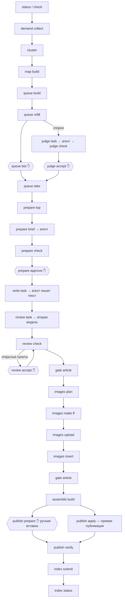

# Методология — Контент-машина, каталог операций (для навыка и сервера MCP)

## Краткая суть

Контент-машина — пакет `content_engine` с командой `content-engine`. У каждой её команды есть **контракт**: что нужно
до, что получится, какие эффекты (чтение, запись, внешний вызов, деньги, задание агенту, решение человека), цена,
право на запись, коды выхода, следующая операция и тесты, которые это доказывают. Контракт живёт **в коде выпуска**
(`contracts.yaml` рядом с кодом) и печатается командой `content-engine catalog [--json | --md]`. Навык
`content-engine`, люди и будущий сервер MCP читают каталог **того выпуска, который стоит в проекте**: канон не
подменяет его смысл, а хранит снимки по версиям — в папке [`Каталог операций`](<Каталог операций/1.3.1.md>).

Модули и механики машины — в [Карте Контент-машины](<Справочник — Карта Контент-машины (контуры, связи, ритм).md>);
поле `module` контракта ссылается на неё (А1–Д6, «Основание», «Подключение»).

## Пять правил контракта

1. **Работает контракт выпуска проекта.** Навык и сервер берут `catalog` установленной версии; версия выпуска — в
   паспорте выпуска (`_паспорт_выпуска.json`).
2. **Одна операция — один устойчивый `operation_id`** и схема аргументов из парсера команды. Ветки с разными деньгами
   или записью — эффекты с условием (`when`): `queue take` берёт выдачу из кэша бесплатно и платит только при отказе
   основного источника.
3. **Эффекты — перечислением:** `filesystem_read`, `filesystem_write`, `external_read`, `external_write`,
   `paid_external_call`, `agent_task_required`, `human_approval_required`. Эффект с `requires_apply` происходит только
   с `--apply`. Цена — структурой: валюта, как считается, когда известна точная сумма, чем подтверждается.
4. **Флаги доказаны поведением.** У операции с деньгами или записью вовне поле `proof` называет тесты: без «да» — ноль
   платных вызовов, без `--apply` — состояние неизменно, снимок до записи, откат восстанавливает, `status` ничего не
   пишет. Тест пакета проверяет, что каждая подкоманда описана, эффекты сходятся с флагами, а тесты из `proof` есть.
5. **Сгенерированное руками не правится.** Каталог меняется только с кодом и новой версией пакета; снимок вышедшей
   версии не переписывается.

## Маршрут статьи

Ромбы — решение человека, «₽» — возможен платный вызов. Порядок внутри контуров и развилки — поле `next` каждой
операции в каталоге. Вне маршрута: `onboard` (приёмка запуска проекта), `known-answers` (машина отвечает так, как
решено раньше), `spend report|add`, `reserve list|release|convert`, `publish rollback`, `images backfill`.

## Шаги агента между командами

Команды машины не вызывают модель сами: команда пишет задание (`task_*.md`) в рабочую папку темы, агент выполняет его
и кладёт ответ файлом, следующая команда проверяет ответ кодом. Роль и модель — из профиля проекта.

| После команды | Задание | Ответ агента | Проверка |
|---|---|---|---|
| `judge task` | `task_judge.md` | `judge.json` | `judge check` |
| `prepare brief` | `task_brief.md` | `brief.yaml` | `prepare check` |
| `write task` | `task_plan.md`, `task_write.md`, `task_critique.md` | `plan.md`, `article.md`, `critique.md` | `review task`, `gate article` |
| `review task` | задание вычитки в `data/factcheck/<id>/` | `claims.jsonl` (вторая модель, без контекста автора) | `review check` |
| `images photo` | `task_photo.md` | `photos.jsonl` | `images photo <id> --merge` |

## Где решает человек

| Решение | Чем фиксируется |
|---|---|
| Режим вычитки фактов и ритм выпуска | `onboard --answer` |
| Ставка темы — какая гипотеза | `queue bet` |
| Спорная тема — свободно или закрыто | `judge accept --who` |
| Бриф | `prepare approve --who`; правка брифа снимает утверждение |
| Спорное утверждение в тексте — оставить или убрать | `review accept --who` |
| Цена платного вызова | `--confirm-spend <сумма на весь прогон>` |
| Ручная вставка страницы | человек вставляет по `paste.md`, в тот же день — `publish verify` |
| Перевод профиля, откат записи, снятие брони | `profile migrate --apply`, `publish rollback --apply`, `reserve release` |

## Деньги

- Платный вызов (`paid_external_call`) — только с `--confirm-spend`, и подтверждение покрывает **сумму всего прогона**,
  а не одного вызова. Без «да» команда выходит с кодом 2 и печатает цену.
- `--unattended` — ноль платных вызовов: прогон без человека ничего не тратит.
- Цена известна до вызова: поле `price` говорит, как она считается и когда известна точно. Бюджет проекта (`budget` в
  профиле) — потолок; цена в долларах переводится по курсу профиля, без курса вызов не делается.
- Каждая трата пишется в учёт расхода (`spend report` показывает цену статьи и итог периода).

## Запись вовне

- Право — строкой профиля по ступеням (`publish.allow`, `paths.allow`, `images.allow`, `indexing.allow`,
  `records.allow`); ступень `files` пишет только в инстанс.
- Запись вовне — только с `--apply`; без него печатается план.
- Перед записью — снимок «до», после — чтение обратно; не подтвердилась — код 3. Откат — `publish rollback <id>` по
  снимку; где удалить нельзя, печатается инструкция «откатить вручную».
- Побочная запись (поле `side_writes`) — то, о чём человек не просил: перед любой командой с профилем, кроме
  `status`, освобождаются истёкшие брони; отчёты дня пишутся в `reports/`.

## Коды выхода

| Код | Значение | Что делать |
|---|---|---|
| 0 | успех | следующая операция из `next` |
| 1 | найдена проблема или отказ запрета в коде (пересечение, черновик, нет права, тема без гейта) | прочитать причину, исправить вход или решить человеку |
| 2 | «спорно» или бюджет-гейт без «да» | различать по тексту: «спорно» — к судье или человеку; цена — спросить «да» |
| 3 | ошибка входа или источника; запись не подтверждена | проверить вход, профиль, ключи (по именам переменных) |

## Путь к серверу MCP

Сервер строится из `catalog --json`, а не из строки команды:

- **операция = инструмент**: имя — `operation_id`, описание — `name`, `requires`, `produces`, `side_writes`; аргументы —
  `input_schema`;
- **✋ = подтверждение клиента**: операция с `human_approval_required` не выполняется без явного ответа человека;
- **деньги — подтверждение с ценой**: сервер сначала получает цену (запуск без `--confirm-spend` выходит с кодом 2 и
  ценой), показывает её и повторяет вызов с подтверждённой суммой;
- **запись вовне** — отдельное подтверждение на `--apply`; без него инструмент возвращает план;
- **шаг агента** — инструмент возвращает путь к заданию; ответ кладёт агент клиента, проверяет следующая операция;
- **побочная запись** — в описании инструмента, чтобы клиент знал, что изменится.

## Снимки каталога и сверка

- Снимки — `Каталог операций/<версия>.json` и `.md`, по одному на выпуск пакета; разница с предыдущей версией
  печатается при снятии.
- Снять снимок новой версии: `py -3 _Движок/Инструменты/kos_catalog_check.py write --package
  _Движок/Пакеты/content_engine --snapshots "Методологии/Контент-машина/Каталог операций"`.
- Сверить выпуск у проекта со снимком его версии и хэшем каталога в паспорте: `... check --code <каталог кода выпуска>
  --snapshots "Методологии/Контент-машина/Каталог операций"`. Сверяется пара «выпуск ↔ его снимок»: проект на старой
  версии сверяется со старым снимком.

## Связанные документы

- [Карта Контент-машины](<Справочник — Карта Контент-машины (контуры, связи, ритм).md>) — модули и механики.
- [Дорожная карта](<План — Контент-машина, дорожная карта (все волны до готовой машины).md>) — волны и выпуски.
- [Каталог операций 1.3.1](<Каталог операций/1.3.1.md>) — снимок выпуска.
- Навык `content-engine` — `_Движок/Исходники скиллов/content-engine/`.
