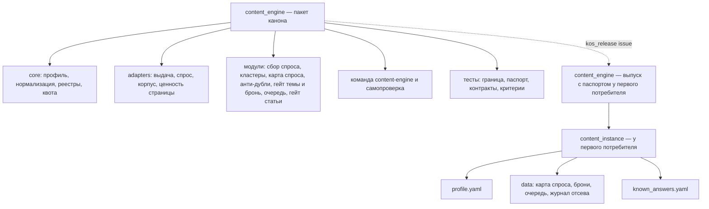

# План — Контент-машина, волна 1 (пакет, проверка на корпусе, выпуск)

Сделан из: [Постановка — Контент-машина](<Постановка — Контент-машина (переносимое производство SEO-статей).md>)
(принята 25.10.2026) и [Спецификация — Контент-машина, волна 1](<Спецификация — Контент-машина, волна 1 (реестр, анти-дубли, очередь, гейт).md>)
(принята с уточнениями 25.10.2026, редакция после сверки фактов). Каркас —
[Справочник — Карта Контент-машины](<Справочник — Карта Контент-машины (контуры, связи, ритм).md>). Режим —
один проход: исполняет один агент в новой сессии; субагенты — только для проверок (не больше двух одновременно,
в промптах «субагентов не запускай»). План принимает: Дмитрий.

**Номера требований и критериев** (Т1–Т14, П1–П14, В1–В9, Р1–Р10) — из спецификации. Спецификация главнее
плана: при расхождении исполнитель останавливается и пишет, в чём расхождение.

## Замысел

### Происхождение

Дмитрий ведёт SEO-контент в нескольких проектах; работающая контент-машина есть только у компании — первого
потребителя (около 400 статей блога). Её механики проверены, но зашиты под компанию и не переносятся. Гайд
К. Васина «SEO-машина» дал архитектуру, которой у нас не хватало: реестр «страница ↔ ключи» с бронью, слои
анти-дублей до модели, кластеры по выдаче, очередь с запасом, гейт без модели. Провал 23.10.2026: тему
«вентиляция для газового котла» предложили до гейта, а её закрывал раздел опубликованной статьи о печи и камине.
Решения Дмитрия 25.10.2026: сначала волна 1 целиком до выпуска; выдача и семантика — Keys.so адаптером,
XMLRiver не подключать; публикация — двумя режимами (волна 2); квоту Keys.so брать весь остаток дня; деньги
страницы у первого потребителя — существующая выгрузка по странице входа; корпус — из готовой выгрузки, без
новой обкачки сайта, все статьи, включая написанные людьми.

### Результат (изменение в мире)

Агент или человек в любом проекте ставит пакет, заполняет один профиль и одной командой узнаёт, свободна ли тема:
машина сама находит, что тему уже закрывает чужая статья или её раздел, наша страница в топе или продающая
страница, и не даёт взять тему в работу без такой проверки. У первого потребителя это доказано на его корпусе:
известные пересечения находятся, очередь тем не пустая, доля ложных тревог известна числом.

### Что уже решено

- Объём волны 1 и всё, что в неё не входит, — раздел 1 спецификации. Никаких вызовов моделей, никакой записи во
  внешние системы.
- Данные проекта — файлами JSON/JSONL в каталоге инстанса (Р1); свои адаптеры, без зависимости от `growth_engine`
  (Р2); Snowball + снятие беглой гласной (Р3, Т5.1).
- Код — пакетом канона по ADR-0003; данные первого потребителя в канон не попадают.
- Push на GitHub и публикация в GitLab компании — только по команде Дмитрия.

## Цель и критерии готовности

Готово, когда выполнены критерии П1–П14 спецификации и записано, чем доказан каждый (раздел «Проверка»).

## Откат

- Канон `D:\Knowledge-OS`: `1c338871293e506e75f789e6ad45725b1d700702` (25.10.2026, до плана). Работа идёт в
  отдельной ветке и отдельном рабочем дереве (T1) — главная ветка не меняется до T19; откат — удалить ветку и
  рабочее дерево.
- Репозиторий первого потребителя `breezeks/areas/digital-marketing` (папка `C:\Users\redmi\Breezeks-Git\02 — Области\Digital-маркетинг`):
  `39b81397e87328b0722c3ed19d885e569a199b2d` (через GitLab MCP, 25.10.2026). Всё новое — в двух новых каталогах
  (T15, T20); откат — удалить их. Shell `git` в этой папке не запускать — только MCP `gitlab-employee`.

## Скан канона (находки)

| Что | Где | Как используем |
|---|---|---|
| Порядок нового пакета, выпуск, стоп-условия | `D:\Knowledge-OS\_Движок\Сценарии\Плейбук — Система с кодом- версия, выпуск, новый пакет.md`, раздел 4 | Шаги T1, T19, T20. **Коммит в канон — уже публикация:** ревью и скан на данные компании — до коммита кода |
| Образец пакета | `D:\Knowledge-OS\_Движок\Пакеты\growth_engine\` (`pyproject.toml`, `tests/test_release_passport.py`, `tests/test_package_boundary.py`, `sources/base.py`) | Копируем тест паспорта; тест границы — строже образца (Т1.2); устройство клиента «только чтение с белым списком» — по образцу `sources/base.py`, своим кодом |
| Выпуск и проверка | `D:\Knowledge-OS\_Движок\Инструменты\kos_release.py` (`issue --package <папка> --into <каталог> [--first]`, `check`) | T20 |
| Keys.so | `D:\Knowledge-OS\_Движок\Исходники скиллов\keysso\SKILL.md`, `reference\методы.md`, `reference\openapi.json`, клиент `scripts\keysso.py` | Методы `tools/check-top`, `report/simple/organic/keywords`, `report/compare`, `limits`; правила квоты и 429 |
| Числа и статусы | `growth_engine/core/number.py` | Те же четыре статуса (факт / оценка / proxy / нет данных) |
| Правила агента | `D:\Knowledge-OS\_Движок\Подключение\agent-rules.md` | «Записано N — прочитано N», запрет в коде, данные компании наружу — только агрегат |
| Машина первого потребителя | `C:\Users\redmi\Breezeks-Git\02 — Области\Digital-маркетинг\Контент блога\` | Источник порогов (спецификация, раздел 4), корпус, скрипт денег по странице, известные ответы |

## Карта воздействия

- **Прямое:** новый пакет `content_engine` (ветка канона); новые каталоги `content_instance\` и `content_engine\`
  (выпуск) у первого потребителя.
- **Косвенное:** документы контура «Контент-машина» в каноне (манифест, спецификация — статус); `_Движок\Пакеты\_manifest.md`;
  `_Движок\0 — System Docs\CHANGELOG.md`; `_Движок\Канон\Справочник — Карта Knowledge-OS.md` (выпуски);
  `D:\Knowledge-OS\TASKS.md`.
- **Вверх (от чего зависим):** Keys.so (ключ `KEYSO_API_KEY`, суточная квота `analysis` общая на аккаунт);
  Search Console (сервисный аккаунт — путь к ключу в `Производство контента\Скрипты\refresh_effect.py`, переменная
  `GSC_KEY`); Яндекс.Вебмастер (`YANDEX_WEBMASTER_TOKEN`, идентификаторы в
  `Выбор тем и SEO-стратегия\Скрипты\research_orchestrator\adapter_webmaster_popular.py`); Roistat через
  `Производство контента\Скрипты\analytics_by_slug.py` (деньги по странице).
- **Вниз (что зависит от нас):** маршрут статьи первого потребителя — не меняется в волне 1, старые скрипты
  остаются (В5); подключение выпуска к маршруту — дело чата контента первого потребителя.
- **Синхронизация:** журнал действий первого потребителя (`C:\Users\redmi\Breezeks-Git\00 — Мета\Журнал действий\2026-10.md`)
  — строка о новых каталогах; CHANGELOG канона; манифест контура; статус спецификации и постановки.
- **Не задевает:** MCP «Аналитика Бризекса», Ядро данных, `growth_engine` — пробу контракта MCP не запускать.

## Границы исполнения

- **В работе:** рабочее дерево канона `D:\KOS-content-engine\` (ветка `content-engine-wave1`) →
  `_Движок\Пакеты\content_engine\` и документы `Методологии\Контент-машина\`; у первого потребителя —
  `…\Контент блога\Производство контента\Скрипты\content_instance\` и `…\Скрипты\content_engine\`.
- **Вне работы:** любые другие файлы первого потребителя (их правят параллельные чаты), `growth_engine`,
  `datacore`, чужие незакоммиченные файлы канона.
- **Коммит разрешён:** в ветку `content-engine-wave1` канона — после ревью (T18); слияние в главную ветку — T19.
- **Push на GitHub и публикация в GitLab компании:** только по команде Дмитрия.
- **Платные вызовы:** нет. Keys.so — по подписке, квота — остаток дня (решение Дмитрия); Roistat, консоли —
  чтение без оплаты.

## Структура результата

## Граф зависимостей

```mermaid
flowchart LR
  T0["T0 предполёт"] --> T1["T1 ветка и каркас"]
  T1 --> T2["T2 профиль"]
  T1 --> T3["T3 реестры"]
  T1 --> T4["T4 нормализация"]
  T1 --> T5["T5 клиент и выдача"]
  T5 --> T6["T6 спрос, корпус, ценность"]
  T5 --> T7["T7 квота и кэш"]
  T2 --> T8["T8 сбор спроса"]
  T3 --> T8
  T6 --> T8
  T4 --> T9["T9 кластеры"]
  T7 --> T9
  T8 --> T9
  T9 --> T10["T10 карта спроса и брони"]
  T10 --> T11["T11 анти-дубли"]
  T11 --> T12["T12 гейт темы и очередь"]
  T10 --> T13["T13 гейт статьи"]
  T12 --> T14["T14 самопроверка и известные ответы"]
  T13 --> T14
  T14 --> T15["T15 инстанс"]
  T15 --> H1["Точка человека 1"]
  H1 --> T16["T16 прогон на корпусе"]
  T16 --> T17["T17 калибровка и ложные тревоги"]
  T17 --> H2["Точка человека 2"]
  H2 --> T18["T18 ревью до коммита"]
  T18 --> T19["T19 слияние, метка, документы"]
  T19 --> T20["T20 выпуск у первого потребителя"]
  T20 --> T21["T21 приёмка и передача"]
```

## Задачи

Общее для всех задач кода: Python ≥ 3.12; пакет в `D:\KOS-content-engine\_Движок\Пакеты\content_engine\`; тесты
— `py -3 -m pytest content_engine/tests` из папки пакета; кодировка UTF-8, переводы строк LF (Python — `newline=''`
или инструмент правки); в коде, тестах и пояснениях — ни имён, ни доменов, ни чисел первого потребителя (урок —
словами). Фикстуры — синтетические: домены `example.ru`, `shop.example`, тексты придуманные. После каждой задачи
— строка в `D:\Knowledge-OS\TASKS.md`, раздел «Контент-машина»: что сделано, сколько тестов зелёных.

### T0 — Предполёт

**Исполнитель:** агент новой сессии (Opus).
**Файлы контекста:** постановка, спецификация, карта, этот план; `D:\Knowledge-OS\CLAUDE.md`; плейбук «Система с
кодом», раздел 4; `growth_engine/tests/test_release_passport.py`, `test_package_boundary.py`, `sources/base.py`.
**Шаги:**
1. Прочитать файлы контекста целиком.
2. `git -C "D:\Knowledge-OS" status --short` и `rev-parse HEAD`; если HEAD не `1c33887…` — записать новый хэш в
   раздел «Откат» и продолжить.
3. Проба Keys.so: из `D:\Knowledge-OS\_Движок\Исходники скиллов\keysso` — `py -3 scripts/keysso.py limits`
   (с `PYTHONIOENCODING=utf-8`); записать остаток `analysis`. 401 — остановиться и попросить свежий ключ.
4. `py -3 -c "import snowballstemmer, yaml, requests, google.auth"` — нет модуля — `py -3 -m pip install <имя>`.
**Готово, когда:** записаны хэш, остаток квоты и итог проверки окружения.

### T1 — Ветка, рабочее дерево и каркас пакета

**Почему отдельное рабочее дерево:** в канон пишут параллельные чаты, их push уносит на GitHub всё закоммиченное
в главной ветке. Отдельная ветка в отдельной папке не задевает их работу и не уходит на GitHub до слияния.
**Шаги:**
1. `git -C "D:\Knowledge-OS" worktree add "D:\KOS-content-engine" -b content-engine-wave1`.
2. В `D:\KOS-content-engine\_Движок\Пакеты\content_engine\`: `pyproject.toml` по образцу `growth_engine`
   (имя `content_engine`, версия `1.0.0`, зависимости `pyyaml`, `requests`, `snowballstemmer`, `google-auth`,
   точка входа `content-engine = content_engine.cli:main`, `package-data` для `*.yaml`, `*.txt`, `*.json`);
   каталоги `content_engine/core`, `content_engine/adapters`, `content_engine/templates`, `content_engine/data`,
   `content_engine/tests/fixtures`; `__main__.py`.
3. Скопировать `growth_engine/growth_engine/tests/test_release_passport.py`, заменив имя пакета.
4. `tests/test_package_boundary.py`: обходит **все** файлы пакета (код, тесты, фикстуры, шаблоны, комментарии) и
   падает на строках из списка запрещённых в самом тесте: домены и имена компаний-потребителей, их бренды и
   продукты, кириллические домены `.рф`, пути `Breezeks`, числа с разрядами и «млн».
5. `py -3 -m pip install -e "D:\KOS-content-engine\_Движок\Пакеты\content_engine"`.
**Готово, когда:** `pytest` зелёный; проба: временная строка с запрещённым доменом в фикстуре краснит тест
границы, после удаления — зелёный (П2).

### T2 — Профиль проекта (Т2)

**Файлы:** `core/profile.py`, `templates/profile.template.yaml`, тесты.
**Шаги:** загрузчик и проверка разделов Т2.2 (неизвестный ключ и пропуск обязательного — ошибка с именем поля;
значений по умолчанию «молча» нет); шаблон с комментарием к каждому полю и стартовыми порогами из раздела 4
спецификации (пороги раздела `section_*` — пустые, с пометкой «калибруется»); секреты — только именами переменных и
путями (Т2.3).
**Готово, когда:** тесты: валидный профиль читается; неизвестный ключ, пропуск, значение секрета в профиле — три
разные ошибки с именем поля.

### T3 — Реестры и журнал (Т3)

**Файлы:** `core/store.py`, тесты.
**Шаги:** запись JSON через временный файл и замену, `schema_version` в каждом файле, чтение обратно со сверкой
числа записей («записано N — прочитано N»); журнал JSONL только добавлением; чужая версия схемы — ошибка; ноль
записанных при непустом входе — ошибка. Каждое число — объект со значением, периодом, источником, статусом, датой
съёма (Т3.3).
**Готово, когда:** тесты П5: подмена записи краснит сверку; запись пустого при непустом входе — ошибка.

### T4 — Нормализация и смысловой ключ (Т5)

**Файлы:** `core/normalize.py`, `data/stopwords_ru.txt`, тесты.
**Шаги:** порядок Т5.1, включая снятие беглой гласной после Snowball (основа на «согласная + е/о + согласная
(+ь)» в конце → без гласной); сходство |K ∩ R| / |K| (Т5.2).
**Готово, когда:** тесты: «котёл/котла/котлом/котлы» → одна основа; «окно/окна/окон» → одна; «печь/печи/печью» →
одна; «ремонт» не меняется; слово из `stop_words` профиля не даёт совпадения (Т5.3).

### T5 — Клиент «только чтение» и источник выдачи (Т4.1)

**Файлы:** `adapters/base.py`, `adapters/serp.py` (интерфейс `SerpSource`), `adapters/keysso.py`,
`adapters/fake.py`, фикстуры ответов в формате Keys.so с синтетическими доменами, тесты контракта.
**Шаги:**
1. Клиент: белый список адресов на адаптер; запрос вне списка не отправляется; 401/403 — `AccessDenied`; повтор
   только на тайм-аутах и 5xx; `code: 202` при HTTP 200 — «отчёт готовится», ждать (как в `scripts/keysso.py`);
   ключ — из переменной `KEYSO_API_KEY`, значение не печатается.
2. `keysso.top(phrases, base)` — `POST tools/check-top?base=<база>` пачками до 3 000 фраз, первые 10 позиций,
   отсутствующая фраза — статус «нет в базе». `keysso.site_keywords(domain, base)` —
   `GET report/simple/organic/keywords` постранично с сортировкой по двум полям (`wsk|desc`, второе — `word|asc`),
   поля `word`, `url`, `pos`, `wsk`, `avbid`; кириллический домен — как есть.
3. `keysso.remaining()` — `GET limits/all`, строка `analysis` (`limit − usedLimit`).
4. Один набор тестов контракта на `keysso` (с подменой транспорта на фикстуры) и `fake` (П3).
**Готово, когда:** тесты контракта зелёные на обеих реализациях; тест: 429 → ошибка квоты без повтора.

### T6 — Спрос, корпус, ценность страницы (Т4.2–Т4.4)

**Файлы:** `adapters/gsc.py`, `adapters/webmaster.py`, `adapters/keysso.py` (спрос), `adapters/demand_file.py`,
`adapters/corpus.py`, `adapters/value.py`, тесты на фикстурах.
**Шаги:**
1. `gsc`: `searchAnalytics/query` (сайт из профиля), разрезы `query` и `page,query`, окно из профиля, ключ
   сервисного аккаунта — путь из профиля, область `webmasters.readonly`.
2. `webmaster`: популярные запросы (`/v4/user/{user_id}/hosts/{host_id}/search-queries/popular`), OAuth из
   переменной профиля. **Проба В4:** найти в документации Вебмастера, есть ли запросы в разрезе страницы; итог —
   строкой в спецификации (В4) и в TASKS.
3. `keysso` спрос: запросы своего домена (`site_keywords`) и запросы конкурентов без нас (`report/compare`,
   `view=organic`, `incl=<конкурент>`, `excl=<наш домен>` — по одному конкуренту, затем склейка).
4. `demand_file`: CSV своего ядра (колонки в шаблоне профиля).
5. `corpus.markdown_folder`: шапка (id, slug, заголовок, адрес), текст; несколько папок — по порядку, последняя
   побеждает по адресу; разделы — по markdown-подзаголовкам, иначе по блоку оглавления (маркер из профиля): пункты
   оглавления, которые встречаются в тексте отдельной строкой, — границы разделов; иначе один раздел (Т4.3).
   `corpus.sitemap`: адреса из карты сайта (файл или адрес) для продающих страниц и сверки числа.
6. `value`: лесенка Т4.4 — `file` деньги (CSV: адрес или slug, сумма, период), `file` заявки, `keysso` proxy
   (`avbid × wsk` по запросам страницы из `site_keywords`), иначе «нет данных»; число несёт ступень и статус.
**Готово, когда:** тесты на фикстурах для каждого адаптера; тест разбиения на разделы для трёх случаев
(подзаголовки, оглавление, ничего); тест лесенки: при наличии денег берётся ступень 1, без файлов — ступень 3.

### T7 — Квота и кэш выдачи (Т7.2, Т7.5)

**Файлы:** `core/quota.py`, `core/serp_cache.py`, тесты.
**Шаги:** до запроса — расход = фразы без свежего кэша × базы; бюджет = `remaining()` − резерв профиля, не больше
`--max-quota`; запросить столько фраз, сколько помещается (самые частотные первыми), сохранить кэш, напечатать,
сколько осталось на завтра; после 429 — остановка без повтора. Кэш — файл на фразу × базу, `serp_cache_days`.
**Готово, когда:** тесты П4 (три случая: хватает, не хватает, `--max-quota`; после 429 — ноль повторных запросов).

### T8 — Сбор спроса (Т6)

**Файлы:** `steps/demand.py`, подкоманда `content-engine demand collect`.
**Шаги:** по Т6.1–Т6.3: вызвать подключённые источники, склеить по нормализованному ключу с суммой показов и
списком источников, отсеять брендовые, мусорные и ниже порога показов; упавший источник — «нет данных» с
причиной; запись `data/demand.jsonl` через `store`; отчёт по источникам.
**Готово, когда:** тест на синтетике: два источника с пересекающимися запросами склеены, бренд отсеян, падение
одного источника не обнуляет второй.

### T9 — Кластеры по выдаче (Т7)

**Файлы:** `steps/cluster.py`, подкоманда `content-engine cluster`.
**Шаги:** жёсткая кластеризация от головного запроса по Т7.3; фразы без выдачи — по смысловому ключу с пометкой
способа (Т7.4); запись `data/clusters.json`.
**Готово, когда:** тест: цепочка A~B, B~C, A≁C не склеивается в один кластер; фраза «нет в базе» получает способ
«смысловой ключ».

### T10 — Карта спроса и брони (Т8, Т9, Т11.5)

**Файлы:** `steps/demand_map.py`, `steps/reservations.py`, подкоманды `map build`, `reserve list|release|convert`.
**Шаги:** страницы из корпуса и продающих разделов; запросы страниц из `site_keywords` и Search Console;
владелец кластера, «пересечение живых», статусы (Т8.2–Т8.3); у страницы — смысловой ключ, целевые ключи, до пяти
головных запросов (Т8.2а); выдача головных запросов — через квоту и кэш (Т8.2б); отчёт сборки Т8.4 (страниц в
корпусе против карты сайта поимённо, доля закрытого спроса, «пересечения живых», статьи без разделов);
направления и кандидаты (Т9); брони со сроком, освобождение истёкших при любой команде, истечение возвращает
тему в `candidate` (Т12.4).
**Готово, когда:** тесты на синтетическом сайте из 6 страниц: владелец по позиции, «пересечение живых» при двух
наших страницах в топ-10, истёкшая бронь освобождена и тема вернулась в `candidate`.

### T11 — Анти-дубли, семь слоёв (Т10)

**Файлы:** `steps/dedup.py`, тесты.
**Шаги:** слои 1–7 по таблице Т10 в указанном порядке; слой 2 — оба измерителя (статья целиком с потолком 40 на
основу; раздел — по каждой формулировке); слой 4 — по лесенке ценности (блокируют только ступени 1–2); белый
список; запись в журнал отсева со слоем, страницей и разделом; меньше трёх формулировок — отказ.
**Готово, когда:** тест на каждый слой (срабатывает и не срабатывает); синтетическая копия провала 23.10: тема
закрыта разделом статьи о другом предмете — слой 2 «пересекается» с названием раздела.

### T12 — Гейт темы, очередь и запрет брать тему без гейта (Т11, Т12)

**Файлы:** `steps/gate_topic.py`, `steps/queue.py`, подкоманды `gate topic`, `queue build|status|take`.
**Шаги:** вердикты и коды выхода Т11.1; тип выдачи Т11.2; поля ставки с окнами 90 и 180 (Т11.3); `queue take` —
перепроверка выдачи в день взятия (Т11.4) и отказ без отчёта гейта за `gate_valid_days` (Т11.4а); приоритет,
статусы, запас ≤ `refill_at`, подсказка числа кандидатов по доле отсева (Т12); отчёт текстом и JSON.
**Готово, когда:** тест П7а (`queue take` без отчёта гейта — отказ; с отчётом — взята); тест запаса: 6 тем при
`refill_at` 6 — код 1; тест кодов выхода гейта.

### T13 — Гейт статьи без модели (Т13)

**Файлы:** `steps/gate_article.py`, подкоманда `gate article`.
**Шаги:** все проверки Т13.2 (включая структуру и чужие ключи), уровни из профиля, `--offline`, итог и коды Т13.3.
Ссылки — `HEAD`, при отказе `GET`, тайм-аут из профиля.
**Готово, когда:** тест на синтетической статье с подложенными ошибками (дубль заголовка, кривой слаг, приписка
модели, заголовок с чужим целевым ключом) — «черновик» с четырьмя причинами; чистая статья — «пропуск».

### T14 — Самопроверка и известные ответы (Т14)

**Файлы:** `steps/check.py`, `steps/known_answers.py`, подкоманды `check`, `known-answers [--audit <файл>]`.
**Шаги:** светофор Т14.1 с «не подключено» и подсказкой; прогон известных ответов Т14.2 («совпало N из M», код 1
при расхождении); доля ложных тревог по файлу решений Т14.3.
**Готово, когда:** тест П12: при `AccessDenied` у Keys.so пункт красный «доступ отозван», остальные собраны;
тест прогона на синтетике: одно расхождение → код 1.

### T15 — Инстанс у первого потребителя

**Исполнитель:** агент новой сессии. Данные компании — только здесь, не в каноне.
**Где:** `C:\Users\redmi\Breezeks-Git\02 — Области\Digital-маркетинг\Контент блога\Производство контента\Скрипты\content_instance\`.
**Шаги:**
1. `profile.yaml` из шаблона: домен и разделы блога первого потребителя (оба раздела статей: блог и экология);
   продающие страницы (раздел каталога); базы Keys.so по рынку; корпус — папка
   `…\Производство контента\База статей\Тексты опубликованных статей\` (индекс `Указатель.csv`, маркер оглавления
   «Содержание») и папки `…\Производство контента\Выпущенные статьи\*\Текст статьи.md` (папку `Архив` и файлы
   справочников пропустить); источники спроса — Search Console (путь к ключу — из `Скрипты\refresh_effect.py`),
   Вебмастер (идентификаторы — из `adapter_webmaster_popular.py`, токен — имя переменной), Keys.so; ценность —
   ступень 1, файл `data/page_money.csv`; направления — по корзинам из
   `…\Выбор тем и SEO-стратегия\Методики и пайплайны\Справочник — Бэклог тем.md`; ставка обязательна.
2. `data/page_money.csv`: из `…\Производство контента\Скрипты\` —
   `py -X utf8 analytics_by_slug.py --days 180 --like "" --csv <путь>` и то же с `--section ecology` (скрипт
   читает Roistat; метрика денег — та, что названа в шапке скрипта); склеить в один CSV.
3. `known_answers.yaml`: (а) тема «вентиляция для газового котла» с тремя формулировками → «пересекается», слой 2,
   статья о печи и камине (`pech-i-kamin-v-dome-vozduh`); (б) статьи `ventilyaciya-v-hrushchevke` и
   `ne-rabotaet-ventilyaciya-v-kvartire-pochemu-ehto-proiskhodit-i-chto-delat` → пересечение (не «спорно»);
   (в) место под заведомо свободную тему — заполняет чат контента (точка человека 1).
4. `.gitignore` каталога инстанса: `cache/`.
**Готово, когда:** `content-engine check` с этим профилем показывает зелёный или «не подключено» с причиной по
каждому пункту; список того, что ждёт человека, — в TASKS.

### Точка человека 1

Чат контента первого потребителя (или Дмитрий) проверяет профиль: разделы, продающие страницы, направления; даёт
заведомо свободную тему для известных ответов (П8); подтверждает, что инстанс лежит там, где решено. Сообщение
для чата готовит исполнитель — файлом-брифом в `content_instance\Бриф для чата контента.md`.

### T16 — Прогон на корпусе

**Шаги:** `demand collect` → `cluster` (квота — остаток дня; не хватило — продолжить завтра, записав остаток) →
`map build` → `queue build` → `queue status` → `known-answers`. Отчёты — в `content_instance\reports\<дата>\`.
**Готово, когда:** П6 — число страниц в карте спроса сходится с картой сайта разделов статей, расхождения
перечислены поимённо с причиной; П9 — запас в днях > 0; П7/П8 — итог прогона известных ответов записан (до
калибровки допускается расхождение — его разбирает T17).

### T17 — Калибровка порогов и ложные тревоги

**Шаги:**
1. Подобрать стартовые значения `section_block`/`section_warn` и проверить `key_overlap`, `title_overlap`,
   `twin_shingles` на корпусе: известные ответы — все совпадают; общие слова ниши, дающие ложные тревоги, — в
   `stop_words` профиля, а не в код.
2. Значения, которые подходят любому проекту, — в шаблон профиля пакета; специфичные — только в профиль инстанса.
3. П11: `gate article` на трёх последних выпусках первого потребителя и на копии одного с подложенными ошибками.
4. Выборка для П10: 30 решений гейта по кандидатам очереди (вердикт, слой, страница) — файлом
   `content_instance\reports\<дата>\выборка для разметки.csv` с пустой колонкой «ложная тревога (да/нет)».
**Готово, когда:** `known-answers` — «совпало M из M»; П11 записан; выборка лежит файлом.

### Точка человека 2

Чат контента первого потребителя или Дмитрий размечает 30 решений (П10). Исполнитель запускает
`known-answers --audit` и записывает долю ложных тревог числом с размером выборки.

### T18 — Независимое ревью до коммита

**Исполнитель:** субагент general-purpose с чистым контекстом (навык `maker-checker`) и, если доступен, вторая
модель (навык `second-agent`). Не больше двух одновременно; в промптах — «субагентов не запускай».
**Шаги:** проверяющий получает спецификацию, этот план и путь к пакету; запускает тесты и тест границы; сверяет код
с Т1–Т14; отдельно — скан всего пакета на данные компании (домены, бренды, числа, пути). Находки разобрать: исправить
обоснованные, отклонить необоснованные вслух. Не больше двух итераций, дальше — Дмитрию.
**Готово, когда:** отчёт проверяющего без открытых блокирующих замечаний (П14); скан данных чистый.

### T19 — Коммит, слияние, метка, документы канона

**Шаги:**
1. В рабочем дереве: коммит пакета и документов контура (только свои пути).
2. `_Движок\Пакеты\_manifest.md` — строка пакета (версия 1.0.0, методология — ссылка на манифест контура,
   выпуски); `_Движок\0 — System Docs\CHANGELOG.md` — строка; `_Движок\Канон\Справочник — Карта Knowledge-OS.md` —
   выпуск у первого потребителя (после T20); манифест контура — статус и ссылка на план; спецификация и постановка —
   статус «исполнена, волна 1».
3. Слияние в главную ветку канона: `git -C "D:\Knowledge-OS" merge --no-ff content-engine-wave1` (перед этим
   `git status` главной — чужие незакоммиченные правки не трогать); метка `content_engine-v1.0.0`.
4. Push — только по команде Дмитрия.
**Готово, когда:** `py -3 -m pytest content_engine/tests` зелёный в главной ветке; метка стоит (П13, часть канона).

### T20 — Выпуск у первого потребителя

**Шаги:**
1. `py -3 "D:\Knowledge-OS\_Движок\Инструменты\kos_release.py" issue --package "D:\Knowledge-OS\_Движок\Пакеты\content_engine" --into "C:\Users\redmi\Breezeks-Git\02 — Области\Digital-маркетинг\Контент блога\Производство контента\Скрипты\content_engine"`
   (каталог новый — `--first` не нужен; если инструмент потребует — остановиться и спросить).
2. `kos_release.py check --into <тот же каталог> --package <тот же пакет>` — зелёный.
3. Инстанс переключить с пакета-ссылки на выпуск (`pip install -e <каталог выпуска>` или запуск из него) и
   повторить `known-answers` — совпадает.
4. Строка в журнале действий первого потребителя `C:\Users\redmi\Breezeks-Git\00 — Мета\Журнал действий\2026-10.md`.
5. Публикация в GitLab компании — не делать: передать чату контента (T21). Помнить: чужие незакоммиченные файлы в
   репозитории блокируют публикацию через MCP — их не трогать.
**Готово, когда:** `check` зелёный; `known-answers` на выпуске — «совпало M из M» (П13).

### T21 — Приёмка и передача

**Шаги:** пройти раздел «Проверка» и отчитаться по каждому пункту (что собирались, выполнено ли, где видно);
приёмка `maker-checker` по критериям постановки; бриф чату контента первого потребителя: где выпуск и инстанс,
команды, что опубликовать, что старые скрипты остаются до решения (В5); TASKS и CHANGELOG.
**Готово, когда:** отчёт по «Проверке» передан Дмитрию; бриф лежит файлом.

## Проверка

| Критерий | Чем доказан |
|---|---|
| П1 пакет ставится, тесты зелёные | вывод `pip install -e` и `pytest` (T19, главная ветка) |
| П2 нет данных компаний | тест границы + проба с запрещённой строкой (T1); скан в ревью (T18) |
| П3 второй источник без правки ядра | тесты контракта на `keysso` и `fake` (T5) |
| П4 бюджет квоты | тесты T7 |
| П5 запись проверяется чтением | тесты T3 |
| П6 реестр сходится с сайтом | отчёт `map build` с поимённым расхождением (T16) |
| П7 известные пересечения | `known-answers` на инстансе и на выпуске — «совпало M из M» (T17, T20) |
| П7а нельзя взять тему без гейта | тест T12 |
| П8 свободная тема проходит | тот же прогон, случай (в) (T17) |
| П9 очередь не пустая | `queue status` (T16) |
| П10 ложные тревоги | `known-answers --audit`: доля и размер выборки (точка человека 2) |
| П11 гейт статьи на настоящих статьях | отчёт T17, шаг 3 |
| П12 самопроверка честная | тест T14 |
| П13 выпуск с паспортом | `kos_release check` зелёный, метка, строки манифеста и CHANGELOG (T19, T20) |
| П14 независимая приёмка | отчёт проверяющего (T18) и приёмка (T21) |

## Три вопроса к плану

- **Что может сломать:** чужую работу в каноне — снято отдельным рабочим деревом и коммитом только после ревью;
  чужие файлы у первого потребителя — пишем только в два новых каталога; квоту Keys.so других пользователей — берём
  только остаток дня и не повторяем после 429; маршрут статьи первого потребителя — не меняем, старые скрипты
  остаются.
- **Самый рискованный шаг:** T17 — пороги слоя 2 на корпусе. Сплошной текст старых статей и общие слова ниши дают
  ложные тревоги; если «совпало M из M» не достигается без ослабления до бесполезности — остановиться и показать
  Дмитрию расклад, а не подгонять известные ответы.
- **Что отброшено и почему:** хранение в таблицах (Р1); импорт адаптеров `growth_engine` (Р2); эмбеддинги и
  модель-судья — волна 2; новая обкачка сайта ради разделов — запрещена решением Дмитрия, разделы восстанавливаются
  по оглавлению; разработка прямо в главной ветке канона — её уносит чужой push.

## Приёмка

- Проверка плана — до показа Дмитрию, агент с чистым контекстом.
- Приёмка результата — `maker-checker` (T18, T21); не больше двух итераций, дальше — к Дмитрию.

# Связанные документы

- [Контент-машина — _manifest](<_manifest.md>)
- [Постановка — Контент-машина (переносимое производство SEO-статей)](<Постановка — Контент-машина (переносимое производство SEO-статей).md>)
- [Спецификация — Контент-машина, волна 1 (реестр, анти-дубли, очередь, гейт)](<Спецификация — Контент-машина, волна 1 (реестр, анти-дубли, очередь, гейт).md>)
- [Справочник — Карта Контент-машины (контуры, связи, ритм)](<Справочник — Карта Контент-машины (контуры, связи, ритм).md>)
- [Плейбук — Система с кодом: версия, выпуск, новый пакет](<../../_Движок/Сценарии/Плейбук — Система с кодом- версия, выпуск, новый пакет.md>)
