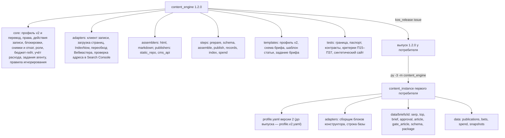

# План — Контент-машина, волна 2, часть 1 (основание, подготовка, выпуск; выпуск 1.2.0)

Сделан из: [Спецификация — Контент-машина, десять систем](<Спецификация — Контент-машина, десять систем (границы, волны 2 и 3).md>)
(принята Дмитрием 26.10.2026; требования Т15–Т25, критерии П15–П37, П48, П49, решения Р11–Р21, вопросы В10–В21;
решения Дмитрия после приёмки — её раздел 11а) и шаг 3 [дорожной карты](<План — Контент-машина, дорожная карта (все волны до готовой машины).md>).
Каркас — [Справочник — Карта Контент-машины](<Справочник — Карта Контент-машины (контуры, связи, ритм).md>); образец
формы и уроки исполнения — [План волны 1](<План — Контент-машина, волна 1 (пакет, проверка на корпусе, выпуск).md>),
раздел «Ход исполнения и отходы от плана». Код — пакет `content_engine` 1.1.0 (метка `content_engine-v1.1.0`),
прочитан 26.10.2026.

**Статус:** принят Дмитрием 26.10.2026 вместе с ответами на вопросы Д1–Д6 (раздел «Решения Дмитрия»). Исполнение —
в новом чате по стартеру шага 3 дорожной карты.

**Режим** — один проход: исполняет один агент (Opus) в новой сессии. Субагентов на исполнение — два: З16 (проверка
кода части 1) и З28 (приёмка). Не больше двух одновременно, в промптах «субагентов не запускай». Вторая итерация
проверки — продолжением того же агента (`SendMessage`), а не новым запуском. Вторая модель (Codex, навык
`second-agent`) — не субагент и в счёт не входит.

**Обозначения.** Задачи плана — **З0–З17, З27–З31** (номера З18–З26а ушли в заготовку части 2 — приложение; номера
не сдвигались, чтобы ссылки в разборе проверки остались верными). Требования (Т), критерии (П), решения (Р) и
вопросы (В) — из спецификации, номера те же. Спецификация главнее плана: при расхождении исполнитель останавливается
и пишет, в чём расхождение. Отход от плана записывается в раздел «Ход исполнения и отходы от плана» в тот же день.

## Замысел

### Происхождение

Волна 1 выпущена 25.10.2026 (1.0.0): реестр «страница ↔ ключи» с бронью, семь слоёв анти-дублей, очередь с запасом,
гейты темы и статьи без модели. 26.10.2026 вышли 1.0.1 (переименован модуль чтения `.env` под проверку секретов
GitLab компании) и 1.1.0 (шаг 0а: нормирование слоя 2 по длине, оценка ложных тревог 16,7 % против 38,5 %).
Подтверждение на новой выборке — шаг 0г, в чате контента первого потребителя, до 15.11.2026. Спецификация десяти
систем принята 26.10.2026 и поставила волне 2 Производство и Выпуск: первой идёт часть 1 — основание, разбор топа,
бриф, сборка, публикация, «доехало», записи, индексация; затем часть 2 — тема из гипотезы, судья, текст, вычитка,
картинки, новые источники спроса. Проверяющий плана показал, что первой статье часть 2 не нужна: Т19.7 разрешает
текст файлом. Дмитрий 26.10.2026 разделил выпуск: часть 1 — 1.2.0, часть 2 — 1.3.0, волна 3 — 1.4.0 (Д6).

Уроки волны 1, которые меняют этот план:
- живые проверки шли из рабочего дерева канона против инстанса первого потребителя, выпуск — в конце; так и здесь;
- правило игнорирования `*.json` у потребителя прятало паспорт и реестры — новые файлы инстанса сверяются с
  `.gitignore` до выпуска;
- предфильтр по всем кандидатам занимал часы — новые команды работают с одной темой или с верхними по приоритету;
- чужие правки в главной ветке канона уносит push — работа идёт в отдельном рабочем дереве.

Пробы до кода (стартер дорожной карты) сделаны при составлении плана, 26.10.2026, только чтение:

| Проба | Итог | Что меняет |
|---|---|---|
| API Вебмастера из сети устройства | соединение не устанавливается за 20 с, как в волне 1 | Дмитрий: ждём, пока Вебмастер заработает (Д4); до этого переобход и статус в Яндексе — «не подключено», `check` показывает пункт; З1 и З27 повторяют пробу |
| Адрес IndexNow Яндекса | отвечает за полсекунды | сеть до IndexNow есть |
| Файл ключа IndexNow на сайте | конструктор не даёт положить свой текстовый файл (ответ Дмитрия, Д3) | у первого потребителя IndexNow «не подключено»; пакет его поддерживает для других проектов, тесты — на синтетике |
| Карта сайта первого потребителя | отвечает 200; дат изменения (`lastmod`) нет ни у одного адреса | день выкладки по карте сайта не восстанавливается — только по первому появлению в Search Console или «не установлен» (Т22.5) |
| Браузер на устройстве | Playwright 1.60 для Python, Chromium запускается без окна | В19 закрыт на устройстве: проверка вёрстки (Т22.4) живая |

### Результат (изменение в мире)

У первого потребителя одна статья проходит машину: тема в работе → разбор топ-3 в числа → бриф, который утвердил
человек → текст и картинки маршрутом проекта (как сейчас) → гейт статьи → сборка сборщиком проекта → ручная вставка →
«доехало» по ответу сайта → записи в карте спроса, очереди и книге ставок в день выкладки → заявки на индексацию там,
где они подключены. Каждый переход держит код, а не память агента: без утверждённого брифа пакет не собирается, без
права в профиле и `--apply` ничего не уходит вовне, без «да» нет ни одного платного вызова, двойной прогон невозможен,
любую запись откатывает одна команда. Любой другой проект получает то же переводом профиля на версию 2 — в ручном
режиме или с прямой публикацией в репозиторий статического сайта. Текст, вычитка, картинки и судья машиной — часть 2.

### Что уже решено

- Объём — раздел 5 спецификации (часть 1) и критерии П15–П37, П48, П49; часть 2 (раздел 6) — выпуск 1.3.0, волна 3
  — 1.4.0 (Д6).
- Пакет моделей не вызывает (Р11, В10): модельный шаг — задание агенту файлом, результат проверяет код.
- Сборщик и публикатор конкретного стека живут в инстансе проекта по контракту ядра (Р12, В13).
- Права — ступенями, по умолчанию «только файлы»; снимок «до» и откат одной командой (Р14).
- Разбор топа берёт выдачу дня взятия, квоту Keys.so сверх неё не тратит (Р15).
- Страница входит в карту спроса из записи выпуска (Р17); браузер — необязательная зависимость (Р19).
- Профиль версии 2 несёт поля части 1; поля части 2 придут версией 3 тем же переводом (Т15.1).
- Тяжёлых локальных установок на устройство нет (Д1): место на диске C мало, машина должна переноситься в облако и
  в будущий MCP-сервер. Браузер уже стоит; новые зависимости части 1 — только стандартная библиотека.
- Платная генерация картинок — норма для любого проекта (Д2), всегда с ценой до запуска и «да»; провайдер — строка
  профиля. В части 1 картинки делает маршрут проекта.
- Данные первого потребителя в канон не попадают: в пакете — синтетика, в документах контура — уроки словами.

## Цель и критерии готовности

Готово, когда выполнены П15–П37, П48 в редакции части 1 и П49, и в разделе «Проверка» записано, чем доказан каждый.
П48 для 1.2.0: `kos_release check` зелёный, метка `content_engine-v1.2.0`, строки манифеста и CHANGELOG; у первого
потребителя одна статья прошла В1, В2, В7, В6, Г1–Г4 командами машины, а В3–В5 (текст, вычитка, картинки) —
маршрутом проекта; отчёт по шагам с файлами. Живые части, которые держит внешний вопрос или срок (П30 — проект для
прямой публикации, В11; П36 — IndexNow у потребителя не подключается, Вебмастер ждёт, статус индексации на 14-й
день), называются в отчёте «живая часть открыта» с причиной.

## Откат

- **Канон `D:\Knowledge-OS`:** главная ветка на 26.10.2026 — `3b0dc481bdc18ba88ae52f2e2043beed3a07a831` (до коммита
  этого плана); фактический хэш на старте исполнения записывает З0. Вся работа — в ветке `content-engine-wave2` в
  рабочем дереве `D:\KOS-content-engine-w2`; главная ветка до З29 не меняется. Откат до З29 — `git worktree remove` и
  удаление ветки; после — `git revert` коммита слияния.
- **Репозиторий первого потребителя** (`C:\Users\redmi\Breezeks-Git\02 — Области\Digital-маркетинг`): хэш читает З0
  через MCP `gitlab-employee` (`gitlab_repo_status`). До З30 пишутся только новые файлы в `content_instance\` — откат:
  удалить их. В З30 перед выпуском — копии `profile.yaml`, `known_answers.yaml` и каталога выпуска
  `content_engine\` в папку сессии; откат выпуска — вернуть копии. **Shell `git` в этой папке не запускать.**
- **Живая статья** (З27): снимок «до» каждой записи в `data/snapshots/before/`, `publish rollback <id>`; страницу,
  вставленную человеком, снимает человек по инструкции из пакета (Т16.5).

## Скан канона (находки)

| Что | Где | Как используем |
|---|---|---|
| Требования, критерии, ответы по умолчанию | спецификация, разделы 5–11 | Источник каждой задачи |
| Клиент «только чтение» с белым списком | `_Движок\Пакеты\content_engine\content_engine\adapters\base.py` | Образец клиента записи (З4) — отдельным модулем: у клиента чтения методов записи нет и не будет |
| Реестры, числа, квота, кэш выдачи | `…\core\store.py`, `core\number.py`, `core\quota.py`, `core\serp_cache.py` | Новые файлы — через `store` со сверкой; снимок выдачи темы берётся из кэша дня взятия (З6) |
| Индекс текстов, слой 2, корпус | `…\core\textindex.py`, `steps\dedup.py` (`layer_texts`), `adapters\corpus.py` (`HEADING`, `split_front_matter`) | Кандидаты перелинковки по телам (З8), лексическая пятёрка судьи (часть 2), разделы статьи |
| Гейт статьи | `…\steps\gate_article.py`; уровни и поля — `core\profile.py` (`GATE_ARTICLE_CHECKS`) | Проверка `schema` пока читает только JSON (З9); новые проверки части 2 — тем же механизмом уровней, версией профиля 3 |
| Самопроверка и известные ответы | `…\steps\check.py`, `steps\known_answers.py` | Незнакомый вид случая — ошибка: поэтому новые виды у потребителя живут отдельным файлом до выпуска (З15, З17) |
| Очередь и брони | `…\steps\queue.py` (`take`), `steps\reservations.py` (`convert`) | Снимок выдачи при взятии, `retake` (З6); записи дня выкладки (З13) |
| Реестр гипотез Движка роста | `_Движок\Пакеты\growth_engine\growth_engine\core\registry.py` (класс `Hypothesis`), `core\storage.py` (`COLUMNS["hypotheses"]`: числа — ссылками `*_id` на лист снимков), `storage\markdown.py` (локальное хранилище) | Часть 2: адаптер ставки читает хранилище Markdown своим кодом, без импорта `growth_engine` (заготовка З18) |
| Выпуск и обновление выпуска | `_Движок\Инструменты\kos_release.py` (`issue`, `check`); `_Движок\Сценарии\Плейбук — Система с кодом- версия, выпуск, новый пакет.md`, разделы 2–3 | З29–З30, как выпуски 1.0.1 и 1.1.0 |
| Модели ролей | навык `llm-pipeline-economy` | Основная и запасная модель каждой роли в профиле (З5, З17) |
| Текст, тон, правка картинок | `Методологии\Методология — Текст и редактура (информационный стиль, Ильяхов).md`, навык `text-editor`; навык `image-edit` | Часть 2 (задания писателя и критика); в части 1 текст и картинки — маршрут проекта |
| Keys.so: Wordstat и подсказки | `_Движок\Исходники скиллов\keysso\reference\методы.md` | Часть 2 (источники спроса) |
| Wordstat через облако | навык `seo-niche-research` | Часть 2 (Wordstat через облако — через бюджет-гейт) |
| Приёмка и второе мнение | навыки `maker-checker`, `second-agent` | З16, З28 |
| Маршрут статьи первого потребителя | `…\Контент блога\Производство контента\Скрипты\README.md`; `md_to_build_body.py`, `build-article-html.ps1` (сборка блоков конструктора), `make_schema_from_text.py`, `check_schema_consistency.py`, `check_articles_live.py`, `write_db_row.py` и `update_db_row.py` (строка базы: план → `--apply` → сверка чтением), `register_published_article.py`, `gen_article_image.py`, `upload_image_s3.py` | Адаптеры инстанса (З17) вызывают эти скрипты как есть, не правя их; в пакет переносятся только идеи |

## Карта воздействия

- **Прямое:** пакет `content_engine` (рабочее дерево); у первого потребителя — новые файлы в `content_instance\`
  (`adapters\`, `profile.v2.yaml`, `known_answers.wave2.yaml`, `data\briefs\`, `data\publications.jsonl`,
  `data\bets.json`, `data\spend.jsonl`, `data\snapshots\`, `locks\`, отчёты); в З30 — `profile.yaml`,
  `known_answers.yaml` и каталог выпуска `content_engine\`; одна статья в блоге (вставляет человек); заявки на
  индексацию и строка базы проекта — только по разрешению (В12, В14).
- **Косвенное:** документы контура (спецификация — статус, дорожная карта, манифест); `_Движок\Пакеты\_manifest.md`;
  `_Движок\0 — System Docs\CHANGELOG.md`; `_Движок\Канон\Справочник — Карта Knowledge-OS.md` (выпуск 1.2.0 — в З30); окружение Python
  устройства: `pip install -e` из рабочего дерева; браузер уже стоит, других установок нет (Д1).
- **Вверх:** Keys.so — квота только при взятии и перевзятии темы; Search Console — чтение, проверка адреса (URL
  Inspection); Вебмастер — сеть (В20); IndexNow Яндекса и Bing; конструктор сайта — вручную; база проекта первого
  потребителя (таблица) — запись через его скрипт, только с разрешением.
- **Вниз:** чат контента первого потребителя каждый день обкатывает выпуск 1.1.0 на тех же реестрах (шаги 0б–0г).
  Поэтому до З30: `profile.yaml` и `known_answers.yaml` не трогаются; новые поля записей очереди и броней —
  только добавлением, статусы — существующие; профиль версии 2 — отдельным файлом `profile.v2.yaml` в том же каталоге
  (те же реестры); после каждой записи выпуск 1.1.0 должен читать реестры (З17, шаг 7). `map build` выпуска 1.1.0
  не знает записей выпуска и уберёт из карты новую страницу, пока статья не лежит в корпусе маршрута (З13, шаг 2;
  З27, точка человека 4). Взятые машиной темы выходят из запаса чата контента — их id идут в журнал и в бриф.
  Чат контента запускает выпуск через `py -3 -m content_engine` из папки `Скрипты\` — переустановка
  пакета на устройстве его не задевает. Новая статья попадает в корпус слоя 2, когда маршрут потребителя положит её в
  «Выпущенные статьи» (как сейчас); в карту спроса — сразу записью выпуска (Т23).
- **Синхронизация:** `D:\Knowledge-OS\TASKS.md`; CHANGELOG и манифесты канона; дорожная карта (✅ шага 3, таблица
  «Деньги», стартер шага 3а — план части 2); журнал действий первого потребителя; его инструкция «Контент-машина в блоге» —
  обновляет чат контента по брифу из З30; база инцидентов — при сбое.
- **Не задевает:** `growth_engine`, Ядро данных, MCP «Аналитика Бризекса», старые скрипты
  первого потребителя (вызываются, не правятся).

## Границы исполнения

- **В работе:**
  - рабочее дерево `D:\KOS-content-engine-w2` (ветка `content-engine-wave2`): `_Движок\Пакеты\content_engine\` и
    документы `Методологии\Контент-машина\` — все правки канона до З29 только здесь;
  - `D:\Knowledge-OS\TASKS.md` — ход работ (вне git);
  - у первого потребителя: `…\Скрипты\content_instance\` (новые файлы, перечень — в «Карте воздействия»; в З30 —
    `profile.yaml` и `known_answers.yaml`), `…\Скрипты\content_engine\` (только в З30, через `kos_release.py`),
    строки в `C:\Users\redmi\Breezeks-Git\00 — Мета\Журнал действий\<год-месяц>.md`.
- **Вне работы:** главная ветка канона до З29; любые другие файлы первого потребителя (его скрипты только
  запускаются); `growth_engine`, `datacore`; чужие незакоммиченные файлы канона.
- **Коммиты:** в ветку — после З16 и после З27; слияние в главную и метка — З29; строка «Карты» — отдельным коммитом
  после З30.
- **Push канона:** по правилу паспорта `D:\Knowledge-OS\CLAUDE.md` — после блока изменений, со сканом добавленных
  строк на секреты и персональные данные, с метками (`--follow-tags`).
- **GitLab компании:** публикует чат контента через MCP `gitlab-employee` (бриф — З30).
- **Платные вызовы:** по умолчанию ноль. Каждый — с ценой до запуска, `--confirm-spend` и «да» Дмитрия в чате.
  Keys.so — по подписке; консоли, карта сайта, IndexNow — бесплатно.

## Решения Дмитрия при приёмке плана (26.10.2026)

| № | Вопрос | Решение | Что меняет |
|---|---|---|---|
| Д1 | Локальная модель эмбеддингов для судьи (около 2 ГБ) | Не ставить: на диске C мало места, машина должна работать в облаке и через будущий MCP-сервер | Судья в части 2 — лексическая пятёрка слоя 2 без установки; эмбеддинги через API — адаптером через бюджет-гейт, по желанию проекта. Р13 и Т27.1 спецификации поправлены (раздел 11а) |
| Д2 | Картинки — платный генератор или шаблон | Платный генератор, всегда, в любом проекте; свой провайдер — позже | Провайдер — строка профиля; в части 1 картинки делает маршрут проекта, адаптер — часть 2 |
| Д3 | Файл ключа IndexNow на сайте конструктора | Конструктор не даёт положить свой текстовый файл | IndexNow у первого потребителя «не подключено»; поддержка в пакете остаётся для других проектов |
| Д4 | Вебмастер из сети устройства | Ждать, пока заработает | «Не подключено»; проба повторяется в З1 и перед индексацией в З27 |
| Д5 | Страницы доноров (Т18.9) | Решить самим, выбрать реальный способ | Донор — домен из `prepare.donors`: кандидаты — из его карты сайта по совпадению с английскими формулировками темы, плюс явный адрес (З7, шаг 4) |
| Д6 | Разделить выпуск | Да | 1.2.0 — часть 1 и первая статья; 1.3.0 — часть 2; 1.4.0 — волна 3. Дорожная карта и Р20 поправлены |

## Структура результата

## Граф зависимостей

```mermaid
flowchart LR
  Z0["З0 предполёт"] --> Z1["З1 пробы"]
  Z0 --> Z2["З2 рабочее дерево"]
  Z2 --> Z3["З3 профиль v2"]
  Z3 --> Z4["З4 права и откат"]
  Z3 --> Z5["З5 роли, бюджет, расход"]
  Z3 --> Z6["З6 снимок выдачи, retake"]
  Z6 --> Z7["З7 разбор топа"]
  Z4 --> Z7
  Z7 --> Z8["З8 бриф"]
  Z5 --> Z8
  Z8 --> Z9["З9 разметка"]
  Z9 --> Z10["З10 сборка"]
  Z10 --> Z11["З11 публикация"]
  Z4 --> Z11
  Z11 --> Z12["З12 доехало"]
  Z7 --> Z12
  Z12 --> Z13["З13 записи"]
  Z13 --> Z14["З14 индексация"]
  Z1 --> Z14
  Z14 --> Z15["З15 известные ответы"]
  Z15 --> Z16["З16 проверка кода, коммит"]
  Z1 --> Z17["З17 инстанс"]
  Z16 --> Z17
  Z17 --> H1["Точка человека 1"]
  H1 --> Z27["З27 первая статья"]
  Z27 --> Z28["З28 независимая приёмка"]
  Z28 --> Z29["З29 слияние, метка"]
  Z29 --> Z30["З30 выпуск у потребителя"]
  Z30 --> Z31["З31 закрытие шага"]
```

Порядок исполнения в одном проходе: З0 → З1 → … → З16 → З17 → точка человека 1 → З27 → З28 → З29 → З30 → З31.

## Задачи

**Общее для задач кода.** Python ≥ 3.12. Пакет — `D:\KOS-content-engine-w2\_Движок\Пакеты\content_engine\`, каталог
кода — `…\content_engine\content_engine\`. Тесты — из папки пакета: `py -3 -m pytest content_engine/tests`; после
каждой задачи весь набор зелёный, число тестов — в TASKS. UTF-8, переводы строк LF (инструмент правки или Python с
`newline=''`); вывод в консоль — `PYTHONIOENCODING=utf-8`. Стиль — как в коде волны 1: модуль начинается строкой
назначения и требованием (Т…), подкоманда регистрируется функцией `register(sub)` и добавляется в `STEPS` в
`cli.py`, реестр пишется через `core/store.py` со сверкой «записано N — прочитано N», число — объектом `Number`,
ошибка называет поле или файл. Коды выхода — как в `cli.py`: 0 — успех, 1 — найдена проблема или отказ запрета в
коде, 2 — «спорно» и отказ бюджет-гейта без «да», 3 — ошибка входа, источника или неподтверждённая запись. В коде,
тестах и фикстурах — ни имён, ни доменов, ни чисел первого потребителя: домены `example.ru`, `shop.example`, тексты
придуманные; тест границы `tests/test_package_boundary.py` зелёный. Сетевых запросов в тестах нет: транспорт
подменяется, как в `tests/keysso_transport.py`. Секреты — именами переменных из профиля, значения не печатаются.
После каждой задачи — строка в `D:\Knowledge-OS\TASKS.md`, раздел «Контент-машина», подраздел «Волна 2».
**Если контекст сессии кончается:** записать в TASKS сделанное и номер следующей задачи; новая сессия продолжает по
стартеру шага 3 дорожной карты с этого номера.

### З0 — Предполёт

**Исполнитель:** агент новой сессии (Opus).
**Файлы контекста:** этот план; спецификация десяти систем целиком (особо разделы 5, 6, 9, 11); дорожная карта;
карта Контент-машины; план волны 1 (раздел «Ход исполнения»); `D:\Knowledge-OS\CLAUDE.md`; плейбук «Система с
кодом», разделы 2–3; файлы из «Скана канона».
**Шаги:**
1. Прочитать файлы контекста целиком.
2. `git -C "D:\Knowledge-OS" status --short` и `git -C "D:\Knowledge-OS" rev-parse HEAD` — хэш в TASKS как точка
   отката.
3. Хэш репозитория первого потребителя — MCP `gitlab-employee`, `gitlab_repo_status`; в TASKS. Чужие
   незакоммиченные файлы в `content_instance\` — записать списком, не трогать.
4. Последние записи журнала действий первого потребителя (`…\00 — Мета\Журнал действий\` — последний месяц) про
   Контент-машину: что чат контента менял в инстансе после 26.10.2026 (калибровка профиля, выпуски).
5. Окружение: `py -3 --version`; `py -3 -c "import yaml, requests, snowballstemmer, google.auth, playwright"`.
6. Ответы Дмитрия на Д1–Д6 (если даны при приёмке плана) — в TASKS. Проверить, что план в главной ветке:
   `git -C "D:\Knowledge-OS" log -1 --format=%h -- "Методологии/Контент-машина/План — Контент-машина, волна 2, часть 1 (основание, подготовка, выпуск; выпуск 1.2.0).md"`.
   Пусто — закоммитить план, дорожную карту и манифест контура (только эти пути) до З2: иначе их не будет в рабочем
   дереве.
**Готово, когда:** в TASKS записаны оба хэша, итог проверки окружения, ответы Д1–Д6 или «по умолчанию».

### З1 — Пробы, оставшиеся после составления плана

**Шаги:**
1. **Вебмастер (Д4, В20).** Если Дмитрий назвал другой выход в сеть устройства — повторить с него
   `curl -sS -m 20 -o /dev/null -w "%{http_code}" https://api.webmaster.yandex.net/v4/user` (без токена: ждём 401).
   401 — `indexing.webmaster.enabled: true` в З17; тайм-аут или выхода нет — «не подключено». По документации API
   Вебмастера (v4) выписать: метод заявки на переобход и его квоты, метод проверки «адрес в поиске» — их названия
   идут в З14.
2. **IndexNow (Д3, В17).** Ответ Дмитрия записать. Можно — сгенерировать ключ (32 символа `[a-f0-9]`) и записать в
   файл секретов под именем `INDEXNOW_KEY`. Ключ IndexNow по устройству протокола публичный (он лежит на сайте
   открытым файлом), поэтому имя файла `<ключ>.txt` и его содержимое передаются Дмитрию для выкладки. После выкладки
   — `GET` файла: 200 и совпадение. Хост в запросах IndexNow — в punycode (домен кириллический). Нельзя — «не
   подключено».
3. **Search Console — проверка адреса.** Одна проба на опубликованной статье первого потребителя:
   `POST https://searchconsole.googleapis.com/v1/urlInspection/index:inspect` с `{inspectionUrl, siteUrl}`, ключ и
   адрес сайта — из `content_instance\profile.yaml` (`sources.gsc`), область `webmasters.readonly`. Итог — какое поле
   ответа говорит «в индексе» (`inspectionResult.indexStatusResult.coverageState`, `lastCrawlTime`).
4. **Сборка первого потребителя — контракт адаптера.** Прочитать `Скрипты\README.md`, `md_to_build_body.py`,
   `build-article-html.ps1`, `build-config.json` трёх последних выпусков (папки `…\Выпущенные статьи\` с
   наибольшим id). **Боевые папки не трогать:** скрипт сборки `build-<slug>.ps1` берёт пути от своего места и пишет
   прямо в `..\Выпущенные статьи\<название>\` (переменная `$outPath`), а эту папку читает корпус слоя 2. Поэтому:
   до запуска — контрольные суммы всех файлов папки выпуска выбранной статьи; копия `build-<slug>.ps1` — в папку
   сессии, в копии `$scriptRoot` заменён на полный путь `…\Скрипты` (чтобы эталонные блоки нашлись), а `$outPath` и
   пути `article-block*.html` — на папку сессии; запуск копии; суммы боевой папки сверить — должны совпасть. В
   репозиторий потребителя ничего не пишется. `md_to_build_body.py` пишет в
   стандартный вывод — его направлять в папку сессии. Записать: что на входе (текст, `build-config.json`,
   `schema.json`), что на выходе (`article-block1.html`, `article-block2.html`, `article.html`), где мета, как узнать
   «сборка прошла» (строка «ВСЕ КРИТИЧЕСКИЕ ПРОВЕРКИ ПРОЙДЕНЫ»). Какие поля `build-config.json` выводятся из брифа
   (якоря, «Читайте также», мост), а какие — нет.
5. Итоги — в TASKS сразу, в раздел «Ход исполнения» этого плана — после З2 (в рабочем дереве), словами, без данных
   компании.
**Готово, когда:** по каждой пробе записан итог и что он меняет.

### З2 — Рабочее дерево и каркас версии

**Шаги:**
1. `git -C "D:\Knowledge-OS" worktree add "D:\KOS-content-engine-w2" -b content-engine-wave2`.
2. `py -3 -m pip install -e "D:\KOS-content-engine-w2\_Движок\Пакеты\content_engine"`; проверка
   `py -3 -c "import content_engine; print(content_engine.__file__)"` — путь внутри рабочего дерева.
3. `pyproject.toml`: необязательная зависимость `[project.optional-dependencies]`: `browser = ["playwright"]`; в
   `package-data` добавить `*.html`. Версию не
   менять до З29.
4. `py -3 -m pytest content_engine/tests` — зелёный; число тестов — в TASKS (точка отсчёта; на 26.10.2026 — 178
   прошли, 1 пропущен).
5. Правила для всех новых файлов пакета (выпуск уходит в GitLab компании): ни одного `.md` в каталоге кода —
   проверка оформления GitLab требует шапку у каждого `.md`; шаблоны заданий ролей — `.txt` или строки в коде.
   Фикстуры, которым по устройству нужен `.md` (статья для контракта сборки — З10, корпус), не хранятся файлами: тест создаёт их во временной папке (`tmp_path`), как `conftest.py` волны 1. В
   именах файлов нет `secret`, `token`, `key`, `credential`, `password` — урок выпуска 1.0.1 (ложное срабатывание
   поиска секретов по имени файла). Тест границы дополнить этими двумя проверками.
6. Константа `SCHEMA_VERSION` в `core/store.py` — **остаётся 1** всю волну: по нему сверяются реестры и кэш выдачи, и выпуск 1.1.0 чата контента читает те же
   файлы. Поднимается только версия профиля (`core/profile.py`). Новые реестры несут `schema_version: 1` и свой
   `kind`.
**Готово, когда:** тесты зелёные из рабочего дерева; команда `content-engine` указывает на рабочее дерево; тест
границы краснеет на подложенной строке с доменом компании, на `.md` в каталоге кода и на файле с `token` в имени и
зеленеет без них.

### З3 — Профиль версии 2 и перевод инстанса (Т15)

**Файлы:** `core/profile.py`, `templates/profile.template.yaml`, `steps/profile_cmd.py`, тесты `tests/test_profile_v2.py`.
**Шаги:**
1. `SCHEMA_VERSION = 2`. Схема версии 1 остаётся в коде (`SCHEMA_V1`) — только для перевода. Загрузка профиля
   версии 1 любой командой, кроме `profile migrate`, — `ProfileError` с текстом «профиль версии 1: переведите
   командой `content-engine profile migrate --profile <путь>`».
2. Новые разделы и поля части 1 (значение в шаблоне — с комментарием; молчаливых значений нет). Имена ниже —
   рабочие: исполнитель может уточнить, но записывает уточнение в «Ход исполнения». Поля части 2 (`facts`, `images`,
   `niche`, `onboard`, новые источники, новые проверки гейта статьи) — версией 3 в плане части 2; перевод З3 пишется
   так, чтобы шаг «версия N → N+1» добавлялся без переделки.

| Раздел | Поля и значение в шаблоне | Т |
|---|---|---|
| `models` | шесть ролей `planner`, `writer`, `critic`, `fact_checker`, `judge`, `cheap` — у каждой `primary` и `fallback` (модели — по навыку `llm-pipeline-economy`) | Т17.1 |
| `prepare` | `top_n: 3`, `serp_max_age_days: 3` (меньше `thresholds.gate_valid_days`, иначе `queue retake` недостижим: снимок стареет вместе с отчётом гейта), `volume_rule: mean`, `images_margin: 0.15`, `table_rule: any`, `page_timeout: 20`, `page_max_kb: 2048`, `page_cache_days: 30`, `skip_url_patterns` (главная, каталог, метки), `main_blocks: [article, main]`, `donors: []`, `donor_sitemaps: 3`, `donor_top: 3` | Т18 |
| `brief` | `authors` — список `{name, role, experience, directions, month_limit}`; `bridge_share: [0.05, 0.10]`; `link_candidates: 10`. Число вопросов FAQ — одна норма на бриф и гейт статьи: `gate_article.faq_questions` | Т19 |
| `directions[]` | плюс `volume: [6000, 12000]` — коридор объёма направления, знаков | Т18.6, Т28.2 |
| `assemble` | `adapter: html` (`html`, `markdown` или `module:<путь от инстанса>:<класс>`), `template: ""`, `schema_format: json-ld` (`json-ld` или `microdata`), `required_elements: []`, `levels` — `anchors`, `toc`, `tables`, `required`, `section_borders` | Т20 |
| `publish` | `mode: manual`, `allow: files` (`files`, `commit`, `publish`), `adapter: none` (`static_repo`, `cms_api`, `module:…`), `repo_path: ""`, `cms: {base_url: "", user_env: "", token_env: ""}`, `hosts: []`, `lock_minutes: 60`, `text_match: 0.8`, `browser: false`, `widths: [1440, 1024, 390, 360]`, `counter_domains` (счётчики Метрики и Google), `window: ["10:00", "18:00"]`, `schedule_ahead_days: 0`, `journal_path: ""` (шаблон с `{yyyy-mm}` — журнал помесячный) | Т16, Т21, Т22, Т23.3 |
| `indexing` | `allow: files` (`files` или `write`), `indexnow: {enabled: false, key_env: INDEXNOW_KEY, key_location: ""}`, `webmaster: {enabled: false}`, `status_days: [1, 3, 7, 14]` | Т24 |
| `records` | `allow: files` (`files` или `write`), `adapter: none` | Т23.2 |
| `budget` | плюс `run_limit_rub: 0`, `month_limit_rub: 0` (0 — платные вызовы запрещены) | Т17.2 |
| `queue` | `require_bet: false` | Т15.2 |

3. Проверки смысла: у каждой роли `models` есть `fallback` (П20); `.allow` — из списка своего раздела; `publish.mode:
   direct` при `publish.adapter: none` — ошибка; `budget.run_limit_rub ≤ month_limit_rub`.
4. `content-engine profile migrate --profile <путь> [--apply]`: читает профиль версии 1 по `SCHEMA_V1`; без
   `--apply` печатает добавляемые разделы и поля со значениями шаблона и изменения (`require_bet`, `schema_version`);
   с `--apply` пишет через временный файл, читает обратно, проверяет схемой версии 2 и печатает «записано — прочитано».
   Комментарии и значения старого профиля сохраняются, YAML не пересобирается. Вставка текстом идёт тремя видами:
   (а) новый раздел верхнего уровня — блок из шаблона в конец файла; (б) новое поле в существующем разделе
   (`budget`, `sources`, `queue`, `gate_article`, `gate_article.levels`) — строки из шаблона сразу после последней
   строки этого раздела, с его отступом; второй ключ с тем же именем не появляется никогда (PyYAML молча взял бы
   последний и стёр калибровку); (в) поле каждого элемента списка (`directions[].volume`) — строка после последнего
   поля каждого элемента. Изменение значения (`schema_version`, `queue.require_bet` — не трогать, если проект уже
   выставил своё) — заменой одной строки. После вставки — разбор YAML и сверка: все старые значения на месте (обход
   дерева), новые поля есть. Реестры волны 1 не трогает.
**Готово, когда:** тесты П16: профиль версии 1 в `queue status` — ошибка с названием `profile migrate`; `migrate` без
`--apply` не меняет файл (контрольная сумма); с `--apply` — «записано — прочитано», `profile check` зелёный; профиль с
комментариями внутри `budget` и своими значениями порогов переводится без потерь (старые значения и комментарии на
месте, ключ `budget` один); в шаблоне `require_bet: false`; роль без запасной — ошибка профиля. Тестовый профиль
`conftest.py` переведён на версию 2.

### З4 — Права на запись, клиент записи, блокировки, снимок «до», откат (Т16)

**Файлы:** `core/rights.py`, `adapters/write_client.py`, `core/actions.py`, `core/locks.py`, `core/snapshots.py`,
`steps/publish.py` (подкоманда `publish rollback`), `core/errors.py`, `cli.py`, тесты `tests/test_rights.py`.
**Шаги:**
1. `rights.require(instance, area, level)`: ступени `publish`: `files < commit < publish`; `indexing`, `records`:
   `files < write` (часть 2 добавит `images` тем же механизмом). Ниже нужного — `RightsRefused` (подкласс `GateRefused`, код 1) с текстом «нужно разрешение:
   publish.allow = commit». Разрешение выше `files` — только строкой профиля; в шаблоне комментарий «по разрешению
   владельца, запись в журнале действий проекта».
2. `WriteClient(name, base_url, allowed: set[(method, endpoint)], headers, transport)`: запрос вне списка —
   `EndpointNotAllowed`, не отправлен; счётчик `writes`. Отдельный модуль; в `adapters/base.py` методов записи
   по-прежнему нет.
3. `actions.py`: `Action(kind, target, method, summary, confirm)` — `confirm` одно из `read_back`, `status_code`,
   `ticket`; `run(actions, apply)` — без `apply` печатает план (что, куда, каким методом) и ноль запросов записи; с
   `apply` выполняет, подтверждает каждое действие своим видом (Т16.3) и печатает «записано N — подтверждено N». Ноль
   подтверждённых при непустом плане — `WriteUnconfirmed` (код 3).
4. `locks.py`: файл `locks/<id>-<действие>.lock` (время, процесс). Живая блокировка — `LockBusy` (подкласс
   `GateRefused`, код 1), ноль запросов. Старше `publish.lock_minutes` — снимается, строка в
   `data/publications.jsonl` `{event: lock_removed, …}`.
5. `snapshots.py`: перед записью адаптер кладёт текущее состояние цели в
   `data/snapshots/before/<id>/<run_id>/` (что читал, откуда, когда). Нет снимка — запись не выполняется (отказ,
   код 1). Пакетная правка получает `run_id`. `publish rollback <id>` и `publish rollback --run <run_id>` — план
   возврата тем же адаптером; с `--apply` — возврат и чтение обратно. Ручной режим: откат — инструкция в пакете.
6. `cli.py`: `BudgetRefused` → 2, `WriteUnconfirmed` → 3 (до общего `EngineError`).
**Готово, когда:** тесты П17 (при `files` публикация не в плане; при `commit` нет действия публикации; без
`--apply` счётчик записей 0; хост вне списка не отправлен; ноль подтверждённых — код 3), П18 (второй запуск при
живой блокировке — код 1, ноль запросов; старая снята с записью в журнал), П19 (синтетический сайт: запись →
`publish rollback --apply` → чтение обратно равно снимку «до»; без снимка запись не выполнена).

### З5 — Роли моделей, задания агенту, бюджет-гейт, учёт расхода (Т17)

**Файлы:** `core/roles.py`, `core/tasks.py`, `core/budget.py`, `core/spend.py`, `steps/spend_cmd.py`, тесты
`tests/test_budget_spend.py`.
**Шаги:**
1. `tasks.write_task(instance, topic_id, role, name, body)` → `data/briefs/<id>/task_<name>.md`: шапка — роль,
   основная и запасная модель из `models`, правило «основная недоступна — выполнять запасной», путь файла результата,
   схема результата, просьба сообщить токены в поле `tokens` результата (необязательно).
2. `budget.gate(instance, price_rub, *, confirm, unattended, what)`: `unattended` — `BudgetRefused`, ноль вызовов
   при любой цене; цена выше `run_limit_rub` или сумма месяца из `spend.jsonl` плюс цена выше `month_limit_rub` —
   отказ и с подтверждением; без `--confirm-spend <сумма>` (или сумма меньше цены) — печать цены и `BudgetRefused`
   (код 2). Флаги `--confirm-spend` и `--unattended` — у каждой команды с платным шагом.
3. `spend.add(instance, topic_id, step, kind, value, status)`: `data/spend.jsonl`, виды — `rub`, `keysso_objects`,
   `tokens`; статус — факт, оценка, нет данных. Объекты Keys.so пишет `queue take` и `queue retake` из счётчика плана
   выдачи (`SerpPlan.requested`). Модельный шаг без токенов в результате — строка `tokens`, статус «нет данных», без
   значения.
4. `content-engine spend report [--days 30]` — цена каждой статьи и итог периода по видам; «нет данных» называется,
   а не превращается в ноль. Месячный предел — календарный месяц по `spend.jsonl`; траты вне машины (например,
   генерация картинок старым маршрутом) он не видит — так и пишется в отчёте и в комментарии шаблона.
   `content-engine spend add <id> --step <шаг> --rub <сумма> --status оценка --source "<откуда цена>"` — ручная
   строка для трат вне машины (картинки маршрута в З27): так цена статьи полная.
5. Платных вызовов в части 1 у пакета нет: бюджет-гейт проверяется тестами на фейковом платном адаптере и ждёт
   картинок, Wordstat и эмбеддингов API части 2.
**Готово, когда:** тесты П20 (задание называет роль, основную и запасную модель), П21 (четыре случая бюджет-гейта,
счётчик вызовов фейкового платного адаптера), П22 (объекты Keys.so по теме равны счётчику клиента; работа агента без
токенов — «нет данных»; отчёт по видам).

### З6 — Снимок выдачи темы и перевзятие (Т18.2)

**Файлы:** `steps/queue.py`, тесты `tests/test_prepare_top.py` (общий с З7).
**Шаги:**
1. `queue take`: после успешной перепроверки записать `data/briefs/<id>/serp.json` — по каждой формулировке и базе
   выдача из кэша дня взятия (`SerpCache.get(..., fresh_only=True)`), `as_of`, `schema_version`, `kind: topic_serp`.
   Перезапись общего кэша снимок не меняет.
2. `queue retake <id>`: тема `taken`, бронь активна, отчёт гейта годен (`gate_valid_days`) — тема снова `gated` и
   сразу `take` со свежей выдачей и новым снимком; иначе отказ, код 1: «тема идёт через полный гейт заново:
   `gate topic --from-queue <id> --reserve`».
**Готово, когда:** тесты П23 (снимок не меняется после перезаписи кэша; `retake` при живой брони берёт заново, при
истёкшей — отказ).

### З7 — Загрузка страниц и разбор топа (Т18)

**Файлы:** `adapters/page_fetch.py`, `steps/prepare.py` (подкоманда `prepare top`), фикстуры
`tests/fixtures/pages/` (три синтетические страницы конкурентов HTML и одна пустая без скриптов), тесты.
**Шаги:**
1. `PageFetcher(allowed_urls, timeout, max_bytes, cache_dir, cache_days, transport)`: только GET, без исполнения
   скриптов; адрес не из `allowed_urls` — `EndpointNotAllowed`, не загружен; ответ больше предела — отказ с причиной.
   Разбор HTML — стандартным `html.parser`, без новых зависимостей: основной блок — первый из `prepare.main_blocks`,
   иначе `body` без `nav`, `header`, `footer`, `aside`, `script`, `style`. Маркеры Т18.5. Нет текста без скриптов —
   «не разобрано» с причиной.
2. `prepare top <id>`: тема не `taken` — отказ, код 1. Снимок `serp.json` старше `serp_max_age_days` — отказ с
   подсказкой `queue retake <id>`. Белый список — адреса снимка темы. Отбор Т18.3: топ-10 головной формулировки,
   добор из остальных по порядку; минус свои домены, `commercial_domains`, `skip_url_patterns`; первые `top_n`,
   ответившие 200; не набралось — разбор «неполный» с причиной. Запросов к `SerpSource` — ноль.
3. Три числа (Т18.6): объём по `volume_rule` в коридоре `directions[].volume` направления темы; картинок — наибольшее
   в топе × (1 + `images_margin`), вверх до целого; таблица — по `table_rule`. Пробелы (Т18.7): основы заголовков
   H2–H3 конкурентов, которых нет в заголовках разделов статей корпуса, найденных слоем 2 по этой теме
   (`layer_texts`, верхние 5 по весу). Фактура (Т18.8): библиотеки фактов в части 1 нет — пункт «не подключено».
4. **Доноры (Т18.9, решение Д5).** Страниц доноров в выдаче дня взятия нет, поэтому их адреса машина берёт сама с
   домена донора. Сравнение способов: явный адрес от человека или агента — надёжно, но вручную; карта сайта донора —
   бесплатно, без квоты, но нужны формулировки на языке донора; поиск по сайту донора через Yandex Search API —
   платно и для зарубежных сайтов слабо; Keys.so — база российской выдачи, зарубежных доноров почти нет. Берём первые
   два:
   - `prepare donors <id> --terms "<англ. формулировка>" --terms …` (3–5 формулировок темы на языке донора — их
     пишет агент по заданию `planner` в шаге брифа, З8): один GET карты сайта каждого домена из `prepare.donors`
     (`/sitemap.xml`, вложенные карты — до `prepare.donor_sitemaps` штук), отбор адресов по совпадению основ slug и
     формулировок (английская нормализация — Snowball `english`, тот же `snowballstemmer`), верхние
     `prepare.donor_top` (стартово 3) — в белый список загрузки этой темы;
   - `--donor-url <адрес>` — явный адрес, только с домена из `prepare.donors`; адрес с другого домена — отказ;
   - в разбор идут тезисы — заголовки и предложения с числами, — а не текст; у тезиса — адрес-источник.
   Поля `prepare.donor_sitemaps: 3`, `prepare.donor_top: 3` — в профиль версии 2 (З3). Правка Т18.9 — в
   спецификации, раздел 11а.
5. Выход — `top.json` (у каждого числа — адрес-источник, дата съёма, статус «факт») и `top.md` рядом.
**Готово, когда:** тесты П23 (ноль вызовов `SerpSource`; не `taken` — отказ; старый снимок — отказ), П24 (свои и
коммерческие выкинуты; чужой адрес не загружен; пустое тело — «не разобрано»), П25 в тестовой части (объём по `mean`
и `max`, картинки с запасом, таблица, пробелы — как в ожидании фикстуры; фактура — «не подключено»; донор даёт
тезисы без текста; донор вне `prepare.donors` — отказ; `prepare donors` на фикстуре карты сайта донора отбирает
адреса с совпадающими основами и не берёт остальные).

### З8 — Бриф: задание, проверка, утверждение (Т19)

**Файлы:** `steps/prepare.py` (подкоманды `prepare brief`, `check`, `approve`), `templates/brief.schema.yaml`,
`core/approval.py`, `steps/gate_article.py` (флаг `--topic`), тесты `tests/test_brief.py`.
**Шаги:**
1. Схема брифа `brief.yaml`: `h1`, `title`, `description`, `slug`, `angle`, `level` (`обычный` или `усиленный`),
   `sections` (`h2`, `h3[]`), `faq` (`q`, `from_query`), `author`, `links`, `read_also`, `bridge` (`place`, `share`,
   `honesty_limit`), `cta_place`.
2. `prepare brief <id>` (тема `taken`, есть `top.json`): `task_brief.md` роли `planner` — тема, формулировки,
   кластер и его запросы из карты спроса, разбор топа, кандидаты в авторы (Т19.3: по направлению, сверх
   `month_limit` за месяц — предупреждение и следующий), кандидаты перелинковки (Т19.4: верхние
   `brief.link_candidates` статей корпуса по весу совпадения основ темы **по телам** через `TextIndex`, плюс
   продающие страницы кластера из карты спроса), мост и правила проекта ссылками, схема брифа.
3. `prepare check <id>`: Т19.2 — длины title и description (`gate_article`), слаг; H1 и H2 против целевых ключей
   чужих страниц (та же логика, что `foreign_keys` в `gate_article.py`); почти-дубль заголовка среди живых; FAQ —
   число в `gate_article.faq_questions`, каждый вопрос содержит основы своего `from_query`, начинается с вопросительного
   слова, кончается «?». Ссылка вне кандидатов — предупреждение. Т19.5: `bridge.share` в `brief.bridge_share`,
   `honesty_limit` не пуст, `cta_place` не заголовок. Ошибки списком, код 1.
4. `prepare approve <id> --who <имя>`: только после чистого `check`; пишет `approval.json` (кто, дата, SHA-256
   `brief.yaml`). `approval.require(instance, id)` — запрет в коде для сборки (З10), публикации (З11) и задания
   писателю (часть 2): нет утверждения или сумма не совпала — `GateRefused`, код 1.
5. Т19.7: текст части 1 принимается файлом `data/briefs/<id>/article.md`. В `steps/gate_article.py` — флаг
   `--topic <id>`: позиционный файл тогда не нужен, берётся `data/briefs/<id>/article.md`; разметка строится
   `schema.build` (З9) и сразу проходит проверку `schema` — так согласованность разметки с текстом проверяется и на
   статье машины (Т20.1). Отчёт — `data/briefs/<id>/gate_article.json` с SHA-256 текста; сборка (З10) сверяет сумму —
   «пропуск» от старого текста не годится. Флаг `--topic` появляется в З9 (нужен `schema.build`); до него — проверка
   без разметки.
**Готово, когда:** тесты П26 (три ошибки: FAQ без основ запроса, заголовок с чужим ключом, кривой слаг; автор сверх
предела — следующий; ссылка вне кандидатов — предупреждение; статья с близким телом и далёким заголовком — в
кандидатах; без границы честности не утверждается), П27 в части брифа (правка `brief.yaml` после утверждения снимает
его; `article.md` проходит гейт статьи).

### З9 — Разметка из текста и чтение микроразметки (Т20.1)

**Файлы:** `steps/schema.py`, `steps/gate_article.py`, тесты `tests/test_schema.py`.
**Шаги:**
1. `schema.build(article, brief, profile, day)` → узлы Article (headline, description, author, datePublished —
   день сборки, dateModified), FAQPage (вопросы и ответы раздела FAQ), BreadcrumbList (домен → раздел → статья).
   Вывод — JSON-LD (`schema.json`) или атрибуты микроразметки для сборщика — по `assemble.schema_format`.
2. Проверка `schema` гейта статьи: кроме `--schema schema.json` — `--html <файл>`: читает JSON-LD из
   `<script type="application/ld+json">` и микроразметку (`itemscope`, `itemtype`, `itemprop`) стандартным
   `html.parser` и сверяет те же поля: заголовок, slug, вопросы FAQ в тексте.
**Готово, когда:** тесты П28 в части разметки: оба формата читаются; расхождение заголовка с текстом ловится в
обоих.

### З10 — Сборка страницы (Т20.2–Т20.5)

**Файлы:** `assemblers/base.py` (протокол `Assembler`, загрузчик `module:`), `assemblers/html.py`,
`assemblers/markdown.py`, `templates/article.html`, `steps/assemble.py` (подкоманды `assemble build <id>`,
`assemble contract`), фикстура синтетической статьи `tests/fixtures/contract_article/`, тесты.
**Шаги:**
1. `Assembler.build(article_path, schema, images, brief) → Package` — файлы и манифест. Загрузчик
   `module:<путь от инстанса>:<класс>` — `importlib.util.spec_from_file_location`; модуль инстанса получает тот же
   вход.
2. `assemble build <id>`: запрет в коде — нужен утверждённый бриф (`approval.require`) и отчёт
   `data/briefs/<id>/gate_article.json` с итогом «пропуск» и суммой, равной SHA-256 текущего `article.md` (З8, шаг 5). Пакет — в `data/briefs/<id>/package/`.
3. Автопроверки Т20.4 с уровнями `assemble.levels`: битые внутренние якоря; якоря оглавления = разделы; таблицы
   целые (одинаковое число ячеек в строках); `required_elements` на месте; у каждого раздела есть подзаголовок —
   нет длинных разделов без границы.
4. Манифест Т20.5 `package/manifest.json`: файлы с SHA-256, title, description, slug, H1, canonical, дата сборки.
5. `assemble contract [--profile]`: синтетическая статья пакета → адаптер профиля → манифест валиден, файлы на месте,
   суммы совпадают. `check` вызывает этот тест (З15).
**Готово, когда:** тесты П28 (битый якорь и раздел без подзаголовка — по уровню; манифест с суммами всех файлов;
адаптер из инстанса проходит контракт, нарушающий — нет), П27 в части сборки (без утверждённого брифа — код 1).

### З11 — Публикация двумя режимами (Т21)

**Файлы:** `publishers/base.py` (протокол `Publisher`), `publishers/static_repo.py`, `publishers/cms_api.py`,
`steps/publish.py` (подкоманды `prepare`, `apply`, `next`), фикстура синтетического статического сайта
`tests/fixtures/site/` с подменённым транспортом, тесты `tests/test_publish.py`.
**Шаги:**
1. `publish prepare <id>` (ручной режим): запрет — утверждённый бриф и пакет сборки; в `package/` — блоки в порядке
   вставки, мета, разметка, список нативных блоков, картинки с alt, `paste.md` (что куда вставить, итоговый адрес),
   `rollback.md` (как снять страницу руками).
2. `Publisher`: `plan(package) → actions`, `snapshot(actions)`, `apply(actions)`, `read_back(url)`. Ступень прав —
   до плана (Т21.4): действие выше ступени не входит в план, печать «нужно разрешение: publish.allow = …».
   `static_repo`: файл в `publish.repo_path`; `commit` — коммит в репозиторий сайта; `publish` — push по правилам
   репозитория; `read_back` — GET адреса. `cms_api` по образцу REST WordPress (`/wp-json/wp/v2/posts`): черновик
   `status=draft`, публикация — отдельное действие `status=publish`, чтение — GET; хосты — `publish.hosts`; токен —
   по имени переменной.
3. `publish apply <id> [--apply]`: блокировка (З4) → финальная чистка Т21.5 (автор и даты на месте; внутренние ссылки
   отвечают 200 — GET своих адресов; «Читайте также» только из `brief.read_also`) → снимок «до» → план → `--apply`.
4. `publish next`: следующая тема с готовым пакетом, если по ритму (`queue.per_day` и последний день выкладки из
   `publications.jsonl`) пора и сейчас окно `publish.window`; `schedule_ahead_days` — выкладка наперёд для CMS с
   отложенной публикацией.
**Готово, когда:** тесты П27 (публикация без утверждённого брифа — код 1), П30 тестовая часть (синтетический
статический сайт: план → снимок → применение → чтение обратно; ступени; чистка ловит битую внутреннюю ссылку;
`next` не берёт раньше срока ритма); `cms_api` — черновик и публикация двумя действиями на подменённом транспорте.

### З12 — «Доехало» (Т22)

**Файлы:** `steps/publish.py` (подкоманда `verify`), `steps/layout.py` (браузер), `core/publications.py`, тесты
`tests/test_verify.py`.
**Шаги:**
1. `publish verify <id> [--url <адрес>]`: GET через `PageFetcher` из З7 с `allow_redirects=False` и белым списком
   своих доменов (клиент `adapters/base.py` разбирает только JSON и сам идёт по перенаправлениям — для HTML не годится);
   проверки Т22.1; эталон — `package/manifest.json`, у страницы без манифеста — запись корпуса (title, slug, текст), в
   отчёте «description и H1 не сверялись». Текст: доля восьмисловных цепочек эталона, найденных на странице, не ниже
   `publish.text_match`. Разметка — тем же чтением, что З9.
2. Без `--url` в ручном режиме адрес ищется по slug в карте сайта (`site.sitemap_url` или `sitemap_file`).
3. Не доехало — причина по каждому пункту, код 1.
4. Вёрстка (Т22.4) при `publish.browser: true` и установленном Playwright: ширины `publish.widths`; запросы к
   `publish.counter_domains` блокируются (`page.route` → `abort`) и пишутся в журнал сети отчёта; нет горизонтальной
   прокрутки (`scrollWidth ≤ innerWidth`); правый край таблиц не выходит за колонку; `required_elements` видимы;
   снимки — в `reports/<дата>/layout/`. Браузера нет — пункт «не подключено», итог не «прошло».
5. День выкладки (Т22.5): первое успешное «доехало» пишет `published` в `data/publications.jsonl`; день сборки —
   отдельное поле, не меняется; дата в тексте или разметке не равна дню выкладки — замечание с заданием поправить.
   Страница без записи: день — из `lastmod` карты сайта, иначе первый день с показами страницы в Search Console
   (`searchAnalytics`, разрез `page`, окно 16 месяцев), с пометкой «восстановлен: <источник>»; иначе «не установлен».
6. Эталонный снимок (Т22.6) — `data/snapshots/live/<slug>.json`.
7. Успешный `verify` сразу вызывает записи З13 (Т22.7).
**Готово, когда:** тесты П31 (200 без нужного title, перенаправление, чужой canonical, запрет индексации, текст ниже
порога — «не доехало» с причиной; без манифеста — по корпусу с пометкой), П33 (сборка в один день, подтверждение на
следующий — день выкладки = день подтверждения, день сборки прежний; восстановленный и «не установлен»; снимок
записан), П32 тестовая часть (без браузера — «не подключено»).

### З13 — Записи в день выкладки (Т23)

**Файлы:** `steps/records.py` (подкоманда `publish record <id>`), `core/bets.py`, тесты `tests/test_records.py`.
**Шаги:**
1. Каждая запись проверяет, есть ли она уже (Т23.4): бронь → `converted` с адресом (так же, как действие
   `reserve convert` в `steps/reservations.py`, но и для брони, истёкшей, пока писалась статья: тема `taken` её не
   теряет — конвертация с пометкой «бронь истекла <дата>»); тема → `published`; карта спроса — страница со своим
   кластером, целевыми ключами из запросов кластера брифа, видом «статья», источником «запись выпуска», статус
   кластера — `covered`; книга ставок `data/bets.json` — тема, поля ставки, день выкладки, даты замеров `+90` и `+180`.
2. **Запись должна пережить пересборку карты.** `map build` (`steps/demand_map.py`, `build_map`) пересобирает
   страницы из корпуса, карты сайта и источников и стёр бы страницу из записи выпуска. Поэтому `build_map` дочитывает
   страницы из `data/publications.jsonl` (события «доехало»), если их ещё нет среди страниц корпуса. До выпуска 1.2.0
   чат контента может собрать карту выпуском 1.1.0 — тогда страница держится в карте, только если статья уже лежит в
   корпусе маршрута потребителя (З27, точка человека 4).
3. База проекта (Т23.2) — адаптер `records.adapter` (`module:…`): снимок «до» → план → `--apply` → чтение обратно со
   сверкой каждого поля; права `records.allow`. Не подключён — «не подключено». Если адаптер не умеет удалять
   (новая строка таблицы), откат — инструкция человеку в отчёте, а не команда.
4. Строка журнала действий проекта (`publish.journal_path`, `{yyyy-mm}` — месяц дня выкладки): что выпущено, где, как
   проверить. Пусто — «не подключено». Отчёт: что вышло, запас в днях (`queue.status`).
**Готово, когда:** тесты П34 (после `verify` — все записи; даты = выкладка + 90 и + 180; повторный `record` — ноль
новых; истёкшая бронь — конвертация с пометкой; база — снимок «до» и «записано N — прочитано N» на фейковом
адаптере), П35 (после записей `gate topic` на ту же тему — «пересекается» по новой странице, которой нет в данных
источников; **и после `map build`** — по-прежнему «пересекается»).

### З14 — Индексация (Т24)

**Файлы:** `adapters/indexnow.py`, `adapters/webmaster_write.py`, `adapters/gsc_inspect.py`, `steps/indexing.py`
(подкоманды `index submit <id>`, `index status`), тесты `tests/test_indexing.py`.
**Шаги:**
1. `index submit <id> [--apply]`: права `indexing.allow: write`. IndexNow: GET файла ключа
   (`indexing.indexnow.key_location` или `https://<домен>/<ключ>.txt`) — 200 и совпадение, иначе «не подключено» с
   заданием положить ключ; затем `POST https://yandex.com/indexnow` и `POST https://www.bing.com/indexnow`
   (`{host, key, keyLocation, urlList}`), подтверждение — код 200 или 202 в журнале. Вебмастер:
   `GET …/hosts/{host_id}/recrawl/quota` до отправки (предел — как квота Keys.so), `POST …/recrawl/queue`,
   подтверждение — id заявки и её статус чтением. Google — адрес есть в карте сайта (GET), заявки нет.
2. Не больше одной заявки на адрес в каждую систему за сутки — по `publications.jsonl`.
3. `index status`: для новых адресов на дни `indexing.status_days` от выкладки — когда отправлен, в индексе ли:
   Google — `urlInspection/index:inspect` (поле из пробы З1, шаг 3), Яндекс — метод проверки адреса, выписанный в
   З1, шаг 1, при доступной сети; иначе «не подключено». Не в индексе к
   14-му дню — замечание.
**Готово, когда:** тесты П36 (повтор в те же сутки не отправлен; без файла ключа — «не подключено»; предел переобхода
считается до отправки), П37 тестовая часть (IndexNow 202 — подтверждено; без ответа — не подтверждено, код 3).

### З15 — Известные ответы и самопроверка части 1 (Т25)

**Файлы:** `steps/known_answers.py`, `steps/check.py`, тесты.
**Шаги:**
1. Виды случаев: `publish` (адрес или подменённая страница → ожидаемый итог «доехало» / «не доехало») и `refuse`
   (действие → ожидаемый отказ: сборка без утверждённого брифа, второй прогон при блокировке, запись выше ступени
   прав, запись без снимка «до»). Отказы проверяются без записи вовне.
2. `known-answers --cases <файл>` — другой файл случаев (по умолчанию `known_answers.yaml`): у потребителя новые виды
   до выпуска лежат в `known_answers.wave2.yaml`, потому что выпуск 1.1.0 на незнакомом виде падает.
3. `check` — пункты Т25.2: ступени прав публикации, индексации и базы; сайт отвечает на чтение (GET главной);
   файл ключа IndexNow; браузер; `assemble contract`; контракт публикатора (план на синтетическом пакете без
   записи); роли моделей заполнены. Т42.4 частично: предупреждение, если профиль, реестры, известные ответы, адаптеры
   инстанса или паспорт выпуска попадают под правила игнорирования. Сверка — **без вызова git** (у потребителя shell
   `git` запрещён): `core/ignore.py` читает `.gitignore` от папки инстанса вверх до корня репозитория (папка с `.git`)
   и сопоставляет пути по правилам gitignore (шаблоны, `**`, `!`-исключения, каталоги); тесты на синтетическом
   дереве с правилом `*.json` и исключением. `.git/info/exclude` и глобальный `core.excludesFile` не сверяются —
   так и написано в пункте `check`.
**Готово, когда:** тесты П37 (четыре отказа и два итога «доехало» на синтетике; `check` показывает пункты Т25.2).

### З16 — Проверка части 1 чистым контекстом и коммит

**Исполнитель:** субагент general-purpose (навык `maker-checker`, только чтение, тесты запускать может); «субагентов
не запускай».
**Шаги:** проверяющий получает спецификацию (разделы 5, 8, 9 — часть 1), этот план и путь к пакету; запускает
тесты; сверяет код с Т15–Т25 и критериями П15–П37 в тестовой части; ищет запись вовне без права, без `--apply`, без
снимка; данные компании в пакете; подкладывает строку с доменом компании в фикстуру и убеждается, что тест границы
краснеет (П15), затем убирает. Находки — разобрать: обоснованные исправить, необоснованные отклонить вслух. Не
больше двух итераций, дальше — Дмитрию. Затем коммит в ветку `content-engine-wave2` — только пути пакета и
документов контура.
**Готово, когда:** отчёт без открытых блокирующих; коммит в ветке; П15 (тесты и граница) зелёный.

### З17 — Инстанс первого потребителя, часть 1

**Где:** `C:\Users\redmi\Breezeks-Git\02 — Области\Digital-маркетинг\Контент блога\Производство контента\Скрипты\content_instance\`.
Данные компании — только здесь. Запуск — командой рабочего дерева `content-engine … --profile <путь>`.
**Шаги:**
1. Скопировать `profile.yaml` → `profile.v2.yaml`; `content-engine profile migrate --profile profile.v2.yaml --apply`.
2. Заполнить в `profile.v2.yaml`: `models` (по навыку `llm-pipeline-economy`); `prepare.skip_url_patterns` (каталог
   и служебные разделы сайта); `brief.authors` — по правилам автора в стандартах блога потребителя (папка `Пайплайн и
   стандарты`), черновик — на точку человека 1; `directions[].volume` — из его норм объёма; `assemble.adapter:
   module:adapters/creatium_assembler.py:Assembler`, `schema_format: json-ld` (как `schema.json` маршрута);
   `publish.mode: manual`, `allow: files`, `browser: true`, `widths`, `counter_domains`, `required_elements` (оглавление,
   «Читайте также», автор, дата — селекторы из его стандарта HTML-блоков), `journal_path` — журнал действий
   компании; `indexing.allow: files`, IndexNow и Вебмастер — по итогам З1; `records.allow: files`,
   `records.adapter: module:adapters/research_db_records.py:Records`; `budget` — пределы рублей 0 (платных вызовов в части 1 нет); `journal_path` — с
   `{yyyy-mm}`. Картинки первой статьи делает маршрут проекта своим платным генератором (Д2).
3. `adapters/creatium_assembler.py` — адаптер по контракту `Assembler` (Р12, В13). Рабочая папка сборки —
   `data/briefs/<id>/route/` внутри инстанса (не `Выпущенные статьи\`): туда — `Текст статьи.md`, `build-config.json`
   (поля из брифа, остальное — по правилам маршрута; что выводится, а что нет, — из З1, шаг 4), `schema.json`. Сборка
   — `md_to_build_body.py` и копия шаблона сборки с `$scriptRoot` на `…\Скрипты` и `$outPath` на рабочую папку, как в
   З1, шаг 4; без строки «ВСЕ КРИТИЧЕСКИЕ ПРОВЕРКИ ПРОЙДЕНЫ» — ошибка; блоки и манифест — в `package/`. Скрипты
   маршрута не правит, в `Выпущенные статьи\` не пишет.
4. `adapters/research_db_records.py` — адаптер `records`: план — запуск `write_db_row.py <db_row.json>` без
   `--apply`, применение — с `--apply`, чтение обратно — сверка, которую печатает скрипт, плюс чтение строки.
   Удаления строки у скриптов нет — откат новой строки — инструкция человеку. До разрешения (В12) — только план.
5. `known_answers.wave2.yaml`: «доехало» для одной опубликованной статьи; «не доехало» для подменённого адреса
   (несуществующий slug); четыре отказа Т25.1.
6. **Что идёт в git компании.** Правило `*.json` раздела блога и проверка шапки у каждого `.md` в GitLab:
   - в `content_instance\.gitignore` дописать: `cache/`, `locks/`, `data/snapshots/`, `data/briefs/` (рабочие данные
     статей, `.md` без шапки) и исключение `!data/bets.json` (книга ставок; `publications.jsonl` и `spend.jsonl` правилом
     `*.json` не задеты — проверить сверкой `check`);
   - профиль, известные ответы и адаптеры (`.py`) — в git;
   - доказательства, которые должны остаться (сверка разбора топа, путь первой статьи), — не в `reports\` (он
     игнорируется), а документом с шапкой по канону репозитория потребителя (З27, шаг 10).
   `check --profile profile.v2.yaml` не показывает предупреждений об игнорировании.
7. **Совместимость с обкаткой.** После любой записи в реестры инстанса из рабочего дерева — выпуском 1.1.0 из папки
   `Скрипты\`: `py -3 -m content_engine queue status --profile content_instance\profile.yaml` и `check` —
   читаются без ошибок. Не читаются — стоп, откат записи, разбор.
8. Живые проверки без новой статьи: `content-engine check --profile profile.v2.yaml` — зелёный или «не подключено»
   с причиной; `known-answers --cases known_answers.wave2.yaml` — «совпало M из M»; П31 — `publish verify` двух
   старых статей корпуса без манифеста («доехало», «description и H1 не сверялись») и подменённого адреса («не
   доехало»); П32 — вёрстка двух живых статей на четырёх ширинах, журнал сети без счётчиков; `assemble contract`
   на адаптере конструктора.
9. Бриф для точки человека 1 — сообщением Дмитрию в чате (не файлом в `reports\`): что подтвердить — авторы,
   коридоры объёма, модели ролей, три темы для взятия (по умолчанию три верхние из запаса по приоритету), какая из
   них первая статья и что делать с двумя другими.
**Готово, когда:** `check` и `known-answers` выше; выпуск 1.1.0 читает реестры; отчёты П31 и П32 записаны; бриф
отправлен.

### Точка человека 1

Решает Дмитрий (подтверждение агентом точкой человека не считается): авторы, коридоры, модели, три темы для взятия и
первая статья. Взятие (`taken`) выводит тему из запаса чата контента, поэтому вторая и третья темы по умолчанию
передаются в маршрут чата контента следующими статьями вместе с их `top.json`. Id трёх тем — строкой в журнал
действий компании и в бриф чату контента (З30), чтобы не было двойной работы. После решения исполнитель: `queue
take` трёх тем (квота Keys.so — по счётчику, строки в `spend.jsonl`) → `prepare top` каждой → П25 живая часть:
`top.json` с тремя страницами у каждой; одна страница пересчитана руками — знаки (расхождение не больше 10 %),
таблицы и картинки — точно; таблица сверки — в отчёт первой статьи (З27, шаг 10).

### З27 — Первая статья через машину у первого потребителя (П48)

**Исполнитель:** агент сессии; бриф — по заданию роли `planner` сам; текст, вычитка и картинки — маршрут проекта.
**Шаги** (тема — первая статья из точки человека 1; каждая команда — с `--profile profile.v2.yaml`):
1. `prepare brief` → бриф по заданию `planner` → `prepare check` до чистого.
2. **Точка человека 2:** Дмитрий читает бриф и утверждает — `prepare approve <id> --who Дмитрий`.
3. Текст по утверждённому брифу пишет маршрут проекта (Т19.7): агент или человек по стандартам блога потребителя —
   как сейчас, вне команд машины; вычитка фактов — тоже по маршруту. Результат кладётся файлом
   `data/briefs/<id>/article.md`.
4. **Точка человека 3:** Дмитрий принимает текст после вычитки маршрута (непроверенные утверждения — убраны или
   приняты им).
5. Картинки — платным генератором маршрута (`gen_article_image.py`, Д2): цена до запуска и «да» Дмитрия, как в
   маршруте; загрузку в хранилище картинок сайта делает маршрут; адреса картинок — в `article.md`. Траты — строкой
   `spend add` (рубли, статус «оценка» по прайсу провайдера), чтобы цена статьи в `spend report` была полной.
6. `gate article --topic <id>` → «пропуск» → `assemble build` (адаптер конструктора). П29 — эталон старым маршрутом:
   исполнитель составляет `build-config.json` по правилам маршрута (README скриптов и `build-config.json` прошлых
   выпусков), собирает копией скрипта в папку сессии, как в З1, шаг 4, и сверяет с пакетом машины: title,
   description, H1, slug, состав и порядок блоков, поля разметки; разница HTML внутри блока допустима при равном
   тексте блока; иное — не прошло. Таблица — в отчёт.
7. `publish prepare` → `paste.md`. **Точка человека 4:** Дмитрий вставляет страницу и решает:
   - В12 и В14 — разрешает ли `indexing.allow: write` и `records.allow: write` (строка профиля и запись в журнале
     действий компании);
   - передачу статьи в маршрут потребителя: папка `Выпущенные статьи\<название>\` с `Текст статьи.md` и
     `schema.json` (из неё корпус слоя 2 и `analytics_funnel` узнают статью) и `register_published_article.py`.
     По умолчанию это делает исполнитель с явного «да» Дмитрия (запись за границами плана); без «да» — пункт брифа
     чату контента (З30). До этой передачи страница держится в карте спроса только записью выпуска (З13, шаг 2).
8. `publish verify <id> --url <адрес>` → «доехало», день выкладки, снимок, записи; база проекта — по разрешению.
9. `index submit <id> --apply` (по разрешению) → `index status` на 1-й день; 3, 7, 14-й — записать даты в TASKS и
   выполнить в эти дни (14-й может прийти после З30 — тогда П36 «живая часть открыта до <дата>»).
10. Отчёт — документом с шапкой по канону репозитория потребителя, не в `reports\` (он не идёт в git):
    `content_instance\Отчёт — Первая статья через Контент-машину.md` — путь по шагам (шаг, команда, файл, итог),
    сверка разбора топа (точка человека 1), сверка П29, цена статьи из `spend report`, id трёх взятых тем. В
    документы канона — уроки словами в «Ход исполнения».
**Готово, когда:** П29, П31 (новая статья — по манифесту), П33–П36 (живые части), П48 в части статьи — каждый с файлом-доказательством.

### З28 — Независимая приёмка части 1 (П49)

**Исполнитель:** субагент general-purpose (`maker-checker`) и вторая модель (навык `second-agent`, Codex), если
доступна; не больше двух одновременно. Вход — спецификация, план с «Ходом исполнения», путь к пакету, отчёты З17 и
З27. Разбор находок — как З16; не больше двух итераций.
**Готово, когда:** отчёт без открытых блокирующих.

### З29 — Коммит, слияние, метка, переустановка

**Шаги:** как T19 волны 1. `__version__` и `pyproject.toml` — `1.2.0`; в рабочем дереве — строка пакета в
`_Движок\Пакеты\_manifest.md`, строка CHANGELOG, статус спецификации «исполнена: волна 2, часть 1», манифест контура; коммит
своих путей. В главной: `git status --short` (чужие правки в тех же файлах — остановиться); `merge --no-ff
content-engine-wave2`; метка `content_engine-v1.2.0` на коммит из `git log -1 --format=%H --
"_Движок/Пакеты/content_engine"`; `pip install -e "D:\Knowledge-OS\_Движок\Пакеты\content_engine"` и тесты из главной;
`git worktree remove "D:\KOS-content-engine-w2"`; push по правилу паспорта.
**Готово, когда:** тесты зелёные из главной; метка; команда указывает на главную; push выполнен.

### З30 — Выпуск у первого потребителя (П48)

**Шаги:**
1. Копии `profile.yaml`, `known_answers.yaml` и каталога `content_engine\` — в папку сессии (откат).
2. `kos_release.py issue --package "D:\Knowledge-OS\_Движок\Пакеты\content_engine" --into "<…\Скрипты\content_engine>"`,
   затем `check` — зелёный.
3. `py -3 -m content_engine profile migrate --profile content_instance\profile.yaml --apply` из папки `Скрипты\`
   (так переводится текущий профиль с калибровкой чата контента); новые разделы — значения из `profile.v2.yaml`
   (разница только в новых разделах и полях; старые разделы не трогать); `profile check`; `profile.v2.yaml` удалить.
4. Случаи `known_answers.wave2.yaml` — в `known_answers.yaml`; файл удалить. `py -3 -m content_engine check` и
   `known-answers` — «совпало M из M» (отложенные — с причиной).
5. Строка журнала действий компании; строка «Карты Knowledge-OS» (выпуск 1.2.0) — отдельным коммитом в главной, push по паспорту.
6. Перед публикацией — скан всего, что пойдёт в GitLab: в выпуске и адаптерах нет `.md` без шапки; имена файлов
   без `secret`, `token`, `key`, `credential`; `.gitignore` пропускает профиль, реестры, известные ответы, адаптеры и
   отчёт первой статьи, а `data/briefs/` и `cache/` — нет (`check`).
7. Бриф чату контента — поручением по канону его репозитория, как в волне 1 (инструкция плюс промпт в чат): что
   опубликовать через GitLab MCP (выпуск, инстанс, адаптеры, отчёт первой статьи), как обновить инструкцию
   «Контент-машина в блоге» (новые команды, ручной маршрут через машину), id трёх взятых тем и что делать с двумя
   оставшимися (их `top.json` лежат в `data/briefs/` только на устройстве — в GitLab не идут), передача первой статьи в маршрут — если не сделана в точке человека 4; старый маршрут сборки
   продолжает работать.
**Готово, когда:** `kos_release check` зелёный; `check` и `known-answers` на выпуске зелёные; путь импорта —
каталог выпуска; бриф лежит.

### З31 — Закрытие шага 3 дорожной карты

**Шаги:** пройти раздел «Проверка» и отчитаться по каждому П (выполнено, где видно, что открыто и до какой даты);
дорожная карта — ✅ шага 3 с датой и ссылками, таблица «Деньги» (бюджет-гейт, учёт расхода, книга ставок — день
выкладки и даты замеров), стартер шага 3а (план части 2, выпуск 1.3.0: заготовка — приложение этого плана, Д1 и Д2); тест ADR для Р11 и Р12 (выбор был, задаёт
структуру, новичок спросит «почему»): прошли — ADR в `_Движок\0 — System Docs\ADR-log\` (номер — максимальный + 1),
иначе строка CHANGELOG; TASKS; удалить ветку `content-engine-wave2`. Итог Дмитрию — три раздела: «Ждёт меня»,
«Изменено», «Найдено».
**Готово, когда:** отчёт передан; дорожная карта и стартер шага 3а закоммичены.

## Проверка

| Критерий | Чем доказан |
|---|---|
| П15 пакет, тесты, граница | `pytest` из главной (З29); тест границы и подложенная строка (З2, З16) |
| П16 перевод профиля | тесты З3; перевод у потребителя (З17 — копия, З30 — `profile.yaml`), `check` зелёный |
| П17–П19 права, блокировка, откат | тесты З4 |
| П20–П22 роли, бюджет, расход | тесты З5; `spend report` первой статьи (З27) |
| П23–П24 разбор без квоты, отбор | тесты З6–З7 |
| П25 три числа и пробелы | тесты З7; живая часть — сверка разбора топа в `Отчёт — Первая статья через Контент-машину.md` (точка человека 1, З27 шаг 10) |
| П26–П27 бриф и запрет | тесты З8, З10, З11 |
| П28 разметка и сборка | тесты З9–З10; `assemble contract` на адаптере конструктора (З17) |
| П29 ручная вставка | отчёт сверки с маршрутом и «доехало» (З27, шаги 6–8) |
| П30 прямая публикация | тесты З11; живая часть открыта до ответа на В11 |
| П31 «доехало» не верит файлу | тесты З12; живая часть — З17 (старые статьи, подменённый адрес) и З27 (новая) |
| П32 вёрстка без счётчиков | снимки и журнал сети (З17, З27) |
| П33–П35 день выкладки, записи, видимость | тесты З12–З13; записи первой статьи (З27) |
| П36 индексация | тесты З14; журнал заявок и `index status` на 1, 3, 7, 14 день (З27); Вебмастер — по В20 |
| П37 известные ответы и подтверждение | `known-answers --cases` (З17), после выпуска — `known_answers.yaml` (З30); тест 202 (З14) |
| П38–П47 | часть 2, выпуск 1.3.0 — не в этом плане |
| П48 выпуск и первая статья | `kos_release check`, метка, строки манифеста и CHANGELOG (З29–З30); `Отчёт — Первая статья через Контент-машину.md` (З27, шаг 10) |
| П49 независимая приёмка | отчёт З28 |

## Три вопроса к плану

- **Что может сломать:** обкатку чата контента — профиль и известные ответы потребителя до З30 не трогаются, профиль
  версии 2 и новые случаи — отдельными файлами, записи реестров только добавляют поля; живую страницу — запись
  только по ступени прав, со снимком «до» и откатом, первая статья вставляется руками; деньги — бюджет-гейт с нулём в
  шаблоне; квоту Keys.so — тратят только `take` и `retake` по счётчику; главную ветку канона — рабочее дерево до З29.
- **Самый рискованный шаг:** адаптер сборщика конструктора (З17, П29): маршрут потребителя держит часть полей
  `build-config.json` в голове агента. Поэтому З1 сначала собирает уже выпущенную статью по README и выписывает,
  какие поля выводятся из брифа; сверка П29 идёт против текущего маршрута на той же статье.
- **Что отброшено и почему:** клиент LLM в пакете (Р11); перенос сборщика конструктора в пакет (Р12); отдельный съём
  выдачи под разбор (Р15); перевод `profile.yaml` потребителя в начале работы — сломал бы обкатку на 1.1.0; новые
  зависимости разбора HTML — хватает стандартной библиотеки; общий файл известных ответов для обеих версий — 1.1.0
  падает на незнакомом виде.

## Разбор проверки плана 26.10.2026

Проверяющий — агент с чистым контекстом, только чтение, сверка со спецификацией, дорожной картой, планом волны 1,
кодом пакета, инстансом и скриптами первого потребителя, реестром Движка роста. Итог редакции 1 — «не прошёл»:
1 блокирующая, 20 важных, 15 мелких.

- **Блокирующая, принята.** Сборка «во временную папку» в З1 записала бы в боевую папку выпусков: скрипт сборки берёт
  путь вывода от своего места. Теперь копия скрипта лежит в папке сессии с подменёнными путями, суммы боевой папки
  сверяются до и после; в репозиторий потребителя ничего не пишется (З1, шаг 4; З17, шаг 3; З27, шаг 6).
- **Важные, приняты все:**
  - формат гипотез — хранилище Markdown Движка роста своим кодом; CSV-выгрузки нет (З18);
  - запись выпуска переживает `map build`, статус кластера — `covered` (З13, шаг 2; П35);
  - адаптер картинок — отдельная задача З26а после З22;
  - Вебмастер с сервера — не путь: пакет локальный, вопрос Д4 переписан, методы API выписывает З1;
  - «доехало» — через `PageFetcher` без перенаправлений: клиент чтения разбирает только JSON (З12);
  - отчёт гейта статьи с суммой текста (З8, шаг 5; З10);
  - версия реестров (`core/store.py`) остаётся 1, проверка чтением выпуском 1.1.0 (З2, шаг 6; З17, шаг 7);
  - перевод профиля — вставкой по трём видам без второго ключа раздела, тест на комментариях в `budget` (З3);
  - проверка `.gitignore` без вызова git (З15);
  - что идёт в git и проверка шапок `.md` в GitLab: `data/briefs/` игнорируется, `.md` в пакете нет (З2, шаг 5;
    З17, шаг 6; З30, шаг 6);
  - доказательства — документом с шапкой, а не в игнорируемых `reports\` (З27, шаг 10);
  - передача первой статьи в маршрут потребителя — решение в точке человека 4;
  - загрузка картинок — запись с правом `images.allow` (З22, шаг 6);
  - судьба трёх взятых тем и их id — в журнал и бриф (точка человека 1);
  - `retake` недостижим при равных сроках — `serp_max_age_days: 3` (З3);
  - эталон П29 — сборка копией скрипта в папку сессии (З27, шаг 6);
  - лимит субагентов посчитан, вторая итерация — продолжением агента (раздел «Режим»);
  - стартер шага 3 — в дорожной карте, план закоммичен в главную до исполнения;
  - недостающие рёбра графа добавлены.
- **Мелкие, приняты все:** аргументы `queue bet`; истёкшая бронь при записи; одна норма FAQ; помесячный журнал;
  ключ IndexNow публичный, хост в punycode; `*.html` в данных пакета; проба тестом границы; расход лимита парсера;
  узкий регион и технический чек-лист в `onboard`; методы Вебмастера; «расширить» `steps/demand.py`; откат строки
  базы — инструкцией; точка человека — только Дмитрий; правка спецификации по донорам — после «да» (Д5); З22–З24
  расписаны подробнее.
- **Сильнейший довод против** — разделить выпуск на часть 1 и часть 2. Это меняет Р20 спецификации, решать
  Дмитрию — вопрос Д6; по умолчанию план идёт по спецификации.
- **Отклонено:** нет.

Вторая итерация, по редакции 2 — **«прошёл»**: все находки закрыты по существу. Остались и закрыты в редакции 3:
фикстуры с `.md` создаются в тесте, а не хранятся файлами (З2, шаг 5); `gate article --topic` строит разметку и
проверяет её на статье машины (З8, шаг 5); проверка, что план закоммичен до З2 (З0, шаг 6); порог годности ниши —
частотность Wordstat кластера, статус «оценка», раздел `onboard` (З3, З24); мелкие — норма FAQ в З8, ступень
`images` в З4, оговорка `core/ignore.py`, ссылки таблицы «Проверка», `top.json` двух тем не в GitLab, декодирование
ячеек хранилища Движка (З18).

## Приёмка

- Проверка плана — агент с чистым контекстом до показа Дмитрию; не больше двух итераций.
- Проверка кода — З16; приёмка результата — З28 (`maker-checker` и вторая модель).
- Принятие плана — Дмитрий.

## Ход исполнения и отходы от плана

- **З1, 26.10.2026 — Вебмастер заработал.** Из сети устройства API отвечает: без токена — 403 за секунды (а не
  тайм-аут), с токеном — 200. Условие Д4 («ждать, пока заработает») выполнено: у первого потребителя
  `indexing.webmaster.enabled: true`, заявки — по разрешению В14. Методы: квота `GET …/recrawl/quota`, заявка
  `POST …/recrawl/queue`, статус `GET …/recrawl/queue/{task_id}`. Отдельного метода «адрес в поиске» для одного адреса
  без записи нет (важные страницы — это добавление в мониторинг, то есть запись), поэтому `index status` ищет адрес в
  выборке `search-urls/in-search/samples` постранично. Search Console: «в индексе» — `verdict == PASS`.
- **З1 — контракт сборки потребителя.** Сборка уже выпущенной статьи копией скрипта в папку сессии повторила блоки
  выпуска один в один, боевая папка не изменилась; конвертер текста воспроизводит тело скрипта. Из брифа выводятся
  оглавление, мета и «Читайте также»; заголовок квиза и подписи фото моста — нет (их даёт адаптер инстанса из своих
  правил или человек).
- **З2.** Проверка имён файлов — по слову целиком: «keysso» — имя поставщика, а не «key».
- **З4 — контракт публикатора.** Снимок «до» и применение живут в самом действии записи (`Action.snapshot`,
  `Action.do`, `Action.verify`), откат — `Publisher.restore(снимки)`. Так ядро одним порядком снимает все снимки до
  первой записи. Чтобы проверить откат на синтетическом сайте, контракты З7, З10 и З11 (разбор HTML, загрузка страниц,
  пакет сборки, публикаторы) написаны раньше своих задач.
- **З4 — строже Т16.3.** Ошибка (код 3) не только при нуле подтверждённых, а при любой неподтверждённой записи:
  «записано 2 — подтверждено 1» тоже не «готово». Подтверждённые записи при этом остаются в журнале.
- **З7.** Страница, ответившая 200, но без текста без скриптов — «не разобрано» и места в топе не занимает: берётся
  следующая. Перенаправления не выполняются: белый список — адреса снимка выдачи. Пробел — заголовок конкурента, у
  которого больше половины основ нет в заголовках наших статей по теме.
- **З10.** Граница раздела проверяется порогом `thresholds.section_length_ref` (в основах) — тем же, что нормирует
  слой 2; нового поля профиля нет. Сборщик проекта со своим форматом текста отдаёт свою синтетическую статью для
  `assemble contract` методом `contract_input()`. Итог автопроверок — в манифесте (`ready`); пакет «не готов»
  публиковать нельзя.
- **З12.** Логика «доехало» — отдельным модулем `steps/verify.py` (подкоманда — в `publish`). Title совпадает, если
  равен эталону или сайт дописал своё имя через разделитель («Заголовок — Сайт»). Текст сверяется со всем текстом
  страницы, а не только с основным блоком: у конструкторов основной блок часто не размечен.
- **З13.** Страница из записи выпуска видна слою 1 гейта темы (по ключу и по кластеру), `map build` дочитывает её из
  журнала выпуска, пока статьи нет в корпусе.
- **З15.** Отказы известных ответов проверяются в песочнице — временной папке с копией профиля; «доехало» в известных
  ответах только читает сайт (ни дня выкладки, ни снимка, ни записей).
- **З16, 26.10.2026 — проверка кода чистым контекстом.** Первая итерация — «не прошёл»: 2 блокирующие, 4 важные,
  11 мелких; все блокирующие и важные приняты и закрыты тестами, которые сначала падали:
  - повторный откат брал снимки, снятые первым откатом, и выкладывал статью снова в обход утверждения брифа —
    прогоны отката больше не считаются снимками «до»;
  - публикатор статического сайта коммитил весь индекс репозитория и отправлял чужие неотправленные коммиты — теперь
    коммит только своего пути, перед push проверка «уходят только коммиты машины» и хост удалённого репозитория из
    белого списка;
  - обрыв сети на одной заявке терял запись об уже отправленных и разрешал повтор в те же сутки — сутки считаются по
    отправке, исключение действия — неподтверждённая запись;
  - ручной пакет готовился без финальной чистки; работа агента над брифом не попадала в учёт расхода (теперь строка
    `tokens` при утверждении, «нет данных» без числа); блокировка была не атомарной.
  Мелкие приняты: пакет помнит суммы брифа и текста и не публикуется из старых; сборка не берёт гейт с `--offline`;
  ритм при нескольких статьях в день; замер запросов к счётчикам вместо константы; `check` строит план публикатора на
  синтетическом пакете. Вторая итерация — «прошёл»; из её мелких закрыты три (пакет без подписей брифа и текста —
  отказ; адрес удалённого репозитория `host:path` проверяется по белому списку; ошибка файловой системы действия —
  неподтверждённая запись), отложены три: повторный откат уже снятой страницы даёт код 3, а не «нечего делать»;
  отказ до отправки (401, исчерпанная квота) тоже закрывает систему индексации до конца суток; push, остановленный
  стражем, считается в «записано». Все три — в сторону осторожности, записи вовне не добавляют. Отклонено одно: отказы в известных ответах проверяют функции ядра, а не команду целиком —
  запрет живёт именно в этих функциях, команды зовут их же; песочница без записи вовне важнее полного пути.
- **З17, 26.10.2026 — инстанс первого потребителя.** Сборщик конструктора берёт голову и хвост скрипта сборки
  последнего выпуска (у последних выпусков они совпадают до строки пути вывода), а тело — от конвертера маршрута;
  поля `build-config.json`, которых из брифа не вывести (заголовок квиза, подписи фото моста, начало абзаца о
  приборе), агент маршрута кладёт отдельным файлом рядом. Контракт сборщика проверяется настоящей сборкой во
  временной папке. Живая проверка вёрстки нашла ошибку, которой не видели тесты без браузера: Playwright передаёт
  обработчику маршрута два аргумента — исправлено, добавлен браузерный тест на локальной странице. Keys.so отвечает
  401 и выпуску 1.1.0 тоже — ключ сменили вне машины; это держит взятие тем (`queue take` перепроверяет выдачу).
- **Точка человека 1, 26.10.2026 (Дмитрий).** Автор — одна запись (руководитель проектов) до сигнала о замене,
  без подробностей. Коридоры объёма — по стандарту контента блога; целевой объём и так считается от
  среднего топа (`volume_rule: mean`) и укладывается в коридор. Модели не привязываются к версии: в профиле и
  шаблоне — псевдонимы `claude-opus-latest` и подобные («последняя версия семейства на день работы»), вычитка фактов —
  `codex-latest`, вторая независимая модель; задание агенту раскрывает псевдоним словами (`core/roles.describe`).
  Дешёвая модель закреплена номером: её выбрали проверкой на выборке. Три темы из запаса подходят (id — в журнале действий проекта). **Отход от
  плана:** запуск на контенте первого потребителя Дмитрий ведёт в отдельном чате контента, этот чат — канон
  (спецификации, волны, выпуск). Поэтому взятие трёх тем, разбор топа и первая статья (З27, точки человека 2–4)
  уходят поручением чату контента в брифе выпуска (З30). П29 и живые части П25, П33–П36 открыты до первой статьи
  там; П48 для 1.2.0 закрывается выпуском и известными ответами, первая статья — живая часть, открытая до её выхода.
- **З28, 26.10.2026 — независимая приёмка.** Приёмщик с чистым контекстом — «прошёл», блокирующих нет. Вторая
  модель (Codex, пакет кода пути записи вовне, двумя частями: первый запуск упал по памяти устройства, второй — на
  песочнице, третий прошёл) — 18 замечаний: принято 15, все закрыты кодом и тестами. Ступень прав проверяет и сам
  исполнитель действий; любое исключение после отправки — неподтверждённая запись; брошенная блокировка снимается
  атомарно; CMS — снимок только при ответе 200, подтверждение и по тексту, откат по всем полям; `static_repo` — slug
  по шаблону, путь внутри `repo_path`, push явной веткой, локальный удалённый репозиторий — только из белого списка,
  снимок живой страницы при 5xx запрещает запись; заявки на индексацию и записи дня выкладки — под блокировкой темы;
  проверки публикации — под блокировкой; строка журнала действий читается обратно. Отклонено 3: строка журнала
  действий проекта — файл репозитория проекта, а не внешняя система, его делает та же команда «доехало» (Т23.3), снимок
  «до» для дописывания строки избыточен; откат строки базы — инструкцией (у скриптов маршрута нет удаления, З13).
  Из находок приёмщика приняты: перенос первой статьи внесён в спецификацию (раздел 11а, П48); данные первого
  потребителя убраны из этого документа; в сборщике конструктора — запрет в коде на запись копией скрипта мимо рабочей
  папки; снимок выдачи темы пишется до статуса «взята»; путь журнала действий — относительно инстанса; задание агенту
  просит поле `model_used` (псевдонимы «-latest» иначе невоспроизводимы). Сборщик конструктора в выпуске 1.2.0 проверен
  синтетическим контрактом, на живой статье — нет: это записано в CHANGELOG, живые части проверяет чат контента, после
  первой статьи — короткая приёмка живых частей.
- **Выпуск 1.2.1, 26.10.2026 — находки первой статьи у первого потребителя.** Сборка машины не прошла собственные
  автопроверки на вёрстке конструктора: оглавление там — список после строки «Содержание», id стоят на обёртках
  разделов, «Выводы» и FAQ в оглавление не входят, окно консультации — нативный якорь страницы, H1 — заголовок
  страницы вне блоков. Исправлено без новых полей профиля: оглавление ищется и по `corpus.toc_marker`, остальное
  сборщик проекта объявляет в манифесте (`toc_skip`, `native_anchors`, `outside_blocks`) — это знание о
  конструкторе. Разметка: адрес в punycode, обложка — полем шапки текста (после утверждения брифа его не правят).
  Разбор топа: перенаправления внутри сайта выкидывали больше половины выдачи; страница с десятками знаков входила
  в среднее; иконки сайта давали цель «56 картинок»; служебные строки попадали в пробелы. Сверка П29 со старым
  маршрутом: структура совпала (классы, H2, блок 2 до символа), расхождения — headline (правило блога: Title,
  теперь в адаптере), адрес кириллицей, общий текст призыва (поле `cta` стало обязательным). **В план части 2:**
  путь папки статьи строкой профиля (сейчас рабочая папка `data/briefs/` и «Выпущенные статьи» — два места),
  провайдер картинок у первого потребителя сменился (прямой доступ к генератору из РФ закрыт), кандидаты
  перелинковки должны включать страницы, чьи целевые ключи берут подзаголовки брифа, — иначе гейт статьи требует
  ссылку, которой нет в кандидатах.
- **27.10.2026 — приёмка живых частей первой статьи.** «Доехало» по манифесту: все девять проверок, текст — 92 %;
  вёрстка на четырёх ширинах (широкий снимок снят со второй попытки), счётчики заблокированы, до них не дошло ни одного
  запроса; записи дня выкладки — бронь, тема, карта спроса, книга ставок (+90 и +180), журнал; строка базы проекта
  уже была — машина это прочитала и не задвоила; гейт той же темы — «пересекается» на слое 1; Google — в индексе на
  нулевой день. Урок: в ручном режиме день выкладки — день первого «доехало», поэтому `publish verify` нужно
  запускать в день вставки; здесь проверка шла на следующий день, и машина записала его. Урок: чат контента положил в
  пакет лишний файл — пакет перестал сходиться с манифестом; в пакет руками ничего не кладётся. Ставка у первой статьи
  пустая (`require_bet: false`) — книга ставок замерит деньги, но сравнивать будет не с чем: тема из гипотезы — часть 2.
- **Тесты.** Сеть в тестах запрещена общим правилом `conftest.py`: настоящий запрос — ошибка соединения. Страницы
  конкурентов для разбора топа собираются в коде теста — ожидаемые числа видны рядом с текстом страниц.

## Приложение — заготовка части 2 (выпуск 1.3.0), в этом плане не исполняется

Решение Дмитрия 26.10.2026 (Д6): часть 2 выходит отдельным выпуском 1.3.0 по своему плану. Ниже — задачи,
написанные для неё в редакции 3 этого плана; план части 2 берёт их как черновик и пересматривает по ответам
Дмитрия (Д1, Д2) и урокам части 1. Номера З18–З26а здесь не исполняются.

#### З18 — Тема из гипотезы Движка роста (Т26)

**Файлы:** `adapters/growth.py`, `steps/queue.py` (`queue bet`), `steps/check.py`, фикстура
`tests/fixtures/growth_store/` (два листа: гипотезы и снимки чисел), тесты.
**Шаги:**
1. До кода прочитать `growth_engine/storage/markdown.py` и `core/storage.py`: как хранилище Markdown Движка роста
   держит лист гипотез (колонки `COLUMNS["hypotheses"]`, числа — ссылками `*_id`) и лист снимков чисел. CSV-выгрузки
   у Движка нет; хранилища — Lark, Google и Markdown. Ячейки закодированы (`decode_text` и `_decode` в
   `core/storage.py`, экранирование в `storage/markdown.py`: префикс `'`, HTML-сущности вроде `&#124;`) — адаптер
   повторяет это декодирование своим кодом и проверяет его тестом на закодированных ячейках.
2. Адаптер своим кодом, без импорта `growth_engine` (Р2 волны 1), только читает папку хранилища Markdown
   (`sources.growth.file` — путь к ней): по id гипотезы — `formulation`, ожидание по ссылкам `effect_goal_units_id` и
   `effect_rub_id` (значение, период, источник, статус — из листа снимков), `failure_criterion`, `window_days` → поля
   ставки темы и `hypothesis_id`. Ни одного запроса записи; ссылка на число, которого нет, — ошибка с id.
3. `queue bet <id> --hypothesis-id <H>` — аргументы `--hypothesis`, `--expectation`, `--fail-threshold` становятся
   необязательными: нужен либо `--hypothesis-id`, либо все три.
4. `check`: `require_bet: true` при выключенном `sources.growth` — предупреждение «запас останется нулём».
5. Живой части П38 нет: Движок роста первого потребителя хранится в книге Lark, выгрузки в Markdown у него нет —
   записать в «Ход исполнения» как открытое для волны 3.
**Готово, когда:** тест П38.

#### З19 — Судья спорного (Т27)

**Файлы:** `adapters/embeddings.py`, `steps/judge.py` (подкоманды `judge task <id>`, `judge check <id>`,
`judge accept <id> --who`), `steps/queue.py` (`refill` — задание чтения статьи-риска), тесты `tests/test_judge.py`.
**Шаги:**
1. Пять ближайших разделов корпуса (решение Д1 — без локальной модели): по умолчанию пять верхних по весам слоя 2
   (`layer_texts`, раздел) с пометкой «лексическая пятёрка», без установки; `embeddings.kind: api` — эмбеддинги
   облачного провайдера адаптером через бюджет-гейт, кэш `cache/embeddings/`. Локального варианта нет.
2. `judge task <id>` — задание роли `judge`: тема, формулировки, пять разделов текстом, схема ответа (`verdict`:
   `free_with_angle` / `closed_by` / `disputed`, `section_id`, `quote`, `angle`).
3. `judge check <id>`: раздел — из пяти, цитата — подстрока его текста (после нормализации пробелов); иначе ответ не
   принят. Итог — `data/judgements.jsonl`. `disputed` решает человек `judge accept`.
4. `queue refill`: по каждой теме со «спорно» — задание чтения статьи-риска целиком (каких подтем нет); итог — поле
   `angle` темы в очереди.
**Готово, когда:** тесты П39 (раздел вне пятёрки и цитата не из текста не приняты; без эмбеддингов — «лексическая
пятёрка»), П40.

#### З20 — Текст: задания ролей и проверки (Т28)

**Файлы:** `steps/write.py` (подкоманда `write task <id>`), `steps/gate_article.py`, тесты `tests/test_write.py`.
**Шаги:**
1. `write task <id>`: запрет — утверждённый бриф; три задания — `planner` (план разделов), `writer` (текст), `critic`
   (критика): бриф, `top.json`, правила проекта и канона ссылками (методология «Текст и редактура», навык
   `text-editor`), стоп-лист, коридор объёма. Усиленный уровень без пакета проверенных фактов (утверждения брифа с
   итогом «подтверждено» в `facts.jsonl`, схема — `core/facts.py` из З5) — отказ (Т28.3).
2. Новые проверки `gate_article` с уровнями профиля: `rhythm` (коэффициент вариации длины абзацев и предложений ниже
   порога — замечание; порог — параметр), `ai_tone` (`gate_article.ai_tone_patterns`), `volume` (коридор
   направления), `norm_links` (предложение со словами из `norm_patterns` без ссылки в том же абзаце), `internal_links`
   (ссылка на свой раздел статей ведёт на slug корпуса), `ai_answers` (у каждого H2 первый абзац короче 60 слов и
   отвечает — содержит основы заголовка; FAQ на месте).
**Готово, когда:** тест П41.

#### З21 — Критика, вычитка фактов, библиотека фактов, профиль ниши (Т29)

**Файлы:** `steps/review.py` (подкоманды `review task <id>`, `review check <id>`, `review accept <id> <№> --who`),
`core/facts.py`, `steps/gate_article.py` (проверки `facts`, `niche`), тесты `tests/test_review.py`.
**Шаги:**
1. `review task`: задание критика (таблица «было → стало») и задание вычитки. В задании вычитки — только путь к
   `article.md` и к `facts.jsonl`; код проверяет, что путей к брифу, заданию писателя и переписке в нём нет.
2. `review check`: схема `claims.jsonl` (утверждение, тип, первоисточник, итог); блокер или «непроверено» без
   решения человека — статья черновик (флаг, который читает `gate article` и `assemble build`); юридический риск —
   черновик до решения человека. Подтверждённые утверждения пополняют `facts.jsonl` (факт, значение,
   первоисточник, дата проверки, срок годности `ttl_days`, статус).
3. Проверка `facts`: числа текста, совпавшие с фактом библиотеки с истёкшим сроком, — черновик с указанием факта.
   Проверка `niche`: правила `niche` — минимум первоисточников, обязательная оговорка, усиленный уровень.
**Готово, когда:** тесты П42, П43, П44.

#### З22 — Картинки (Т30)

**Файлы:** `images/base.py` (протокол `ImageProvider`), `images/template.py`, `images/none.py`, `steps/images.py`
(подкоманды `images make <id>`, `images backfill`), `steps/gate_article.py` (проверка `image_credits`), тесты.
**Шаги:**
1. `ImageProvider.price(запрос) → рубли` и `make(запрос) → файл`; запрос — вид (обложка, схема, иллюстрация), тема,
   заголовок раздела, alt.
2. `template`: шаблон пакета `templates/image_cover.html` и `templates/image_scheme.html` (или свой — `images.template`):
   обложка — заголовок статьи и направление на однотонном фоне; схема — шаги из пунктов нумерованного списка
   раздела. PNG — снимком браузера при установленном Playwright, иначе SVG тем же шаблоном. Цена 0.
3. `none` — заглушка: в манифесте картинка «нет», сборка не падает.
4. Места — после H2 с номерами `images.after_h2`; alt обязателен; сжатие до `images.max_kb` (Pillow — необязательная
   зависимость; нет — замечание «не сжато»).
5. Фото из сети машина не ищет: адрес кадра, автора и лицензию даёт агент по заданию проверки кадра (стоп-лист
   категорий `images.stop_categories` — в задании); итог — `images.json` (файл, alt, источник, лицензия, цена).
   Проверка `image_credits` гейта статьи требует кредит у каждого фото из сети.
6. Загрузка картинки в хранилище сайта — запись вовне: право `images.allow: write`, `--apply`, снимок «до» (что
   лежало по этому адресу), подтверждение — публичный адрес отвечает 200 (Т16.3).
7. Платный провайдер — `module:…`: перед каждым прогоном `price` по всем кадрам → бюджет-гейт → `make`.
8. `images backfill`: статьи корпуса, у которых на живой странице (`PageFetcher`, основной блок) нет картинок, —
   прогон с `run_id`, снимком «до» и откатом `publish rollback --run`.
**Готово, когда:** тест П45 и тест загрузки (без `images.allow: write` — только план; адрес не отвечает — не
подтверждено, код 3).

#### З23 — Новые источники спроса (Т31)

**Файлы:** новые `adapters/client_questions.py`, `adapters/wordstat.py`, `adapters/suggest.py` по интерфейсу
`DemandSource` из существующего `adapters/demand.py`; расширить существующий `steps/demand.py`; тесты.
**Шаги:**
1. До кода — сверить методы и лимиты в `_Движок\Исходники скиллов\keysso\reference\методы.md` (Wordstat и подсказки)
   и способ облака в навыке `seo-niche-research` (имя переменной ключа, цена запроса); записать в «Ход исполнения».
2. Вопросы клиентов — CSV `question;count` из речевой аналитики проекта; колонка с именем, телефоном или почтой —
   ошибка (П46). Вопрос без ответа в корпусе (слой 2 по тексту вопроса — «свободно») — кандидат.
3. Wordstat: частота и динамика за 24 месяца по `sources.wordstat.region`. Через Keys.so — расход месячного лимита
   парсера считается до запроса, как `core/quota.py`, и печатается в отчёте; через облако — цена до вызова и
   бюджет-гейт.
4. Подсказки Keys.so — подсказка без частоты в очередь не идёт; число, собранное по подстроке, — в отчёте вместе с
   10–15 примерами.
**Готово, когда:** тест П46 и тест «расход месячного лимита виден в отчёте».

#### З24 — Совет по темпу и приёмка запуска (Т32)

**Файлы:** `steps/queue.py` (`status` — совет по темпу), `steps/onboard.py` (подкоманда `onboard`), тесты.
**Шаги:** `queue status` — совет: возраст домена (поле профиля или первый день в Search Console), скорость
индексации из `index status`, запас; домен моложе `queue.pace.new_domain_days` и ритм выше
`new_domain_max_per_day` — предупреждение. `onboard --profile <путь>`: годность ниши (спрос по 10–15 запросам
кластера, кто в топе, есть ли цена заявки, не узкий ли регион — частотность Wordstat кластера по `sources.wordstat.region` (З23) против
`onboard.min_cluster_frequency`, статус «оценка»; Wordstat не подключён — «не подключено», а не «годна»; числа с источником и статусом), светофор `check`, вёрстка выборки живых страниц (З12),
технический чек-лист проекта — `tech_checklist.yaml` есть: пройти по нему, нет: «не подключено» (строится в волне 3),
`queue build` и `refill`; два решения человека (режим вычитки, ритм) пишутся в профиль только после ответа
(`--answer vychitka=… --answer rhythm=…`), без ответа — печать вопросов и код 2.
**Готово, когда:** тест П47.

#### З25 — Известные ответы части 2 (Т33.2)

**Шаги:** случаи — судья (ответ вне пятёрки не принят), вычитка (блокер держит черновик), просроченный факт,
платный вызов без бюджета (код 2, ноль вызовов), задание писателю без брифа (отказ). Синтетикой в тестах и строками
в `known_answers.wave2.yaml` потребителя.
**Готово, когда:** прогон на синтетике и у потребителя — «совпало M из M».

#### З26 — Проверка части 2 чистым контекстом и коммит

Как З16 — по Т26–Т33 и П38–П47. Затем коммит в ветку.

#### З26а — Адаптер картинок у первого потребителя (по ответу Д2)

**Где:** `content_instance\adapters\image_generator.py`. Только если Д2 — «нынешний генератор».
**Шаги:** адаптер по контракту `ImageProvider` (З22) вызывает генератор маршрута (`gen_article_image.py`) в рабочую
папку `data/briefs/<id>/images/`; `price` — по прайсу провайдера модели на дату прогона (источник — записать);
загрузка в хранилище картинок сайта (`upload_image_s3.py`) — отдельным действием записи с `images.allow: write` и
подтверждением «публичный адрес отвечает 200». Скрипты маршрута не правит.
**Готово, когда:** `images make <id>` без `--confirm-spend` печатает цену и выходит с кодом 2, ноль вызовов
генератора; при `images.allow: files` загрузка только в плане.

# Связанные документы

- [Контент-машина — _manifest](<_manifest.md>)
- [Спецификация — Контент-машина, десять систем (границы, волны 2 и 3)](<Спецификация — Контент-машина, десять систем (границы, волны 2 и 3).md>)
- [План — Контент-машина, дорожная карта (все волны до готовой машины)](<План — Контент-машина, дорожная карта (все волны до готовой машины).md>)
- [Справочник — Карта Контент-машины (контуры, связи, ритм)](<Справочник — Карта Контент-машины (контуры, связи, ритм).md>)
- [План — Контент-машина, волна 1 (пакет, проверка на корпусе, выпуск)](<План — Контент-машина, волна 1 (пакет, проверка на корпусе, выпуск).md>)
- [Плейбук — Система с кодом: версия, выпуск, новый пакет](<../../_Движок/Сценарии/Плейбук — Система с кодом- версия, выпуск, новый пакет.md>)
