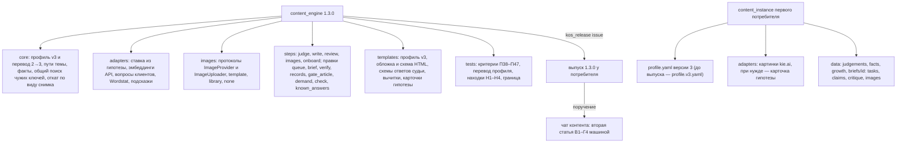
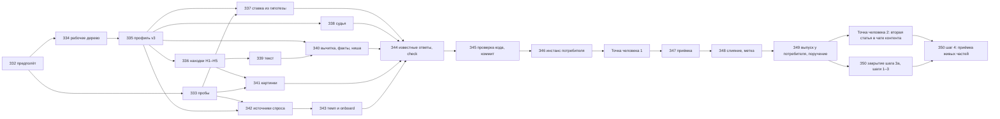

# План — Контент-машина, волна 2, часть 2 (решение, текст, вычитка, картинки, спрос; выпуск 1.3.0)

Сделан из: [Спецификация — Контент-машина, десять систем](<Спецификация — Контент-машина, десять систем (границы, волны 2 и 3).md>)
(принята Дмитрием 26.10.2026; требования Т26–Т33, критерии П38–П47, П48 и П49 для 1.3.0, решения Р11–Р21, решения
Дмитрия — её раздел 11а) и шаг 3а [дорожной карты](<План — Контент-машина, дорожная карта (все волны до готовой машины).md>).
Черновик задач — приложение «Заготовка части 2» [плана части 1](<План — Контент-машина, волна 2, часть 1 (основание, подготовка, выпуск; выпуск 1.2.0).md>)
(З18–З26а), пересмотренный по решениям Дмитрия и разделу «Ход исполнения и отходы от плана» того же плана (уроки
исполнения, выпуск 1.2.1, приёмка первой статьи 27.10.2026). Устройство пакета —
[ADR-0006](<../../_Движок/0 — System Docs/ADR-log/0006-content-engine-no-llm-calls-stack-adapters-in-instance.md>).
Код — пакет `content_engine` 1.2.1 (метка `content_engine-v1.2.1`), прочитан 27.10.2026: `pytest` — 351 прошёл,
1 пропущен.

**Статус:** принят Дмитрием 27.10.2026 с ответами на Д7–Д12 и правилом Н5 (раздел «Решения Дмитрия при приёмке
плана»). Исполнение — в этом же чате канона (решение Дмитрия: «продолжим с тобой»), срок — эта неделя: выпуск
1.3.0 до 30.10.2026, вторая статья — в чате контента сразу после выпуска.

**Режим** — один проход: исполняет один агент (Opus) в чате, где план составлен (если контекст кончится — новая
сессия по стартеру дорожной карты). Субагентов на исполнение — два: З45 (проверка
кода) и З47 (приёмка). Не больше двух одновременно, в промптах «субагентов не запускай». Вторая итерация проверки —
продолжением того же агента (`SendMessage`), а не новым запуском. Вторая модель (Codex, навык `second-agent`) —
не субагент и в счёт не входит.

**Обозначения.** Задачи этого плана — **З32–З50**: номера продолжают план части 1, чтобы ссылки не путались. Связь с
заготовкой — в каждой задаче строкой «Из заготовки». Требования (Т), критерии (П), решения (Р) и вопросы (В) — из
спецификации, номера те же. Спецификация главнее плана: при расхождении исполнитель останавливается и пишет, в чём
расхождение. Отход от плана записывается в раздел «Ход исполнения и отходы от плана» в тот же день.

## Замысел

### Происхождение

Часть 1 волны 2 вышла 26.10.2026 выпуском 1.2.0: профиль версии 2, права ступенями, снимок «до» и откат, роли
моделей, бюджет-гейт, учёт расхода, разбор топа, бриф с утверждением, сборка, публикация двумя режимами, «доехало»,
записи дня выкладки, индексация. Первая статья у первого потребителя вышла старым маршрутом сборки, подтверждена
машиной 27.10.2026 (живые части П25, П29, П31–П35 приняты); её находки ушли в выпуск 1.2.1. Текст, вычитка и
картинки первой статьи шли маршрутом проекта (Т19.7). Открыты П36 (заявки на индексацию — разрешение дано 27.10,
по первой статье переобход отправлен вручную) и П30 (прямая публикация ждёт проекта, В11).

Дмитрий разделил волну 2 на два выпуска (Д6, 26.10.2026): эта часть — выпуск 1.3.0 — замыкает производство
статьи машиной: тема рождается из гипотезы Движка роста, спорное решает судья, текст, критика, вычитка и картинки
идут заданиями ролей и проверками кода, спрос пополняется вопросами клиентов, Wordstat и подсказками. Решения
Дмитрия, которые в силе:
- **Д1** — судья без локальной модели: пятёрка ближайших разделов — лексическая (слой 2), эмбеддинги — облачным API
  через бюджет-гейт по желанию проекта;
- **Д2** — картинки платным генератором в любом проекте, всегда с ценой до запуска и «да»; провайдер — строка профиля.
  У первого потребителя генератор сменился на kie.ai: прямой доступ к прежнему генератору из РФ закрыт;
- **модели ролей** — псевдонимы последней версии (`claude-opus-latest` и подобные), вычитка фактов — `codex-latest`,
  вторая независимая модель; дешёвая модель закреплена номером (точка человека 1 части 1);
- **где идёт запуск** — работа на контенте первого потребителя идёт в его чате контента; этот чат — канон:
  спецификации, волны, выпуск. Поэтому вторая статья (статья машиной целиком) уходит поручением чату контента.

Находки первой статьи, которые входят в эту часть (план части 1, «Ход исполнения», выпуск 1.2.1 и приёмка
27.10.2026):
1. **Папка статьи — два места.** Рабочая папка машины `data/briefs/<id>/` и папка выпущенных статей проекта, из
   которой корпус слоя 2 узнаёт статью. Передача из одной в другую шла руками. Путь — строкой профиля, версия 3.
2. **Перелинковка.** Гейт статьи требует ссылку на страницу, чей целевой ключ взял подзаголовок брифа (проверка
   `foreign_mentions`), а в кандидатах перелинковки (`brief_context.json`) этой страницы нет: кандидаты считаются по
   формулировкам темы, а не по подзаголовкам. Кандидаты должны включать такие страницы.
3. **«Доехало» в день вставки.** В ручном режиме день выкладки — день первого успешного `publish verify`. Проверка
   первой статьи шла на следующий день после вставки, и машина записала его.
4. **Тема без ставки.** У первой статьи ставка пустая (`require_bet: false`): книга ставок замерит деньги, но сравнить
   их будет не с чем. Ставку даёт тема из гипотезы (Т26).
5. **В пакет руками ничего не кладётся.** Лишний файл в `package/` ломает сверку с манифестом — это уже ловится
   кодом; правило повторяется в поручении чату контента.

Уроки исполнения части 1, которые меняют этот план:
- живые проверки шли из рабочего дерева канона против инстанса первого потребителя, выпуск — в конце; так и здесь;
- чат контента каждый день работает выпуском 1.2.1 на тех же реестрах: профиль версии 3 и новые известные ответы до
  выпуска живут отдельными файлами (`profile.v3.yaml`, `known_answers.part2.yaml`), реестры меняются только
  добавлением полей;
- сеть в тестах запрещена (`conftest.py`), страницы и ответы сервисов собираются в коде теста;
- в каталоге кода нет `.md` (проверка шапок GitLab), в именах файлов нет `secret`, `token`, `key`, `credential`,
  `password` — тест границы это держит;
- проверка кода чистым контекстом нашла в части 1 две блокирующие ошибки на пути записи вовне; Codex — ещё 15
  принятых замечаний. Новые записи вовне этой части — загрузка картинок и передача статьи в папку проекта — идут тем же
  ядром действий (`core/actions.py`).

### Результат (изменение в мире)

У первого потребителя вторая статья проходит машину целиком, от темы до «доехало», и каждый шаг держит код:
тема берётся из гипотезы Движка роста со ставкой (ожидание, порог провала, окна 90 и 180 дней), поэтому через 90 дней
книга ставок сравнит деньги страницы с ожиданием; спорное пересечение решает судья только из пяти найденных
разделов, а последнее слово — за человеком; текст пишет агент по заданию роли с утверждённым брифом, критик правит
тон по таблице «было → стало», факты вычитывает вторая модель без контекста автора, и непроверенное не проходит в
статью без решения человека; картинки делает платный генератор только после цены и «да», и с alt, сжатием и
кредитами; статья сама уходит в папку выпущенных статей проекта, а «доехало» пишет настоящий день вставки. Любой
другой проект получает то же переводом профиля на версию 3; для проекта без Движка роста, без генератора и без
речевой аналитики машина честно пишет «не подключено». Запас тем пополняется вопросами клиентов, Wordstat и
подсказками — с проверкой чтением и без персональных данных.

### Что уже решено

- Объём — раздел 6 спецификации (Т26–Т33) и критерии П38–П47, П48 и П49 для 1.3.0; волна 3 — выпуск 1.4.0.
- Пакет моделей не вызывает (Р11, ADR-0006): модельный шаг — задание агенту файлом, результат проверяет код.
  Адаптеры конкретного стека — в инстансе (Р12): у первого потребителя адаптер картинок kie.ai и адаптер ставки
  живут в его `content_instance\adapters\`.
- Права ступенями, снимок «до» и откат одной командой (Р14) — и для загрузки картинок (`images.allow`), и для передачи
  статьи в папку проекта.
- Платный вызов — только через бюджет-гейт (Т17.2): цена до вызова, `--confirm-spend`, потолки профиля — не согласие,
  `--unattended` — ноль платных вызовов.
- Профиль версии 3 несёт все новые поля части 2 (Т15.1); перевод — тем же `profile migrate`, шагом `2 → 3`.
- Версия реестров (`core/store.py`, `SCHEMA_VERSION = 1`) не меняется: выпуск 1.2.1 чата контента читает те же
  файлы.
- Тяжёлых локальных установок нет (Д1). Новые зависимости — только необязательные и лёгкие: Pillow для сжатия
  картинок (`[project.optional-dependencies] images`), без него — замечание «не сжато».
- Данные первого потребителя в канон не попадают: в пакете — синтетика, в документах контура — уроки словами.

## Цель и критерии готовности

Готово, когда выполнены П38–П47, П48 в редакции 1.3.0 и П49 для 1.3.0, и в разделе «Проверка» записано, чем
доказан каждый. П48 для 1.3.0: `kos_release check` зелёный, метка `content_engine-v1.3.0`, строки манифеста пакетов
и CHANGELOG, `known-answers` — «совпало M из M» (отложенные — с причиной); профиль первого потребителя переведён на
версию 3. Живая часть П48 — вторая статья прошла В1–Г4 командами машины целиком — идёт в чате контента первого
потребителя по поручению (З49) и называется в отчёте «живая часть открыта до выхода второй статьи»; после её выхода
— короткая приёмка живых частей в чате канона (как у 1.2.0). Живые части, которые держит внешний вопрос (П38 — связь
с реестром гипотез первого потребителя, П39 — выборка «спорно», платный путь П45 — потолки бюджета), называются в
отчёте с причиной.

## Откат

- **Канон `D:\Knowledge-OS`:** главная ветка на 27.10.2026 — `ab77de7ec25ddf5b35b049a500621cc64c5fa0dd` (до
  коммита этого плана); фактический хэш на старте исполнения записывает З32. Вся работа — в ветке
  `content-engine-wave2-part2` в рабочем дереве `D:\KOS-content-engine-w2b`; главная ветка до З48 не меняется. Откат
  до З48 — `git worktree remove` и удаление ветки; после — `git revert` коммита слияния.
- **Репозиторий первого потребителя** (`C:\Users\redmi\Breezeks-Git\02 — Области\Digital-маркетинг`): хэш читает
  З32 через MCP `gitlab-employee` (`gitlab_repo_status`). До З49 пишутся новые файлы в `content_instance\`
  (`profile.v3.yaml`, `known_answers.part2.yaml`, новые адаптеры, папка `data/growth/` с карточками) — откат: удалить
  их; единственная правка существующего файла — `content_instance\.gitignore` (З46, шаг 6): до правки копия в папку
  сессии, откат — вернуть копию. Общие реестры (`queue.json`, `judgements.jsonl`, `facts.jsonl`) до З49 из рабочего
  дерева не пишутся: живые проверки З46 идут с `--dry-run` или на копии инстанса в папке сессии. В З49 перед выпуском — копии
  `profile.yaml`, `known_answers.yaml` и каталога выпуска `content_engine\` в папку сессии; откат выпуска — вернуть
  копии. **Shell `git` в этой папке не запускать.**
- **Записи вовне второй статьи** (в чате контента): загрузка картинок и передача статьи в папку проекта — снимок «до»
  в `data/snapshots/before/`, `publish rollback <id>` или `--run <id прогона>`. Откат идёт по виду снимка, а не
  только через публикатор, поэтому работает и в ручном режиме (З36, шаг 2а): передача — удаление созданных файлов,
  загрузка картинки — `restore` загрузчика. Страницу, вставленную человеком, снимает человек по `rollback.md` пакета.

## Скан канона (находки)

| Что | Где | Как используем |
|---|---|---|
| Требования, критерии, решения | спецификация, разделы 6, 8, 9, 11а | Источник каждой задачи |
| Черновик задач части 2 | план части 1, приложение (З18–З26а) | Пересмотрен здесь: З37–З44, З46 |
| Профиль и его перевод | `_Движок\Пакеты\content_engine\content_engine\core\profile.py` (`SCHEMA_VERSION = 2`, `SCHEMAS`, `GATE_ARTICLE_CHECKS`, `ALLOW`, `_semantics_v2`), `core\migrate.py` (`STEPS` — шаг «версия N → N+1» строкой, три вида вставки, `keep`) | Версия 3 — `SCHEMA_V2` остаётся для перевода, `STEPS[2]` (З35) |
| Рабочая папка темы | `core\instance.py` (`brief_dir`); пути зашиты ещё в `steps\brief.py` (`_month_load`, `instance.root / "data" / "briefs"`) и `steps\verify.py` (`folder = instance.root / "data" / "briefs" / tid / "package"`) | Все пути — через `instance.brief_dir` и строку профиля (З36) |
| Кандидаты перелинковки и чужие ключи | `steps\brief.py` (`link_candidates`, `CONTEXT = "brief_context.json"`), `steps\gate_article.py` (блок «чужие целевые ключи — по карте спроса»: `foreign_keys`, `foreign_mentions`, `title_similarity`) | Одна логика «подзаголовок берёт чужой ключ» для кандидатов и гейта (З36) |
| День выкладки | `steps\verify.py`, `core\publications.py`, `steps\records.py` | Флаг дня вставки (З36) |
| Ставка | `steps\queue.py` (`bet`: три обязательных аргумента), `steps\gate_topic.py` (`require_bet`), `core\bets.py` (поле `hypothesis_id` уже есть) | Ставка из гипотезы (З37) |
| Реестр гипотез Движка роста | `_Движок\Пакеты\growth_engine\growth_engine\core\storage.py` (`COLUMNS["hypotheses"]` — числа ссылками `*_id` на лист чисел; `decode_text`, `_decode`), `storage\markdown.py` (экранирование ячеек); MCP «Аналитика Бризекса»: `growth_hypothesis` (карточка по номеру — формулировка, эффект, гейт шума, замер), `growth_hypotheses` (список) — только чтение | Адаптер своим кодом без импорта `growth_engine` (Р2 волны 1): хранилище Markdown или карточка файлом, которую агент выгружает из MCP (З37) |
| Слой 2 и индекс текстов | `steps\dedup.py` (`layer_texts`, `concepts_of`, `BODY_CAP`), `core\textindex.py`, `adapters\corpus.py` (разделы по `HEADING`) | Лексическая пятёрка судьи (З38), чтение статьи-риска |
| Задания агенту, роли, бюджет, расход | `core\tasks.py` (`write_task`), `core\roles.py` (`describe`), `core\budget.py` (`gate`, `paid_call`, `add_flags`), `core\spend.py` | Все задания части 2; каждый платный вызов — `paid_call` |
| Утверждение брифа | `core\approval.py` (`require`) | Запрет заданий писателю без брифа (З39) |
| Ядро записи вовне | `core\actions.py`, `core\rights.py`, `core\snapshots.py`, `core\locks.py`, `adapters\write_client.py`, `steps\publish.py` (`rollback --run`) | Загрузка картинок, передача статьи (З36, З41) |
| Гейт статьи | `steps\gate_article.py` (`check_article`, `add(name, ok, detail)`, уровни из `gate_article.levels`) | Новые проверки — тем же механизмом (З39–З41) |
| Известные ответы и самопроверка | `steps\known_answers.py` (виды `gate`, `pair`, `publish`, `refuse`; песочница отказов), `steps\check.py` (`wave2_items`) | Виды части 2 и пункты `check` (З44) |
| Выпуск | `_Движок\Инструменты\kos_release.py` (`issue`, `check`); `_Движок\Сценарии\Плейбук — Система с кодом- версия, выпуск, новый пакет.md`, разделы 2–3 | З48–З49, как 1.2.0 и 1.2.1 |
| Модели ролей | навык `llm-pipeline-economy` | Основная и запасная модель ролей (профиль версии 2 уже несёт) |
| Текст и тон | `Методологии\Методология — Текст и редактура (информационный стиль, Ильяхов).md`, навык `text-editor` | Ссылками в заданиях писателя и критика (З39, З40) |
| Вычитка второй моделью | навык `second-agent` (Codex: только оболочка, нет нашей памяти и MCP) | Задание вычитки самодостаточно: текст и библиотека фактов, без брифа (З40) |
| Картинки | навык `image-edit` (правка готовой картинки — генеративным редактором, а не заплаткой) | Правило в задании проверки кадра (З41) |
| Keys.so: Wordstat, подсказки | `_Движок\Исходники скиллов\keysso\reference\методы.md` | Методы и лимиты — проба З33 до кода (З42) |
| Wordstat через облако | навык `seo-niche-research` | Имя переменной ключа, цена запроса — проба З33 (З42) |
| Речевая аналитика | MCP «Аналитика Бризекса» (`speech_ask`, `speech_search`, `speech_count`) — только чтение, имена клиентов не выносить | Вопросы клиентов — агрегат «вопрос; число обращений» файлом, без персональных данных (З42, поручение З49) |
| Приёмка и второе мнение | навыки `maker-checker`, `second-agent` | З45, З47 |
| Маршрут статьи первого потребителя | `…\Контент блога\Производство контента\Скрипты\README.md`; генератор картинок маршрута (скрипт генерации и загрузки в хранилище картинок сайта) | Адаптер картинок инстанса вызывает их как есть (З46) |

## Карта воздействия

- **Прямое:** пакет `content_engine` (рабочее дерево): профиль версии 3 и шаг перевода; новые модули `adapters/growth.py`,
  `adapters/embeddings.py`, `adapters/client_questions.py`, `adapters/wordstat.py`, `adapters/suggest.py`,
  `core/facts.py`, `images/` (`base.py`, `template.py`, `none.py`), `steps/judge.py`, `steps/write.py`,
  `steps/review.py`, `steps/images.py`, `steps/onboard.py`; правки `core/instance.py`, `steps/brief.py`,
  `steps/verify.py`, `steps/records.py`, `steps/queue.py`, `steps/gate_topic.py`, `steps/gate_article.py`,
  `steps/assemble.py`, `steps/demand.py`, `steps/known_answers.py`, `steps/check.py`, `cli.py`, шаблоны. У первого
  потребителя — новые файлы в `content_instance\` (`profile.v3.yaml`, `known_answers.part2.yaml`,
  `adapters\image_kie.py`, `adapters\growth_card.py` при необходимости); в З49 — `profile.yaml`, `known_answers.yaml`
  и каталог выпуска `content_engine\`.
- **Косвенное:** документы контура (спецификация — статус, дорожная карта, манифест контура); `_Движок\Пакеты\_manifest.md`;
  `_Движок\0 — System Docs\CHANGELOG.md`; `_Движок\Канон\Справочник — Карта Knowledge-OS.md` (выпуск 1.3.0);
  окружение Python устройства: `pip install -e` из рабочего дерева; Pillow — только если уже стоит или Дмитрий
  разрешит (лёгкая, но установка).
- **Вверх:** Keys.so — квота выдачи только при взятии темы; месячный лимит парсера — Wordstat и подсказки (считается
  до запроса); Yandex Cloud — Wordstat за деньги, через бюджет-гейт; облачный API эмбеддингов — только если проект
  включил, через бюджет-гейт; kie.ai — платная генерация через адаптер инстанса и бюджет-гейт; хранилище картинок сайта
  первого потребителя — запись с правом `images.allow: write`; реестр гипотез Движка роста — только чтение; речевая
  аналитика — только чтение агрегата.
- **Вниз:** чат контента первого потребителя каждый день работает выпуском 1.2.1 на тех же реестрах. Поэтому до З49:
  `profile.yaml` и `known_answers.yaml` не трогаются; профиль версии 3 — отдельным файлом `profile.v3.yaml` (те же
  реестры); новые известные ответы — `known_answers.part2.yaml`; новые поля записей очереди (`bet.hypothesis_id`,
  `angle`) и книги ставок — только добавлением, статусы — существующие; после каждой записи в реестры выпуск 1.2.1
  должен их читать (З46, шаг 8). Поле ставки `bet.expectation` остаётся строкой (его читает 1.2.1 — `steps/queue.py`,
  `core/bets.py`, `steps/gate_topic.py`); числа ожидания — новым полем `bet.expectation_numbers`. Тема, взятая машиной
  части 2 для второй статьи, выходит из запаса чата контента — её id идёт в журнал и в поручение. Чат контента
  запускает выпуск через `py -3 -m content_engine` из папки `Скрипты\` — переустановка пакета на устройстве (`pip
  install -e` из рабочего дерева) его не задевает.
- **Синхронизация:** `D:\Knowledge-OS\TASKS.md`; CHANGELOG и манифесты канона; дорожная карта (✅ шага 3а, таблица
  «Деньги» — ставка темы, бюджет-гейт с первыми платными вызовами, книга ставок, стартер шага 4 — навык); журнал
  действий первого потребителя; его инструкция «Контент-машина в блоге» — обновляет чат контента по поручению З49;
  база инцидентов — при сбое.
- **Не задевает:** `growth_engine` (только чтение его формата), Ядро данных, MCP «Аналитика Бризекса» (вызывает агент
  чата контента, не пакет), старые скрипты первого потребителя (вызываются, не правятся).

## Границы исполнения

- **В работе:**
  - рабочее дерево `D:\KOS-content-engine-w2b` (ветка `content-engine-wave2-part2`): `_Движок\Пакеты\content_engine\`
    и документы `Методологии\Контент-машина\` — все правки канона до З48 только здесь;
  - `D:\Knowledge-OS\TASKS.md`, раздел «Контент-машина», подраздел «Волна 2, часть 2» — ход работ (вне git);
  - у первого потребителя: `…\Контент блога\Производство контента\Скрипты\content_instance\` (новые файлы,
    перечень — в «Карте воздействия»; в З49 — `profile.yaml` и `known_answers.yaml`), `…\Скрипты\content_engine\`
    (только в З49, через `kos_release.py`), строки в `C:\Users\redmi\Breezeks-Git\00 — Мета\Журнал действий\<год-месяц>.md`.
- **Вне работы:** главная ветка канона до З48; любые другие файлы первого потребителя (его скрипты только
  запускаются); `growth_engine`, `datacore`; чужие незакоммиченные файлы канона.
- **Коммиты:** в ветку — после З45 и после З46; слияние в главную и метка — З48; строка «Карты» — отдельным коммитом
  после З49.
- **Push канона:** по правилу паспорта `D:\Knowledge-OS\CLAUDE.md` — после блока изменений, со сканом добавленных
  строк на секреты и персональные данные, с метками (`--follow-tags`).
- **GitLab компании:** публикует чат контента через MCP `gitlab-employee` (поручение — З49).
- **Платные вызовы:** в этом чате — ноль. Платные вызовы второй статьи (картинки, при желании Wordstat через облако)
  — в чате контента, каждый с ценой до запуска, `--confirm-spend` и «да» Дмитрия. Keys.so — по подписке; консоли,
  карта сайта — бесплатно; Codex — по подписке (токены — «нет данных», если не сообщены).

## Решения плана по находкам первой статьи

| № | Находка | Решение | Отброшено |
|---|---|---|---|
| Н1 | Папка статьи — два места | Профиль версии 3, раздел `paths`: `topic_dir: "data/briefs/{id}"` — рабочая папка темы (задания, бриф, разбор, текст, пакет); `published_dir: ""` — шаблон папки выпущенной статьи в корпусе проекта (`{slug}`, `{h1}`, `{id}`, путь от инстанса; имя очищается от запрещённых в Windows знаков); пусто — передачи нет, как сейчас. Папка лежит вне инстанса, поэтому это запись вовне со своей ступенью прав `paths.allow` (`files` — только план, `write` — передача; выше `files` — по разрешению Дмитрия строкой журнала действий, как В14). После первого «доехало» записи дня выкладки печатают план передачи; выполняет её `publish record <id> --apply` (или `publish verify … --apply`): снимок «до» (папки нет или в ней те же файлы — иначе отказ без перезаписи), копия текста и разметки под именами `paths.published_files`, чтение обратно (суммы), корпус находит страницу. Откат — `publish rollback <id>` по виду снимка, без публикатора: удаляет созданные машиной файлы и пустую папку. Повтор ничего не дублирует | Перенести всю рабочую папку в папку выпущенных статей: корпус слоя 2 читал бы черновики, задания и кэш. Передача на ступени `files`: Т16.1 — `files` значит «только в инстансе» |
| Н2 | Кандидаты перелинковки не видят подзаголовков | Одна функция «чей целевой ключ берёт заголовок или упоминает текст» — выносится из `gate_article.py` в общий модуль и вызывается тремя местами: `prepare brief` (по формулировкам и запросам кластера), `prepare check` (по H2 и H3 брифа — дописывает найденные страницы в `brief_context.json` с пометкой «по подзаголовку», печатает «нужна ссылка на …»), `gate article` (как сейчас) | Отдельный список «обязательных ссылок» в брифе: второе определение того же правила |
| Н3 | «Доехало» не в день вставки | `publish verify --inserted-on <дата> --who <имя>`: день вставки со слов человека — не раньше дня сборки и не позже сегодня; пишется днём выкладки с пометкой «со слов: <имя>». Без флага — как сейчас, день проверки. `paste.md` и вывод `publish prepare` говорят: «после вставки запустите `publish verify` в тот же день или укажите `--inserted-on`». `check` предупреждает о пакете, готовом больше суток без «доехало» | Брать день из карты сайта (у конструктора нет `lastmod`) или из первого показа в консоли (опаздывает на дни) |
| Н4 | Тема без ставки | Ставка из гипотезы (З37). Плюс предупреждение: `prepare brief`, `write task` и `publish record` при пустой ставке печатают «ставки нет — замер через 90 дней не с чем сравнить: `queue bet <id> --hypothesis-id …`»; `require_bet: true` при живой связи с Движком — «спорно» в гейте темы (Т26.2) | Запрет взятия темы без ставки: чат контента встал бы, пока реестр гипотез не связан |

## Вопросы Дмитрию при приёмке плана

Порядок — по тому, насколько ответ меняет работу. Ни один не держит код: тесты — на синтетике.

| № | Вопрос | По умолчанию | Держит |
|---|---|---|---|
| Д7 | Потолки бюджета первого потребителя на картинки: `budget.run_limit_rub` и `month_limit_rub` (сейчас 0 — платные вызовы запрещены) | Дмитрий называет числа в точке человека 1 (З46), исполнитель приносит цену кадра kie.ai с источником и датой; до ответа 0 — `images make` даёт код 2, платный путь П45 — «живая часть открыта» | Платный путь П45, картинки второй статьи машиной |
| Д8 | Откуда ставка у первого потребителя: его реестр гипотез — книга Lark, выгрузки в Markdown нет | Карточка гипотезы файлом: агент чата контента выгружает её из MCP `growth_hypothesis` в `data/growth/<H>.yaml` по схеме пакета, адаптер `file` читает и проверяет; вторая статья — тема с гипотезой, которую выберет Дмитрий | Живая часть П38 |
| Д9 | Передавать ли статью машиной в папку выпущенных статей проекта (Н1, запись в репозиторий проекта) | Да: `paths.allow: write` строкой профиля и строкой журнала действий, передача после «доехало» с `--apply`, без перезаписи; до ответа `published_dir: ""` и `paths.allow: files` — передача руками, как у первой статьи | Н1 у первого потребителя |
| Д10 | Wordstat — через парсер Keys.so (месячный лимит подписки) или Yandex Cloud (платно, бюджет-гейт) | Keys.so, если проба З33 найдёт метод частоты по месяцам; облако — вторым адаптером, выключено | Живая часть П46 по Wordstat |
| Д11 | Вопросы клиентов из речевой аналитики — какой контур и период | Агрегат «вопрос; число обращений» за 6 месяцев по переписке и звонкам контура продаж, без цитат; файл кладёт чат контента | Живая часть П46 по вопросам клиентов |
| Д12 | Объём выпуска: 19 задач и пять новых путей вовне в одном 1.3.0 (довод проверяющего плана) | Один выпуск 1.3.0, как в Т33 спецификации: задачи независимы и закрываются тестами по одной. Если к 21.11.2026 З42–З43 (источники спроса, `onboard`) не готовы, а остальное прошло З45, — они уходят в 1.3.1, исполнитель пишет это в «Ход исполнения» и спрашивает Дмитрия | Срок шага 3а |

## Решения Дмитрия при приёмке плана (27.10.2026)

Отменяют ответы по умолчанию из раздела выше.

| № | Решение | Что меняет |
|---|---|---|
| Д7 | Жёсткого потолка на картинки нет: кадр дешёвый, «не сильно ограничиваться». Главное — **картинки внутри текста**: сейчас у статей генерируется только обложка, а в теле — только готовые фото продукта | Потолки первого потребителя — `run_limit_rub: 500`, `month_limit_rub: 5000` (запас на десятки статей; «да» на цену — одно на прогон статьи). План картинок статьи добирает число из разбора топа (Т18.6) смесью: готовые фото проекта из библиотеки (новый провайдер `library`, 0 ₽) → схема из нумерованного списка (`template`, 0 ₽) → сгенерированная иллюстрация (платный провайдер). Провайдер — по виду картинки (`images.providers`), а не один на всё (З35, З41) |
| Д8 | Пока есть Бризекс — карточка из MCP «Аналитика Бризекса» файлом. Для нового проекта без своей аналитики — временное решение предложить самому | Вид `file` — общий для всех: у первого потребителя карточку выгружает агент из MCP, у нового проекта ту же карточку заполняет агент с владельцем по шаблону пакета `growth_card` (гипотеза, ожидание с источником и статусом «оценка», порог провала, окна). Когда у проекта появится свой Движок или своя аналитика — адаптер `module:` (З37) |
| Д9 | Машине разрешено класть статью в «Выпущенные статьи». Раскладка статей у каждого проекта своя | У первого потребителя `paths.allow: write` (строка журнала действий). Для проекта со своей архитектурой — `paths.transfer: module:<путь>:<класс>` (адаптер раскладки в инстансе по контракту ядра, как сборщик); по умолчанию `builtin` — папка по шаблону (З35, З36) |
| Д10 | Сначала Keys.so; не работает или недоступно — облако Яндекса по уже имеющемуся ключу API | `sources.wordstat.order: [keysso, cloud]`: второй источник берётся, только если первый отказал (ошибка, лимит, не подключён), с пометкой в отчёте; облако — ключ по имени переменной из файла секретов, цена до вызова и бюджет-гейт, если запрос платный (З42) |
| Д11 | Сначала увидеть общую статистику и решать от неё | Двухшаговый порядок в поручении чату контента (З49): (1) сводка — сколько вопросов клиентов по темам за 12 месяцев, звонки и переписки раздельно, «N из M»; Дмитрий выбирает темы и порог; (2) выгрузка агрегата `question;count` по выбору — без цитат и имён |
| Д12 | Не растягивать: машина производства — готовая и самодостаточная на этой неделе | Один выпуск 1.3.0, исполнение здесь, срок — 30.10.2026; запасной путь в 1.3.1 не закладывается |
| Н6 | (находка пробы З33, 27.10.2026) Подписка Keys.so, по записи в реестре гипотез, кончается около 28.10.2026; без выдачи встают взятие темы и гейт | Запасной источник выдачи — Yandex Search API по ключу, который уже работает (З42, шаг 4а); порядок `sources.serp_order` |
| Н5 | **Публикуемый HTML — без комментариев** (их видно в коде страницы). Пояснения для агентов — не второй копией HTML, а рядом | Сборка удаляет комментарии из файлов пакета, которые идут на сайт, и проверяет кодом: комментарий остался — «не готово» (новая автопроверка `comments`). Пояснения блоков — в манифесте (`notes`) и `paste.md`. Две версии HTML не делаем: копии расходятся. Подтверждено на первой статье: блоки пакета содержат служебные комментарии разделов (З36, шаг 6; З46) |

## Структура результата

## Граф зависимостей

Порядок исполнения в одном проходе: З32 → З33 → З34 → З35 → З36 → З37 → З38 → З39 → З40 → З41 → З42 → З43 → З44 →
З45 → З46 → точка человека 1 → З47 → З48 → З49 → З50 (шаги 1–3). Точка человека 2 — вторая статья в чате контента;
после её отчёта — З50, шаг 4: короткая приёмка живых частей, которой закрывается живая часть П48.

## Задачи

**Общее для задач кода.** Python ≥ 3.12. Пакет — `D:\KOS-content-engine-w2b\_Движок\Пакеты\content_engine\`, каталог
кода — `…\content_engine\content_engine\`. Тесты — из папки пакета: `py -3 -m pytest content_engine/tests`; после
каждой задачи весь набор зелёный, число тестов — в TASKS. UTF-8, переводы строк LF (инструмент правки или Python с
`newline=''`); вывод в консоль — `PYTHONIOENCODING=utf-8`. Стиль — как в коде частей 1 и 2: модуль начинается
строкой назначения и требованием (Т…); подкоманда регистрируется функцией `register(sub)` и добавляется в `STEPS` в
`cli.py`; реестр пишется через `core/store.py` со сверкой «записано N — прочитано N»; число — объектом `Number` со
статусом; задание агенту — `core/tasks.write_task`; платный вызов — `core/budget.paid_call`; запись вовне —
действием `core/actions.py` с правом `core/rights.require`, снимком «до» и подтверждением; ошибка называет поле или
файл. Коды выхода — как в `cli.py`: 0 — успех, 1 — найдена проблема или отказ запрета в коде, 2 — «спорно» и отказ
бюджет-гейта без «да», 3 — ошибка входа, источника или неподтверждённая запись. В коде, тестах и фикстурах — ни
имён, ни доменов, ни чисел первого потребителя: домены `example.ru`, `shop.example`, тексты придуманные; тест границы
`tests/test_package_boundary.py` зелёный. Сетевых запросов в тестах нет: транспорт подменяется, как в
`tests/keysso_transport.py`. Секреты — именами переменных из профиля. Новые `.md` в каталоге кода запрещены: шаблоны
заданий — строки в коде или `.txt`; фикстуры с `.md` создаёт тест во временной папке. После каждой задачи — строка в
`D:\Knowledge-OS\TASKS.md`, раздел «Контент-машина», подраздел «Волна 2, часть 2».
**Если контекст сессии кончается:** записать в TASKS сделанное и номер следующей задачи; новая сессия продолжает по
стартеру исполнения шага 3а дорожной карты с этого номера.

### З32 — Предполёт

**Исполнитель:** агент новой сессии (Opus).
**Файлы контекста:** этот план; спецификация десяти систем (разделы 3.2–3.5, 5 — Т15–Т17, 6, 8, 9, 11а целиком);
дорожная карта; план части 1 — разделы «Задачи» З3–З5, З8, З15, З17, З27–З30, «Ход исполнения», «Приложение»;
ADR-0006; `D:\Knowledge-OS\CLAUDE.md`; плейбук «Система с кодом», разделы 2–3; файлы из «Скана канона».
**Шаги:**
1. Прочитать файлы контекста целиком.
2. `git -C "D:\Knowledge-OS" status --short` и `git -C "D:\Knowledge-OS" rev-parse HEAD` — хэш в TASKS как точка
   отката.
3. Хэш репозитория первого потребителя — MCP `gitlab-employee`, `gitlab_repo_status`; в TASKS. Чужие незакоммиченные
   файлы в `content_instance\` — списком, не трогать.
4. Последние записи журнала действий первого потребителя (`…\00 — Мета\Журнал действий\` — текущий месяц) про
   Контент-машину: что чат контента менял в инстансе после 27.10.2026 (калибровка профиля, выпуски, темы взяты).
5. Окружение: `py -3 --version`; `py -3 -c "import yaml, requests, snowballstemmer, google.auth, playwright"`;
   `py -3 -c "import PIL; print(PIL.__version__)"` — есть ли Pillow (нет — не ставить без «да» Дмитрия).
6. Ответы Дмитрия на Д7–Д11 (если даны при приёмке плана) — в TASKS, иначе «по умолчанию». Проверить, что план в
   главной ветке: `git -C "D:\Knowledge-OS" log -1 --format=%h -- "Методологии/Контент-машина/План — Контент-машина, волна 2, часть 2 (решение, текст, вычитка, картинки, спрос; выпуск 1.3.0).md"`.
   Пусто — закоммитить план, дорожную карту и манифест контура (только эти пути) до З34.
**Готово, когда:** в TASKS записаны оба хэша, итог проверки окружения, ответы Д7–Д11 или «по умолчанию».

### З33 — Пробы до кода (только чтение)

**Шаги:**
1. **Карточка гипотезы.** Вызвать MCP `growth_hypotheses` (без фильтра) и `growth_hypothesis` для одной гипотезы со
   статусом не «архив». Выписать в TASKS только **имена полей** карточки и как в ней записаны ожидание (единицы и
   рубли — значение, период, источник, статус), порог провала, окна замера, статус гипотезы. Значения и формулировки
   компании в документы канона не идут. Итог определяет схему карточки файлом (З37, шаг 2).
2. **Keys.so: Wordstat и подсказки.** По `_Движок\Исходники скиллов\keysso\reference\методы.md` — методы частоты по
   месяцам за 24 месяца и подсказок, параметры региона, чем расходуется месячный лимит парсера, как узнать остаток до
   запроса. Один запрос остатка лимита (только чтение), если такой метод есть.
3. **Wordstat через облако.** По навыку `seo-niche-research` — адрес метода, имя переменной ключа, цена запроса с
   источником и датой. Запросов не делать.
4. **Генератор картинок первого потребителя.** Прочитать README скриптов маршрута и скрипт генерации картинки
   (провайдер kie.ai) и скрипт загрузки в хранилище картинок сайта: аргументы, куда пишет файл, как узнать цену кадра
   (прайс провайдера — адрес и дата), чем подтверждается загрузка (публичный адрес отвечает 200). Скрипты не
   запускать.
5. **Речевая аналитика.** MCP `speech_freshness`; есть ли способ получить агрегат вопросов клиентов (`speech_count` по
   признаку вопроса, `speech_search`) без цитат с персональными данными. Записать способ словами; данные не снимать.
6. **Выпуск 1.2.1 и новые виды известных ответов.** В коде `steps/known_answers.py` 1.2.1: что делает незнакомый вид
   случая и незнакомое имя отказа (`refuse`) — ошибка или пропуск. От этого — нужен ли отдельный файл
   `known_answers.part2.yaml` (по умолчанию — да).
7. **Выборка «спорно» для П39.** Сколько тем со «спорно» в `data/queue.json` и `data/rejections.jsonl` первого
   потребителя (только чтение) — число в TASKS.
8. Итоги — в TASKS сразу, в «Ход исполнения» — после З34 (в рабочем дереве), словами, без данных компании.
**Готово, когда:** по каждой пробе записан итог и что он меняет.

### З34 — Рабочее дерево

**Шаги:**
1. `git -C "D:\Knowledge-OS" worktree add "D:\KOS-content-engine-w2b" -b content-engine-wave2-part2`.
2. `py -3 -m pip install -e "D:\KOS-content-engine-w2b\_Движок\Пакеты\content_engine"`; проверка
   `py -3 -c "import content_engine; print(content_engine.__file__)"` — путь внутри рабочего дерева.
3. `pyproject.toml`: необязательная зависимость `images = ["pillow"]`. Версию не менять до З48.
4. `py -3 -m pytest content_engine/tests` — зелёный; число тестов — в TASKS (точка отсчёта: 351 прошёл, 1 пропущен).
**Готово, когда:** тесты зелёные из рабочего дерева; команда `content-engine` указывает на рабочее дерево.

### З35 — Профиль версии 3 и перевод `2 → 3` (Т15.1, Т33.1)

**Файлы:** `core/profile.py`, `core/migrate.py`, `templates/profile.template.yaml`, тесты `tests/test_profile_v3.py`,
`tests/conftest.py` (тестовый профиль — на версию 3), фикстура `tests/fixtures/profile_v2.yaml` (снять с текущего
шаблона версии 2 до правки).
**Шаги:**
1. `SCHEMA_VERSION = 3`. Нынешняя схема — `SCHEMA_V2` (только для перевода), `SCHEMAS = {1: …, 2: SCHEMA_V2, 3:
   SCHEMA}`. `_semantics_v3` вызывается при `version >= 3`. **Ловушка общих разделов:** `gate_article`, `sources`,
   `queue` лежат в `COMMON` (`core/profile.py`, `COMMON = dict(…)`) и общие для всех версий; `_semantics_v1` требует в
   `gate_article.levels` каждое имя из `GATE_ARTICLE_CHECKS`, `_semantics_v2` обходит все ключи `ALLOW`. Дописать поля в
   общие разделы и константы — значит сломать схемы версий 1 и 2, и `migrate.plan()` упадёт на проверке исходного
   профиля. Поэтому: `COMMON` разводится по версиям (`COMMON_V2` заморожен, версия 3 строится из него заменой
   разделов `gate_article`, `sources`, `queue`); `GATE_ARTICLE_CHECKS` и `ALLOW` — словари по версии
   (`GATE_ARTICLE_CHECKS[2]`, `[3]`, `ALLOW[2]`, `[3]`), семантические проверки берут набор своей версии. Тест:
   фикстура версии 2 проходит `validate(…, 2)` и после правок.
2. Новые разделы и поля. Имена — рабочие: исполнитель может уточнить и записывает уточнение в «Ход исполнения».
   Значение каждого поля — в шаблоне с комментарием; молчаливых значений нет.

| Раздел | Поля и значение в шаблоне | Т |
|---|---|---|
| `paths` (новый) | `allow: files` (`files` или `write`), `transfer: builtin` (`builtin` или `module:…`, Д9), `topic_dir: "data/briefs/{id}"` (обязателен `{id}`), `published_dir: ""` (шаблон с `{slug}`, `{h1}`, `{id}`; пусто — передачи нет), `published_files: {article: "article.md", schema: "schema.json"}` | Н1 |
| `sources` | плюс `growth: {kind: none, path: ""}` (`none`, `markdown` — папка хранилища Движка роста, `file` — папка карточек), `client_questions: {enabled: false, path: ""}`, `wordstat: {order: [], region: 0, cloud_key_env: "", cloud_price_rub: 0}` (`order` — список из `keysso`, `cloud` по порядку; пусто — выключен, Д10), `suggest: {enabled: false, limit: 50}` | Т26, Т31 |
| `sources` (Н6) | плюс `serp_order: [keysso]` (список из `keysso`, `yandex_search`), `yandex_search: {key_env: "", folder_env: "", price_rub: 0, regions: {}}` | Т4, Н6 |
| `budget` | плюс `usd_rub: 0` и `usd_rub_source: ""` — курс для провайдеров с ценой в долларах или кредитах (курс ЦБ с датой). Валюту знает только провайдер, поэтому проверку делает он: при `usd_rub: 0` его `price()` отказывает (код 3) до бюджет-гейта | Т17.2, Т30 |
| `judge` (новый) | `top: 5`, `embeddings: {kind: lexical, model: "", key_env: "", price_per_1k_rub: 0}` (`lexical` или `api`) | Т27 |
| `write` (новый) | `rules: []` (пути от инстанса к правилам проекта: эталон, стоп-лист, тон), `level: обычный` (уровень брифа по умолчанию) | Т28 |
| `gate_article` | плюс `rhythm_min_cv: 0.35`, `ai_tone_patterns: []`, `norm_patterns: []`, `answer_words: 60`; в `levels` — `rhythm: warn`, `ai_tone: warn`, `volume: warn`, `norm_links: warn`, `internal_links: warn`, `ai_answers: warn`, `facts: block`, `niche: block`, `image_alt: block`, `image_credits: block` | Т28–Т30 |
| `facts` (новый) | `enabled: false`, `ttl_days: 365`, `mode: separate` (`separate` — вычитка отдельной моделью без контекста автора; `human` — вычитывает человек) | Т29 |
| `niche` (новый) | `kind: general`, `min_sources: 0`, `disclaimer: ""`, `level: обычный` | Т29.4 |
| `images` (новый) | `allow: files` (`files` или `write`), `providers: {cover: none, illustration: none, scheme: template, product: none}` (каждый — `none`, `template`, `library` или `module:<путь от инстанса>:<класс>`, Д7), `library: {index: ""}` (CSV готовых картинок проекта: файл или адрес, alt, ключевые слова), `fill_rule: top` (`top` — число из разбора топа, `after_h2` — только места из списка), `upload: none` (`none` — загрузку делает провайдер или человек; `module:…` — отдельный загрузчик), `template: ""`, `after_h2: []`, `max_kb: 300`, `stop_categories: []`, `cover: true` | Т30 |
| `queue` | плюс `pace: {domain_since: "", new_domain_days: 180, new_domain_max_per_day: 1}` | Т32.1 |
| `onboard` (новый) | `min_cluster_frequency: 100`, `sample_pages: 5`, `answers: {vychitka: "", rhythm: ""}` | Т32.2 |

3. `ALLOW[3]` — плюс `images: ("files", "write")` и `paths: ("files", "write")`; `GATE_ARTICLE_CHECKS[3]` — плюс
   десять проверок из таблицы.
   Проверки смысла `_semantics_v3`: `topic_dir` содержит `{id}`; `published_dir` — только известные подстановки и путь
   внутри репозитория проекта (не абсолютный); `sources.growth.kind`, элементы `wordstat.order`, `judge.embeddings.kind`,
   `facts.mode`, `niche.level`, `write.level` — из своего списка; `embeddings.kind: api` без `key_env` — ошибка;
   каждый `images.providers.*` — через `_adapter` (встроенные `none`, `template`, `library`), `paths.transfer` — тоже;
   `library` в провайдерах без `images.library.index` — ошибка; в `ASSEMBLE_CHECKS[3]` — плюс `comments` (Н5),
   уровень `assemble.levels.comments: block` в шаблоне и в `fields` шага перевода; `answer_words`, `max_kb`, `judge.top` — положительные; `rhythm_min_cv` —
   от 0 до 1.
4. `core/migrate.py`: `STEPS[2] = Step(to=3, sections=("paths", "judge", "write", "facts", "niche", "images", "onboard"), fields=(("sources", "growth"), …,
   ("gate_article", "rhythm_min_cv"), …, ("gate_article.levels", "rhythm"), …, ("queue", "pace")))`. Проверить
   тестом, что поле внутри вложенного раздела (`gate_article.levels`) вставляется с его отступом и не даёт второго
   ключа. В `fields` шага — и `("budget", "usd_rub")`, `("budget", "usd_rub_source")`. Перевод — на одну версию за запуск (Т15.3): профиль версии 1 переводится двумя запусками (`1 → 2`, затем
   `2 → 3`). `apply()` проверяет результат схемой **версии шага** (`step.to`), а не `SCHEMA_VERSION`: сейчас он
   вызывает `profile_mod.load()` (`core/migrate.py`, конец `apply`), и промежуточная версия 2 дала бы «переведите» —
   заменить на `validate(parse(text), step.to)`.
5. `profile migrate` без `--apply` печатает добавляемые разделы и поля; с `--apply` — «записано — прочитано»,
   проверка схемой версии 3.
**Готово, когда:** тесты: профиль версии 2 в `queue status` — ошибка с названием `profile migrate`; `migrate` без
`--apply` не меняет файл (контрольная сумма); с `--apply` — «записано — прочитано», `profile check` зелёный;
фикстура версии 2 с комментариями в `gate_article.levels` и своими уровнями переводится без потерь (старые значения и
комментарии на месте, ключ `levels` один); профиль версии 1 доходит до версии 3 двумя запусками, после первого —
валиден по схеме версии 2; фикстура версии 2 проходит `validate(…, 2)`; неизвестный провайдер в `images.providers` и `topic_dir`
без `{id}` — ошибки профиля; весь набор зелёный.

### З36 — Находки первой статьи и правило HTML: папка статьи, перелинковка, день вставки, ставка, без комментариев (Н1–Н5)

**Из заготовки:** нет — находки первой статьи 27.10.2026.
**Файлы:** `core/instance.py`, `steps/brief.py`, `steps/verify.py`, `steps/assemble.py`, `steps/records.py`,
`steps/publish.py`, `steps/gate_article.py`, `core/htmldoc.py`, новые `core/foreign.py` и `core/restore.py`, `steps/check.py`, тесты
`tests/test_findings_121.py`.
**Шаги:**
1. **Н1, путь темы.** `Instance.brief_dir(tid)` строит путь по `paths.topic_dir`. Найти все места, где путь темы
   собран руками (`grep -rn "briefs" content_engine --include=*.py`: на 27.10.2026 — `steps/brief.py`, `_month_load`;
   `steps/verify.py`, папка пакета; текст ошибки в `steps/assemble.py`), и перевести на `brief_dir`; `_month_load`
   обходит родителя шаблона (`topic_dir` без `{id}`). Тест: `topic_dir: "work/{id}"` — задание, бриф, пакет и
   «доехало» работают из `work/`.
2. **Н1, передача статьи.** В записях дня выкладки (`steps/records.py`) — новая запись «статья в папке проекта»:
   `published_dir` пуст — пункт «не подключено». Иначе — действие `core/actions.py` с `confirm: read_back` и
   `kind: "article_transfer"`, право `rights.require(instance, "paths", "write")` (ступень `files` — действие только
   в плане с печатью «нужно разрешение: paths.allow = write»). Без `--apply` — план (что, куда); выполняет
   `publish record <id> --apply`, а `publish verify` получает флаг `--apply` и передаёт его записям. Имя папки —
   подстановка в шаблон с очисткой: убрать `<>:"/\|?*` и управляющие знаки, сжать пробелы, обрезать точки и пробелы
   по краям, длина не больше 120 знаков; путь после подстановки — внутри репозитория проекта (папка с `.git` выше
   инстанса), иначе ошибка. Снимок «до» — есть ли папка и суммы файлов. Папки нет — создать и положить текст и
   разметку под именами `paths.published_files`; папка есть и суммы те же — «уже есть», ноль записей; суммы другие
   или в папке чужие файлы — отказ без перезаписи (код 1) с путём. Подтверждение — суммы прочитаны обратно и
   `instance.corpus()` (заново, без кэша) находит страницу с её slug.
   2а. **Откат по виду снимка.** Сейчас `publish rollback` без публикатора только печатает `rollback.md` и выходит
   (`steps/publish.py`, `rollback`: ветка `publisher is None`). Новый `core/restore.py`: реестр «вид действия →
   восстановитель»; `article_transfer` — удалить файлы, созданные машиной (по снимку «до»), и папку, если она стала
   пустой; `image_upload` — `restore` загрузчика (З41). `rollback` сначала откатывает снимки этих видов (план без
   `--apply`, с `--apply` — запись и чтение обратно), затем передаёт публикатору **только** снимки без восстановителя в
   `core/restore.py` (сейчас `publisher.restore(snaps)` получает все снимки темы); снимок неизвестного вида без
   публикатора — строка «откатить вручную: <цель>», а не ошибка. В ручном режиме после этого печатается `rollback.md`
   для страницы. `publish verify --apply` печатает план двух записей раздельно (строка базы проекта и передача статьи),
   у каждой своя ступень прав.
3. **Н2, кандидаты перелинковки.** Вынести из `steps/gate_article.py` логику блока «чужие целевые ключи — по карте
   спроса» в `core/foreign.py` одной функцией `foreign_hits(pages, heads, sentences, links, norm, threshold) →
   (taken, mentioned)`: «взят» — заголовок почти совпадает с ключом в обе стороны (`title_similarity ≥ threshold`);
   «упомянут без ссылки» — только если не «взят» (сейчас это ветка `elif`), ключ не короче трёх основ входит во фразу
   целиком, фраза не длиннее трёх длин ключа, ссылки на страницу нет. Одна функция — чтобы связь «упомянут, только если
   не взят» не потерялась. Гейт статьи вызывает её — его тесты не меняются. `prepare check`: фразы — `h1`,
   `sections[].h2`, `sections[].h3[]` брифа; «взятые» — ошибка, как сейчас; «упомянутые» страницы дописываются в
   `links` файла `brief_context.json` с `kind: "по подзаголовку"` и печатью «нужна ссылка на <адрес> — подзаголовок
   «…» задевает её ключ «…»». Это побочная запись `prepare check` (и `prepare approve`, который его вызывает) —
   назвать её в выводе команды и в строке назначения модуля. Ссылка брифа на такую страницу не даёт предупреждения
   «вне кандидатов».
4. **Н3, день вставки.** `publish verify <id> --inserted-on <ГГГГ-ММ-ДД> --who <имя>`: дата не раньше дня сборки из
   манифеста и не позже сегодня, иначе ошибка входа (код 3); день выкладки — эта дата, в журнале выпуска поле
   `published_source: "со слов: <имя>"`. Без флага — день проверки, как сейчас. Это расширяет Т22.5 — строка в
   разделе 12 спецификации («предложение исполнителя») и в CHANGELOG выпуска (З48). `publish prepare` пишет в `paste.md`
   и печатает: «после вставки запустите `publish verify <id>` в тот же день или укажите `--inserted-on`». `check` —
   предупреждение: пакет `ready` старше суток без «доехало».
5. **Н4, пустая ставка.** `prepare brief`, `write task` (З39) и записи дня выкладки при пустых полях ставки печатают
   «ставки нет — замер через 90 дней не с чем сравнить: `queue bet <id> --hypothesis-id …`»; в книге ставок новое поле
   `bet_missing: true` (только добавлением).
6. **Н5, публикуемый HTML без комментариев.** `core/htmldoc.py` — функция `strip_comments(html)` (комментарии
   `<!-- … -->` вне `<script>` и `<style>`; условные комментарии IE тоже). `assemble build` после сборщика проекта
   прогоняет через неё каждый HTML-файл пакета, который идёт на сайт (всё, кроме служебных: `manifest.json`,
   `paste.md`, `rollback.md`), до подсчёта сумм манифеста; снятые пояснения — в манифест полем `notes` (файл, текст
   комментария) и в `paste.md` строкой «пояснения сборки», чтобы агенты их видели. Автопроверка `comments`
   (уровень `assemble.levels.comments`) — комментарий в файле пакета остался, значит пакет «не готов». `publish
   verify` при сверке текста не требует комментариев на живой странице. Шаблон `templates/article.html` пакета —
   без комментариев.
**Готово, когда:** тесты: путь темы из профиля; передача статьи при `paths.allow: files` — только план, без
`--apply` — ноль записей, с правом и `--apply` — «записано 2 — подтверждено 2» и корпус находит страницу по slug;
шаблон `{h1}` с «?» и «:» даёт допустимое имя папки; путь вне репозитория — ошибка; повтор — ноль записей; чужие
файлы в папке — отказ без перезаписи; `publish rollback <id> --apply` при `publish.mode: manual` без публикатора
удаляет только созданное и печатает `rollback.md`; блок с `<!-- ЛИД -->` и `<!-- ===== -->` после сборки — без комментариев, их
tекст — в `notes` манифеста, суммы манифеста — по очищенным файлам; подложенный комментарий после сборки — «не готово»
по `comments`; при пустом `published_dir` — «не подключено»; бриф с H2, задевающим целевой ключ страницы корпуса, даёт её в кандидатах «по подзаголовку», а гейт
статьи с ссылкой на неё — без находки `foreign_mentions`; `--inserted-on` раньше дня сборки — код 3, верная дата —
день выкладки и даты замеров от неё; пустая ставка — предупреждение и `bet_missing`.

### З37 — Тема из гипотезы Движка роста (Т26)

**Из заготовки:** З18, пересмотрена: у первого потребителя хранилище — книга Lark, выгрузки в Markdown нет; карточка
гипотезы доступна через MCP «Аналитика Бризекса» (Д8).
**Файлы:** `adapters/growth.py`, `templates/growth_card.schema.yaml`, `steps/queue.py` (`bet`), `steps/gate_topic.py`,
`steps/check.py`, фикстуры `tests/fixtures/growth_store/` (хранилище Markdown: лист гипотез и лист чисел) и карточка
в коде теста, тесты `tests/test_growth_bet.py`.
**Шаги:**
1. До кода прочитать `growth_engine/storage/markdown.py` и `growth_engine/core/storage.py`: как хранилище Markdown
   держит лист гипотез (`COLUMNS["hypotheses"]`, числа — ссылками `*_id`) и лист чисел; ячейки закодированы
   (`decode_text`, `_decode`, экранирование: префикс `'`, HTML-сущности вроде `&#124;`). Адаптер повторяет
   декодирование своим кодом (без импорта `growth_engine`, Р2) и проверяет его тестом на закодированных ячейках.
2. `GrowthSource.bet(hypothesis_id) → {hypothesis_id, hypothesis, expectation, expectation_numbers,
   fail_threshold, windows}`. В теме очереди это ложится так: `bet.expectation` — **строка**, как в 1.2.1 (её читают
   `steps/queue.py`, `core/bets.py`, `steps/gate_topic.py`): ожидание словами, собранное из чисел; новые поля
   `bet.hypothesis_id` и `bet.expectation_numbers` — список чисел строкой Движка: значение, единица, кабинет,
   период, знаменатель, источник, дата съёма, статус (факт, оценка, proxy, нет данных). Два вида: `markdown` — папка
   хранилища Движка роста; `file` — папка карточек `<H>.yaml` по схеме `growth_card.schema.yaml` (поля — по итогу
   пробы З33, шаг 1; поля `exported_at` и `exported_by` обязательны: карточку выгружает агент из MCP, и её свежесть
   видна; старше 30 дней — предупреждение). Проба З33: у гипотез направлений статей ожидание и порог провала записаны текстом
   формулировки, а ставка — на направление (несколько статей, окна от последней статьи), поэтому в карточке есть
   `unit: direction|article`, `planned_count`, `expectation` (текст), `fail_threshold` (текст),
   `expectation_numbers` (числа, которые агент выписал из формулировки, статус «оценка», источник «формулировка
   гипотезы <id>»); книга ставок при `unit: direction` пишет у статьи долю направления и ссылку на гипотезу. Если MCP `growth_*` агенту недоступен (вход по списку допуска) — запасной
   путь ручной: `queue bet` тремя аргументами со словами Дмитрия, `hypothesis_id` пуст, в отчёте «ставка вручную». Ни одного запроса
   записи; ссылка на число, которого нет, или карточка без обязательного поля — ошибка с id; гипотеза со статусом
   «архив» — отказ (код 1).
3. `queue bet <id> --hypothesis-id <H>`: `--hypothesis`, `--expectation`, `--fail-threshold` становятся
   необязательными — нужен либо `--hypothesis-id`, либо все три (ручной ввод для проектов без Движка). Поля ставки и
   `hypothesis_id` — в теме очереди и затем в книге ставок (`core/bets.py` уже несёт `hypothesis_id`).
4. `check`: `sources.growth.kind: none` при `queue.require_bet: true` — предупреждение «запас останется нулём»;
   связь включена — проба чтения одной гипотезы из профиля или «карточек нет».
5. Гейт темы (Т26.2): при `require_bet: true` тема без ставки — «спорно» (это уже делает `steps/gate_topic.py`;
   проверить тестом с живой связью).
**Готово, когда:** тест П38 на фикстуре хранилища Markdown и на карточке файлом: поля ставки прочитаны, счётчик
записей клиента — 0; закодированные ячейки декодированы; архивная гипотеза — отказ; `require_bet: true` без связи —
предупреждение `check`; после `queue bet --hypothesis-id` поле `bet.expectation` — строка, прежние поля ставки на
месте, новые только добавлены (живая сверка чтением выпуском 1.2.1 — З46, шаг 8).

### З38 — Судья спорного (Т27)

**Из заготовки:** З19, без изменений по существу (Д1).
**Файлы:** `adapters/embeddings.py`, `steps/judge.py` (подкоманды `judge task <id>`, `judge check <id>`,
`judge accept <id> --who <имя> --verdict <…>`), `steps/queue.py` (`refill` — задание чтения статьи-риска; поле
`angle`), `templates/judge.schema.yaml`, тесты `tests/test_judge.py`.
**Шаги:**
1. Пять ближайших разделов (`judge.top`): по умолчанию верхние по весам слоя 2 (`steps/dedup.py`, `layer_texts`;
   раздел — по `HEADING` корпуса) с пометкой «лексическая пятёрка», без установки. `judge.embeddings.kind: api` —
   адаптер облачного провайдера: цена до вызова по `price_per_1k_rub` и числу знаков, `budget.paid_call`, кэш
   `cache/embeddings/<sha>.json`; провайдер и модель — строкой профиля. Локального варианта нет.
2. `judge task <id>` (тема со «спорно» в отчёте гейта): задание роли `judge` — тема, формулировки, пять разделов
   текстом с id (`<slug>#<номер раздела>`), схема ответа `judge.json`: `verdict` (`free_with_angle`, `closed_by`,
   `disputed`), `section_id`, `quote`, `angle`, `tokens`, `model_used`.
3. `judge check <id> [--dry-run]` (`--dry-run` — печать вердикта без записи в реестры; им пользуется З46): раздел — из пяти; цитата — подстрока его текста после нормализации пробелов и кавычек; при
   `free_with_angle` — `angle` не пуст. Иначе ответ не принят (код 1, причина). Принятый — строка в
   `data/judgements.jsonl` (тема, вердикт, раздел, цитата, вид пятёрки, модель, день). `disputed` — код 2 и задание
   человеку: `judge accept <id> --who <имя> --verdict free|closed [--angle …]`. Расход — строка `tokens` (факт или
   «нет данных»).
4. Итог в очереди: `free_with_angle` и принятое человеком `free` — тема `gated` с `angle`; `closed_by` и `closed` —
   тема снята с записью в журнал отсева (слой «судья»).
5. `queue refill`: по каждой новой теме со «спорно» — задание чтения статьи-риска целиком (`task_risk_read.md`: какие
   подтемы статьи нет; ответ — `angle`); итог пишет `judge check` тем же путём. В день выпуска статья-риск не читается.
**Готово, когда:** тесты П39 (ответ с разделом вне пятёрки и цитата не из текста не приняты; без эмбеддингов —
«лексическая пятёрка»; `api` без `--confirm-spend` — код 2 и ноль вызовов), П40 (`queue refill` выдаёт задание
чтения по каждой спорной теме; итог-угол записан в очередь).

### З39 — Текст: задания ролей и проверки гейта статьи (Т28)

**Из заготовки:** З20, плюс находки Н2 и Н4.
**Файлы:** `steps/write.py` (подкоманда `write task <id>`), `core/facts.py` (создаётся здесь), `steps/review.py`
(создаётся здесь с функцией `critique_task`; подкоманды — в З40), `steps/gate_article.py`,
тесты `tests/test_write.py`.
**Шаги:**
0. `core/facts.py` — библиотека фактов `data/facts.jsonl` (Т29.3), чтобы З39 не угадывал формат: строка — `fact`,
   `value`, `unit`, `source`, `checked` (дата), `ttl_days`, `status` (`confirmed`, `expired`), `topic`; функции
   `read(instance)`, `valid(row, today)` (срок годности), `pack(instance, topic_id)` — подтверждённые и годные факты
   темы; `add(instance, rows)` — без дублей по ключу «факт + значение + источник». Тест на чтение, срок и дубль.
   З40 только пользуется этим модулем.
1. `write task <id>`: запрет в коде — `approval.require` (без утверждённого брифа — код 1). Три задания —
   `task_plan.md` (роль `planner`: план разделов по брифу), `task_write.md` (роль `writer`: текст в `article.md`),
   `task_critique.md` (роль `critic`: таблица «было → стало» в `critique.md`). Задание критику пишет одна функция
   `critique_task(instance, tid)` в `steps/review.py`; `write task` и `review task` (З40) зовут её же — файл один,
   повторный вызов его переписывает с той же схемой. Так выполняются и Т28.1 (три роли), и Т29.1 (критика в
   `review task`) без двух заданий на один результат. В задании писателя: путь брифа, `top.json`,
   кандидаты перелинковки из `brief_context.json` (включая «по подзаголовку»), правила проекта ссылками
   (`write.rules`), канон — методология «Текст и редактура» и навык `text-editor` по имени, стоп-фразы
   (`gate_article.stop_phrases`), коридор объёма направления и целевой объём из `top.json`, требования проверок
   ниже словами. Предупреждение Н4 при пустой ставке.
2. Т28.3: уровень текста — `brief.level` (по умолчанию `write.level`, в нише — `niche.level`). Усиленный уровень без
   пакета проверенных фактов (`facts.pack(instance, tid)` пуст) — отказ (код 1).
3. Новые проверки гейта статьи, уровни из профиля:
   - `rhythm` — коэффициент вариации длины абзацев и предложений ниже `rhythm_min_cv` — замечание;
   - `ai_tone` — совпадения с `gate_article.ai_tone_patterns` (регулярные выражения) — замечание со списком;
   - `volume` — длина основного текста в знаках вне `directions[].volume` направления темы;
   - `norm_links` — предложение со словами из `norm_patterns` без ссылки в том же абзаце;
   - `internal_links` — ссылка на свой раздел статей ведёт на slug корпуса или карты спроса;
   - `ai_answers` — у каждого H2 первый абзац не длиннее `answer_words` слов и содержит основы заголовка раздела;
     FAQ на месте; это те же правила, что балл пригодности Т37.1 волны 3 — общая функция в `steps/gate_article.py`.
**Готово, когда:** тест П41: три задания с разными ролями и моделями; без утверждённого брифа — отказ (этот отказ —
случай `refuse` в известных ответах, З44); раздел без прямого ответа в начале — замечание `ai_answers`; ровный ритм и
шаблон ИИ-интонации — замечания; объём вне коридора — по уровню профиля; норма без ссылки и ссылка на статью не из
корпуса — находки; усиленный уровень без пакета фактов — отказ.

### З40 — Критика, вычитка фактов, библиотека фактов, профиль ниши (Т29)

**Из заготовки:** З21, плюс: вычитка — `codex-latest` (вторая модель без нашей памяти и MCP), задание
самодостаточно.
**Файлы:** `steps/review.py` (подкоманды `review task <id>`, `review check <id>`, `review accept <id> <№> --who <имя>`),
`core/facts.py` (из З39 — только использовать), `templates/claims.schema.yaml`, `steps/gate_article.py` (проверки `facts`, `niche`),
`steps/assemble.py` (запрет сборки черновика), тесты `tests/test_review.py`.
**Шаги:**
1. `review task <id>`: два задания. Критик — `critique_task` (функция из З39, тот же `task_critique.md`): текст, бриф,
   правила проекта; результат — `critique.md` (таблица «было → стало»). Вычитка (`task_factcheck.md`, роль `fact_checker`) — в
   задании **только** текст статьи (вставлен в задание, а не путём к рабочей папке) и выдержка библиотеки фактов по
   теме; схема `claims.jsonl`; правило: каждое число, норма, статья закона и свойство продукта — с первоисточником,
   иначе «непроверено». Код проверяет, что в задании вычитки нет путей к `brief.yaml`, `task_write.md`,
   `task_plan.md`, `critique.md`, `brief_context.json` и папки темы — иначе ошибка, задание не пишется. Шапка задания
   говорит, как запускать вторую модель: «Codex CLI, навык `second-agent`; результат — файл по схеме».
2. `review check <id>`: схема `claims.jsonl` — утверждение, тип (`number`, `norm`, `law`, `product`), первоисточник
   (адрес или документ), итог (`confirmed`, `blocker`, `clarify`, `unverified`), пометка `legal_risk`. Статья —
   черновик (флаг `data/briefs/<id>/review.json` с суммой текста), если есть `blocker`, `unverified` без решения
   человека или `legal_risk` без решения человека. `review accept <id> <№> --who <имя>` — решение человека по
   строке. Подтверждённые утверждения пополняют библиотеку через `facts.add` из З39 (дата проверки — день
   `review check`, `ttl_days` из профиля, без дублей).
3. Запрет в коде: `gate article --topic <id>` при включённых `facts` читает `review.json` — черновик или сумма текста
   не та — итог «черновик»; `assemble build` без «пропуска» не собирает (как сейчас).
4. Проверка `facts`: число текста совпадает с фактом библиотеки с истёкшим сроком — «черновик» с указанием факта.
   Проверка `niche`: правила раздела `niche` — минимум первоисточников (`min_sources`), обязательная оговорка
   (`disclaimer` — подстрока текста), уровень брифа не ниже `niche.level`.
5. `facts.mode: human` — задание вычитки не пишется, `review check` принимает `claims.jsonl`, заполненный человеком.
**Готово, когда:** `write task` и `review task` дают один и тот же `task_critique.md`; тесты П42 (в задании вычитки нет путей к брифу, заданию писателя и переписке; блокер держит
черновик; непроверенное без решения человека — черновик; юридический риск — черновик), П43 (число с истёкшим фактом —
«черновик» с указанием факта; подтверждённое утверждение пополнило библиотеку, повтор — без дубля), П44 (статья в нише
с обязательной оговоркой без неё — «черновик»; та же статья в нише без требования — «пропуск»).

### З41 — Картинки (Т30)

**Из заготовки:** З22, плюс Д2: платный провайдер — норма, адаптером инстанса; загрузка — запись вовне; Д7: картинки
внутри текста — главное, провайдер по виду картинки, готовые фото проекта — библиотекой.
**Файлы:** `images/__init__.py`, `images/base.py` (протокол `ImageProvider`, загрузчик `module:` — тот же, что у
сборщика, `core/plugins.py`), `images/template.py`, `images/none.py`, `images/library.py`, `templates/image_cover.html`,
`templates/image_scheme.html`, `steps/images.py` (подкоманды `images plan <id>`, `images make <id>`,
`images upload <id>`, `images backfill`), `steps/gate_article.py` (проверки `image_alt`, `image_credits`), `core/restore.py` (вид `image_upload`), тесты
`tests/test_images.py`.
**Шаги:**
1. `ImageProvider.price(запрос) → рубли` и `make(запрос, путь) → файл и фактическая цена или None`; запрос — вид
   (`cover`, `scheme`, `illustration`, `photo`), тема, заголовок раздела, текст для схемы, alt. Провайдер с ценой в
   долларах или кредитах пересчитывает её в рубли по `budget.usd_rub` и пишет в источник цены курс и его дату
   (`usd_rub_source`). Отдельный протокол загрузки `ImageUploader`: `plan(файл, адрес) → действие`, `snapshot(адрес)`,
   `upload(файл, адрес)`, `read_back(адрес)`, `restore(снимок)` (удалить загруженное или вернуть прежний файл; не
   умеет — `restore` возвращает инструкцию человеку, и откат печатает её). Его реализует провайдер или модуль
   `images.upload`.
2. `images plan <id>` (Д7 — картинки внутри текста): обложка (`images.cover`); места в теле — при `fill_rule: top`
   столько, сколько требует разбор топа (`top.json`, число картинок Т18.6), по одной после H2, начиная с самых
   длинных разделов, без двух подряд и не в FAQ; при `after_h2` — только места из списка. Вид каждого места — по
   правилу: в разделе есть совпадение с библиотекой готовых фото (`product`) → фото из библиотеки; раздел — шаги
   нумерованным списком → `scheme`; иначе → `illustration` (платный провайдер). Провайдер вида — из
   `images.providers`; вид с провайдером `none` — место пропускается с пометкой. Результат — `images.json` (вид,
   место, alt, источник, лицензия, цена, файл) и строка «в теле N картинок из цели M».
3. `images make <id>`: `price` по всем кадрам плана → одна сумма → `budget.paid_call` на прогон (цена выше нуля) →
   `make` по кадрам в `data/briefs/<id>/images/`; фактическая цена, если пришла, — строкой расхода «факт»; сжатие до
   `images.max_kb` (Pillow; нет — замечание «не сжато»). Пустой alt в плане — предупреждение до вызова; в гейте статьи
   — проверка `image_alt` по уровню профиля (картинка в тексте без alt). Отказ провайдера по кадру — заглушка `none` в
   манифесте, сборка не падает; деньги за кадр, не вернувшийся вовремя, списаны — строка расхода «оценка» по цене
   кадра, а не ноль.
3а. `library` (новый встроенный провайдер, 0 ₽): CSV `images.library.index` — `file_or_url;alt;keywords`; выбор —
   наибольшее совпадение основ ключевых слов с заголовком и первым абзацем раздела (нормализация пакета), порог —
   хотя бы одна основа модели или типа продукта; одно фото — не больше одного раза в статье. alt — из библиотеки,
   уточнённый заголовком раздела. Фото уже лежит в хранилище сайта — загрузка не нужна.
4. `template`: обложка — заголовок статьи и направление на однотонном фоне; схема — шаги из пунктов нумерованного
   списка раздела. PNG — снимком браузера при `publish.browser: true` и установленном Playwright, иначе SVG тем же
   шаблоном. Цена 0, бюджет-гейт не зовётся.
5. Фото из сети машина не ищет: адрес кадра, автора и лицензию даёт агент по заданию `task_photo.md` (стоп-лист
   категорий `images.stop_categories`, правило: правка готовой картинки — навыком `image-edit`, не заплаткой); итог —
   строки `photo` в `images.json`. Проверка `image_credits` гейта статьи требует автора и лицензию у каждого фото.
6. `images upload <id> [--apply]` — загрузка в хранилище картинок сайта: действие `kind: "image_upload"` через
   `ImageUploader` (провайдер или модуль `images.upload`; оба `none` — «загрузку делает человек», пункт в
   `paste.md`), право `images.allow: write`, снимок «до» (что отвечает по целевому адресу), подтверждение — публичный
   адрес отвечает 200 и размер совпадает (Т16.3). Откат — `publish rollback <id>` по виду снимка (`core/restore.py`
   из З36, шаг 2а) зовёт `restore` загрузчика, в ручном режиме тоже. Адреса картинок — в `images.json`, сборщик
   берёт их оттуда.
7. `images backfill`: статьи корпуса, у которых на живой странице (`PageFetcher`, основной блок) нет картинок в теле,
   — прогон с `run_id`: план, `make` (через бюджет-гейт), `upload` и правка страницы публикатором проекта как правка
   (Т21) со снимком «до»; `publish rollback --run <run_id>` откатывает весь прогон. В ручном режиме — пакет и
   инструкция человеку.
**Готово, когда:** тест П45 (`template` даёт обложку и схему за 0 ₽ без бюджет-гейта; план при `fill_rule: top` и цели
из `top.json` 4 ставит четыре места в теле, раздел с моделью из библиотеки получает её фото за 0 ₽, раздел с
нумерованным списком — схему, остальные — иллюстрацию платного провайдера; одно фото библиотеки не повторяется; без картинки — заглушка, сборка
не падает; картинка без alt или фото без кредита — по уровню профиля; платный фейковый провайдер без
`--confirm-spend` — код 2, ноль вызовов; `images backfill` находит статью без картинок и ставит добор со снимком «до»;
`publish rollback --run` откатывает весь прогон одной командой) и тест загрузки (без `images.allow: write` — только
план; адрес не отвечает — не подтверждено, код 3; `publish rollback <id> --apply` при `publish.mode: manual` зовёт
`restore` фейкового загрузчика, и адрес больше не отвечает; цена в долларах пересчитана по курсу профиля; при курсе 0
фейковый провайдер в долларах отказывает в `price()` с кодом 3 до бюджет-гейта, ноль вызовов).

### З42 — Новые источники спроса (Т31)

**Из заготовки:** З23, плюс итоги проб З33 (шаги 2, 3, 5) и Д10, Д11.
**Файлы:** новые `adapters/client_questions.py`, `adapters/wordstat.py`, `adapters/suggest.py`, `adapters/yandex_search.py` по интерфейсу
`DemandSource` из `adapters/demand.py`; правки `steps/demand.py`, `core/quota.py` (месячный лимит парсера), тесты
`tests/test_demand_part2.py`.
**Шаги:**
1. **Вопросы клиентов.** CSV `question;count` (UTF-8, разделитель «;»). Колонка, кроме этих двух, — ошибка (П46:
   поле имени или телефона в файле — ошибка). Значение, похожее на телефон, почту или ссылку, — ошибка с номером
   строки, файл не читается; регулярные выражения — по образцу стража ПДн Движка роста
   (`_Движок\Пакеты\growth_engine\growth_engine\core\storage.py`, функция `check_rows_pii` и её шаблоны), повторить
   своим кодом без импорта. Правила «похоже на имя» у стража нет, и в пакет оно не добавляется: на названиях брендов и
   моделей оно даёт ложные срабатывания; имена держит источник — агрегат без цитат (Д11) и правило MCP «имена
   клиентов не выносить». Вопрос, по которому слой 2 гейта темы даёт
   «свободно», — кандидат с источником `client_questions` и числом обращений; остальные — в отчёт «уже отвечено:
   <адрес>».
2. **Wordstat (Д10).** Источники по `wordstat.order`: следующий берётся, только если предыдущий отказал (ошибка
   источника, лимит, «не подключено»), и отчёт пишет, каким источником снято каждое число. `keysso` — метод из пробы З33, частота по месяцам за 24 месяца по `wordstat.region`;
   расход месячного лимита парсера считается до запроса (как `core/quota.py`) и печатается в отчёте; лимита не
   хватает — отказ до запроса. `cloud` — облако Яндекса по ключу `wordstat.cloud_key_env` (имя переменной; адрес метода — из пробы З33, шаг 3);
   если `cloud_price_rub` выше нуля — цена до вызова (за запрос × число фраз) и `budget.paid_call`.
   Итог — строки `demand.jsonl` с частотой и рядом по месяцам (поле `history`); ряд для волны 3 (заморозка) хранится
   уже сейчас.
3. **Подсказки.** Подсказки и похожие запросы Keys.so — до `suggest.limit` на фразу; подсказка без частоты в очередь
   не попадает (строка в отчёте «без частоты — отброшено N»); число, собранное по подстроке, — в отчёте вместе с
   10–15 примерами для проверки чтением.
4а. **Н6, запасной источник выдачи** (проба З33: подписка Keys.so может кончиться около 28.10.2026, а без выдачи
   встают `queue take` и гейт темы). `adapters/yandex_search.py` — реализация `SerpSource` (`adapters/serp.py`) через
   Yandex Search API `POST https://searchapi.api.cloud.yandex.net/v2/web/search` (ответ — base64 XML выдачи, первые 10
   адресов; регион базы — по таблице `sources.yandex_search.regions`, например `msk: "213"`); ключ и каталог облака —
   именами переменных `sources.yandex_search.key_env`, `folder_env`. Цена запроса — `price_rub` × число фраз,
   `budget.paid_call` (флаги `--confirm-spend`, `--unattended` у `queue take`, `retake`, `refill`, `gate topic`);
   `site_keywords` у него нет — «не подключено» (запросы своего домена дают консоли). Порядок источников —
   `sources.serp_order: [keysso, yandex_search]`: следующий — только при отказе предыдущего (401, лимит, сеть), отчёт
   пишет источник выдачи; кэш выдачи — общий, ключ кэша содержит источник. Тест контракта `SerpSource` — тот же набор,
   что у `keysso` и `fake` (`tests/test_serp_contract.py`).
4. `demand collect` получает новые источники по флагам профиля; выключенный источник — «не подключено» в отчёте,
   а не ноль.
**Готово, когда:** тест П46 (вопросы клиентов с колонкой имени или телефоном в значении — ошибка; Wordstat — квота до
запроса, как П4, расход месячного лимита виден в отчёте, облако — через бюджет-гейт; подсказка без частоты не входит
в очередь; у числа по подстроке в отчёте 10–15 примеров).

### З43 — Совет по темпу и приёмка запуска (Т32)

**Из заготовки:** З24, без изменений по существу.
**Файлы:** `steps/queue.py` (`status` — совет по темпу), `steps/onboard.py` (подкоманда `onboard`), тесты
`tests/test_onboard.py`.
**Шаги:**
1. `queue status` — совет по темпу: возраст домена (`queue.pace.domain_since`, иначе первый день в Search Console;
   нет — «возраст не установлен»), скорость индексации из `index status` (доля новых адресов в индексе к 7-му дню),
   запас. Домен моложе `new_domain_days` и ритм `queue.per_day` выше `new_domain_max_per_day` — предупреждение.
2. `onboard --profile <путь> [--answer vychitka=… --answer rhythm=…]`: годность ниши — частотность Wordstat кластера
   из 10–15 запросов по региону против `onboard.min_cluster_frequency` (статус «оценка»; Wordstat не подключён — «не
   подключено», а не «годна»), кто в топе (доля коммерческих доменов профиля), есть ли цена заявки (`sources.value`),
   узкий ли регион — числа с источником и статусом; светофор `check`; вёрстка `onboard.sample_pages` живых страниц
   (З12 части 1); технический чек-лист — `tech_checklist.yaml` есть: пройти, нет: «не подключено» (волна 3);
   `queue build` и `refill`. Два решения человека (режим вычитки — `facts.mode`, ритм — `queue.per_day`) пишутся в
   профиль только с `--answer`: без ответа — печать вопросов и код 2; с ответом — правка одной строки профиля
   текстом (как `profile migrate`), чтение обратно.
**Готово, когда:** тест П47 (новый домен с темпом выше предела — предупреждение; `onboard` на синтетическом проекте
даёт годность ниши с источниками чисел, светофор и записывает два решения в профиль только после ответа человека).

### З44 — Известные ответы части 2 и самопроверка (Т33.2)

**Из заготовки:** З25.
**Файлы:** `steps/known_answers.py`, `steps/check.py`, тесты `tests/test_known_part2.py`.
**Шаги:**
1. Новые случаи (виды — по итогу пробы З33, шаг 6): `judge` — готовый ответ судьи и ожидаемое «принят» / «не
   принят»; `review` — `claims.jsonl` и ожидаемое «черновик» / «пропуск»; `facts` — текст с числом и истёкший факт →
   «черновик»; отказы `refuse`: `writer_without_brief` (задание писателю без утверждённого брифа), `paid_without_budget`
   (платный вызов при нулевом потолке и без `--confirm-spend` — код 2, счётчик вызовов 0), `factcheck_with_context`
   (задание вычитки с путём к брифу не пишется). Все — в песочнице без записи вовне, как отказы части 1.
2. `check` — пункты части 2: связь с реестром гипотез (З37); вид пятёрки судьи; роли `critic`, `fact_checker`,
   `judge` заполнены, `fact_checker` — вторая модель (`codex-latest`) или человек (`facts.mode: human`), иначе
   предупреждение «вычитка той же моделью, что автор»; провайдер картинок и право загрузки; потолки бюджета при платном
   провайдере (0 — «платные вызовы запрещены профилем»); источники спроса части 2; `published_dir` существует;
   пакеты без «доехало» старше суток (Н3).
**Готово, когда:** прогон известных ответов на синтетике — «совпало M из M»; `check` показывает пункты части 2.

### З45 — Проверка кода части 2 чистым контекстом и коммит

**Исполнитель:** субагент general-purpose (навык `maker-checker`, только чтение, тесты запускать может); «субагентов
не запускай».
**Шаги:** проверяющий получает спецификацию (разделы 6, 8, 9 — часть 2), этот план и путь к пакету; запускает тесты
(исключение из «только чтения» — подложенная строка в фикстуре ниже, которую он сам убирает; итог — `git status`
рабочего дерева без его следов);
сверяет код с Т26–Т33 и П38–П47 в тестовой части и с Н1–Н4; ищет платный вызов мимо `budget.paid_call`, запись вовне
без права, без `--apply` или без снимка (загрузка картинок, передача статьи, добор); задание вычитки с контекстом
автора; задание писателю без утверждения; данные компании в пакете; подкладывает строку с доменом компании в фикстуру
и убеждается, что тест границы краснеет, затем убирает. Находки — разобрать: обоснованные исправить тестом, который
сначала падает, необоснованные отклонить вслух в «Ходе исполнения». Не больше двух итераций, вторая — продолжением
того же агента; дальше — Дмитрию. Затем коммит в ветку `content-engine-wave2-part2` — только пути пакета и документов
контура.
**Готово, когда:** отчёт без открытых блокирующих; коммит в ветке; тесты и граница зелёные.

### З46 — Инстанс первого потребителя, часть 2

**Из заготовки:** З26а, пересмотрена: провайдер — kie.ai (Д2), плюс ставка, судья, вычитка, папка статьи.
**Где:** `C:\Users\redmi\Breezeks-Git\02 — Области\Digital-маркетинг\Контент блога\Производство контента\Скрипты\content_instance\`.
Данные компании — только здесь. Запуск — командой рабочего дерева `content-engine … --profile profile.v3.yaml`.
**Шаги:**
1. Скопировать `profile.yaml` → `profile.v3.yaml`; `content-engine profile migrate --profile profile.v3.yaml --apply`.
2. Заполнить в `profile.v3.yaml`: `paths.published_dir` — шаблон папки выпущенных статей маршрута (по README скриптов и
   именам папок последних выпусков; по Д9 — до «да» пусто), `paths.published_files` — имена файлов текста и разметки
   маршрута; `sources.growth: {kind: file, path: data/growth}` (Д8); `judge.embeddings.kind: lexical`; `write.rules` —
   пути к стандартам блога (папка «Пайплайн и стандарты»: эталон статьи, тон, стоп-лист); `gate_article.ai_tone_patterns`
   и `norm_patterns` — из стоп-листа и правил норм блога; `facts: {enabled: true, mode: separate}`;
   `niche` — по правилам блога (по умолчанию `general`); `images.providers: {cover: module:adapters/image_kie.py:Provider, illustration: module:adapters/image_kie.py:Provider,
   scheme: template, product: library}`, `images.library.index` — CSV готовых фото продукта (собрать из папки фото
   маршрута: файл или адрес в хранилище, alt, ключевые слова — модель и тип прибора), `fill_rule: top`,
   `images.allow: files`, `after_h2`, `max_kb`, `stop_categories` — из стандарта картинок блога; `queue.pace`
   — возраст домена; `sources.wordstat`, `client_questions`, `suggest` — по Д10, Д11 (по умолчанию выключены до
   поручения чату контента); `budget` — `run_limit_rub: 500`, `month_limit_rub: 5000` (Д7), `paths.allow: write` и `published_dir` (Д9) — со
   строкой журнала действий компании, `sources.wordstat.order: [keysso, cloud]` и `cloud_key_env` (Д10), `usd_rub` и `usd_rub_source` — курс ЦБ на день
   заполнения (kie.ai берёт кредиты, цена кадра — в долларах).
3. `adapters/image_kie.py` — адаптер `ImageProvider` и `ImageUploader`: `price` — по прайсу kie.ai в кредитах и
   долларах, пересчёт по `budget.usd_rub` (адрес прайса и дата из пробы З33, шаг 4 — в комментарии адаптера); задача,
   не вернувшая кадр вовремя, — расход «оценка», не ноль; `make` вызывает скрипт генерации маршрута как есть в рабочую папку темы; загрузка в
   хранилище картинок сайта — отдельным действием `images upload` через скрипт загрузки маршрута с `images.allow:
   write` и подтверждением «публичный адрес отвечает 200»; `restore` — если у скриптов маршрута нет удаления,
   инструкция человеку (как у строки базы в части 1). Скрипты маршрута не правит, ключ — по имени переменной.
4. Карточка гипотезы (Д8): папка `data/growth/` и одна карточка-образец по схеме пакета, выгруженная из MCP
   `growth_hypothesis` для гипотезы, которую назовёт Дмитрий в точке человека 1 (до ответа — образец не кладётся,
   П38 живая часть открыта).
5. `known_answers.part2.yaml`: случаи З44 на данных инстанса — судья (ответ вне пятёрки не принят), вычитка (блокер),
   просроченный факт, три отказа.
6. **Что идёт в git компании.** До правки — копия `content_instance\.gitignore` в папку сессии (откат). `.gitignore` инстанса: `data/growth/` — в git (карточки — данные компании, но не
   персональные; проверить сканом на ПДн), `cache/embeddings/` — нет, `data/facts.jsonl` и `data/judgements.jsonl` —
   в git (правило `*.json` их не задевает — сверить `check`), картинки в `data/briefs/` — нет (уже игнорируется).
   `check --profile profile.v3.yaml` без предупреждений об игнорировании.
7. Живые проверки без новой статьи: `content-engine check --profile profile.v3.yaml` — зелёный или «не подключено» с
   причиной; `known-answers --cases known_answers.part2.yaml` — «совпало M из M»; `images make` по синтетическому
   плану на теме из запаса без `--confirm-spend` — цена с источником и код 2, ноль вызовов генератора; при
   `images.allow: files` загрузка только в плане; `judge task` и `judge check` на одной теме со «спорно», если она
   есть в очереди (проба З33, шаг 7), — задание и `judge check --dry-run` (без записи в `judgements.jsonl` и
   очередь). Проверки, которые пишут в папку темы (`prepare check` — `brief_context.json`, `images plan` и
   `images make` — `images.json`), идут на копии инстанса в папке сессии (копия `content_instance\` без `cache\`),
   не на боевом; `prepare check`
   на брифе первой статьи — кандидаты «по подзаголовку» (Н2) не ломают его.
8. **Совместимость с выпуском 1.2.1.** После любой записи в реестры инстанса из рабочего дерева — выпуском 1.2.1 из
   папки `Скрипты\`: `py -3 -m content_engine queue status --profile content_instance\profile.yaml` и `check` —
   читаются без ошибок. Не читаются — стоп, откат записи, разбор.
9. Бриф для точки человека 1 — сообщением Дмитрию в чате: Д7 (потолки бюджета с ценой кадра kie.ai и источником),
   Д8 (гипотеза для второй статьи), Д9 (передача статьи в папку проекта), Д10, Д11; какая тема станет второй статьёй
   (по умолчанию — верхняя в запасе, к которой подходит выбранная гипотеза).
10. Коммит ветки (пакет, если правился по итогам живых проверок, и документы контура).
**Готово, когда:** `check` и `known-answers` выше; выпуск 1.2.1 читает реестры; бриф отправлен.

### Точка человека 1

Решает Дмитрий (подтверждение агентом точкой человека не считается): Д7–Д11 и вторая статья. Исполнитель вписывает
ответы в `profile.v3.yaml` (потолки бюджета, `published_dir`, источники спроса) и строкой в журнал действий компании
(разрешения `images.allow: write` и `paths.allow: write` по Д9, если даны, — строкой профиля и строкой журнала, как
В14). Взятие темы второй статьи и её
прохождение — в чате контента по поручению З49, не здесь.

### З47 — Независимая приёмка части 2 (П49)

**Исполнитель:** субагент general-purpose (`maker-checker`) и вторая модель (навык `second-agent`, Codex), если
доступна; не больше двух одновременно. Вход — спецификация, план с «Ходом исполнения», путь к пакету, итоги З46.
Codex получает пакет кода путей записи вовне и платных вызовов (`steps/images.py`, `images/`, `steps/records.py` —
передача статьи, `adapters/embeddings.py`, `adapters/wordstat.py`) и пакет запретов (`steps/write.py`,
`steps/review.py`, `steps/judge.py`): при сбое по памяти устройства — двумя частями, как в части 1. Разбор находок —
как З45; не больше двух итераций.
**Готово, когда:** отчёт без открытых блокирующих.

### З48 — Коммит, слияние, метка, переустановка

**Шаги:** как З29 части 1. `__version__` и `pyproject.toml` — `1.3.0`; в рабочем дереве — строка пакета в
`_Движок\Пакеты\_manifest.md`, строка CHANGELOG (что нового, профиль версии 3 и команда перевода, что объявить
адаптерам проекта), статус спецификации «исполнена: волна 2, части 1 и 2», манифест контура, «Ход исполнения» этого
плана; коммит своих путей. В главной: `git status --short` (чужие правки в тех же файлах — остановиться);
`merge --no-ff content-engine-wave2-part2`; метка `content_engine-v1.3.0` на коммит из
`git log -1 --format=%H -- "_Движок/Пакеты/content_engine"`; `pip install -e "D:\Knowledge-OS\_Движок\Пакеты\content_engine"`
и тесты из главной; `git worktree remove "D:\KOS-content-engine-w2b"`; push по правилу паспорта.
**Готово, когда:** тесты зелёные из главной; метка; команда указывает на главную; push выполнен.

### З49 — Выпуск у первого потребителя и поручение чату контента (П48)

**Шаги:**
1. Копии `profile.yaml`, `known_answers.yaml` и каталога `content_engine\` — в папку сессии (откат).
2. `kos_release.py issue --package "D:\Knowledge-OS\_Движок\Пакеты\content_engine" --into "<…\Скрипты\content_engine>"`,
   затем `check` — зелёный.
3. `py -3 -m content_engine profile migrate --profile content_instance\profile.yaml --apply` из папки `Скрипты\` (так
   переводится текущий профиль с калибровкой чата контента); значения новых разделов и полей — из `profile.v3.yaml`
   (старые разделы не трогать). Сверка скриптом из папки сессии: разобрать оба файла, сравнить значения всех полей
   версии 3 — новые поля совпадают с `profile.v3.yaml`, старые — с копией `profile.yaml` до перевода; расхождение —
   стоп. Затем `profile check`; `profile.v3.yaml` удалить.
4. Случаи `known_answers.part2.yaml` — в `known_answers.yaml`; файл удалить. `py -3 -m content_engine check` и
   `known-answers` — «совпало M из M» (отложенные — с причиной).
5. Строка журнала действий компании; строка «Карты Knowledge-OS» (выпуск 1.3.0) — отдельным коммитом в главной,
   push по паспорту.
6. Перед публикацией — скан всего, что пойдёт в GitLab: в выпуске и адаптерах нет `.md` без шапки; имена файлов без
   `secret`, `token`, `key`, `credential`; `.gitignore` пропускает профиль, реестры, известные ответы, адаптеры и
   карточки гипотез, а `data/briefs/` и `cache/` — нет (`check`); в карточках гипотез нет персональных данных.
7. Поручение чату контента — по канону его репозитория, как в 1.2.0 (инструкция плюс промпт в чат): что опубликовать
   через GitLab MCP; как обновить инструкцию «Контент-машина в блоге» (новые команды); **вторая статья машиной
   целиком** по шагам: карточка гипотезы из MCP → `queue bet --hypothesis-id` → `queue take` → `prepare top` →
   `prepare brief` → бриф (точка Дмитрия: утверждение) → `write task` → план, текст, критика заданиями ролей →
   `review task` → вычитка Codex (`second-agent`) → `review check` и решения Дмитрия по непроверенному → `images plan` →
   `images make --confirm-spend` с «да» Дмитрия → `images upload --apply` (по разрешению) → `gate article --topic` →
   `assemble build` → `publish prepare` → вставка → `publish verify` **в день вставки** (или `--inserted-on`) →
   записи, передача в папку проекта → `index submit --apply` → `index status` на 1, 3, 7, 14 день; правило «в пакет
   руками ничего не кладётся»; живые части П38 (ставка прочитана, записей в Движок нет), П39 (доля решений судьи,
   совпавших с решением человека, на всех «спорно» обкатки — числом с размером выборки; меньше 10 — так и назвать),
   П46 (вопросы клиентов по Д11: сначала сводка по темам за 12 месяцев, звонки и переписки раздельно, «N из M» —
   Дмитрий выбирает темы и порог; затем агрегат `question;count` без цитат; Wordstat — Keys.so, при отказе облако), П45 (платный путь); отчёт — документом с шапкой по канону
   репозитория потребителя `content_instance\Отчёт — Вторая статья через Контент-машину.md` (шаг, команда, файл, итог;
   цена статьи из `spend report`); затем — короткая приёмка живых частей в чате канона.
**Готово, когда:** `kos_release check` зелёный; `check` и `known-answers` на выпуске зелёные; путь импорта — каталог
выпуска; поручение лежит.

### Точка человека 2 — вторая статья (чат контента)

Вторую статью ведёт чат контента первого потребителя по поручению З49; решения Дмитрия там — ставка (гипотеза),
утверждение брифа, непроверенные факты, «да» на цену картинок, вставка страницы. Этот чат ждёт отчёт и проводит
короткую приёмку живых частей (З50, шаг 4).

### З50 — Закрытие шага 3а дорожной карты

**Шаги:**
1. Пройти раздел «Проверка» и отчитаться по каждому П (выполнено, где видно, что открыто и до какой даты).
2. Дорожная карта — ✅ шага 3а с датой и ссылками (живая часть П48 — «вторая статья в чате контента»), таблица
   «Деньги» (ставка темы — тема из гипотезы; бюджет-гейт — первые платные вызовы пакета: картинки, Wordstat через
   облако, эмбеддинги API; книга ставок — `hypothesis_id`, `bet_missing`), модули Б1, Б3, В3–В5, А1 в «Модулях по
   волнам» — как построенные; стартер шага 4 (навык `content-engine`); тест ADR для решений Н1 (папка статьи) и
   Д8 (карточка гипотезы файлом): выбор был, задаёт структуру, новичок спросит «почему» — прошли, ADR в
   `_Движок\0 — System Docs\ADR-log\` (номер — максимальный + 1), иначе строка CHANGELOG; TASKS; удалить ветку
   `content-engine-wave2-part2`.
3. Итог Дмитрию — три раздела: «Ждёт меня», «Изменено», «Найдено».
4. После отчёта второй статьи — короткая приёмка живых частей П38, П39, П45, П46, П48 (чистым контекстом, только
   чтение отчёта и файлов инстанса), строка в «Ход исполнения» и в дорожную карту.
**Готово, когда:** отчёт передан; дорожная карта и стартер шага 4 закоммичены.

## Проверка

| Критерий | Чем доказан |
|---|---|
| Перевод профиля на версию 3 | тесты З35; перевод у потребителя (З46 — копия, З49 — `profile.yaml`), `profile check` зелёный |
| Н1–Н5 находки первой статьи и HTML без комментариев | тесты З36; передача статьи и день вставки — вторая статья (поручение З49) |
| П38 ставка из гипотезы | тесты З37; живая часть — карточка гипотезы второй статьи, ноль записей в Движок (З49, отчёт второй статьи) |
| П39 судья из пятёрки | тесты З38; живая часть — доля совпадений с человеком на «спорно» обкатки, числом с размером выборки (З49) |
| П40 чтение статьи-риска | тесты З38 |
| П41 задания текста и проверки | тесты З39; отказ писателю без брифа в известных ответах (З44, З46) |
| П42 вычитка без контекста автора | тесты З40; задание вычитки второй статьи (З49) |
| П43 просроченный факт | тесты З40; известные ответы (З44, З46) |
| П44 профиль ниши | тесты З40 |
| П45 картинки | тесты З41; `images make` без «да» у потребителя — код 2 (З46); платный путь — вторая статья по Д7 (З49) |
| П46 источники спроса | тесты З42; живая часть — по Д10, Д11 (З49) |
| П47 темп и приёмка запуска | тесты З43 |
| П48 выпуск 1.3.0 и статья | `kos_release check`, метка, строки манифеста и CHANGELOG (З48–З49); `Отчёт — Вторая статья через Контент-машину.md` (живая часть, З49) |
| П49 независимая приёмка 1.3.0 | отчёт З47; короткая приёмка живых частей (З50, шаг 4) |

## Три вопроса к плану

- **Что может сломать:** обкатку чата контента — профиль и известные ответы потребителя до З49 не трогаются, профиль
  версии 3 и новые случаи — отдельными файлами, записи реестров только добавляют поля, после каждой записи выпуск 1.2.1
  читает реестры; деньги — бюджет-гейт с нулём потолков до ответа Дмитрия, `--unattended` — ноль платных вызовов;
  живую страницу и хранилище картинок — запись только по ступени прав, со снимком «до» и откатом; корпус проекта —
  передача статьи без перезаписи чужих файлов; независимость вычитки — задание без путей к контексту автора,
  проверка в коде.
- **Самый рискованный шаг:** вычитка фактов второй моделью (З40, живая часть в чате контента). Codex без нашей памяти
  и MCP может не найти первоисточник и пометить всё «непроверено» — статья застрянет черновиком. Поэтому
  «непроверено» снимает человек одной командой (`review accept`), библиотека фактов растёт с каждой статьёй, а режим
  `facts.mode: human` остаётся запасным путём.
- **Что отброшено и почему:** клиент LLM в пакете (Р11); локальная модель эмбеддингов (Д1); импорт `growth_engine` в
  адаптер ставки (Р2 волны 1 — пакеты независимы); перенос всей рабочей папки в папку выпущенных статей (корпус читал
  бы черновики); запрет взятия темы без ставки (чат контента встал бы до связи с реестром гипотез); общий файл
  известных ответов для 1.2.1 и 1.3.0 (выпуск 1.2.1 может упасть на незнакомом виде — проба З33, шаг 6).

## Разбор проверки плана 27.10.2026

Проверяющий — агент с чистым контекстом, только чтение, сверка со спецификацией, дорожной картой, планом части 1,
ADR-0006, кодом пакета 1.2.1 (тесты — 351 прошёл, 1 пропущен) и форматом Движка роста. Итог редакции 1 — «не
прошёл»: 2 блокирующие, 12 важных, 7 мелких. Обе блокирующие подтверждены чтением кода до правки.

- **Блокирующие, приняты:**
  - откат в ручном режиме был только инструкцией (`steps/publish.py`, `rollback`: без публикатора печатает
    `rollback.md`) — откат теперь идёт по виду снимка через `core/restore.py`, и для передачи статьи, и для загрузки
    картинок, в ручном режиме тоже (З36, шаг 2а; З41, шаги 1 и 6);
  - передача статьи шла на ступени `files`, которая по Т16.1 значит «только в инстансе», и без `--apply` — новая
    ступень `paths.allow`, передача только с `--apply`, разрешение строкой журнала (Н1, Д9, З35, З36).
- **Важные, приняты все:** развести общие разделы и константы профиля по версиям (З35, шаг 1); перевод — на одну
  версию за запуск, проверка схемой версии шага (З35, шаг 4); `core/facts.py` — в З39, до З40; поле `images.upload`
  в профиле; проверка `image_alt` по уровню; `bet.expectation` остаётся строкой, числа — новым полем (З37, «Карта
  воздействия»); очистка имени папки и проверка, что корпус видит статью (З36); одно задание критику на обе команды
  (З39, З40); страж ПДн — точный путь и отказ от правила «похоже на имя» (З42); записи З46 вне «только новых файлов» —
  копия `.gitignore`, `judge check --dry-run`, папка карточек в «Откате»; граф и текст о З50; цена kie.ai в долларах —
  курс в профиле, несостоявшийся кадр — «оценка».
- **Мелкие, приняты все:** точная формулировка «упомянут без ссылки» и одна функция на оба случая (З36, шаг 3);
  побочная запись `prepare check` названа; `--inserted-on` — строкой в спецификации и CHANGELOG; фраза о запуске
  чата контента из `Скрипты\` возвращена в «Карту воздействия»; исключение из «только чтения» для З45; поля числа
  ставки строкой Движка и запасной путь без MCP (З37); сверка значений профиля скриптом (З49, шаг 3).
- **Сильнейший довод против** — объём одного выпуска. Оставлен один 1.3.0 по Т33; запасной путь — вопрос Д12.
- **Отклонено:** нет.

Вторая итерация, по редакции 2 — **«прошёл»**: блокирующих нет. Закрыты в редакции 3: проверку курса делает
провайдер, а не профиль (З35, З41); публикатору — только снимки без восстановителя, неизвестный вид — «вручную»
(З36, шаг 2а); сверка одного задания критику — в критерии З40, `critique_task` создаётся в З39; мелкие — разрешение
`paths.allow` в точке человека 1, явный список разделов шага перевода, проверки З46 с записью в папку темы — на копии
инстанса, узлы структуры результата, раздельный план двух записей `publish verify --apply`.

## Ход исполнения и отходы от плана

- **27.10.2026, пробы З33.** Гипотезы направлений статей в реестре первого потребителя записывают ожидание и порог
  провала текстом формулировки, ставка — на направление из нескольких статей; эффект Движком не посчитан. Отсюда в
  карточке `unit`, `planned_count`, числа со статусом «оценка». В Keys.so частоту без записи даёт
  `keyword_dashboard`, похожие с частотой — `similarkeys`; помесячную динамику — только онлайн-парсер, который
  создаёт проект в аккаунте, поэтому ряд по месяцам у пути Keys.so — «нет данных», ряд даёт облако
  (`wordstat/dynamics`). Подписка Keys.so, по записи в реестре гипотез, кончается около 28.10.2026 — добавлена Н6:
  запасной источник выдачи Yandex Search API. Выпуск 1.2.1 на незнакомом виде случая и незнакомом отказе падает —
  новые случаи у потребителя живут в `known_answers.part2.yaml` до выпуска. «Спорно» в очереди потребителя — одна тема.
- **З35.** Шаблон профиля версии 2 заморожен файлом `profile.template.v2.yaml`: шаг `1 → 2` берёт поля из шаблона
  своей версии, иначе в разделы попадали бы поля версии 3. Добавлены `budget.usd_rub`, `usd_rub_source`.
- **З36.** `paths.topic_dir` — последняя часть пути обязана быть `{id}`. Восстановитель, который удалять не умеет,
  возвращает инструкцию человеку — откат печатает её строкой «откатить вручную». `publish rollback <id>` берёт
  последний прогон темы: передача статьи, сделанная после публикации, откатывается первой; прежний прогон — `--run`.
- **З38.** Встроенного провайдера эмбеддингов нет: `judge.embeddings.model` при `kind: api` — адаптер инстанса
  `module:…` (`price`, `embed`), пакет держит кэш, цену и бюджет-гейт.
- **З39–З40.** Вычитка живёт в отдельной папке `data/factcheck/<id>/` (копия текста байт в байт, выдержка библиотеки,
  задание), а не в папке темы: так вторая модель не видит брифа и заданий автора по устройству, а код ещё и проверяет
  текст задания. Сумма текста для вычитки — без строк картинок и поля `image` (`review.text_digest`): `images insert`
  не сбрасывает вычитку. `critique_task` живёт в `steps/review.py`, его зовут `write task` и `review task`.
- **З41.** Файла `images/none.py` нет: `none` — отсутствие провайдера, место пропускается с пометкой. Шаблон
  `template` пишет SVG кодом, без браузера. Новая команда `images insert` ставит картинки в текст (обложка — полем
  `image`). Правило «не подряд» уступает цели, если разделов мало. `images backfill` ставит добор в очередь прогоном
  со снимком страницы «до»; правку живой страницы делает публикатор проекта или человек по пакету.
- **З42.** Подсказки — в адаптере Wordstat (`suggest: true`), отдельного `adapters/suggest.py` нет. Ключ кэша
  выдачи источник не содержит: оба источника — топ-10 Яндекса по региону базы. Объекты Keys.so в учёте расхода
  считаются только за ответы Keys.so; запасной источник платит рублями через бюджет-гейт.
- **З43.** `index status` пишет событие `index_status` в журнал выпуска — из него совет по темпу считает долю адресов
  в индексе к 7-му дню. `onboard` собирает очередь (`queue build`), пополнение с тратой квоты — отдельной командой.
- **З45, 27.10.2026 — проверка кода чистым контекстом.** Первая итерация — «не прошёл»: 2 блокирующие, 5 важных,
  5 мелких; все приняты и закрыты тестами:
  - вычитку можно было закрыть старыми `claims.jsonl` после правки текста — теперь `review task` начинает новый круг
    (прежние ответы и решения — в архив, сумма вычитанного текста — в `factcheck.json`, и в режиме `human`);
  - запасной источник выдачи не принимал «да» из команд, а при цене 0 шёл мимо гейта — флаги у `queue take`,
    `retake`, `refill`, `gate topic`; платные источники всегда через `paid_call`; цена 0 у платного источника в
    порядке — ошибка профиля;
  - «убрать» закрывает блокер, только если утверждения нет в тексте; пакет фактов берёт годные факты библиотеки по
    общим основам; квота Keys.so Wordstat — до запросов; фото из сети — задание агенту и проверка кредитов у любой
    внешней картинки текста; откат передачи не удаляет файлы, правленные после неё;
  - мелкие: код 1 при отказе по правам с `--apply`, расход пишется и при оборвавшемся платном прогоне, телефон из 10
    цифр, `check` не показывает 10⁹ как квоту. Потолок прогона по-прежнему проверяется на пачку выдачи, а не на весь
    прогон — известное ограничение, в сторону осторожности не ведёт: отложено в волну 3.
  Вторая итерация — блокирующих нет; закрыты новая важная (строки фото агент пишет в отдельный `photos.jsonl`,
  `images photo --merge` вливает их в план) и мелкие (пакет фактов — две общие основы, архив вычитки без перезаписи,
  кредиты и у тегов ``, запрос остатка Keys.so в счёте).
- **З46, 27.10.2026 — инстанс первого потребителя.** `profile.v3.yaml` (перевод копии командой рабочего дерева,
  значения по решениям Д7–Д10: потолки 500/5000 ₽, курс ЦБ 80,4909 на 27.10.2026, тарифы облака Яндекса — Wordstat
  0,02 ₽ и выдача 0,49 ₽ за запрос, прочитаны 27.10.2026), адаптер `adapters/image_kie.py` (генерация скриптом маршрута,
  загрузка в S3 маршрута, ключ `blog/<slug>/`, откат загрузки — инструкцией), индекс библиотеки фото (14 кадров из
  папок фото продукта), `known_answers.part2.yaml` — совпало 8 из 8, `check` на версии 3 — зелёный и «не подключено»
  с причиной, выпуск 1.2.1 читает реестры. Живые проверки, которые пишут в папку темы, — на копии инстанса в папке
  сессии: задание судье на единственной «спорной» теме, план картинок первой статьи. Песочница нашла слабое место —
  библиотека фото ставила продукт в 4 раздела из 7 по одному общему слову; исправлено (две общие основы, не больше
  двух фото продукта), повторный план — 2 фото продукта, 2 схемы, 3 иллюстрации и обложка. Цель картинок первой
  статьи — 56: её разбор топа снят до исправления 1.2.1 (иконки сайта), новые разборы считают верно.
- **Исполнение.** Коммит `af1a3ea` ушёл с красным тестом границы (синтетический телефон с пробелами в тесте) —
  исправлено следующим коммитом `03a4e52`. Урок: правки кода с `\n` в строках Python — только файлом-скриптом или
  инструментом правки, не через heredoc оболочки (дважды ломало строки).

## Приёмка

- Проверка плана — агент с чистым контекстом до показа Дмитрию; не больше двух итераций.
- Проверка кода — З45; приёмка результата — З47 (`maker-checker` и вторая модель); живые части — З50, шаг 4.
- Принятие плана — Дмитрий.

# Связанные документы

- [Контент-машина — _manifest](<_manifest.md>)
- [Спецификация — Контент-машина, десять систем (границы, волны 2 и 3)](<Спецификация — Контент-машина, десять систем (границы, волны 2 и 3).md>)
- [План — Контент-машина, дорожная карта (все волны до готовой машины)](<План — Контент-машина, дорожная карта (все волны до готовой машины).md>)
- [План — Контент-машина, волна 2, часть 1 (основание, подготовка, выпуск; выпуск 1.2.0)](<План — Контент-машина, волна 2, часть 1 (основание, подготовка, выпуск; выпуск 1.2.0).md>)
- [Справочник — Карта Контент-машины (контуры, связи, ритм)](<Справочник — Карта Контент-машины (контуры, связи, ритм).md>)
- [ADR-0006 — Контент-машина: пакет не вызывает модели, адаптеры стека — в инстансе](<../../_Движок/0 — System Docs/ADR-log/0006-content-engine-no-llm-calls-stack-adapters-in-instance.md>)
- [Плейбук — Система с кодом: версия, выпуск, новый пакет](<../../_Движок/Сценарии/Плейбук — Система с кодом- версия, выпуск, новый пакет.md>)
