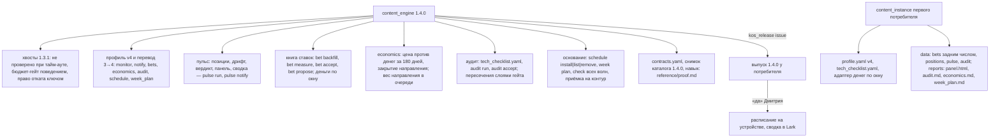
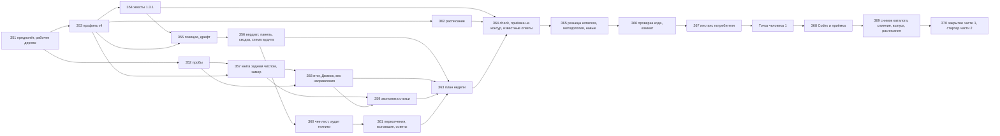

# План — Контент-машина, волна 3, часть 1 (пульс, замер ставки, аудит, основание; выпуск 1.4.0)

Сделан из: [Спецификация — Контент-машина, десять систем](<Спецификация — Контент-машина, десять систем (границы, волны 2 и 3).md>)
(принята Дмитрием 26.10.2026; требования Т34–Т43, критерии П50–П62, решения Р11–Р21, раздел 11а) и шаг 5
[дорожной карты](<План — Контент-машина, дорожная карта (все волны до готовой машины).md>) — стартер волны 3 с решением
Дмитрия 27.10.2026 «строим сейчас, данные замеров не ждём». Каркас модулей —
[Карта Контент-машины](<Справочник — Карта Контент-машины (контуры, связи, ритм).md>) (контур Д и основание). Правила
контракта операций — [методология каталога](<Методология — Контент-машина, каталог операций (для навыка и сервера MCP).md>)
и раздел «Ход исполнения» [плана навыка](<План — Контент-машина, навык content-engine (маршрут работы, навык, готовность к серверу MCP).md>).
Устройство пакета — [ADR-0006](<../../_Движок/0 — System Docs/ADR-log/0006-content-engine-no-llm-calls-stack-adapters-in-instance.md>).
Код — пакет `content_engine` 1.3.1 (метка `content_engine-v1.3.1`), прочитан 27.10.2026. Данные первого потребителя —
только чтение его выпуском 1.3.1: `status` (код 0) и `spend report`.

**Статус:** принят Дмитрием 27.10.2026 («ок»): ответы по умолчанию на Д13–Д18; исполнение — в этом чате.

**Режим** — один проход: исполняет один агент (Opus) в этом чате после «исполняй здесь». Субагенты — по одному за
раз, не больше четырёх на задачу (предел — пять): проверка плана (вторая итерация — продолжением через
`SendMessage`), проверка кода (З66), приёмка (З68) и, только если скрипт пересечений найдёт новые спорные фразы,
судья включения навыка (З65). В промптах — «субагентов не запускай». Вторая модель (Codex, навык `second-agent`) — не субагент:
проверка кода и контрактов в З68. Если контекст сессии кончится — новая сессия по стартеру из «Хода исполнения» с
номера следующей задачи.

**Обозначения.** Задачи — **З51–З70**: номера продолжают планы волны 2. Требования (Т), критерии (П), решения (Р) — из
спецификации, номера те же. Вопросы Дмитрию — **Д13–Д18** (Д7–Д12 — у части 2 волны 2; модули контура Д пишутся
«модуль Д1»). Спецификация главнее плана: при расхождении исполнитель останавливается и пишет, в чём расхождение.
Отход от плана — в раздел «Ход исполнения и отходы от плана» в тот же день.

## Замысел

### Происхождение

Машина производства и выпуска готова: 1.2.0–1.3.1 вышли 26–27.10.2026. Статья проходит путь от спроса до «доехало»
командами, с навыком `content-engine` из любого чата и контрактом каждой операции в коде. Машина пока не отвечает на
главный вопрос карты: «какие ставки сыграли в деньгах и куда ставить дальше». Никто каждый день не видит, жив ли сайт
и выпуск; съехавший canonical заметят по просевшему трафику; книга ставок у первого потребителя содержит одну статью
без гипотезы, а статьи блога выходят с лета.

Дмитрий 27.10.2026: волну 3 строим сейчас, до логического завершения машины, не дожидаясь замеров. Модули
доказательства работают на тех данных, что есть, и пишут «нет данных» с датой окна, где окно замера не наступило.
Оценка результатов — отдельной работой после выпуска.

Что выяснила разведка до плана (27.10.2026):
- **Объём.** Волна 3 по спецификации — Т34–Т43 и обязательные пункты стартера. Расписано по задачам — 32 задачи;
  правило стартера «больше 20 — разбей выпуск» сработало. Деление — вопрос Д13 с ответом по умолчанию.
- **Денег по окну от дня выкладки нет.** Лесенка ценности (`adapters/value.py`) читает файл «страница → деньги за
  последние N дней» одной строкой на страницу. У первого потребителя его строит скрипт инстанса из выгрузки по
  странице входа за последние N дней. Для замера на 90-й и 180-й день нужна сумма за окно «день выкладки → +90» —
  новый источник с периодом на строку (Д16, проба З52).
- **Статей со ставкой нет.** Машиной выпущена одна статья, замер — 25.01.2027; корпус блога — сотни страниц с лета.
  Чтобы доказательство работало сейчас, старые статьи входят в книгу ставок задним числом: день выкладки
  восстанавливается из первого показа в Search Console с пометкой источника, итог без ставки — «ставки нет», деньги
  страницы меряются (Д17).
- **Предложение в Движок роста.** Движок принимает замер только ссылкой на число со своего листа чисел
  (`growth_engine/registry.py`, `_measure`: «нужен measured_id»). Машина пишет файл-предложение — строку числа в
  формате листа и id гипотезы; число и замер заводит Движок своими командами. В реестр Движка машина не пишет.
- **Обязательные хвосты 1.3.1** подтверждены в коде: `proof` у `cluster`, `map build`, `known-answers` ссылается на
  `test_serp_commands_take_budget_flags` — тест разбора флагов, а не поведения; у `publish rollback` поле
  `write.right` — строка «та же ступень, что у записи», хотя код проверяет ключ права у каждого действия
  (`rights.split`); тайм-аут сети в `publish verify` уходит в пункт «код ответа» как провал — «не доехало».
- **Сервер MCP в волну не входит:** решение о нём — шаг 7 дорожной карты, Дмитрий решает в конце. Пункт 4 стартера
  (схема результата, цена объектом, план с правом каждого действия — замечания Codex №1, №3, №15) не применяется;
  новые операции получают контракт по схеме каталога 1, как все.

### Результат (изменение в мире)

Утром у первого потребителя сама собирается панель: вердикт дня — красный, жёлтый или зелёный — по правилам, позиции
своих ключей в Яндексе и Google раздельно, дрифт выложенных страниц против эталона, запас тем в днях, свежесть
аудита и цена статьи; разница со вчера уходит сводкой в мессенджер. По каждой статье блога, выпущенной с лета, в
книге ставок видно: день выкладки и откуда он известен, деньги и заявки страницы за 90 и 180 дней со статусом числа,
итог — «сыграла», «провал», «мало данных», «ставки нет» — или «окно не наступило, замер <дата>». Итог принимает
человек; принятый итог уходит в Движок роста файлом-предложением, а решение Движка по направлению меняет приоритет
очереди и закрывает направление, где статьи есть, а заявок нет. Раз в неделю аудит проверяет весь сайт по
техническому чек-листу проекта и отдаёт только дельту; пересечения живых страниц ищет теми же слоями, что гейт темы.
По понедельникам машина пишет план работ на неделю — 5–8 задач, каждая с числом-основанием. Всё это стоит в
расписании одной командой и работает без человека, не тратя денег. Тайм-аут сайта больше не выдаётся за «не
доехало».

**Чего этот выпуск честно не даёт сразу.** Итогов «сыграла / провал» в первые месяцы почти не будет: у статей с лета
нет ставок (итог — «ставки нет», меряются только деньги страницы), у новых статей окно 90 дней не наступило. Книга
задним числом — это замер денег страниц, а не вердикт ставкам, и отчёт так и подписывает. Вес и закрытие направления
заработают, когда Движок роста вынесет решения `scale` или `kill` по гипотезам направлений и карточки будут
выгружены свежими. Машина к этому готова; данные придут со временем — оценка результатов отдельной работой. Любой другой проект получает то же переводом профиля на версию 4; без источника машина пишет «не
подключено», а не ноль.

### Что уже решено

- Объём — раздел 7 спецификации (Т34–Т43), критерии П50–П62; стартер шага 5 дорожной карты и его обязательные пункты.
- Пакет моделей не вызывает (Р11, ADR-0006): советы аудита и разбор слабых страниц — задание роли `cheap` файлом.
- Позиции — из консолей (Р16); Keys.so и Topvisor — опции с согласия Дмитрия (В15).
- Пересечение одно на машину: аудит берёт слои гейта темы (Р18).
- Запись вовне — ступенями, план без `--apply`, снимок «до», подтверждение (Р14, Т16). Новые записи вовне этой части:
  сводка в мессенджер (`notify.allow`) и расписание (`schedule.allow`).
- Каждый выпуск, который добавляет поля, поднимает версию профиля (Т15.1): 1.4.0 — версия 4.
- Тяжёлых локальных установок нет; новых обязательных зависимостей нет.
- Данные первого потребителя в канон не попадают: в пакете синтетика, в документах — уроки словами.
- Модели ролей — псевдонимы «-latest» (память `content-engine-models-not-pinned`).

## Цель и критерии готовности

Готово, когда выполнены П50–П54, П58, П59, П61, П62 и обязательные пункты О1–О4 ниже, и в разделе «Проверка» записано,
чем доказан каждый. П55–П57 и П60 — часть 2 (выпуск 1.5.0, приложение), если Дмитрий примет деление (Д13).

| № | Обязательный пункт стартера | Критерий |
|---|---|---|
| О1 | `publish verify`: тайм-аут сети — «не проверено» с повтором | Тест: транспорт бросает тайм-аут на первые два запроса и отвечает на третий — «доехало»; бросает всегда — итог «не проверено», код 3, день выкладки не записан, в журнале выпуска событие `unverified`; известный ответ вида `publish` с итогом «не проверено» — «отложен», не «не совпало» |
| О2 | Каждая новая команда — с контрактом в `contracts.yaml` и тестами из `proof`; снимок каталога 1.4.0; разница с 1.3.1 — в CHANGELOG; навык дополнен путями контура Д | `test_catalog.py` зелёный; `kos_catalog_check.py write` последним изменением кода (З69, шаг 0) дал `Каталог операций/1.4.0.json` и `.md`, разница перенесена в CHANGELOG; у выпуска потребителя `kos_catalog_check.py check` совпадает; в навыке — `reference/proof.md`, описание ≤ 1000 знаков, фразы контура Д проверены (З65) |
| О3 | `proof` у `cluster`, `map build`, `known-answers` — тест поведения бюджет-гейта; право `publish rollback` — ключом профиля | Тесты на каждую из трёх команд: без `--confirm-spend` при отказе Keys.so — код 2, ноль вызовов платного источника (счётчик транспорта); с `--unattended` — ноль при любой цене; с подтверждением — вызов и строка `spend.jsonl`. В контракте `publish rollback` поле `write.right` — список ключей профиля; тест каталога сверяет его с ключами, которые могут запросить действия отката (`core/restore.py`, публикаторы); тест: откат без права — ноль записей, код 1 |
| О4 | Сервер MCP | Не входит в волну (шаг 7); записано в «Замысле» и в стартере следующего шага |

## Откат

- **Канон `D:\Knowledge-OS`:** главная ветка на 27.10.2026 — `4ef5db242bdbfaf8e97021e24dac76e779f798ff` (до коммита
  этого плана); фактический хэш на старте исполнения записывает З51. Вся работа кода — в ветке `content-engine-wave3`
  в рабочем дереве `D:\KOS-content-engine-w3`; главная ветка до З69 не меняется. Откат до З69 — `git worktree remove`
  и удаление ветки; после — `git revert` коммита слияния.
- **Репозиторий первого потребителя** (`C:\Users\redmi\Breezeks-Git\02 — Области\Digital-маркетинг`): хэш читает З51
  через MCP `gitlab-employee` (`gitlab_repo_status`). **Shell `git` в этой папке не запускать.** До З69 в
  `content_instance\` пишутся только новые файлы (`profile.v4.yaml`, `known_answers.part3.yaml`,
  `tech_checklist.yaml`, адаптер денег по окну в `adapters\`) — откат: удалить их. Общие реестры (`bets.json`,
  `queue.json`, `publications.jsonl`) до З69 из рабочего дерева не пишутся: живые проверки — на копии инстанса в папке
  сессии. В З69 перед выпуском — копии `profile.yaml`, `known_answers.yaml`, `data/bets.json` и каталога выпуска
  `content_engine\` в папку сессии; откат — вернуть копии.
- **Записи вовне:** расписание — `schedule remove` снимает только свои задания (проверка чтением); сводка в мессенджер
  не откатывается (сообщение) — поэтому первая отправка только после «да» Дмитрия на план.

## Скан канона (находки)

| Что | Где | Как используем |
|---|---|---|
| Требования, критерии, решения | спецификация, разделы 3.7–3.10, 7, 8, 9 (волна 3), 12 | Источник каждой задачи |
| Модули и ритм контура Д | карта, разделы «Д. Доказательство», «Основание», «Ритм», «Петли» | Правила вердикта, ритм расписания, петли Д2 → Б1, Д3 → А3 |
| Контракт операций | `content_engine/core/contract.py` (`REQUIRED`, `OPTIONAL`, `validate`, `catalog`), `contracts.yaml`, `tests/test_catalog.py` | Контракт каждой новой подкоманды — в той же задаче, что код (О2) |
| Снимок каталога и сверка | `_Движок/Инструменты/kos_catalog_check.py` (`write`, `check`); методология каталога, раздел «Снимки каталога и сверка» | З65, З69 |
| Профиль и перевод | `core/profile.py` (`SCHEMA_VERSION = 3`, схемы и наборы по версиям — урок З35 части 2: общие разделы разводятся по версиям), `core/migrate.py` (`STEPS`, перевод на одну версию за запуск, проверка схемой версии шага) | Версия 4 и шаг `3 → 4` (З53) |
| Ценность страницы | `adapters/value.py` (лесенка, `Number`), `core/number.py` (статусы факт / оценка / proxy / нет данных) | Деньги по окну — тем же `Number` и той же лесенкой (З57) |
| Книга ставок и журнал выпуска | `core/bets.py` (`WINDOWS`, `add`, `bet_missing`), `core/publications.py` (`read`, `log`, `published`, `last_publication_day`), `steps/records.py` | Замер, итог, книга задним числом (З57, З58) |
| Эталонный снимок страницы | `core/snapshots.py` (`save_live`), `steps/verify.py` (`check_page`, снимок после «доехало») | Дрифт (З55) |
| Консоли | `adapters/gsc.py` (`fetch_pages`, `first_day`), `adapters/webmaster.py` (запросы сайта целиком — разреза «страница × запрос» нет), `adapters/gsc_inspect.py` (проверка адреса, чтение) | Позиции (З55), день выкладки задним числом (З57), выпавшие (З61) |
| Слои анти-дублей | `steps/dedup.py`, `steps/gate_topic.py` | Пересечения живых — тем же кодом (З61, Р18) |
| Гейт статьи, разбор HTML | `steps/gate_article.py`, `core/htmldoc.py`, `adapters/page_fetch.py` | Экспертность, директивы, техника аудита (З60) |
| Ставка из гипотезы | `adapters/growth.py` (карточка `file` и хранилище Markdown, статус гипотезы, свежесть 30 дней) | Решение Движка → вес направления (З58) |
| Формат Движка роста | `_Движок/Пакеты/growth_engine/growth_engine/registry.py` (`measure` — только ссылкой `measured_id` на число листа), `numbers_sheet.py` | Формат файла-предложения (З52, З58) |
| Запись вовне | `core/actions.py`, `core/rights.py` (`split`, `require`), `core/snapshots.py`, `core/locks.py`, `adapters/write_client.py` | Сводка в мессенджер, расписание (З56, З62) |
| Бюджет-гейт и расход | `core/budget.py` (`gate`, `paid_call`, `add_flags`), `core/spend.py`, `steps/spend_cmd` | О3; цена статьи в панели и экономике (З56, З59) |
| Самопроверка и состояние | `steps/check.py` (`run_check`, `wave2_items`, `part2_items`), `steps/status_cmd.py` | Пункты всех волн и приёмка на контур (З64) |
| Известные ответы | `steps/known_answers.py` (виды `gate`, `pair`, `publish`, `refuse` и части 2) | Виды волны 3 (З64) |
| Навык | `_Движок/Исходники скиллов/content-engine/` (`SKILL.md`, `reference/*.md`, `scripts/trigger_overlap.py`) | Пути контура Д (З65) |
| Выпуск | `_Движок/Инструменты/kos_release.py` (`issue --package --into`, `check`); `_Движок/Сценарии/Плейбук — Система с кодом- версия, выпуск, новый пакет.md`, разделы 2–3 | З69 |
| Приёмка и второе мнение | навыки `maker-checker`, `second-agent` | З66, З68 |
| Уведомления | MCP Lark есть, но пакет MCP не вызывает: сводка — адаптером вебхука бота (адрес — по имени переменной) | З56, Д14 |
| Деньги страниц у первого потребителя | `…\Скрипты\content_instance\scripts\build_page_money.py` (выгрузка по странице входа за последние N дней, решение Дмитрия 25.10.2026) | Адаптер денег по окну в инстансе (З52, З67, Д16) |

Готовых реализаций пульса, аудита, расписания и замера ставки в каноне нет (поиск по `_Движок/Пакеты/`, `Методологии/`,
`Экосистема инструментов/_manifest.md` — 27.10.2026).

## Карта воздействия

- **Прямое:** пакет `content_engine` (рабочее дерево): профиль версии 4 и шаг перевода; новые модули
  `steps/pulse.py`, `steps/bets_cmd.py`, `steps/economics.py`, `steps/audit.py`, `steps/schedule.py`,
  `steps/week_plan.py`, `adapters/money_windows.py`, `adapters/notify.py`, `schedulers/` (`base.py`, `windows.py`,
  `cron.py`), `core/positions.py`, `core/drift.py`, `core/verdict.py`, `core/audit_store.py`, `templates/panel.html`,
  `templates/tech_checklist.yaml`; правки `steps/verify.py`, `steps/publish.py` (контракт отката), `steps/queue.py` и
  `steps/gate_topic.py` (вес и закрытие направления), `steps/check.py`, `steps/status_cmd.py`,
  `steps/known_answers.py`, `core/bets.py`, `contracts.yaml`, `cli.py`, тесты. У первого потребителя — новые файлы в
  `content_instance\`; в З69 — `profile.yaml`, `known_answers.yaml`, `data/bets.json` (книга задним числом) и каталог
  выпуска.
- **Косвенное:** методология каталога и снимок `Каталог операций/1.4.0`; навык `content-engine`; дорожная карта, карта
  (признаки работы контура Д — без изменений смысла), спецификация — статус; `_Движок/Пакеты/_manifest.md`;
  CHANGELOG; «Справочник — Карта Knowledge-OS» (выпуск 1.4.0).
- **Вверх:** Search Console и Вебмастер — чтение, бесплатно; проверка адреса Search Console — суточная квота (Д18);
  Keys.so — без новых трат (позиции не из него, Р16); источник денег по окну — инстанс; Движок роста — только чтение
  статуса гипотезы; планировщик Windows и cron — запись по `schedule.allow`; мессенджер — запись по `notify.allow`.
- **Вниз:** чат контента первого потребителя каждый день работает выпуском 1.3.1 на тех же реестрах. Поэтому до З69
  профиль версии 4 — отдельным файлом `profile.v4.yaml`, известные ответы — `known_answers.part3.yaml`; новые поля
  книги ставок и журнала выпуска — только добавлением, версия реестров `store.SCHEMA_VERSION = 1` не меняется; после
  записи на копии выпуск 1.3.1 должен читать реестры (З67). Навык `content-engine` ссылкой стоит у всех чатов
  устройства — правка навыка вступает сразу, поэтому в навыке пути контура Д помечаются «с выпуска 1.4.0» (навык
  сверяет версию выпуска, раздел 1).
- **Синхронизация:** `D:\Knowledge-OS\TASKS.md` (раздел «Контент-машина», подраздел «Волна 3»); CHANGELOG и манифесты;
  дорожная карта (шаг 5 — ход, таблица «Деньги»: замер ставки, экономика статьи, закрытие направления, вес направления);
  журнал действий первого потребителя; поручение чату контента; база инцидентов — при сбое.
- **Не задевает:** `growth_engine` и Ядро данных (только чтение формата и статуса), старые скрипты первого
  потребителя (вызываются адаптером инстанса, не правятся), MCP-серверы.

## Границы исполнения

- **В работе:** рабочее дерево `D:\KOS-content-engine-w3` (ветка `content-engine-wave3`): `_Движок\Пакеты\content_engine\`,
  `Методологии\Контент-машина\` (план, снимок каталога, методология), `_Движок\Исходники скиллов\content-engine\`
  (через рабочее дерево; ссылка в `~/.claude/skills` указывает на главную ветку — навык меняется у всех после
  слияния); `D:\Knowledge-OS\TASKS.md` (вне git); у первого потребителя — `…\Скрипты\content_instance\` (новые файлы до
  З69), `…\Скрипты\content_engine\` (только З69, через `kos_release.py`), строки журнала действий
  `C:\Users\redmi\Breezeks-Git\00 — Мета\Журнал действий\<год-месяц>.md`.
- **Вне работы:** главная ветка канона до З69; чужие незакоммиченные файлы канона (`Экосистема инструментов/…`,
  `keysso_out/`); `growth_engine`, `datacore`; любые другие файлы первого потребителя.
- **Установка пакета на устройстве не переключается** (её используют все чаты): тесты и команды рабочего дерева — `py
  -3 -m pytest` и `py -3 -m content_engine` из папки пакета рабочего дерева; проверка — `py -3 -c "import
  content_engine as c; print(c.__file__)"` из этой папки показывает рабочее дерево.
- **Коммиты** — в ветку после З66 и после З67; слияние, метка и `pip install -e` из главной — З69; push канона — по
  паспорту `D:\Knowledge-OS\CLAUDE.md` (после блока, со сканом добавленных строк, `--follow-tags`).
- **GitLab компании** — публикация выпуска через MCP `gitlab-employee` в З69 (как Н4 навыка, разрешение Дмитрия
  27.10.2026), со сканом публикуемого на секреты и персональные данные.
- **Платные вызовы:** ноль. Позиции — из консолей; запасной платный источник выдачи в тестах — подменённый транспорт.
- **Запись вовне на устройстве и в мессенджер** — только в З69 после «да» Дмитрия на напечатанный план.

## Вопросы Дмитрию при приёмке плана

Порядок — по тому, насколько ответ меняет работу. Ни один не держит код: тесты — на синтетике.

| № | Вопрос | По умолчанию | Держит |
|---|---|---|---|
| Д13 | Как делить волну 3 на выпуски (в плане 32 задачи, правило — больше 20 делить) | **1.4.0** — пульс и панель (модуль Д1), замер ставки с деньгами, экономика статьи и решение по итогам (Д2, Б1), аудит недели (Д3), основание (расписание, план недели, приёмка на контур, технический чек-лист) и обязательные пункты О1–О4 — это и есть результат шага 5 в дорожной карте. **1.5.0** — дожим (Д4), ИИ-видимость (Д5), поведение (Д6, опция), заморозка по динамике (А3), разведка конкурентов и «поле шире» (А4); план — приложение, исполнение — сразу после 1.4.0 в этом же чате | Состав выпуска |
| Д14 | Куда слать сводку пульса | Lark — бот группы через вебхук, адрес по имени переменной `NOTIFY_LARK_WEBHOOK` в файле секретов; до ответа и до «да» на первую отправку — только панель файлом, сводка «не подключено» | Живая часть П51 по сводке |
| Д15 | Ставить ли расписание на это устройство после выпуска и что в нём | Да: планировщик Windows, режим «по включению» (пропущенный запуск — один раз при включении); ежедневно 09:00 — пульс и замер ставок, по понедельникам — аудит и план недели; всё с `--unattended`, денег ноль. **Сбор спроса и пополнение очереди по расписанию — не ставить** до части 2: они пишут общую очередь и карту спроса параллельно с чатом контента и тратят суточную квоту Keys.so (общую на аккаунт); чат контента запускает их сам. Ставится в З69 после «да» на напечатанный план | Живые части П51, П61 |
| Д16 | Деньги страницы за окно «день выкладки → +90/+180» у первого потребителя | Адаптер инстанса поверх той же выгрузки по странице входа (решение 25.10.2026) — с датами окна, если выгрузка их умеет (проба З52); не умеет — итог «мало данных» с причиной, пока выгрузка не научится | Живая часть П58 |
| Д17 | Книга ставок задним числом для статей блога с лета | Да: каждая статья корпуса получает запись с днём выкладки из первого показа в Search Console (пометка «восстановлен: gsc»), без ставки — итог «ставки нет», деньги за окна меряются; по статьям моложе 90 дней — «окно не наступило, замер <дата>» | Живая часть П58, «Деньги» дорожной карты |
| Д18 | Аудит проверяет выпавшие из индекса адреса через проверку адреса Search Console (бесплатно, суточная квота сервиса) | Да, не больше 50 адресов за аудит — изменившиеся за неделю и ставки на замере | Живая часть П54 |

## Структура результата

## Граф зависимостей

Порядок в одном проходе: З51 → З52 → З53 → З54 → З55 → З56 → З57 → З58 → З59 → З60 → З61 → З62 → З63 → З64 →
З65 → З66 → З67 → точка человека 1 → З68 → З69 → З70.

## Задачи

**Общее для задач кода.** Python ≥ 3.12. Пакет — `D:\KOS-content-engine-w3\_Движок\Пакеты\content_engine\`, каталог
кода — `…\content_engine\content_engine\`. Тесты — из папки пакета: `py -3 -m pytest content_engine/tests`; после
каждой задачи весь набор зелёный, число тестов — в TASKS (точка отсчёта — число З51). UTF-8, переводы строк LF
(инструмент правки или Python с `newline=''`); вывод в консоль — `PYTHONIOENCODING=utf-8`. Стиль — как в коде волны
2: модуль начинается строкой назначения и требованием (Т…); подкоманда — функцией `register(sub)` и именем модуля в
`STEPS` в `cli.py`; реестр — через `core/store.py` со сверкой «записано N — прочитано N»; число — `Number` со статусом,
периодом, источником и датой съёма; задание агенту — `core/tasks.write_task`; платный вызов — `core/budget.paid_call`;
запись вовне — действием `core/actions.py` с правом `core/rights`, снимком «до» и подтверждением. Коды выхода — как в
`cli.py`: 0 — успех, 1 — найдена проблема или отказ запрета в коде, 2 — «спорно» или бюджет-гейт без «да», 3 — ошибка
входа, источника или неподтверждённая запись. В коде, тестах и фикстурах — ни имён, ни доменов, ни чисел первого
потребителя: `example.ru`, `shop.example`; тест границы `tests/test_package_boundary.py` зелёный. Сети в тестах нет
(`conftest.py`): транспорт подменяется. Новых `.md` в каталоге кода нет: шаблоны — строки в коде, `.txt`, `.html`,
`.yaml`. **Каждая новая подкоманда — в той же задаче:** контракт в `contracts.yaml` (поля — `core/contract.py`,
`REQUIRED` и `OPTIONAL`; модуль карты; эффекты с условием; `proof` — имена тестов этой задачи) — иначе
`test_catalog.py` красный. После каждой задачи — строка в `D:\Knowledge-OS\TASKS.md`, раздел «Контент-машина»,
подраздел «Волна 3».
**Если контекст сессии кончается:** записать в TASKS сделанное и номер следующей задачи; новая сессия продолжает с
этого номера по этому плану.

### З51 — Предполёт и рабочее дерево

**Файлы контекста:** этот план целиком; спецификация — разделы 3.7–3.10, 7, 8, 9 (волна 3), 12; карта — контур Д,
основание, ритм, петли; дорожная карта; методология каталога; ADR-0006; `D:\Knowledge-OS\CLAUDE.md`; плейбук «Система
с кодом», разделы 2–3; файлы из «Скана канона».
**Шаги:**
1. `git -C "D:\Knowledge-OS" status --short` и `rev-parse HEAD` — хэш в TASKS. Проверить, что план в главной ветке:
   `git -C "D:\Knowledge-OS" log -1 --format=%h -- "Методологии/Контент-машина/План — Контент-машина, волна 3, часть 1 (пульс, замер ставки, аудит, основание; выпуск 1.4.0).md"`;
   пусто — закоммитить план, дорожную карту и манифест контура (только эти пути).
2. Хэш репозитория первого потребителя — MCP `gitlab-employee`, `gitlab_repo_status`; чужие незакоммиченные файлы в
   `content_instance\` — списком в TASKS, не трогать. Последние записи журнала действий потребителя за текущий месяц
   про Контент-машину.
3. `git -C "D:\Knowledge-OS" worktree add "D:\KOS-content-engine-w3" -b content-engine-wave3`; удалить прошлое рабочее
   дерево навыка `D:\KOS-content-engine-skill`, если оно ещё стоит и его ветка слита (`git worktree list`, `git branch
   --merged main`) — находка Н8 навыка.
4. Из папки пакета рабочего дерева: `py -3 -c "import content_engine as c; print(c.__file__, c.__version__)"` —
   рабочее дерево, 1.3.1; `py -3 -m pytest content_engine/tests -q` — число в TASKS (ожидается 487 ± новые тесты
   1.3.1).
5. Ответы Дмитрия на Д13–Д18 — в TASKS (или «по умолчанию»). Если деление выпуска принято (Д13) — правка
   спецификации до кода, иначе по её же правилу исполнитель обязан остановиться: Р20, Т43, П62 — «волна 3: 1.4.0 —
   часть 1 (Т34–Т35, Т39–Т40, Т42, О1–О3), 1.5.0 — часть 2 (Т36–Т38, Т41)», Т15.1 — «1.5.0 — версия 5», раздел 11а —
   строка решения Д13; заодно — раздел 11а, строка В20: Вебмастер отвечает из сети устройства с 26.10.2026 (проба З1
   части 1); коммит этих путей вместе с планом.
**Готово, когда:** в TASKS — оба хэша, рабочее дерево, число тестов, ответы.

### З52 — Пробы до кода (только чтение)

**Шаги:** итоги — в TASKS сразу, словами и именами полей, без данных компании.
1. **Деньги по окну (Д16).** Прочитать у первого потребителя `…\Скрипты\analytics_by_slug.py` (аргументы: есть ли
   дата «с»/«по», кроме `--days`) и `content_instance\scripts\build_page_money.py`. Не запускать. Итог — умеет ли
   выгрузка окно с датами; если нет — какой минимальной правкой в инстансе (новый скрипт рядом, старый не трогать).
2. **Позиции.** Search Console `searchAnalytics/query` с разрезами `page`, `query` и `date` — достаточно ли одного
   запроса на окно 7 дней (ROW_LIMIT, постранично); Вебмастер `search-queries/popular` — позиция запроса сайта
   целиком (разреза по странице нет, проба В4 волны 1). Один запрос каждого вида на инстансе потребителя его ключами
   — только чтение, число строк в TASKS.
3. **Выпавшие из индекса.** Вебмастер `search-urls/in-search/samples` (проба З1 части 1) и `gsc_inspect` —
   суточный предел проверки адреса Search Console по документации (адрес и дата). Запросов не делать.
4. **Движок роста.** `growth_engine/numbers_sheet.py` и `registry.py` — колонки листа чисел (значение, кабинет,
   период, знаменатель, источник, дата съёма, статус) и как оператор заводит число и `measure`; словарь статусов
   (`core/registry.py`, `HStatus`) и решений (`Decision`: `scale`, `iterate`, `kill`, `research`), где команда `close`
   хранит решение и как его прочитать в хранилище Markdown; через MCP `growth_hypothesis` — есть ли решение в
   карточке (только имена полей). Итог — схема файла-предложения и полей `decision`, `decided_at` карточки (З58).
5. **Уведомления.** Есть ли в `C:\Users\redmi\Second Brain Secrets\.env` переменные вебхука Lark или Telegram — только
   **имена** (`grep -o "^[A-Z_]*LARK[A-Z_]*=" …`), значения не печатать. Формат вебхука бота Lark (документация:
   адрес, тело, ответ `{"code":0}`).
6. **Планировщик.** `schtasks /Query /FO CSV /NH` — есть ли задания с префиксом `KOS-content-engine` (ожидается нет);
   `schtasks /Create /XML` поддерживает `StartWhenAvailable` (запуск пропущенного при включении) — по документации.
7. **Корпус и день выкладки задним числом.** Сколько страниц корпуса потребителя с датой в шапке и сколько без неё
   (`content_instance` — корпус по профилю, только чтение); `gsc.first_day` — один вызов на одну старую статью.
**Готово, когда:** по каждой пробе — итог и что он меняет в З55–З62.

### З53 — Профиль версии 4 и перевод `3 → 4` (Т15.1, Т43.1)

**Файлы:** `core/profile.py`, `core/migrate.py`, `templates/profile.template.yaml` (текущий — заморозить копией
`profile.template.v3.yaml` до правки), `tests/fixtures/profile_v3.yaml`, `tests/test_profile_v4.py`, `tests/conftest.py`.
**Шаги:**
1. `SCHEMA_VERSION = 4`; текущая схема — `SCHEMA_V3` (только для перевода); наборы по версии — как в З35 части 2:
   общие разделы, которые меняются (`publish`, `directions`), разводятся по версиям, версия 4 строится заменой. Тест:
   фикстура версии 3 проходит `validate(…, 3)` и после правок.
2. Новые разделы и поля (имена — рабочие; уточнение — в «Ход исполнения»). Значение каждого поля — в шаблоне с
   комментарием; молчаливых значений нет.

| Раздел | Поля и значение в шаблоне | Т |
|---|---|---|
| `publish` | плюс `verify_retries: 2`, `verify_retry_seconds: 20` | О1 |
| `monitor` (новый) | `positions: consoles` (`consoles`, `none`, `module:…`), `keys: demand_map` (целевые ключи страниц из карты спроса), `drop: 5`, `tops: [10, 30]`, `silence_intervals: 2`, `stock_yellow_days: 3`, `audit_stale_days: 30`, `drift_shrink: 0.33`, `index_days_alarm: 14` | Т34 |
| `notify` (новый) | `allow: files` (`files`, `write`), `kind: none` (`none`, `lark_webhook`, `telegram`, `module:…`), `url_env: ""`, `chat_env: ""` | Т34.5 |
| `bets` (новый) | `money: {kind: none, file: ""}` (`none`, `file` — CSV с периодом на строку, `module:…`), `min_step: 2` (ступени лесенки 1–2 считаются данными; 3–4 — «мало данных»), `proposal_dir: data/proposals`, `backfill_section: ""` (раздел сайта статей для книги задним числом; пусто — все страницы корпуса) | Т39 |
| `economics` (новый) | `close_min_articles: 3`, `close_window: 90`, `close_leads_max: 0` | Т40 |
| `directions[]` | плюс необязательный `hypothesis_id: ""` — гипотеза направления в Движке роста | Т39.3, Б1 |
| `audit` (новый) | `checklist: tech_checklist.yaml`, `false_alarm: {rate: -1, as_of: "", source: ""}` (последний замер доли ложных тревог гейта; `-1` — не замерено, задач на склейку нет), `false_alarm_max: 0.20`, `neighbours: 5`, `inspect_limit: 50`, `speed: none`, `delay_seconds: 1` (пауза между загрузками страниц своего сайта) | Т35 |
| `schedule` (новый) | `allow: files` (`files`, `write`), `kind: windows` (`windows`, `cron`, `module:…`), `python: "py -3"`, `on_boot: true`, `jobs:` — список `{name, command, every: day|week, at: "09:00", weekday: ""}`; **в З53 шаблон — `jobs: []`**: команд контура Д ещё нет, а проверка профиля требует существующую команду с `--unattended`. Задания шаблона дописывает З64, когда все команды есть: ежедневно `pulse` — `pulse run`, `measure` — `bet measure`; по понедельникам (`weekday: mon`) `audit` — `audit run`, `week` — `week plan`. Сбор спроса и пополнение очереди по расписанию в части 1 не ставятся (Д15): они пишут общие `queue.json` и карту спроса параллельно с чатом контента и тратят суточную квоту Keys.so | Т42.1 |
| `week_plan` (новый) | `min: 5`, `max: 8` | Т42.3 |

3. Проверки смысла `_semantics_v4`: адаптеры `module:` — через `_adapter`; `notify.kind ≠ none` без `url_env` — ошибка;
   `bets.money.kind: file` без `file` — ошибка; доли — от 0 до 1; `schedule.jobs[].command` — существующая подкоманда
   из `cli.build_parser()` (обход листьев `core/contract.leaves`) **и у неё есть флаг `--unattended`** (иначе задание
   расписания встанет на коде 2 — находка проверки плана); `every: week` с пустым `weekday` — ошибка.
4. **Все поля схемы обязательны** (`core/profile.py`, `_walk_section`: нет поля — «пропущено обязательное поле»,
   лишнее — «неизвестное поле»). Поэтому необязательных полей не вводится: `directions[].hypothesis_id` и
   `schedule.jobs[].weekday` — обязательные со значением `""` (пусто — «нет»); перевод вставляет `hypothesis_id: ""`
   в каждый элемент `directions` (вставка в элементы списка — механизм `item_fields` шага перевода, как
   `directions[].volume` в шаге `1 → 2`; если его нет — дописать с тестом на два направления с комментариями).
5. `ALLOW_BY_VERSION[4]` и общий словарь областей `ALLOW` (`core/profile.py`) — плюс `notify: ("files", "write")` и `schedule: ("files", "write")`: иначе
   `core/rights.level` даёт «неизвестная область прав».
6. `core/migrate.py`: `STEPS[3] = Step(to=4, sections=("monitor", "notify", "bets", "economics", "audit", "schedule",
   "week_plan"), fields=(("publish", "verify_retries"), ("publish", "verify_retry_seconds")), item_fields: в каждый элемент
   `directions` — `hypothesis_id: ""`)`.
**Готово, когда:** профиль версии 3 в `queue status` — ошибка с названием `profile migrate`; `migrate` без `--apply`
не меняет файл; с `--apply` — «записано — прочитано», `profile check` зелёный; версия 1 доходит до 4 тремя запусками;
фикстура версии 3 с комментариями переводится без потерь; весь набор зелёный.

### З54 — Хвосты 1.3.1: «не проверено» при тайм-ауте, бюджет-гейт поведением, право отката ключом (О1, О3)

**Файлы:** `steps/verify.py`, `adapters/page_fetch.py`, `core/errors.py`, `steps/known_answers.py`,
`contracts.yaml` (`publish verify`, `cluster`, `map build`, `known-answers`, `publish rollback`),
`tests/test_verify_unverified.py`, `tests/test_budget_behaviour.py`, `tests/test_catalog.py`.
**Шаги:**
1. `page_fetch.get`: сетевой сбой (`requests.exceptions.Timeout`, `ConnectionError`) — новая ошибка `NetworkUnreachable`
   (наследник `SourceError`, код 3), остальное — как было.
2. `verify.check_page`: `NetworkUnreachable` — повтор до `publish.verify_retries` раз (профиль v4, шаблон 2) с паузой
   `publish.verify_retry_seconds` (шаблон 20; в тестах — подменённый `sleep`). Не ответил ни разу — итог **«не
   проверено»** (третье значение рядом с `ARRIVED`, `NOT_ARRIVED`): день выкладки не пишется, записи дня выкладки не
   делаются, снимок не снимается, в журнал выпуска — событие `unverified` с причиной; печать «не проверено: сеть не
   отвечает (<тип>) — повторите `publish verify <id>` позже»; код 3. HTTP-ответ с кодом ≠ 200 — по-прежнему «не
   доехало».
3. `known_answers`: случай вида `publish` с итогом «не проверено» — «отложен: сеть» (в счёт «совпало M из M» не
   входит, печатается отдельной строкой), а не «не совпало».
4. Бюджет-гейт поведением: тест на каждую из `cluster`, `map build`, `known-answers` (параметризованный, через
   `main([...])` с инстансом из `conftest`): Keys.so отвечает отказом, запасной источник Yandex Search с ценой > 0 —
   (а) без `--confirm-spend`: код 2, счётчик вызовов запасного источника 0; (б) `--unattended` с подтверждением: ноль
   вызовов; (в) `--confirm-spend <цена>`: вызов и строка в `spend.jsonl`. Имена тестов — в `proof` трёх контрактов
   вместо `test_serp_commands_take_budget_flags` (тест разбора флагов остаётся, но не доказательство). Тем же
   поиском (`grep -n "test_serp_commands_take_budget_flags" contracts.yaml`) найти другие операции, которые называют
   этот тест доказательством (`gate topic`, `queue build`, `queue refill` и др.), — для них тот же поведенческий
   тест. Тест каталога: ни одна операция с `paid_external_call` не называет в `proof` только тест разбора флагов.
5. Право отката ключом: в контракте `publish rollback` поле `write.right` — список строк того же формата, что у
   записи в других контрактах, «<ключ профиля> = <ступень>»: `[publish.allow = commit, publish.allow = publish,
   paths.allow = write, images.allow = write, records.allow = write]` (ступень — как у действия, которое откатывается). Тест каталога: множество
   ключей в `write.right` отката = множество `action.right[0]`, которые могут вернуть `core/restore.actions` и
   `publishers/*.restore` (перечислить по видам снимков в коде). Поведенческий тест: снимок передачи статьи есть,
   `paths.allow: files` — откат с `--apply` печатает «не в плане — нужно разрешение paths.allow», код 1, файлы на месте.
   Добавить проверку в `contract.validate`: `write.right` — строка или список, каждый элемент начинается с известного
   ключа права (`core/rights` — перечень областей).
**Готово, когда:** О1 и О3 доказаны тестами; весь набор зелёный.

### З55 — Позиции и дрифт (модуль Д1, Т34.1–Т34.2)

**Файлы:** `core/positions.py`, `core/drift.py`, `steps/pulse.py` (каркас), тесты `tests/test_pulse_positions.py`,
`tests/test_drift.py`.
**Шаги:**
1. `core/positions.py`: снимок позиций дня — ключи из карты спроса (`monitor.keys: demand_map` — целевые ключи страниц
   со статусом «закрыт страницей» и записи выпуска), Яндекс — Вебмастер (позиция запроса сайта), Google — Search
   Console (`page × query`, позиция страницы по запросу); окно — 7 дней по `as_of` консоли; строка в
   `data/positions.jsonl`: дата, поисковик, запрос, страница (если известна), позиция `Number` (факт, период, источник).
   Нет доступа к консоли — блок «не подключено» с подсказкой из `check`, а не ноль.
2. Тревоги против прошлого снимка: падение на `monitor.drop` и больше; вход в топ-10/топ-30 и выход из них
   (`monitor.tops`). Первый снимок — тревог нет, «база снята».
3. `core/drift.py`: для каждой страницы с эталоном `data/snapshots/live/<slug>.json` (Т22.6) — загрузка `page_fetch`
   (белый список — свои домены), сравнение. Критично: код ≠ 200, `noindex`, canonical сменился или пропал, H1 пропал,
   разметка не читается, перенаправление. Важно: title, description или H1 переписаны, пропала картинка для соцсетей,
   текст короче эталона больше чем на `monitor.drift_shrink`. Сеть не отвечает — «не проверено» (как О1), не критично.
4. Страницы без эталона (старые статьи) — эталон снимается при первом пульсе с пометкой «эталон снят пульсом
   <дата>», дрифт для них — со второго дня.
**Готово, когда:** П50 частично: тесты — падение на 5 позиций — тревога, на 4 — нет; вход и выход из топ-10; сменился
canonical — критично; текст ужался на 40 % — важно, на 20 % — нет; консоль недоступна — «не подключено»; тайм-аут —
«не проверено».

### З56 — Вердикт дня, панель, сводка (модуль Д1, Т34.3–Т34.5)

**Файлы:** `core/verdict.py`, `core/audit_store.py`, `steps/pulse.py`, `templates/panel.html`, `adapters/notify.py`,
`contracts.yaml` (`pulse run`, `pulse notify`), тесты `tests/test_verdict.py`, `tests/test_panel.py`,
`tests/test_notify.py`.
**Шаги:**
0. `core/audit_store.py` — схема снимка аудита, которую вердикт читает здесь, а пишет З60: `data/audit/<дата>.json` =
   `{"schema_version": 1, "kind": "audit", "date", "scope": "full|changed", "findings": [{"id", "url", "check",
   "level": "critical|high|medium|low", "detail", "first_seen"}]}`; `latest(instance)` и `write(instance, …)` со сверкой
   «записано — прочитано». Тест вердикта — на фикстуре снимка этой схемы.
1. `core/verdict.py` — правила по порядку, первое сработавшее (Т34.3): сайт не отвечает (главная и последняя статья —
   код ≠ 200 или сеть) → красный; публикаций нет дольше `silence_intervals` интервалов ритма (интервал = 1 /
   `queue.per_day` дней; при ритме раз в два дня два пустых дня — не красный; в спецификации поле названо
   `monitor.silence` — уточнение имени записать в «Ход исполнения») → красный; критичный дрифт или критичные находки последнего
   аудита → красный; запас < `stock_yellow_days` дней → жёлтый; аудит старше `audit_stale_days` или аудита нет →
   жёлтый; иначе зелёный. Каждое правило возвращает причину и задание агенту («что сделать»: команда и файл).
2. `content-engine pulse run --profile [--unattended] [--no-network]`: позиции и дрифт (З55), запас (`queue.status` с
   освобождением броней — как у всех команд с профилем), публикации против плана за 7 дней (журнал выпуска против
   ритма), трафик Яндекса и Google раздельно за 7 дней (консоли), свежесть аудита (`data/audit/` последний),
   индексация новых адресов (`index status` из журнала: не в индексе к `index_days_alarm` дню — замечание), цена
   статьи за 30 дней (`spend report`, неполная — с «нет данных»), ближайшие замеры книги ставок (по существующему
   полю дат `measure` записи, `core/bets.py`; итоги замеров `measures` из З57 панель показывает, если они есть). Упавший источник не
   мешает остальным блокам. Пишет `data/pulse/<дата>.json` и `reports/<дата>/panel.html` (витрина без кнопок, задания
   — текстом рядом с проблемой). Разница со вчера — по прошлому `data/pulse/*.json`. Код 0 — собрано (вердикт любой);
   3 — профиль или реестры не читаются.
3. `adapters/notify.py`: протокол `Notifier.send(text) → ответ`; встроенные `lark_webhook` (POST JSON на адрес из
   переменной `notify.url_env`, подтверждение — `{"code": 0}` в ответе) и `telegram` (Bot API `sendMessage`, токен и
   чат по именам переменных, подтверждение — `ok: true`); `module:` — адаптер инстанса. Белый список хостов клиента
   записи — хост адреса из переменной.
4. `content-engine pulse notify --profile [--apply]`: текст — только разница со вчера и что сделать (из последнего
   `data/pulse/`); без `--apply` — план (куда, текст); с `--apply` — право `notify.allow: write`, отправка действием
   `core/actions.py` (снимок «до» — «сообщение не отправлялось сегодня», подтверждение — код ответа), «записано 1 —
   подтверждено 1»; повтор в тот же день — ноль отправок. Ступень `files` — отказ «нужно разрешение notify.allow».
**Готово, когда:** П50 (вердикт), П51 тестами: каждое правило на своей фикстуре; правило тишины от ритма; источник без
данных — «не подключено», не ноль; упавший источник не мешает блокам; цена статьи — из учёта расхода; сводка без
`notify.allow` или без `--apply` не отправлена (счётчик записей клиента 0); с правом и `--apply` — подтверждена кодом.

### З57 — Книга ставок задним числом и замер ставки (модуль Д2, Т39.1–Т39.2)

**Файлы:** `adapters/money_windows.py`, `core/bets.py`, `steps/bets_cmd.py`, `contracts.yaml` (`bet backfill`,
`bet measure`), тесты `tests/test_bet_backfill.py`, `tests/test_bet_measure.py`.
**Шаги:**
1. `adapters/money_windows.py` — деньги и заявки страницы за окно: `kind: file` — CSV `slug;money;leads;period_from;
   period_to;source;as_of` (несколько строк на страницу — разные окна); `money(slug, period_from, period_to) → {"money":
   Number, "leads": Number | None, "step": 1–4}` — та же лесенка Т4.4, что `adapters/value.py`: строка с точным окном
   и деньгами — ступень 1 (факт); с заявками без денег — ступень 2 (заявки × `sources.value.average_check`, оценка);
   нет строки — ступень 3 (proxy, цена трафика Keys.so из кэша карты, без запросов) или 4 («нет данных»). **Ноль —
   только из строки:** страницы нет в файле — «нет данных», а не 0 (иначе неполная выгрузка даёт ложный «провал»).
   `module:` — адаптер инстанса по тому же протоколу. `none` — «не подключено».
2. `content-engine bet backfill --profile [--since ДАТА] [--apply]`: страницы корпуса (`adapters/corpus.py`; раздел —
   `bets.backfill_section`), которых нет в книге ставок, получают запись. **Ключ сверки — нормализованный адрес**
   (`core/urls.norm_url`): запись машины (по теме) и запись задним числом с тем же адресом — одна страница, второй не
   заводится; id записи задним числом — `C:<slug>`, поле `origin: corpus`. **День выкладки:** в корпусе роли даты нет
   (`adapters/corpus.py`, `ROLES = ("id", "slug", "title", "url")`) — добавить роль `date` в `ROLES` (`corpus.fields` — словарь «поле шапки → роль»; проект, у которого дата в шапке
   есть, допишет строку сам, перевод профиля её не вставляет); дата из поля — «из шапки статьи», иначе `gsc.first_day` (пометка «восстановлен: gsc»),
   иначе «не установлен» (такая запись не замеряется). `bet_missing: true`, окна +90/+180. Без `--apply` — план
   (сколько страниц, по каким источникам день); с `--apply` — запись в `data/bets.json` (файл инстанса — ступень
   `files`, право не нужно) под блокировкой `core/locks.held(instance, "bets", "write")`, «записано N — прочитано N».
   Повтор — ноль новых записей. **Все записи в `bets.json`** (backfill, measure, accept, а также `core/bets.add` при
   «доехало») — под той же блокировкой с перечитыванием файла внутри неё: чат контента пишет книгу параллельно.
3. `content-engine bet measure --profile [--id ID] [--as-of ДАТА]`: по каждой записи книги и каждому окну 90 и 180 —
   окно не наступило → «окно не наступило, замер <дата>»; наступило и замера нет → деньги и заявки за окно «день
   выкладки → +N» из `money_windows`; итог (Т39.2): ступень 3–4 (`< bets.min_step`) или «нет данных» → «мало
   данных»; ставки нет → «ставки нет» (деньги записаны); иначе — сравнение в единице ставки: из
   `expectation_numbers` берётся число с единицей `leads` или `rub` (`core/bets`, поле `unit` числа); замер в той же
   единице (заявки или деньги окна) ≥ ожидания → «сыграла»; ≤ порога провала (`fail_threshold` — число в той же
   единице) → «провал»; между порогом и ожиданием → «мало данных» с причиной «между порогом и ожиданием — решает
   человек в `bet accept`»; ожидание только строкой без чисел или единицы не совпадают → «мало данных» с причиной
   «ожидание не числом». У команды — флаг `--unattended` (запуск по расписанию; платных вызовов в ней нет). Числа —
   `Number` с периодом, источником, статусом и датой съёма. Пишет в запись книги поле `measures: {"90": {...}, "180":
   {...}}` (добавлением; старые поля не меняются), итог — `result_proposed` (а `result` — только после принятия).
   Повтор в тот же день — ноль изменений. Отчёт — `reports/<дата>/bets.md`.
**Готово, когда:** П58 тестами: замер считает 90 дней от дня выкладки, а не сборки; proxy — «мало данных»; окно в
будущем — «окно не наступило» с датой; статья без ставки — «ставки нет» и деньги; день «не установлен» — не
замеряется; backfill без `--apply` ничего не пишет (сумма файла до и после), повтор — ноль записей; страница с
записью машины не получает второй записи; страницы нет в файле денег — «нет данных», не 0 и не «провал»; замер между
порогом и ожиданием — «мало данных» с причиной; запись книги при живой блокировке — отказ (код 1), а не потеря
чужой записи.

### З58 — Итог ставки, предложение в Движок роста, вес и закрытие направления (модули Д2, Б1, Т39.3)

**Файлы:** `steps/bets_cmd.py`, `adapters/growth.py`, `steps/queue.py`, `steps/gate_topic.py`, `contracts.yaml`
(`bet accept`, `bet propose`), тесты `tests/test_bet_accept.py`, `tests/test_direction_weight.py`.
**Шаги:**
1. `content-engine bet accept <id> --window 90|180 --who <имя> [--result сыграла|провал|мало данных]`: человек
   принимает предложенный итог или ставит свой с причиной; пишет `result` окна, кто и когда. ✋ — эффект
   `human_approval_required`.
2. `content-engine bet propose --profile [--id ID]`: по принятым итогам со ставкой из гипотезы — файл-предложение в
   `bets.proposal_dir/<дата>-<hypothesis_id>.yaml` в формате листа чисел Движка (схема — итог пробы З52.4: значение,
   кабинет, период, знаменатель, источник, дата съёма, статус; плюс `hypothesis_id`, `window`, `result`, ссылки на
   статьи). Без принятого итога — отказ, код 1. Ни одного вызова к Движку: машина пишет только свой файл; печать —
   «передайте файл в Движок: число → `measure <H> measured_id=…`».
3. Решение Движка → очередь. Словарь Движка (`growth_engine/core/registry.py`): статусы гипотезы `идея … замер,
   вывод, архив` (`HStatus`), **решения** `scale`, `iterate`, `kill`, `research` (`Decision`) — решение записывает
   команда `close` Движка. Карточка, которую читает машина (`adapters/growth.py`, `CARD_REQUIRED`), поля решения не
   несёт — **схема карточки получает поля `decision` и `decided_at`** (пусто — решения нет; версия схемы карточки +1,
   старая карточка без полей читается как «решения нет»); выгрузка карточки агентом (шаблон `queue card`) их
   заполняет. Для хранилища Markdown Движка — читать решение из его журнала решений (путь и формат — проба З52.4).
   Правила: `kill` → направление **закрыто данными**: `queue build|refill` не берут его кандидатов (журнал отсева,
   причина «направление закрыто данными: <H>, решение kill от <дата>»), `queue status` пишет, что квота свободна;
   `scale` → вес направления в приоритете очереди (Б5: деньги направления → …) поднимается на шаг; `iterate`,
   `research`, пусто — без изменений. Карточка старше `CARD_MAX_AGE` (30 дней) — решение **не применяется**,
   предупреждение «карточка устарела — выгрузите заново» (и в `check`). Связи нет (`directions[].hypothesis_id`
   пусто или `sources.growth.kind: none`) — «не подключено», очередь как раньше.
**Готово, когда:** П58 тестами: итог без принятия человеком не уходит в предложение; файл-предложение — в формате
Движка, ноль запросов к Движку (счётчик транспорта); направление с решением `kill` не даёт кандидатов в очередь,
причина в журнале отсева; `scale` поднимает приоритет; устаревшая карточка решения не применяет; карточка старой
схемы без `decision` читается.

### З59 — Экономика статьи и закрытие направления (Т40)

**Файлы:** `steps/economics.py`, `contracts.yaml` (`economics`), тест `tests/test_economics.py`.
**Шаги:**
1. `content-engine economics --profile [--days 180]`: по каждой статье книги — цена (`core/spend.py`: рубли, объекты
   Keys.so, токены; с «нет данных» — «неполная», не ноль) против денег страницы за окно 180 (замер З57; окно не
   наступило — «окно не наступило»); по направлению — сумма цен, сумма денег, окупаемость (`Number`, статус —
   наихудший из слагаемых). Отчёт `reports/<дата>/economics.md`.
2. Предложение «закрыть»: направление с не меньше `close_min_articles` статьями, у которых окно `close_window`
   наступило, и заявок ≤ `close_leads_max` по ступеням 1–2 — строка «предложение: закрыть направление <X> — статей N,
   заявок 0 за окно; решение — Движок роста и человек». Ступени 3–4 — «мало данных», закрытие не предлагается.
**Готово, когда:** П59 тестами: цена с «нет данных» помечена неполной; направление без заявок за окно — предложение
закрыть; направление с proxy — нет предложения.

### З60 — Технический чек-лист и аудит техники (модуль Д3, Т35.1–Т35.3)

**Файлы:** `templates/tech_checklist.yaml`, `steps/audit.py`, `contracts.yaml` (`audit run`), тесты
`tests/test_audit_tech.py` с синтетическим сайтом (`tests/site_fixture.py`).
**Шаги:**
1. `templates/tech_checklist.yaml`: проверки с уровнем (`critical`, `high`, `medium`, `low`) и параметрами: title и
   description (длина, пустые, дубли), canonical (нет, чужой домен, битая цель, ведёт на `noindex`, цепочка),
   4xx и 5xx, нужный тип разметки по типу страницы, карта сайта и robots (есть, отдаются, адреса карты отвечают 200),
   директивы эксперта (Т35.3: свои сайты между собой не ссылаются — список своих доменов из профиля; призыв не
   заголовком; FAQ с разметкой; ссылки без параметров; слаги латиницей в нижнем регистре), экспертность — балл
   (автор с ролью, дата, внутренние ссылки, источники, объём, FAQ; веса — в чек-листе), чистота текста (шаблоны
   `gate_article.ai_tone_patterns` и стоп-лист — копится, не блокирует), сироты. Скорость на мобильном — `audit.speed:
   none` → «не подключено».
2. `content-engine audit run --profile [--full] [--unattended]`: обход карты сайта (`page_fetch`, белый список — свои
   домены, кэш дня, пауза `audit.delay_seconds` между загрузками), граф внутренних ссылок → `data/link_graph.json`;
   проверки чек-листа; итог `data/audit/<дата>.json` по схеме `core/audit_store.py` (З56)
   и `reports/<дата>/audit.md` — **только дельта** к прошлому снимку (новые, исчезнувшие, изменившие уровень), первый
   прогон — «база снята» и полный список. Без `--full` — изменившиеся за неделю страницы (по `lastmod` или сумме тела
   против прошлого снимка) и их соседи по графу; с `--full` — весь сайт. Чек-листа нет — «не подключено» с заданием
   `audit checklist` (копия шаблона в инстанс — это `profile template`-подобная операция, см. шаг 3).
3. `content-engine audit checklist --profile [--apply]` — кладёт шаблон чек-листа в инстанс (`audit.checklist`), без
   `--apply` печатает его; существующий файл не перезаписывает.
**Готово, когда:** П52 тестами: на синтетическом сайте с подложенными ошибками (пустой title, чужой canonical,
цепочка перенаправлений, сирота, ссылка с параметрами, призыв заголовком) каждая найдена со своим уровнем; второй
прогон без изменений — пустая дельта; одна правка — дельта из одной строки.

### З61 — Пересечения живых, выпавшие, советы (модуль Д3, Т35.4–Т35.6)

**Файлы:** `steps/audit.py`, `steps/dedup.py` (вынести «сравнить страницу со страницей» в функцию, общую с гейтом
темы), `contracts.yaml` (`audit accept`), тесты `tests/test_audit_overlaps.py`, `tests/test_audit_dropped.py`.
**Шаги:**
1. Пересечения — тем же кодом слоёв, что `gate topic` (Р18): изменившиеся страницы и `audit.neighbours` ближайших по
   слою 2; статья против продающей — «срочно», статья против статьи, три и больше статей на головной термин — «хаб».
   Находки пишутся **отдельным реестром** `data/overlaps.json` (пара адресов, вид, дата, решение человека), а не
   полем в `data/demand_map.json`: карту перестраивает `map build`, в том числе выпуском 1.3.1 чата контента, и
   пометки стёрлись бы. `map build` 1.4.0 читает `overlaps.json` и показывает конфликты в отчёте покрытия (Д3 → А3);
   тест — после `map build` реестр пересечений не изменился.
2. Задачи на склейку и перенацеливание — только если `audit.false_alarm.rate` задан и ниже `false_alarm_max`;
   иначе в отчёте «задачи на склейку не выдаются: доля ложных тревог не замерена» или «выше порога (<доля>, <дата>,
   <источник>)».
3. Выпавшие из поиска: адреса, которые были в индексе в прошлом снимке и пропали — Вебмастер `in-search/samples` и
   проверка адреса Search Console (`gsc_inspect`, не больше `audit.inspect_limit` за прогон, счётчик до запроса);
   план по приоритетам (деньги страницы по лесенке → заявки → трафик).
4. Советы по находкам — задание роли `cheap` файлом `reports/<дата>/task_audit_advice.md` (ADR-0006): по слабой
   экспертности — что дописать (Т35.2), по сироте — с какими статьями связать (кандидаты — кодом по слою 2), по
   выпавшей — вероятная причина из данных аудита (код ответа, `noindex`, canonical, дубль) и что сделать (Т35.5); ответ
   агента `advice.json` проверяется кодом по схеме (номер находки есть в аудите, кандидат связи — из списка кода).
5. `content-engine audit accept <№> --who <имя> [--reject]` — «утверждаю» правку выпавшей страницы или склейку;
   утверждённые идут в план недели (З63); без утверждения — только в отчёте. Правка страницы машиной — часть 2
   (дожим, Т36).
**Готово, когда:** П53, П54 тестами: пара живых статей находится аудитом и гейтом темы одинаково (одна функция); при
доле выше порога задачи на склейку не выдаются, ниже — выдаются; адрес, пропавший из индекса между снимками, — в
плане; предел проверки адресов считается до запроса; правка без «утверждаю» в план недели не идёт.

### З62 — Расписание одной командой (Т42.1–Т42.2)

**Файлы:** `schedulers/base.py`, `schedulers/windows.py`, `schedulers/cron.py`, `steps/schedule.py`, `contracts.yaml`
(`schedule install`, `schedule list`, `schedule remove`), тест `tests/test_schedule.py`.
**Шаги:**
1. Протокол `Scheduler`: `plan(jobs) → действия`, `list() → свои задания`, `install(действие)`, `remove(имя)`.
   Свои задания — по префиксу `KOS-content-engine-<имя инстанса>-<job>`; чужие не читаются в план и не снимаются.
2. `windows`: `schtasks /Create /TN <имя> /XML <файл>` — XML с триггером по `at`/`weekday`, `StartWhenAvailable=true`
   при `on_boot` (пропущенный запуск — один раз при включении), действие — `<python> -m content_engine <command>
   --profile <абсолютный путь> --unattended` из папки выпуска проекта (родитель `content_engine/`). Подтверждение —
   `schtasks /Query /TN <имя> /XML` (чтение обратно, сравнение триггера и команды). `cron`: строки в `crontab -l`
   между маркерами `# KOS-content-engine <инстанс> begin/end`, подтверждение — повторное `crontab -l`. Запуск
   внешних программ — через подменяемый `runner` (в тестах — фальшивый). XML задания пишется Python-ом в UTF-16 с
   объявлением кодировки (так его ждёт `schtasks`), пути с кириллицей и длинным тире — в тесте; имя задания — только
   латиница (`KOS-content-engine-<короткий id инстанса из профиля>-<job>`). Задания пишут только в инстанс
   (`data/pulse/`, `reports/`, `data/audit/`) — в З67 проверить, что `.gitignore` инстанса их закрывает, иначе
   расписание создаёт изменения в рабочей копии репозитория компании.
3. `content-engine schedule install --profile [--apply]`: без `--apply` — план (имя, когда, команда); с `--apply` —
   право `schedule.allow: write`, снимок «до» (`list()`), установка, чтение обратно, «записано N — подтверждено N»;
   ступень `files` — отказ «нужно разрешение schedule.allow». `schedule list` — только чтение, плюс «последний запуск и
   код» (Windows — `/Query /V`, cron — журнал `reports/schedule.log`, который пишет сама команда при `--unattended`).
   `schedule remove --profile [--job ИМЯ] [--apply]` — снимает только свои; откат установки — `schedule remove`.
4. `--unattended` у всех задач расписания: ✋ и деньги — остановка без действия, строка в `reports/<дата>/unattended.md`
   («ждёт человека: …»), платных вызовов ноль (Т17.2).
**Готово, когда:** П61 тестами: `install` без `schedule.allow` или без `--apply` — только план, ноль вызовов
`runner` с изменением; с правом и `--apply` — подтверждение чтением; `remove` снимает только своё (чужое задание в
фальшивом планировщике осталось); XML содержит `StartWhenAvailable` при `on_boot`; задача расписания с платным шагом
под `--unattended` — ноль платных вызовов.

### З63 — План работ на неделю (Т42.3)

**Файлы:** `steps/week_plan.py`, `contracts.yaml` (`week plan`), тест `tests/test_week_plan.py`.
**Шаги:**
1. `content-engine week plan --profile`: кандидаты задач из узких мест машины — запас ниже нормы (`queue status`),
   «не доехало» и «не проверено» (журнал выпуска), тревоги позиций и критичный дрифт (последний пульс), ставки на
   замере в ближайшие 14 дней и принятые итоги без предложения в Движок, сироты и утверждённые правки аудита,
   предложения «закрыть направление» (экономика), «не подключено» из `check`. У каждой — что сделать (команда), зачем,
   число-основание (`Number` со ссылкой на файл), объём (`малая`, `средняя`, `большая` — по правилу вида задачи).
2. Ранжирование: красное пульса → деньги (ставки, экономика) → запас → аудит → подключения; берутся
   `week_plan.min`–`max` задач. Кандидатов меньше `min` — честно меньше, с пометкой «узких мест меньше пяти».
3. Отчёт `reports/<дата>/week_plan.md`. У команды — флаг `--unattended` (запуск по расписанию).
**Готово, когда:** П61 (план недели) тестами: 5–8 задач на насыщенной фикстуре, у каждой число-основание и ссылка на
файл; на пустой фикстуре — меньше пяти с пометкой.

### З64 — Самопроверка всех волн, приёмка на контур, известные ответы волны 3, `status` (Т42.4–Т42.5)

**Файлы:** `steps/check.py`, `steps/status_cmd.py`, `steps/known_answers.py`, `data/contours.yaml` (признаки работы
контуров — текст из карты, без данных компании), тесты `tests/test_check_wave3.py`, `tests/test_known_wave3.py`,
`tests/test_contours.py`, `tests/test_status.py`.
**Шаги:**
1. `check`: пункты волны 3 — позиции (консоли), сводка (`notify`), деньги по окну (`bets.money`), чек-лист аудита,
   расписание (что стоит и когда отработало последний раз — `schedule list` только чтением), свежесть пульса и аудита;
   «не подключено» с заданием, как подключить. Предупреждение об игнорируемых файлах (Т42.4) расширяется на
   `tech_checklist.yaml`; `data/pulse/`, `data/audit/`, `data/positions.jsonl` — отчёты, им игнорироваться можно;
   `data/bets.json` (реестр решений) — нельзя, как и профилю, известным ответам и паспорту выпуска.
2. Приёмка на контур: `data/contours.yaml` — для каждого контура (А, Б, В, Г, Д, Основание) признак работы из карты
   («Признак, что работает») как проверка кодом по реестрам инстанса (например, Д: «по каждой ставке есть итог на
   90-й и 180-й день, если окно наступило» — число записей без замера после наступления окна = 0), виды известных
   ответов контура и имена тестов. `check --contours` печатает таблицу «контур → признак → да/нет/не подключено →
   известных ответов → тестов». Тест `test_contours.py`: у каждого контура есть признак, хотя бы один вид известного
   ответа и тесты из списка существуют.
3. Известные ответы волны 3: виды `pulse` (фикстура-состояние → ожидаемый вердикт и причина), `bet` (запись книги на
   дату → ожидаемый итог окна), `audit` (страница → ожидаемая находка и уровень) и отказы `refuse`: сводка без права,
   расписание без права, `bet propose` без принятого итога. Незнакомый вид в выпуске 1.3.1 — ошибка (проба З33.6 части
   2) — поэтому в инстансе до выпуска — отдельный файл `known_answers.part3.yaml`.
3а. Шаблон профиля версии 4: `schedule.jobs` — четыре задания контура Д (ежедневно `pulse run`, `bet measure`; по
   понедельникам `audit run`, `week plan`); тест — шаблон проходит `_semantics_v4` (команды есть, у каждой
   `--unattended`).
4. `status`: строка вердикта последнего пульса и даты аудита; ближайшие замеры — с итогом «окно не наступило» и датой;
   по-прежнему только чтение (тест К2 навыка — суммы файлов и список путей до и после равны).
**Готово, когда:** П61 (приёмка на контур, `check` об игнорируемом профиле) и П62-подготовка: тесты зелёные; `check`
на инстансе из `conftest` показывает пункты волны 3; `status` ничего не пишет.

### З65 — Каталог 1.4.0, методология, навык (О2)

**Файлы:** `contracts.yaml` (сверка), `Методологии/Контент-машина/Каталог операций/1.4.0.json`, `.md`, методология
каталога, `_Движок/Исходники скиллов/content-engine/SKILL.md`, `reference/proof.md` (новый), `scripts/trigger_overlap.py`.
**Шаги:**
1. `py -3 -m content_engine catalog --json` из пакета рабочего дерева — у всех новых операций контракт, `missing` и
   `extra` пусты.
2. Версия пакета — `1.4.0` (`pyproject.toml`, `__init__.py`). **Снимок здесь не снимается:** `kos_catalog_check.py
   write` не переписывает снимок вышедшей версии, если код потом изменится (`_Движок/Инструменты/kos_catalog_check.py`
   — «каталог вышедшей версии не переписывается»), а код ещё правят З66 и З68. Здесь — только черновая разница:
   `py -3 -m content_engine catalog --json` во временный файл папки сессии и сравнение операций с
   `Каталог операций/1.3.1.json` (новые, удалённые, изменённые поля) — в TASKS. Снимок — З69, шаг 1.
3. Методология каталога: маршрут — контур Д (`pulse run` → `bet measure` → `bet accept ✋` → `bet propose` →
   Движок; `audit run` → `audit accept ✋` → `week plan`; `schedule install` ✋ запись); «Где решает человек» —
   итог ставки, утверждение правок аудита, расписание и сводка (разрешение); ссылка на снимок 1.4.0.
4. Навык: `reference/proof.md` — пути контура Д и основания («что с машиной сегодня» — `status`, затем `pulse run`;
   «замерь ставки», «итог ставки», «книга ставок», «аудит недели», «план на неделю», «поставь расписание», «пришли
   сводку»), пометка «с выпуска 1.4.0: в 1.3.1 этих команд нет — сказать владельцу»; правила — запись в мессенджер и
   расписание только по «да» на план, `--who` — имя владельца. В `SKILL.md` — ссылка на `reference/proof.md` и
   фразы контура Д в описании (маркер машины: «пульс машины», «книга ставок», «замер ставки», «аудит недели машины»,
   «план недели машины»). **Описание уже 997 знаков из 1024:** сначала сократить — слить близкие фразы производства
   («сделай картинки для статьи», «собери статью», «подготовь к вставке» → «картинки, сборка и вставка статьи»),
   убрать перечисление контуров из первой фразы (оно повторено триггерами); итог ≤ 1000 знаков, длина — в TASKS.
   Фразы, которые судьи шага 4 подтвердили (TASKS, Н6), не удалять — сливать.
5. `trigger_overlap.py` — пересечения новых фраз с описаниями навыков устройства; спорное — разбор в TASKS. Проверка
   включения тремя судьями — не повторяется (дорого): если скрипт дал новые спорные пары, один судья с чистым
   контекстом на 8 фраз контура Д (6 своих, 2 чужих) — в счёт приёмки З68 не входит, это четвёртый субагент задачи.
**Готово, когда:** черновая разница каталога — в TASKS; методология и навык ссылаются на существующие файлы (снимок
1.4.0 — ссылкой, файл появится в З69); описание навыка ≤ 1000 знаков; флаги, названные в навыке, сверены с парсером
— 0 расхождений (как Н3).

### З66 — Проверка кода чистым контекстом и коммит в ветку

**Исполнитель:** субагент general-purpose (Opus), только чтение и запуск тестов, «субагентов не запускай».
**Шаги:** дать агенту: этот план (О1–О4, З53–З65), спецификацию (раздел 7, П50–П54, П58, П59, П61), путь рабочего
дерева, команду тестов. Вопрос — блокирующие и важные ошибки на путях записи вовне (`pulse notify`, `schedule *`),
денег (О3), «только чтение» (`status`, `schedule list`), честности чисел (ноль вместо «нет данных», статус числа),
соответствие контракта и поведения. Ответ — `файл:строка`, воспроизведение. Принятое — исправить тестом
(RED → GREEN); вторая итерация — продолжением (`SendMessage`); не больше двух. Коммит в ветку.
**Готово, когда:** «прошёл» или остаток записан в «Ход исполнения» с решением; весь набор зелёный; коммит.

### З67 — Инстанс первого потребителя, часть волны 3 (живые проверки на копии)

**Шаги:**
1. Копия инстанса в папку сессии (как З46 части 2: пути корпуса — абсолютными). На копии командой рабочего дерева:
   `profile migrate` → версия 4 (`profile.v4.yaml` в боевом инстансе — новым файлом, значения по Д14–Д18).
2. Адаптер денег по окну — `content_instance\adapters\money_windows_<имя>.py` (по итогу З52.1; старый скрипт не
   правится) или `bets.money.kind: none` до ответа Д16.
3. `tech_checklist.yaml` инстанса — из шаблона (`audit checklist --apply` на копии, затем файл в боевой инстанс).
4. На копии: `pulse run` (панель — открыть и проверить глазами: вердикт, блоки, «не подключено»), `bet backfill` (план и
   `--apply` на копии), `bet measure`, `economics`, `audit run --full` (известные пары «пересечение живых» из
   `known_answers.yaml` потребителя найдены — П53 живая), `week plan`, `schedule install` без `--apply` (план),
   `pulse notify` без `--apply` (план). Выпуск 1.3.1 из `Скрипты` читает реестры копии после записи (`queue status`,
   `status` — код 0).
5. `known_answers.part3.yaml` — случаи `pulse`, `bet`, `audit`, `refuse` волны 3; прогон рабочим деревом на копии —
   «совпало M из M».
6. Итог — в TASKS: числа — без данных компании в документах канона.
**Готово, когда:** на копии все команды части 1 дали код 0 или ожидаемый код; выпуск 1.3.1 читает реестры; known
answers part3 совпали; коммит ветки (только канон).

### Точка человека 1

Дмитрию — короткий отчёт: панель копии (путь), сколько статей вошло в книгу задним числом и по каким источникам дня,
что дал замер (сколько «окно не наступило», «мало данных», «ставки нет», с деньгами — без сумм в канон), план
расписания и текст сводки. Решения: «да» на расписание (Д15) и на первую сводку (Д14, адрес — по имени переменной),
ответы на оставшиеся Д13–Д18.

### З68 — Независимая приёмка: Codex и `maker-checker` (П62)

**Шаги:**
1. Codex (навык `second-agent`): `catalog --json` 1.4.0, `core/contract.py`, новые модули с записью и деньгами
   (`steps/pulse.py`, `adapters/notify.py`, `schedulers/*`, `steps/schedule.py`, `steps/bets_cmd.py`,
   `adapters/money_windows.py`), О1–О3. Вопрос — где контракт противоречит коду, где запись или трата без права/«да»,
   где ноль вместо «нет данных». Разбор по пунктам вслух: принятое — тестом, отклонённое — с причиной в «Ход
   исполнения».
2. `maker-checker` (субагент с чистым контекстом, только чтение, тесты запускает): критерии «Цель и критерии
   готовности», П50–П54, П58, П59, П61, О1–О4. Не больше двух итераций, дальше — к Дмитрию.
**Готово, когда:** нет открытых блокирующих; итог — в TASKS.

### З69 — Слияние, метка, выпуск у потребителя, расписание и сводка

**Шаги:**
0. **Снимок каталога — последним изменением кода:** из корня рабочего дерева `py -3 _Движок/Инструменты/kos_catalog_check.py
   write --package _Движок/Пакеты/content_engine --snapshots "Методологии/Контент-машина/Каталог операций"` — снимок
   `1.4.0.json` и `.md`, напечатанная разница с 1.3.1 — в CHANGELOG (шаг 2); коммит в ветку. Любая правка кода после
   этого шага — новая версия (1.4.1), а не правка снимка.
1. Скан добавленных строк ветки на секреты и персональные данные; слияние в главную, метка `content_engine-v1.4.0`,
   `py -3 -m pip install -e "D:\Knowledge-OS\_Движок\Пакеты\content_engine"` из главной, весь набор зелёный, push с
   `--follow-tags`; рабочее дерево удалить после выпуска.
2. CHANGELOG движка: строка 1.4.0 с разницей каталога 1.3.1 → 1.4.0 (из З65.2); манифест пакетов; карта Knowledge-OS.
3. У потребителя: **пауза чата контента на время выпуска** — до начала Дмитрию строкой «чат контента не запускает
   команды машины до сообщения о выпуске» (реестры общие, выпуск меняет профиль); копии `profile.yaml`,
   `known_answers.yaml`, `data/bets.json`, каталога выпуска — в папку сессии; значения `profile.v4.yaml` переносятся
   в переведённый `profile.yaml` скриптом в папке сессии со сверкой «поле → значение» обоих файлов (не руками);
   `py -3 _Движок/Инструменты/kos_release.py issue --package "D:\Knowledge-OS\_Движок\Пакеты\content_engine" --into
   "<…\Скрипты\content_engine>"` → `check` совпадает; `kos_catalog_check.py check` — пара «1.4.0 ↔ снимок»
   совпадает; `profile migrate --apply` выпуском (значения — из `profile.v4.yaml`, затем он удаляется);
   `known_answers.part3.yaml` — в `known_answers.yaml`, прогон «совпало M из M» (отложенные — с причиной).
4. Живые части: `bet backfill --apply` и `bet measure` на боевом инстансе (Д17); `pulse run`; `audit run --full`.
5. По «да» Дмитрия: `schedule install` → план → `--apply` → `schedule list` подтверждает (П61 на устройстве);
   `schedule remove --job <одно задание> --apply` → `list` показывает, что снято только оно, чужие задания
   планировщика на месте (сверка `schtasks /Query` до и после) → `install --apply` возвращает; `pulse notify` → план →
   `--apply` (Д14). Строки журнала действий потребителя: выпуск, разрешения `schedule.allow`, `notify.allow`.
   Открытый пункт П61 с датой: «пропущенный запуск по включению выполнен один раз» — проверяется после первого
   выключенного утра (`schedule list`: последний запуск после включения, один), закрывается в З70 или в начале части 2.
6. Публикация выпуска в GitLab компании — MCP `gitlab-employee`, со сканом. Поручение чату контента — файл
   `Контент блога/Инструкция — Контент-машина 1.4.0 (пульс, книга ставок, аудит).md`: что нового, как читать панель,
   что принимать человеку (`bet accept`, `audit accept`), что делать при красном.
**Готово, когда:** П62: `kos_release check` зелёный, метка, строки манифеста и CHANGELOG; известные ответы совпали;
расписание стоит (или записано «ждёт «да»»).

### З70 — Закрытие части 1 и стартер части 2

**Шаги:** дорожная карта — шаг 5: ход «часть 1 ✅ <дата> — выпуск 1.4.0 …», таблица «Деньги» (замер ставки, экономика
статьи, закрытие направления, вес направления — «есть (1.4.0)», книга ставок — замеры и итог), стартер части 2
(1.5.0) по приложению; спецификация — строка «Исполнена: волна 3, часть 1»; манифест контура; TASKS; итог Дмитрию —
«Ждёт меня», «Изменено», «Найдено». Живая часть П51 «неделя ежедневных панелей» — открыта до семи дней расписания,
закрывается короткой проверкой в начале части 2.

## Проверка

| Пункт результата | Чем доказан |
|---|---|
| О1 «не проверено» при тайм-ауте | `tests/test_verify_unverified.py`; известный ответ с тайм-аутом — «отложен: сеть» |
| О2 контракты, снимок, навык | `test_catalog.py`; `Каталог операций/1.4.0`; `kos_catalog_check.py check` у выпуска; `reference/proof.md` |
| О3 бюджет-гейт поведением, право отката | `tests/test_budget_behaviour.py`; тест каталога по `write.right`; тест отката без права |
| П50 пульс по правилам | `tests/test_verdict.py`, `test_pulse_positions.py`, `test_drift.py` |
| П51 панель честная | `tests/test_panel.py`, `test_notify.py`; живая — панели расписания за неделю (З70) |
| П52 аудит техники | `tests/test_audit_tech.py` |
| П53 пересечения одним определением | `tests/test_audit_overlaps.py`; живая — известные пары на копии (З67) |
| П54 выпавшие и советы | `tests/test_audit_dropped.py` |
| П58 замер ставки | `tests/test_bet_measure.py`, `test_bet_backfill.py`, `test_bet_accept.py`; живая — книга задним числом (З69) |
| П59 экономика | `tests/test_economics.py` |
| П61 расписание, план, приёмка на контур | `tests/test_schedule.py`, `test_week_plan.py`, `test_contours.py`, `test_check_wave3.py`; на устройстве — `schedule list` после `--apply` (З69) |
| П62 выпуск и приёмка | `kos_release check`, метка, CHANGELOG; Codex и `maker-checker` (З68) |

## Приёмка

- Проверка плана — агент с чистым контекстом, не больше двух итераций; принимает Дмитрий.
- Приёмка результата — З66 (код), З68 (Codex и `maker-checker`); не больше двух итераций, дальше — к Дмитрию.
- Значимые решения проходят тест ADR (выбор между реальными вариантами, структура на будущее, «почему так»): кандидат —
  «книга ставок задним числом с восстановленным днём выкладки» (если Дмитрий примет Д17) — ADR-0007 или строка
  CHANGELOG по итогам.

## Разбор проверки плана 27.10.2026

Редакция 1 — «не прошёл»: 2 блокирующие, 10 важных, 8 мелких. Каждая сверена с кодом; принято всё, кроме одной
мелкой. Это редакция 2.
- **Блокирующие:** (1) решения Движка — `scale/iterate/kill` (`Decision`), а не статусы; карточка получает
  `decision`, `decided_at`, устаревшая решения не применяет (З58, З52.4); (2) снимок каталога — последним изменением
  кода в З69, в З65 только черновая разница (`kos_catalog_check.py` не переписывает снимок вышедшей версии).
- **Важные:** необязательных полей в схеме профиля нет — поля обязательные с `""`, `notify` и `schedule` в `ALLOW`
  (З53); профиль v4 идёт до хвостов (задачи З53 и З54 переставлены, рёбра графа добавлены); `--unattended` у каждой
  команды расписания — проверкой профиля и тестом (З53, З57, З63); правка спецификации после Д13 — в З51; блокировка
  записей `bets.json` и пересечения отдельным реестром `overlaps.json`, пауза чата контента на время выпуска (З57,
  З61, З69); ключ книги задним числом — адрес, роль `date` корпуса (З57); правило итога в единице ставки и зона между
  порогом и ожиданием (З57); схема снимка аудита — в З56; сокращение описания навыка (З65); живая часть П61 на
  устройстве (З69).
- **Мелкие приняты:** `queue.per_day` вместо несуществующего `queue.rhythm`; ступень 2 и «нет строки — нет данных»
  в деньгах по окну; задания «что дописать», «с кем связать», «почему выпал»; формат `write.right`; пауза обхода
  аудита; недельные задачи спроса в расписании; поведенческий тест бюджета для всех операций, которые ссылались на тест
  флагов; XML задания в UTF-16 с кириллицей в пути и `.gitignore` для отчётов расписания.
- **Отклонено:** «Яндекс-позиции и выпавшие будут „не подключено“, Вебмастер недоступен (раздел 11а)» — устарело:
  проба З1 части 1 (26.10.2026, TASKS) — Вебмастер отвечает из сети устройства, `indexing.webmaster.enabled: true`.
- **Сильнейший довод против** — книга задним числом даёт видимость денежного замера, которого ещё нет — принят
  оговоркой «Чего этот выпуск честно не даёт сразу» в «Результате».

Редакция 2 — «не прошёл»: прежние находки закрыты, отказ по Вебмастеру признан обоснованным; новые — 2 важные, 3
мелкие. Все приняты, это редакция 3 (третьей проверки нет — предел две): шаблон версии 4 в З53 — `jobs: []`, задания
контура Д дописывает З64, когда команды есть; сбор спроса и пополнение по расписанию в части 1 не ставятся — Д15
говорит об этом и о квоте Keys.so; роль `date` — в `ROLES` корпуса, без вставки переводом; `ALLOW_BY_VERSION[4]`;
панель читает даты замеров из существующего поля `measure`; строка В20 раздела 11а спецификации правится в З51.

## Ход исполнения и отходы от плана

Исполнение 27–28.10.2026, ветка `content-engine-wave3`, рабочее дерево `D:\KOS-content-engine-w3`. Подробный ход — в
`D:\Knowledge-OS\TASKS.md`, подраздел «Волна 3».

| Задача | Итог |
|---|---|
| З51–З52 | откат канона `8108535`; потребитель `776b898`; пробы: выгрузка денег умеет окно `--from/--to`; данные Вебмастера запаздывают ~3 недели; вебхука для сводки у первого проекта нет; дата в шапке корпуса — «02 марта 2022» |
| З53 | профиль версии 4, перевод `3 → 4` (поля обязательные с `""`, `hypothesis_id` — в каждый элемент направлений) |
| З54 | О1 «не проверено» с повтором; О3 бюджет-гейт поведением у 7 команд; право отката — ключами профиля (`restore.RIGHTS`) |
| З55–З56 | позиции из консолей, дрифт, вердикт, панель, сводка (Lark и Telegram — общие адаптеры; по умолчанию `none`) |
| З57–З58 | книга задним числом, замер окон, итог человеком, файл-предложение в формате листа чисел Движка; решение Движка `kill/scale` в очереди |
| З59–З63 | экономика, технический чек-лист и аудит, пересечения отдельным реестром, выпавшие, расписание (Windows/cron), план недели |
| З64–З65 | самопроверка волны 3, приёмка на контур, известные ответы волны 3; каталог 53 → 68 операций; методология и навык |
| З66 | проверка кода: 2 итерации, всё принято (секрет вебхука, proxy без итога, cron, «не проверено» в вердикте, расписание без броней, перенос непроверенных находок) |
| З67 | живые прогоны на копии инстанса: русская дата и punycode в книге задним числом (из 401 статьи — 336 по шапке, 60 по Search Console, 4 без дня), ложный «критичный дрифт» на переехавших адресах, 404 пары пересечений на серийных статьях → не выше «среднего» до замера ложных тревог, «0/факт» в экономике без денег, обрыв сети (пульс и аудит больше не падают целиком) |
| З68 | Codex (`gpt-5.6-sol`): 5 из 8 приняты, 3 отклонены (код отказа права — 1, Codex не видел `core/errors.py`); `maker-checker` итерация 1 — «не готово»: 2 блокирующие (перезапись файла-предложения за день, кодировка `schtasks` — OEM) и 14 замечаний — приняты |

Отходы от плана:
- **Выпуск у потребителя отложен** (решение Дмитрия 28.10.2026): Бризекс работает на 1.3.1; 1.4.0 сливается в канон с
  меткой и снимком каталога, выпуск у потребителя — вместе с частью 2 (1.5.0) поручением его чату контента. Настройки
  одного проекта (его мессенджер, источник денег, расписание) — в инстансе проекта, не в общем выпуске (уточнение
  Дмитрия 28.10.2026). П62 в части «`kos_release check` у потребителя» — открыт до выпуска 1.5.0.
- Пересечения живых — модулем `steps/overlaps.py` поверх `dedup.run_layers`, а не правкой `dedup.py`; одно
  определение пересечения сохранено (тест «аудит и гейт находят пару одинаково»).
- У `economics` нет флага `--days`: окно — 180 дней по спецификации (Т40.1), а окно закрытия — профилем.
- Имена тестов в `proof` и в разделе «Проверка» отличаются от рабочих имён плана — истина в `contracts.yaml`.
- Отчёт `unattended.md` пишется только при ненулевом коде запуска без человека; журнал всех запусков —
  `data/schedule_runs.jsonl`.
- Окно 90 дней сравнивается с половиной ожидания карточки (ожидание задано за 180 дней) — уточнение правила Т39.2,
  записано в коде и тестах.

## Приложение — заготовка части 2 (выпуск 1.5.0: рост и спрос)

Исполняется после 1.4.0 в этом же чате, если Дмитрий примет деление (Д13). Профиль версии 5 (Т15.1). Перед
исполнением — короткая проверка живой части П51 и пересмотр заготовки по «Ходу исполнения» части 1.

| № | Задача | Т / П | Суть |
|---|---|---|---|
| З71 | Предполёт, рабочее дерево, профиль v5 и перевод `4 → 5` | Т15.1 | разделы `refresh`, `ai_visibility`, `behavior`, `freeze`, `competitors`, `wide_field` |
| З72 | Дожим и актуализация (Д4) | Т36, П55 | зона 4–15 из позиций пульса с показами выше порога → разбор топ-3 (`prepare top` по выдаче — квота Keys.so, считается до запроса); старые статьи старше `refresh.age_days`; правка в очередь с типом `refresh` и ссылкой на страницу; тот же гейт статьи, публикация со снимком «до» и откатом, «доехало»; запрет кодом — новая дата без изменения по существу (доля новых восьмисловных цепочек ниже `refresh.min_change` — отказ) |
| З73 | ИИ-видимость (Д5) | Т37, П56 | балл пригодности к цитированию кодом (ответ 40–60 слов в начале, разделы цитируемыми кусками, конкретика в первой трети, свежая дата, источники, ИИ-краулеры не закрыты в robots); цитирование — отчёты Keys.so по ответам Алисы (месячный лимит, до запроса), трекер нейросетей — «не подключено» до согласия Дмитрия (В16); слабые — в дожим |
| З74 | Поведение (Д6, опция) | Т38, П57 | сырые визиты Метрики (Logs API, только чтение) → воронка по людям; обрыв > 70 % при ровных соседях, тупик, аномалия по устройству; решение — только на шаге ≥ 100 человек; правку утверждает человек, замер через 2–4 недели |
| З75 | Заморозка по динамике (А3) | Т41.1, П60 | `data/demand_history.jsonl` из Wordstat за два года (Keys.so → облако через бюджет-гейт, Д10); кластер с устойчивым падением по правилу профиля — кандидат; заморозка — решение человека (`frozen.json`) |
| З76 | Разведка конкурентов и «поле шире» (А4) | Т41.2–Т41.3, П60 | структура их статей разбором Т18; темп — новые адреса их карт сайта за 14 дней по двум снимкам; «поле шире» — пачка формулировок через `gate topic --offline` раз в месяц, отчёт для решения человека; квота не тратится |
| З77 | Известные ответы, `check`, приёмка на контур, расписание (задачи роста), контракты, снимок 1.5.0, навык | Т42.4–Т42.5 | как З64–З65 |
| З78 | Проверка кода чистым контекстом, коммит | — | как З66 |
| З79 | Инстанс потребителя на копии | — | как З67 |
| З80 | Codex и `maker-checker` | П62 для 1.5.0 | как З68 |
| З81 | Слияние, метка `content_engine-v1.5.0`, выпуск у потребителя | Т43 | как З69 |
| З82 | Закрытие шага 5 дорожной карты | — | ✅ шага 5; стартер шага 6 (второй проект) и шага 7 (решение о сервере MCP — условия Codex №1, №3, №15) |

# Связанные документы

- [Контент-машина — _manifest](<_manifest.md>)
- [План — Контент-машина, дорожная карта (все волны до готовой машины)](<План — Контент-машина, дорожная карта (все волны до готовой машины).md>)
- [Спецификация — Контент-машина, десять систем (границы, волны 2 и 3)](<Спецификация — Контент-машина, десять систем (границы, волны 2 и 3).md>)
- [Справочник — Карта Контент-машины (контуры, связи, ритм)](<Справочник — Карта Контент-машины (контуры, связи, ритм).md>)
- [Методология — Контент-машина, каталог операций (для навыка и сервера MCP)](<Методология — Контент-машина, каталог операций (для навыка и сервера MCP).md>)
- [План — Контент-машина, навык content-engine (маршрут работы, навык, готовность к серверу MCP)](<План — Контент-машина, навык content-engine (маршрут работы, навык, готовность к серверу MCP).md>)
- [План — Контент-машина, волна 2, часть 2 (решение, текст, вычитка, картинки, спрос; выпуск 1.3.0)](<План — Контент-машина, волна 2, часть 2 (решение, текст, вычитка, картинки, спрос; выпуск 1.3.0).md>)
- [ADR-0006 — пакет не вызывает модели, адаптеры стека — в инстансе](<../../_Движок/0 — System Docs/ADR-log/0006-content-engine-no-llm-calls-stack-adapters-in-instance.md>)
