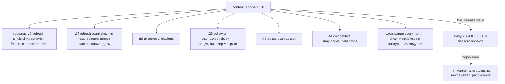
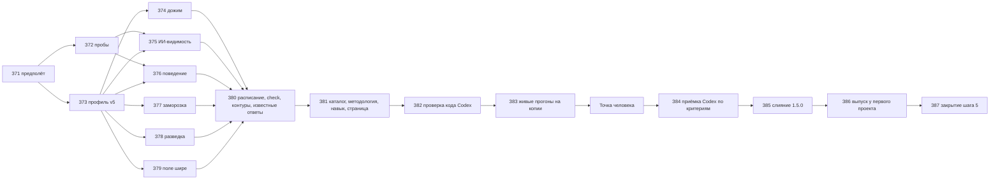

# План — Контент-машина, волна 3, часть 2 (дожим, ИИ-видимость, поведение, заморозка, разведка; выпуск 1.5.0)

Сделан из: [спецификация десяти систем](<Спецификация — Контент-машина, десять систем (границы, волны 2 и 3).md>)
(Т36, Т37, Т38, Т41, критерии П55–П57, П60, П62 для 1.5.0, решение Д13 в разделе 11а) и приложение «Заготовка части 2»
[плана части 1](<План — Контент-машина, волна 3, часть 1 (пульс, замер ставки, аудит, основание; выпуск 1.4.0).md>),
пересмотренное по его «Ходу исполнения». Модули — [карта](<Справочник — Карта Контент-машины (контуры, связи, ритм).md>),
модули Д4–Д6, А3, А4. Код — `content_engine` 1.4.0 (метка `content_engine-v1.4.0`, 687 тестов), прочитан 28.10.2026.

**Статус:** принят Дмитрием 29.10.2026 (ответы Д19–Д24 — раздел «Ответы Дмитрия»); исполняется.

**Режим** — один проход, исполняет этот чат. Субагентов на задачу больше нет (5 из 5 израсходованы частью 1):
проверка плана, проверка кода и приёмка — второй моделью (Codex, навык `second-agent`), не больше двух итераций
на каждую; дальше — к Дмитрию.

**Обозначения.** Задачи — **З71–З87**. Вопросы Дмитрию — **Д19–Д23**. Спецификация главнее плана.

## Замысел

### Происхождение

Часть 1 вышла в канон 28.10.2026 (1.4.0): пульс, книга ставок с деньгами, экономика, аудит недели, расписание, план
недели. Дмитрий 28.10.2026: выпуск у первого проекта отложить — сначала довести машину до полной готовности к любому
проекту; настройки одного проекта (его мессенджер, источник денег, расписание) — в его инстансе поручением, не в
общем выпуске. На карте остались модули, которых нет в коде: Д4, Д5, Д6, механика заморозки в А3 и разведка и «поле
шире» в А4. Без них машина умеет писать и доказывать, но не умеет дожимать почти выигранное, видеть себя в
ИИ-ответах, учиться на поведении людей и честно сворачивать выдохшийся спрос.

Что выяснила разведка до плана:
- **Дожим** ложится на готовое: зона 4–15 — из позиций пульса (`data/positions.jsonl`), разбор топ-3 — `prepare top`
  (нужна тема `taken` со снимком выдачи), текст — `write task`, гейт статьи, публикация, «доехало». Не хватает типа
  темы «правка страницы» и запрета пустого сдвига даты кодом.
- **ИИ-видимость**: проверка «прямой ответ в начале раздела» уже есть в гейте статьи (`text_checks.ai_answers`) —
  балл пригодности строится на ней. Цитирование в Алисе — отчёт Keys.so `organic/ai-answers` (только чтение, только
  база Москвы, тратит квоту); трекер нейросетей Keys.so создаёт объект в аккаунте — только с согласия (В16).
- **Заморозка**: ряд Wordstat по месяцам у строк спроса есть только через облако (платно); у Keys.so ряд — только
  парсером (проект в аккаунте). Без ряда — «нет данных».
- **Поведение**: адаптера Метрики в пакете нет; Метрика — общий инструмент русскоязычных проектов, отчёты API —
  только чтение. Модуль — опция.
- **Разведка и «поле шире»**: карты сайтов конкурентов читаются тем же кодом, что своя (`sitemap_urls`), разбор
  страницы — тем же, что разбор топа; «поле шире» — `gate topic --offline` без квоты.

### Результат (изменение в мире)

Любой проект, подключивший машину одним профилем, получает её целиком: раз в неделю машина сама находит страницы,
которые стоят на 4–15-й позиции или устарели, и ставит их правку в ту же очередь, что новые темы, с тем же гейтом —
и не даёт выдать сдвиг даты за обновление. Видно, какие статьи готовы к цитированию ИИ-поиском и где сайт уже
цитируется. Если проект подключил веб-аналитику, видно, где люди обрываются и какая одна правка это лечит. Кластер,
спрос которого вымер, машина предлагает заморозить, а человек решает. Раз в месяц машина показывает, что
публикуют конкуренты и стоит ли пробовать новое направление. Всё — без единой платной траты без «да» и с «не
подключено» там, где источника нет. После этого первый проект получает 1.4.0 и 1.5.0 разом, а машина на карте —
26 модулей из 26.

### Что уже решено

- Объём — Т36, Т37, Т38 (опция), Т41; П55–П57, П60; П62 для 1.5.0 (Д13). Профиль версии 5 (Т15.1).
- Пакет моделей не вызывает (ADR-0006): правка страницы, советы — задания агенту файлом.
- Универсальность (Дмитрий 28.10.2026): в пакете — общие контракты и нейтральные адаптеры (`none`, файл, `module:`).
- Платный вызов — только с ценой и «да»; `--unattended` — ноль трат; объекты в аккаунтах сервисов (трекер, проект
  мониторинга, парсер) — только с согласия Дмитрия.
- Запись вовне правки страницы — тем же путём, что публикация статьи: право, `--apply`, снимок «до», откат.

## Цель и критерии готовности

Готово, когда выполнены П55–П57 (П57 — опция, по Д21), П60, П62 для 1.5.0 и пункты ниже, и в «Проверке» записано,
чем доказан каждый.

| № | Критерий | Чем доказан |
|---|---|---|
| Ч1 | Каждая новая команда — с контрактом и тестами из `proof`; снимок каталога 1.5.0, разница с 1.4.0 в CHANGELOG; навык дополнен | `test_catalog.py`; `kos_catalog_check.py write` (последним изменением кода) |
| Ч2 | Новый пустой сдвиг даты не публикуется (Т36.4) | тест: правка без изменения по существу — отказ, код 1 |
| Ч3 | Расписание умеет «раз в месяц» (цитирование, поведение, «поле шире») | тест профиля и планировщиков |
| Ч4 | Карта: 26 модулей из 26 построены в коде; у проекта отдельно видно, что подключено и что «не подключено» (Д6, трекер, Метрика — опции); карта-страница обновлена | `data/contours.yaml`, `check --contours`, страница |
| Ч5 | Выпуск у первого проекта 1.4.0 + 1.5.0: `kos_release check` совпадает, профиль переведён 3 → 4 → 5, известные ответы совпали; поручение чату контента о его настройках | З86 |

## Откат

- Канон: главная на 28.10.2026 — `e2b1fce` (слияние 1.4.0); фактический — запишет З71. Работа — в ветке
  `content-engine-wave3b` в `D:\KOS-content-engine-w3b`; откат до слияния — удалить ветку и дерево; после —
  `git revert` слияния.
- Первый проект — только в З86: копии `profile.yaml`, `known_answers.yaml`, `data/bets.json`, каталога выпуска — в
  папку сессии; откат — вернуть копии. Shell `git` в его папке не запускать.

## Скан канона (находки)

| Что | Где | Как используем |
|---|---|---|
| Требования и критерии | спецификация, Т36–Т38, Т41, П55–П57, П60 | Источник задач |
| Позиции и пульс | `core/positions.py`, `steps/pulse.py` | Зона 4–15 (З74) |
| Разбор топа | `steps/prepare.py` (`top`, `topic_of`), снимок выдачи темы `queue take` | Разбор для правки (З74) |
| Текст и гейт | `steps/write.py`, `steps/gate_article.py`, `steps/text_checks.py` (`ai_answers`), `core/textindex.py` (восьмисловные цепочки — `gate_article._shingles`) | Правка, запрет пустого сдвига, балл ИИ (З74, З75) |
| Публикация и откат | `steps/publish.py`, `core/actions.py`, `core/snapshots.py`, `steps/verify.py` | Выкладка правки (З74) |
| Keys.so | `adapters/keysso.py`, навык `keysso` (`organic/ai-answers` — база `msk`) | Цитирование (З75) |
| Wordstat | `adapters/wordstat.py` (`CloudWordstat.dynamics`, `history` у строк спроса) | Заморозка (З77) |
| Карта спроса и заморозка | `steps/demand_map.py` (`FROZEN`, `data/frozen.json`) | Заморозка (З77) |
| Карты сайтов, разбор страниц | `adapters/corpus.sitemap_urls`, `adapters/page_fetch.py`, `core/htmldoc.markers` | Разведка (З78) |
| Гейт темы без сети | `steps/gate_topic.py` (`--offline`) | «Поле шире» (З79) |
| Расписание | `schedulers/*`, `steps/schedule.py`, `_semantics_v4` | «Раз в месяц» (З80) |
| Самопроверка и приёмка на контур | `steps/check.py` (`wave3_items`), `core/contours.py`, `data/contours.yaml` | З80 |
| Выпуск | `_Движок/Инструменты/kos_release.py`, `kos_catalog_check.py` | З85–З86 |
| Метрика | навык `seo-niche-research` (список), MCP Директа (`metrika_get_report` — только как образец полей отчёта) | Адаптер отчётов (З76) |

## Карта воздействия

- **Прямое:** пакет — профиль v5 и шаг `4 → 5`; новые `steps/refresh.py`, `steps/ai_visibility.py`,
  `steps/behavior.py`, `steps/freeze.py`, `steps/competitors.py`, `steps/field.py`, `adapters/metrika.py`; правки
  `steps/queue.py` (тип `refresh`), `steps/write.py` (задание правки), `steps/gate_article.py` (`refresh_change`),
  `steps/check.py`, `core/contours.py`, `data/contours.yaml`, `steps/schedule.py` и `schedulers/*` (`every: month`),
  `contracts.yaml`, `cli.py`, тесты. Канон — снимок каталога 1.5.0, методология, навык, карта-страница.
- **Вверх:** Keys.so — квота (разбор топа для правки, цитирование); облако Wordstat — платно через бюджет-гейт;
  Метрика — чтение; карты сайтов конкурентов — чтение.
- **Вниз:** чат контента первого проекта работает на 1.3.1 до З86; в З86 — пауза его команд на время выпуска.
- **Синхронизация:** TASKS (подраздел «Волна 3»), CHANGELOG, манифесты, дорожная карта (шаг 5 ✅, стартер шага 6),
  карта-страница, поручение чату контента.

## Границы исполнения

- В работе: рабочее дерево `D:\KOS-content-engine-w3b`; `D:\Knowledge-OS\TASKS.md`; у первого проекта — только З86.
- Платные вызовы в этом чате — ноль. Объекты в аккаунтах сервисов — не создаются.
- Push канона — по паспорту `D:\Knowledge-OS\CLAUDE.md`; метку отправлять явно (`git push origin <метка>`).

## Вопросы Дмитрию при приёмке плана

| № | Вопрос | По умолчанию |
|---|---|---|
| Д19 | ИИ-видимость: цитирование в Алисе — отчёт Keys.so (только чтение, только база Москвы, тратит квоту); трекер нейросетей Keys.so — объект в аккаунте с месячным лимитом | Отчёт — да, раз в месяц запуском человека; трекер — не создавать, «не подключено» |
| Д24 | Противоречие спецификации Т37.2: цитирование «раз в месяц», а динамика «неделя к неделе». Недельный ряд без трекера — четыре отчёта Keys.so в месяц | Править спецификацию: динамика — между снимками с интервалом в днях; недельной она станет, если подключить трекер |
| Д20 | Заморозка спроса: ряд Wordstat по месяцам только через облако (платно, цена из тарифа профиля) | Брать ряд из того, что уже собрал `demand collect`; дозапрос облака — только по команде с ценой и «да»; без ряда — «нет данных» |
| Д21 | Поведение на странице (Д6): адаптер отчётов Метрики (только чтение) — строить сейчас или оставить опцией на потом | Строить сейчас как опцию: по умолчанию выключено, у проекта включается профилем и токеном |
| Д22 | Дожим: разбор топ-3 для правки тратит квоту Keys.so (запасной источник — платный, через бюджет-гейт) | Да; кандидатов на правку в неделю — не больше `refresh.weekly_limit` (стартово 3) |
| Д23 | После 1.5.0 — выпуск у первого проекта сразу 1.4.0 + 1.5.0 и поручение его чату контента (Lark, деньги за окно, расписание, 404 в карте сайта) | Да, с паузой чата контента на время выпуска |

## Структура результата

## Граф зависимостей

## Задачи

**Общее для задач кода** — как в плане части 1 (раздел «Задачи», абзац «Общее»): Python ≥ 3.12; тесты из папки
пакета `py -3 -m pytest content_engine/tests -q -p no:cacheprovider`; UTF-8 и LF; контракт каждой новой подкоманды в
той же задаче; числа — `Number` со статусом; «не подключено», а не ноль; сети в тестах нет; данные компании, суммы с
пробелом между разрядами и сокращения сумм в коде запрещены тестом границы; новые паузы (`SLEEP`) отключаются в
`conftest`. Строку в TASKS — после каждой задачи. Многострочный Python с `\n` — файлом-скриптом, не heredoc (урок
части 1).

### З71 — Предполёт и рабочее дерево
1. `git -C D:\Knowledge-OS status --short`, `rev-parse HEAD` — в TASKS; план закоммичен (иначе — закоммитить план,
   TASKS не в git).
2. `git worktree add D:\KOS-content-engine-w3b -b content-engine-wave3b`; тесты из пакета дерева — 687 прошли.
3. Ответы Д19–Д23 — в TASKS.
**Готово:** хэш, дерево, число тестов, ответы.

### З72 — Пробы (только чтение)
1. Только после ответа на Д19, один запрос: Keys.so `report/simple/organic/ai-answers?base=msk&domain=<домен проекта>&per_page=5`
   — поля ответа и сколько квоты ушло (`requests_left` до и после; ожидание — один запрос из месячной подписки, не
   деньги); `ai-answers/state` — готов ли отчёт.
2. Метрика: есть ли в файле секретов переменная токена Метрики (только имя, `grep -o`); поля отчёта
   `stat/v1/data` по документации (визиты, отказы, глубина, цели, устройство, страница входа).
3. Список ИИ-краулеров для robots (GPTBot, ClaudeBot, PerplexityBot, Google-Extended, YandexAdditional и др.) — по
   документации, с датой.
4. Цена запроса облака Wordstat (`sources.wordstat.cloud_price_rub` профиля первого проекта) и сколько строк спроса у
   него уже несут `history`.
5. `search.competitors` профиля первого проекта — есть ли домены; отдают ли их карты сайтов (один GET каждой).
**Готово:** итоги в TASKS словами, без данных компании.

### З73 — Профиль версии 5 и перевод `4 → 5`
Как З53 части 1: шаблон v4 заморозить копией `profile.template.v4.yaml`, `SCHEMA_V4`, наборы по версиям,
`_semantics_v5`, `STEPS[4]`. Разделы (значения шаблона — с комментарием):
- `refresh`: `zone: [4, 15]`, `min_impressions: 50`, `age_days: 120`, `min_change: 0.2` (доля новых восьмисловных
  цепочек), `weekly_limit: 3`, `allow_behavior: false`;
- `ai_visibility`: `answer_words: [40, 60]`, `bots: [GPTBot, ClaudeBot, PerplexityBot, Google-Extended, YandexAdditional]`
  (по итогу З72.3), `citations: none` (`none`, `keysso`, `keysso_tracker`), `tracker_id: ""`, `max_quota: 0` (предел
  квоты Keys.so на прогон; 0 — запрос не выполняется), `min_score: 4`;
- `behavior`: `kind: none` (`none`, `metrika`, `module:…`), `counter_env: ""`, `token_env: ""`, `min_people: 100`,
  `drop_share: 0.7`, `device_ratio: 1.5`, `min_gain: 0.1`, `funnel: []` (шаги — адреса или цели), `recheck_days: [14, 28]`;
- `freeze`: `months: 24`, `drop_share: 0.5` (последние 12 мес. против предыдущих 12), `min_frequency: 10`;
- `competitors`: `window_days: 14`, `max_pages: 30`, `delay_seconds: 1`;
- `field`: `file: ""` (формулировки новых направлений, по строке «направление;формулировка»), `max: 25`;
- `schedule.jobs[].every` — плюс `month` с полем `day` (1–28) — **поле обязательное**, у `day`/`week` — `0`.
**Готово:** перевод `4 → 5` без потерь, профиль версии 1 доходит до 5, шаблон проходит проверку, весь набор зелёный.

### З74 — Дожим и актуализация (Д4, Т36)
1. `content-engine refresh scan --profile` → `data/refresh.json`. Сеть не нужна. Кандидаты:
   - (а) зона дожима: запросы последнего снимка позиций (`data/positions.jsonl`, окно консоли — как в пульсе: Search
     Console 7 дней, Вебмастер 30) на позициях `refresh.zone` с показами ≥ `min_impressions`. Снимок старше 8 дней —
     весь блок «нет данных: снимок позиций устарел», а не пустой список; показы не отданы источником — строка «нет
     данных», не ниже порога;
   - (б) старые статьи: старше `age_days` по дню выкладки в книге ставок, иначе по роли `date` корпуса; даты нет —
     «нет данных», не кандидат;
   - (в) при `allow_behavior` — утверждённые находки поведения (З76.3);
   - (г) статьи с баллом ИИ-видимости ниже `ai_visibility.min_score` (З75.1).
   Ключ кандидата — нормализованный адрес (`norm_url`); у кандидата — причины списком и число-основание у каждой.
2. `content-engine refresh take <адрес> --profile [--max-quota N]` — тема очереди: `id` = `refresh-<slug>`, `type:
   refresh`, `page: <адрес>`, `slug` — слаг живой страницы, направление — по `demand_map.direction_of` адреса, иначе
   «без направления». Повторный `take` той же страницы, пока её тема не опубликована или не снята, — отказ, код 1
   (идемпотентность; под `locks.held(instance, "refresh", "write")`). Не больше `weekly_limit` взятий за 7 дней —
   отказ, код 1. Снимок выдачи — путём `queue take` (Keys.so — квота с пределом `--max-quota`, запасной платный
   источник — только через бюджет-гейт с `--confirm-spend`).
3. Эталон правки — неизменяемый: в `refresh take` страница читается с сайта (`page_fetch`, GET) и пишется отдельным
   файлом темы `data/refresh/baseline/<id>-<день>.json` (адрес, день, хэш текста, текст; `save_live` не используется —
   он перезаписывает `<slug>.json`); существующий файл не перезаписывается. В теме — путь и хэш; гейт и задание
   читают эталон со сверкой хэша, несовпадение — `EngineError`. Сайт не ответил — тема не создаётся, «не проверено»,
   код 3.
4. `prepare top <id>` у темы `refresh` — тот же разбор Т18: свой домен уже отбрасывается (`prepare.candidates`,
   `is_own`); к первым трём адресам разбора сравнение маркеров со страницей-эталоном — «чего не хватает»: разделы,
   таблица, объём, FAQ. Тест: свой адрес в выдаче не попадает в разбор.
5. Бриф правки формирует код (`prepare brief` у темы `refresh`): заголовки и FAQ эталона плюс пробелы из разбора;
   утверждает человек тем же `prepare approve`. `write task` пишет задание правки: текст эталона, пробелы, правило
   «новая дата — только при изменении по существу».
6. Гейт статьи: проверка `refresh_change` (уровень `block`) — доля новых восьмисловных цепочек (`gate_article._shingles`)
   черновика против текста эталона темы, не корпуса; ниже `refresh.min_change` — «черновик: пустое обновление».
7. Публикация — существующие публикаторы правят запись того же слага (`cms_api`: «правка опубликованной записи»;
   `static_repo`: тот же файл) со снимком «до» и откатом; ручной режим — `publish prepare` и вставка человеком.
   Изменение: `package_of` у темы `refresh` берёт слаг и canonical из темы; несовпадение со слагом эталона — отказ.
   Запрет создания: у темы `refresh` действия публикатора получают `must_exist` — снимок «до» с `exists: false`
   (запись или файл исчезли между `take` и публикацией) — отказ до записи, код 1, а не новая страница.
   Книга ставок: новой записи нет, в записи страницы — `refreshed: [{day, id}]`.
**Готово (П55):** тесты — кандидат на 4–15 с показами выше порога есть, ниже — нет, без показов — «нет данных»;
устаревший снимок позиций — «нет данных»; старая статья по дню выкладки — кандидат, без даты — нет; повторный `take` и
предел недели — отказ; правка проходит гейт и «доехало» на фикстуре публикатора; откат возвращает текст эталона
(снимок «до»); новой записи книги нет; страница исчезла до публикации — отказ без записи; эталон с чужим хэшем —
ошибка; новая дата без изменения текста — отказ.

### З75 — ИИ-видимость (Д5, Т37)
1. `content-engine ai score --profile [--offline]` — балл 0–6 по статьям корпуса, по баллу за признак: ответ в начале
   (первый абзац после H1 или H2 — `answer_words` слов), разделы H2 не длиннее 400 слов, конкретика в первой трети
   (число или единица измерения), дата обновления, источник (внешняя ссылка), ИИ-краулеры открыты. Последний признак —
   один GET `robots.txt`; с `--offline` или при ошибке — «нет данных» по признаку, балл считается из пяти и помечен.
   Итог — `data/ai_visibility.jsonl` (день, адрес, балл, признаки); ниже `min_score` — кандидат дожима (З74.1 г).
2. `content-engine ai citations --profile [--max-quota N] [--unattended]` — источник `ai_visibility.citations`:
   - `none` — «не подключено» и как подключить;
   - `keysso` — отчёт `organic/ai-answers` по домену (база `msk`): число строк и страниц считается до запроса, предел —
     `--max-quota` или `ai_visibility.max_quota` профиля (нет предела — отказ без запроса). С `--unattended` — только в
     пределах `ai_visibility.max_quota` профиля: предел в профиле и есть разрешение проекта тратить квоту (Д19); 0 —
     «пропущено: квота не разрешена профилем». Квота Keys.so — не деньги; рубли с `--unattended` — по-прежнему ноль;
     строки — запрос, наши адреса в `source_urls`;
   - `keysso_tracker` — только чтение уже созданного человеком трекера (идентификатор — `ai_visibility.tracker_id`);
     в белом списке клиента нет методов создания и правки трекера — тест; создаёт трекер человек с согласия Дмитрия
     (В16);
   - обзоры поисковиков — источника нет, строка «не подключено».
   Снимок — `data/ai_citations/<день>.json`; динамика — против прошлого снимка с интервалом в днях («за N дней»).
**Готово (П56):** балл на фикстуре с ответом в начале и без, по каждому признаку отдельно; закрытые краулеры —
находка; robots недоступен — «нет данных», не ноль; `none` — «не подключено»; запрос без предела квоты — отказ без
вызова; метод создания трекера отсутствует в белом списке.

### З76 — Поведение на странице (Д6, Т38, опция — по Д21)
1. `adapters/metrika.py` — отчёты API Метрики (`stat/v1/data`, только GET, белый список, токен и счётчик по именам
   переменных `behavior.token_env`, `counter_env`): за 28 дней по странице входа — посетители, отказы, глубина, цели;
   по странице входа и устройству; по шагам `behavior.funnel` — посетители, дошедшие до шага.
2. `content-engine behavior scan --profile` — находки по формулам (все пороги — в профиле):
   - обрыв: шаг i, где посетителей ≥ `min_people`, доля ушедших до шага i+1 > `drop_share`, а у соседних шагов —
     ≤ `drop_share` / 2 («ровные соседи»);
   - тупик: страница входа с посетителями ≥ `min_people`, глубина ≤ 1,2, целей 0;
   - устройство: отказ на одном устройстве выше, чем на остальных, в `device_ratio` раз (стартово 1,5) при ≥ `min_people`
     на каждом;
   - выпавшая из группы: страница раздела с отказом выше медианы раздела + 2 межквартильных размаха (в разделе ≥ 5
     страниц с ≥ `min_people`).
   Итог — `data/behavior/<день>.json`; у находки — числа-основания и показатель замера по её виду: обрыв — доля
   ушедших с шага; тупик — глубина и цели на посетителя; устройство — отказ на этом устройстве; выпавшая — отказ
   страницы.
3. `content-engine behavior accept <id> --who [--reject]` — человек утверждает одну правку; она становится
   кандидатом дожима (З74.1 в). Базовая линия — показатель замера за 28 дней до дня публикации правки (из
   `publications.jsonl`), а не на день находки. `content-engine behavior check --profile` — на 14-й и 28-й день после
   публикации сравнивает тот же показатель за равное окно после: лучше на `behavior.min_gain` (стартово 10 %) —
   «перенести на соседние страницы раздела», иначе — «откатить» с готовой командой `publish rollback <id>`; откат
   выполняет человек существующей командой (её тесты — волна 2).
**Готово (П57):** тесты на фикстурах — обрыв > 70 % на шаге со 100 людьми — находка, с 60 — нет, с неровными
соседями — нет; тупик; аномалия устройства; выпавшая из группы; правка без `accept` не идёт в дожим; `check` на 14-й
день даёт «перенести» и «откатить» на двух фикстурах; без `behavior.kind` — «не подключено».

### З77 — Заморозка по динамике (А3, Т41.1)
1. `content-engine freeze scan --profile [--fetch --confirm-spend]` — история спроса `data/demand_history.jsonl`
   (Т41.1): строка — фраза, месяц, частота, источник, день съёма; пополняется из `history` групп спроса
   (`steps/demand.py` хранит ряд только у головных фраз направлений) без дублей месяца; с `--fetch` — дозапрос
   `CloudWordstat.dynamics` для головных фраз кластеров без ряда или с рядом старше месяца (Д20: история пополняется
   раз в месяц — сезонность видна только на ряде; бюджет-гейт, цена до запроса, без `--unattended`). Первый дозапрос
   берёт 24 месяца, следующие — недостающие месяцы.
2. Правило: нужны 24 последних полных месяца без пропусков (пропуск — «нет данных», не кандидат). Сумма последних 12
   месяцев ниже суммы предыдущих 12 на `drop_share` **и** не меньше 8 из последних 12 месяцев ниже того же месяца год
   назад (устойчиво, а не сезонно); `min_frequency` — средняя за последние 12 месяцев (ниже — «мало спроса», не
   кандидат).
3. `content-engine freeze accept <кластер> --who [--reject]` — решение человека в `data/frozen.json`; карта спроса
   (`map build`) даёт статус `frozen` — уже умеет.
**Готово (П60, часть А3):** падение по правилу — кандидат без автоматической заморозки; сезонная яма — нет; ряд с
пропуском — «нет данных»; заморозка — только `accept`.

### З78 — Разведка конкурентов (А4, Т41.2)
1. `content-engine competitors snap --profile` — карты сайтов доменов `search.competitors` → снимок
   `data/competitors/<день>.json` (домен → адреса с `lastmod`, если есть). Новые адреса — против ближайшего снимка
   старше `window_days`: «появились между <день 1> и <день 2>» — статус proxy (без `lastmod` день публикации неизвестен);
   с `lastmod` внутри окна — оценка. Темп — новых адресов на 7 дней интервала. Первого снимка нет — «нет данных:
   нужен второй снимок через N дней».
2. `content-engine competitors pages --profile [--limit]` — разбор новых адресов (не больше `max_pages`, пауза
   `delay_seconds`, белый список — домены конкурентов) тем же `HtmlDoc.markers`, что разбор топа: разделы, объём,
   картинки, таблицы, разметка. Итог — `data/competitors/pages-<день>.json`. Разведка устройства, не слежка за позициями.
**Готово (П60, часть А4):** новые адреса за 14 дней по двум снимкам (статус proxy, интервал); темп; разбор фикстуры
страницы — разделы, объём, картинки, разметка; без доменов — «не подключено».

### З79 — «Поле шире освоенного» (А4, Т41.3)
`content-engine field probe --profile [--file]` — вход `field.file`: UTF-8, строка «направление;формулировка»,
пустые строки и строки с `#` пропускаются, строка без «;» — ошибка с номером строки, не больше `field.max`. Каждая
формулировка — `gate topic --offline` (без квоты). Итог — `reports/<день>/field.md` и `data/field/<день>.json`: по
направлению — сколько свободно, пересекается, спорно, примеры. Новое направление в профиль вписывает человек.
**Готово (П60):** квота не тратится (счётчик клиента 0); отчёт по направлениям; ошибка формата — с номером строки.

### З80 — Расписание «раз в месяц», самопроверка, приёмка на контур, известные ответы
1. `every: month` + `day`: XML Windows (`ScheduleByMonth`), cron (`M H day * *`), проверка `_semantics_v5`;
   сверка чтением (`matches`) — по виду расписания.
2. Шаблон v5: `refresh scan` (неделя), `ai score` (неделя), `ai citations` (неделя при `citations: keysso_tracker`,
   иначе месяц — квота), `competitors snap` (неделя), `field probe` (месяц), `freeze scan` (месяц, без `--fetch`),
   `behavior scan` (неделя, только если включено), `ai citations` (месяц, только при `ai_visibility.max_quota` > 0).
   Все задания — с `--unattended`; тесты: каждая команда шаблона с `--unattended` — ноль рублей и без
   `--confirm-spend`; при `max_quota: 0` — ноль вызовов, расходующих квоту (счётчик клиента Keys.so — 0); при пределе —
   не больше предела. `week plan` раз в месяц выдаёт задачу «дозапрос истории спроса» с ценой (З77.1).
3. `check`: пункты части 2 — отчёт ИИ Keys.so, трекер, Метрика, ряд Wordstat, конкуренты, файл «поля шире»; контуры А
   и Д в `data/contours.yaml` — признаки с новыми модулями.
4. Известные ответы: виды `refresh` (адрес → кандидат или нет), `freeze` (ряд → кандидат), `ai_score` (текст → балл)
   и отказ `empty_refresh` (пустой сдвиг даты).
**Готово:** тесты; `check --contours` считает модули трёх видов: построено в коде, подключено у проекта, «не
подключено».

### З81 — Каталог 1.5.0, методология, навык, карта-страница
Как З65 части 1: версия 1.5.0; черновая разница каталога с 1.4.0 — в TASKS (снимок — З85); методология — маршрут
дожима и роста; навык — `reference/proof.md` и фразы («дожим статей», «ИИ-видимость», «заморозь кластер»,
«конкуренты публикуют», «поле шире»), описание ≤ 1000 знаков (сжать при нужде, подтверждённые фразы не удалять);
скрипт пересечений фраз. Карта-страница «Справочник — Карта Контент-машины (страница).html» — генератором части 1:
модули Д4–Д6, А3, А4 — в коде, числа — пересчитать из кода.
**Готово:** ссылки целы, флаги навыка есть в парсере.

### З82 — Проверка кода второй моделью
Codex пакетом через stdin (навык `second-agent`, `-m gpt-5.6-sol`, ответ `-o`): новые модули целиком, контракты,
тесты-доказательства; вопрос — запись и деньги без права и «да», «ноль вместо нет данных», пустой сдвиг даты, квота
до запроса. Разбор по пунктам вслух, принятое — тестом; вторая итерация — по исправлениям.
**Готово:** нет открытых блокирующих.

### З83 — Живые прогоны на копии инстанса первого проекта
Копия в папке сессии (как З67 части 1), перевод профиля 4 → 5 на копии, команды только чтения и без трат:
`refresh scan`, `ai score`, `competitors snap` (если домены есть), `field probe` (если файл есть), `freeze scan` без
`--fetch`. Проверить измеритель: ноль или выброс — сначала причина (урок части 1).
**Готово:** итоги и найденные ошибки — в TASKS и «Ход исполнения».

### Точка человека
Дмитрию — итог прогонов (без данных компании в канон) и ответы на открытые Д19–Д23.

### З84 — Приёмка второй моделью по критериям
Codex: критерии П55–П57, П60, Ч1–Ч4 против кода и тестов (он без оболочки — тесты запускаю я, итог — в пакет).
**Готово:** нет открытых блокирующих; итог — в TASKS.

### З85 — Слияние 1.5.0 в канон
Снимок каталога 1.5.0 — последним изменением кода; CHANGELOG с разницей; манифест пакетов; скан добавленных строк;
слияние, метка `content_engine-v1.5.0`, push и метка явно.

### З86 — Выпуск у первого проекта (1.4.0 + 1.5.0) и поручение чату контента
1. Дмитрию — «чат контента не запускает команды машины до сообщения о выпуске».
2. Снимок «до» и откат: копии каталога выпуска `…\Скрипты\content_engine`, `profile.yaml`, `known_answers.yaml`,
   `data/bets.json` — в папку сессии `release_backup_<день>\`; откат — вернуть копии одной командой
   (`robocopy <копия> <место> /MIR` по каждой папке), проверка — `kos_release.py check` против 1.3.1.
   `kos_release.py issue --package … --into <…\Скрипты\content_engine>` → `check`;
   `kos_catalog_check.py check`; `profile migrate --apply` дважды (3 → 4 → 5) выпуском; нейтральные значения
   (`notify.kind: none`, `bets.money.kind: none`, `schedule.allow: files`); `known_answers.part3.yaml` и случаи части 2
   — в `known_answers.yaml`; прогон — «совпало M из M».
3. Публикация выпуска в GitLab компании — только после «да» Дмитрия на этом шаге: MCP `gitlab-employee`
   (`gitlab_repo_status` → публикация своих путей → чтение обратно хэша), со сканом добавленных строк; строка журнала
   действий.
4. Поручение чату контента — файл `Контент блога/Инструкция — Контент-машина 1.5.0 (доказательство и рост).md`:
   что нового; подключить деньги за окно (адаптер `money_windows_roistat.py` — приложен, проверен на одном окне),
   сводку в его мессенджер (вебхук — у Дмитрия), расписание на его ноутбуке (`schedule install` без `--apply` — план
   Дмитрию → его «да» → `--apply` → `schedule list`), чек-лист
   аудита под его сайт; поправить карту сайта (два адреса 404) и поле «Источник» у восьми переехавших статей.
**Готово (Ч5):** `kos_release check` совпадает; профиль версии 5; известные ответы совпали; поручение лежит.

### З87 — Закрытие шага 5
Дорожная карта: ✅ шага 5, «Деньги», модули по волнам; стартер шага 6 (второй проект — проверка универсальности) и
шага 7 (решение о сервере MCP: схема результата операции, цена объектом, план с правом каждого действия — замечания
Codex №1, №3, №15 шага 4); спецификация — «Исполнена: волна 3»; итог Дмитрию — «Ждёт меня», «Изменено», «Найдено».

## Проверка

| Пункт | Чем доказан |
|---|---|
| П55 дожим | тесты З74 |
| П56 ИИ-видимость | тесты З75 |
| П57 поведение (опция) | тесты З76 |
| П60 спрос волны 3 | тесты З77–З79 |
| П62 для 1.5.0 | метка, CHANGELOG, снимок, Codex — З84–З85; `kos_release check` — З86 |
| Ч1–Ч5 | см. «Цель и критерии готовности» |

## Приёмка

- Проверка плана — Codex, не больше двух итераций; принимает Дмитрий.
- Приёмка результата — Codex (З82, З84) и живые прогоны (З83); не больше двух итераций, дальше — к Дмитрию.

## Ответы Дмитрия (29.10.2026)

| № | Ответ |
|---|---|
| Д19 | Отчёт цитирования Keys.so по API раз в месяц — да; квоту Keys.so тратить можно без отдельного «да» (лимиты большие и сбрасываются). Трекер — не создавать |
| Д20 | Берём собранное; историю спроса пополнять раз в месяц — сезонность видна только на ряде. Облако Wordstat — рубли: с ценой и «да» |
| Д21 | Поведение через Метрику — строить, по умолчанию выключено; у каждого проекта своя воронка и свои цели |
| Д22 | Дожим — по умолчанию (не больше 3 правок в неделю, предел в профиле) |
| Д23 | Выпуск у первого проекта — 1.4.0 + 1.5.0 с копиями «до» и откатом; публиковать в GitLab можно; старые копии — удалить позже |
| Д24 | По умолчанию: поправить спецификацию — динамика между снимками с интервалом в днях |

## Разбор проверки плана (Codex, 28.10.2026, две итерации — «доработать»; исправлено после второй)

| Замечание | Решение |
|---|---|
| 🔴 Т37.2: снимок раз в месяц не даёт динамики неделя к неделе; трекер и обзоры без контракта | Принято частично. В спецификации противоречие: «раз в месяц» и «неделя к неделе». Динамика — между снимками с интервалом в днях; трекер (только чтение созданного человеком) снимается еженедельно, отчёт Keys.so — раз в месяц из-за квоты; обзоры — «не подключено»; методов создания трекера нет в белом списке (З75.2, З80.2). Спецификации — строка в разделе 12 при З81 |
| 🔴 Эталон правки — корпус может быть уже правленым | Принято: неизменяемый эталон с сайта при `refresh take` (З74.3, З74.6) |
| 🔴 Публикация правки, снимок «до» и откат не доказаны | Принято частично. Публикаторы уже правят запись того же слага со снимком «до» (`publishers/cms_api.py` — «правка опубликованной записи», `static_repo.py` — тот же файл). Добавлены привязка слага к эталону и тесты отката и «без новой записи книги» (З74.7) |
| 🔴 Д6: формулы не определены, тесты неполные | Принято: формулы и тесты на каждую находку, `accept`, `check` (З76) |
| 🔴 Новые адреса конкурентов за 14 дней недоказуемы без `lastmod` | Принято: интервал между снимками, статус proxy, темп, тест разбора (З78) |
| 🔴 Квота Keys.so без цены и подтверждения; `--unattended` | Принято частично. Квота — часть подписки, не деньги: бюджет-гейт не нужен, но нужен предел до запроса (`--max-quota` или `ai_visibility.max_quota`; без предела — отказ без вызова); проба З72.1 — после Д19 |
| Итерация 2: эталон перезаписывается (`save_live` по слагу) | Принято: отдельный файл темы, хэш, без перезаписи (З74.3) |
| Итерация 2: публикация правки создаст новую запись, если страница исчезла | Принято: `must_exist`, тест (З74.7) |
| Итерация 2: показатель замера поведения не задан по видам; базовая линия на день находки | Принято: показатель по виду, базовая линия до дня публикации, `min_gain` (З76.2–3); сам откат — существующая `publish rollback` с тестами волны 2, новый тест не нужен |
| Итерация 2: `--unattended` и квота противоречат | Принято: запуск по расписанию квоту не тратит, `ai citations` — запуском человека (З75.2, З80.2) |
| Итерация 2: недельная динамика не выполнена | Вынесено Дмитрию — Д24 (противоречие в спецификации) |
| Итерация 2: push канона без права в пакете | Отклонено: право дал владелец в паспорте `D:\Knowledge-OS\CLAUDE.md` (28.09.2026); откат — `git revert` слияния (раздел «Откат») |
| 🔴 З85–З86: запись вовне без права, снимка и отката | Принято частично. Push канона разрешён паспортом `D:\Knowledge-OS\CLAUDE.md` (28.09.2026). Добавлены снимок «до» и откат выпуска, «да» Дмитрия перед GitLab, порядок расписания (З86) |
| 🟡 Окно и свежесть позиций; «нет данных» без показов | Принято (З74.1) |
| 🟡 Идемпотентность `refresh take` | Принято (З74.2) |
| 🟡 Топ-3 без своей страницы | Отклонено: свой домен уже отбрасывается в `prepare.candidates` (`is_own`); добавлен тест (З74.4) |
| 🟡 `ai score` «без сети» с GET robots | Принято: `--offline`, robots — «нет данных» (З75.1) |
| 🟡 Правило заморозки, сезонность, пропуски | Принято (З77.2) |
| 🟡 Формат файла «поля шире» и выход | Принято (З79) |
| 🟡 Расписание с `--unattended` без теста | Принято (З80.2) |
| 🟡 Ч4: «26 из 26» смешивает построено и подключено | Принято (Ч4, З80) |

## Ход исполнения и отходы от плана

- **З71** (29.10): база `b67095a`, ветка `content-engine-wave3b`, 687 тестов.
- **З72** (29.10): отчёт Keys.so `organic/ai-answers` строится по первому запросу (202 «готовится», `ai_state` 0 → 10) — у адаптера статус «готовится, повторить», не пустой список; в отчёте — запросы сайта с ответом Алисы, сайт среди источников не у всех (29.10: 448 из 500 — запись 28.10 «только цитирующие» была ошибкой), адреса `source_urls` в процентной кодировке — сверка своего домена после раскодирования и IDNA (иначе ложный ноль). Метрика отвечает без выборки. Карты сайтов конкурентов с `lastmod` — статус «оценка», если `lastmod` не одинаковый у большинства адресов (иначе proxy); индексы карт обходятся вглубь. История спроса у первого проекта пуста — первый дозапрос З77 платный.

- **З73** (29.10): профиль версии 5. Отход: день месяца — полем раздела `schedule.month_day`, а не у задания — перевод
  профиля вставляет поля разделов, но не элементов вложенных списков.
- **З74** дожим: бриф правки пишет агент по заданию с эталоном и пробелами (у брифа поля суждения — мост, граница
  честности, автор); код требует слаг страницы. Эталон — отдельным файлом темы, сумма — по всему файлу.
- **З75–З80**: модули Д5, Д6, А3, А4, «поле шире», расписание раз в месяц. Отход: формат файла «поля шире» —
  «направление;тема;формулировка» (гейту нужно ≥ 3 формулировок на тему). `ai citations` в шаблон расписания не
  входит, пока проект не разрешил квоту.
- **З81**: навык (998 знаков, `reference/growth.md`), методология, карта-страница.
- **З82** Codex, 2 итерации: принято 19, отклонено 8 с доводами (общий механизм подтверждения записи, платная выдача —
  доказана тестом денег, реестры пишет только машина, страница вне книги ставок, `freeze.months`, отчёт дня, отказ
  известного ответа, миграция эталонов — их нет). Главное принятое: правка не может создать новую страницу.
- **З83** живые прогоны на копии: 6 изъянов измерителя исправлены — корпус по оглавлению (разделы и ссылки «нет
  данных»), подпись фото как первый абзац, порог по доле измеренного, заморозка — только весомые кластеры
  (`freeze.top`, иначе дозапрос по 35 тыс. кластеров), «отчёт готовится» — не сбой, подпись цитирования (в отчёте Keys.so
  — запросы с ответом Алисы, сайт в источниках — не у всех).
- **Точка человека** (29.10): Дмитрий — дозапрос истории спроса (4,00 ₽) — да, делать на выпуске; идти по плану.
- **З84** Codex, 2 итерации по критериям: добавлены тесты пути правки командой (код 1 у пустого обновления, «доехало»
  и записи дня выкладки, содержательная правка проходит `refresh_change`); Ч3 — отклонено (критерий — умение расписания
  «раз в месяц»).
- **З85**: снимок каталога 1.5.0 (+12, ~5), CHANGELOG, манифест; 822 теста, 1 пропущен. Урок: CHANGELOG хранится с
  CRLF — запись LF переписала бы весь файл; возвращено отдельным коммитом.

# Связанные документы

- [План — волна 3, часть 1](<План — Контент-машина, волна 3, часть 1 (пульс, замер ставки, аудит, основание; выпуск 1.4.0).md>)
- [Спецификация — десять систем](<Спецификация — Контент-машина, десять систем (границы, волны 2 и 3).md>)
- [Справочник — Карта Контент-машины](<Справочник — Карта Контент-машины (контуры, связи, ритм).md>)
- [План — дорожная карта](<План — Контент-машина, дорожная карта (все волны до готовой машины).md>)
