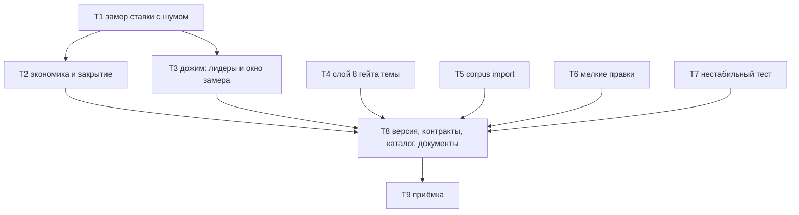
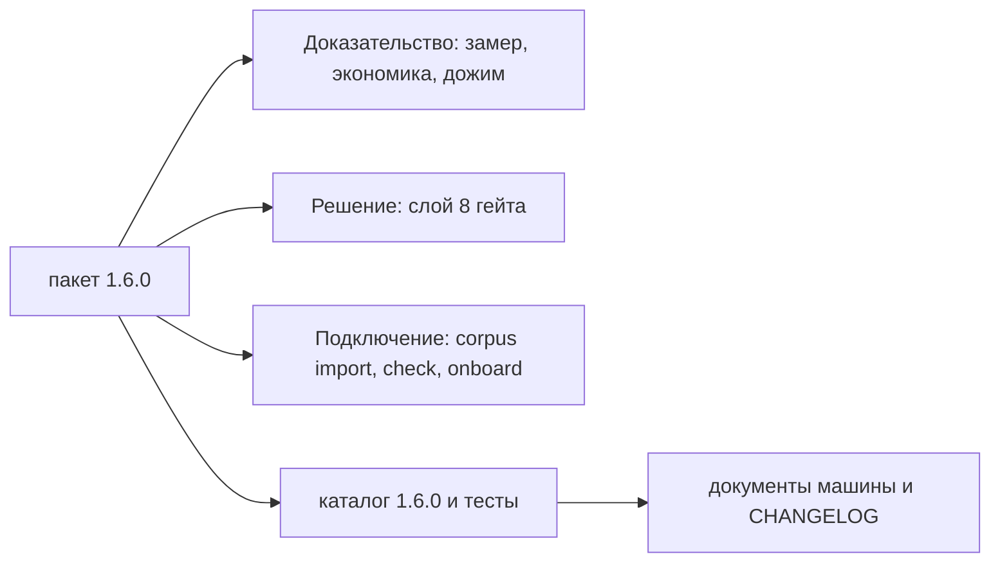

# План — Контент-машина, выпуск 1.6.0 (честный замер, дожим, корпус по карте сайта)

Сделан из: [Аудит — Контент-машина 2026-11-17](<Аудит — Контент-машина 2026-11-17.md>), таблица «Правки на „да“»,
правки 3, 5, 7 и находка Н17; решение Дмитрия 17.11.2026: «делай 1.6.0 с адаптером, ставка пока не обязательная».

## Замысел

### Происхождение

Аудит 17.11.2026 проверил машину как переносимую систему. Производство работает, а денежный слой — главное отличие
машины — даёт выводы, которым нельзя верить: итог ставки и закрытие направления считаются без шума, на 90-й день
ожидание делится пополам. Дожим по возрасту может переписать статью из топ-3. Гейт темы пропустил две темы при живых
статьях (обобщённый урок инцидента D у первого потребителя: формулировки не по смыслу и синонимы). Перенос в сайт с
историей требует выгрузить все тексты в markdown — каждый проект писал бы свой скрипт. Отвергнуто: делать ставку
обязательной (Дмитрий: пока нет; гейт внутри `queue refill` обнулил бы запас); запрещать дожим всех статей младше
180 дней (убивает главный рычаг роста свежих статей); новые поля профиля (перевод профиля на версию 6 у каждого
проекта ради констант статистики не оправдан).

### Результат (изменение в мире)

Агент в любом новом проекте ставит машину и получает выводы, которым можно верить: «сыграла», «провал» и «закрыть
направление» появляются только когда разница больше шума, лидеры выдачи не переписываются, тема с живой статьёй-
близнецом не проходит «свободной», а сайт с историей получает корпус одной командой, без своего скрипта.

### Что уже решено

- Ставка необязательна; `queue.require_bet` и шаблон не меняются.
- Профиль остаётся версии 5: пороги — константами в коде со ссылкой на канон (порог шума Движка роста — минимум 5
  ожидаемых событий, ±2σ; топ-3 — «Карантин лидеров» SEO-диагностики).
- Выпуск в проекты не ставится: это решают их владельцы. Канон: код, тесты, каталог, документы, метка.
- Правило «не воевать с маркетплейсами» (правка 9) — вне этого выпуска.

## Цель и критерии готовности

Редакция 2 (17.11.2026) — после проверки плана чистым контекстом: «не прошёл», 12 замечаний, все приняты; что
изменилось — раздел «Разбор проверки плана» в конце.

1. Шум — на уровне ставки, а не статьи. `bet measure` собирает записи одной ставки (одна `hypothesis_id`; ставка без
   номера — одна запись) и по сумме ожиданий, порогов и фактов окна выносит итог: «сыграла» или «провал» только при
   сумме ожиданий ≥ 5 событий и разнице с противоположной границей больше 2·√ожидания. Итог группы предлагается
   каждой её записи — план недели и `bet accept` работают как раньше. Окно 90 никогда не даёт «провал»; у замера
   окна 90 — пометка `preliminary: true`. Деньги — только если в окне группы ≥ 5 заявок; выгрузка без заявок — «мало
   данных: шум не оценить, в выгрузке денег нет заявок».
2. `economics`: «предложение закрыть» — только по окну 180, по записям со ставкой, при сумме ожиданий ≥ 5 и недоборе
   больше шума; окно 90 — «предварительный сигнал»; ставок с наступившим окном нет — «закрытие данными невозможно».
   В шаблоне `close_window: 180`.
3. Дожим: страница — лидер, если в свежем снимке Search Console у неё запрос с позицией ≤ 3 и показами не ниже
   `refresh.min_impressions`; такая страница не кандидат ни одной ветки (фильтр в `collect`) и не берётся `take`.
   Ветка возраста не берёт статью со ставкой, у которой окно 180 открыто. Правка в окне замера помечается в замере.
4. Корень инцидента D: формулировки темы из кластера — сначала голова кластера и запросы с её основами, потом по весу.
   Восьмой слой гейта — только замечание в отчёте (вердикт не меняет) до замера доли ложных тревог на живом корпусе.
5. `corpus import`: карта сайта, включая индекс карт, → страницы разделов → папка markdown с шапкой (с датой, если
   страница её отдаёт); «записано N — прочитано N» по записанным slug; печатает полную строку `corpus.folders`.
6. Мелкие: новый сайт — жёлтый корпус; `queue refill` без очереди — код 1; текст `onboard`; комментарии в шаблоне;
   нестабильный тест — диагностика.
7. Все тесты зелёные; каталог 1.6.0; коммит → выпуск в пустую папку → проверка → метка `content_engine-v1.6.0`.

## Откат

- `D:\Knowledge-OS` (репозиторий канона): `8123d40ff9e60649ef7c83aa91e4bd4478cd9c47` — `git revert` коммитов выпуска.

## Скан канона (находки)

- Порог шума: `_Движок/Пакеты/growth_engine/growth_engine/core/economy.py`, `noise()` — ±2·√(p(1−p)/N), применим при
  N·p ≥ 5 (`NOISE_MIN_EXPECTED = 5`). Для счётчиков (заявки) берётся пуассоновский аналог: шум = 2·√ожидания при
  ожидании ≥ 5. Стандарт — «Стандарт — Работа с гипотезами», «Порог шума и защитная метрика».
- Лидеры: `Методологии/SEO/Методология — SEO-диагностика просадок и замер правок (причина или шум).md`, «Карантин
  лидеров»; `Методология — SEO-архитектура…`, раздел 9.
- Разбор HTML — `core/htmldoc.py` (`HtmlDoc`, без зависимостей); загрузка своего сайта — `adapters/page_fetch.py`
  (`PageFetcher.for_own_site`, только GET, белый список хостов); карта сайта — `adapters/corpus.py`, `sitemap_urls`.
- Основы слов — `core/normalize.py` (`Normalizer.key`, `Key.stems`), слои гейта — `steps/dedup.py` (`LAYERS`,
  `LAYER_NAMES`).
- Слова «позиция», «деньги страницы» — «Стандарт — Консистентность метрик», «Слова поиска и контента».

## Карта воздействия

- **Прямое:** `core/bets.py`, `steps/bets_cmd.py`, `steps/economics.py`, `steps/refresh.py`, `steps/dedup.py`,
  `steps/gate_topic.py`, новый `steps/corpus_cmd.py`, `steps/check.py`, `steps/queue.py`, `steps/onboard.py`,
  `templates/profile.template.yaml`, `cli.py` (`STEPS`), `contracts.yaml`, тесты.
- **Косвенное:** известные ответы пакета (`known-answers` на фикстурах) — новый слой и новые итоги могут сдвинуть
  ожидания; `check --contours`; `week plan` и `pulse` читают итоги ставок.
- **Вверх:** профиль версии 5 (без изменений), Движок роста читает `bet propose` (поля прежние).
- **Вниз:** выпуск у первого потребителя на 1.5.4 — не трогаем; у него `bet measure` ещё не запускался.
- **Синхронизация:** `pyproject.toml` и `__init__.py` — 1.6.0; снимок `Каталог операций/1.6.0.*`; CHANGELOG движка;
  `_Движок/Пакеты/_manifest.md`; карта машины (слой 8, `corpus import`), методология каталога (вне маршрута —
  `corpus import`), плейбук подключения (шаг 3 — команда), дорожная карта (блок «Открыто по аудиту»), аудит («Что
  сделано»).

## Границы исполнения

- В работе: `D:\Knowledge-OS\_Движок\Пакеты\content_engine\`, `D:\Knowledge-OS\Методологии\Контент-машина\`,
  `D:\Knowledge-OS\_Движок\0 — System Docs\CHANGELOG.md`, `D:\Knowledge-OS\_Движок\Пакеты\_manifest.md`.
- Вне работы: выпуски в проектах, профили проектов, `growth_engine`.
- Коммит — только своих путей; push канона делает git-хук сам; метка — `git push --follow-tags` после коммита.

## Граф зависимостей

## Структура результата

## Задачи

Исполнитель — агент чата канона (один проход). Тесты лежат в `content_engine/content_engine/tests/`; команда из
`D:\Knowledge-OS\_Движок\Пакеты\content_engine`: `python -m pytest -q -p no:cacheprovider content_engine/tests/<файл>`.
Новые тесты — `content_engine/tests/test_release_160_<тема>.py`, фикстуры — `content_engine/tests/conftest.py` (образец —
`test_bets_wave3.py`, `test_refresh.py`).

### T1 — [КОД] Итог ставки по сумме её статей, с порогом шума

**Файлы контекста:** `core/bets.py` (`decide`, `expectation_of`, `RESULTS`), `steps/bets_cmd.py` (`measure`, `accept`),
`steps/week_plan.py:46–56`, `steps/known_answers.py` (вид `bet`), `steps/pulse.py`,
`growth_engine/core/economy.py:220–250` (образец порога).
**Шаги:**
1. `core/bets.py`: `NOISE_MIN_EVENTS = 5`, `noise(expected) = 2·√expected` (пуассоновский аналог порога Движка; ссылка
   в докстроке).
2. `decide_group(records, measured, min_step, window)`: группа — записи с одной непустой `hypothesis_id` (иначе запись
   сама себе группа). E — сумма ожиданий записей в единице ставки (на 90 — половина), T — сумма порогов (нет у любой
   записи — нет), g — сумма фактов. Запись ступени > `min(min_step, 2)` или без данных в единице ставки — группа
   «мало данных» с её номером. Правило: E < 5 → «мало данных: ожидание за окно E < 5»; g ≥ E и (T нет или g − T >
   шум) → «сыграла»; T есть, g ≤ T, E − g > шум и окно 180 → «провал»; окно 90 и g ≤ T → «мало данных
   (предварительно)»; иначе «мало данных» с числами. Деньги: сумма заявок группы < 5 или неизвестна → «мало данных»
   с причиной; иначе то же сравнение без шума в рублях, «провал» — только на 180. `decide` по одной записи — обёртка
   над группой из одной записи.
3. `bets_cmd.measure`: после сбора `fresh` — группы по окну; итог группы → `proposed` и `why` каждой записи (`why`
   называет группу и число записей); окно 90 — `preliminary: true`.
4. Тесты: две записи одной гипотезы, ожидание по 3, факт 4 и 3 → «сыграла» (E = 6); одна запись E = 2 → «мало данных»;
   E = 20, T = 15, g = 21 → «мало данных»; E = 20, T = 2, g = 1: на 180 «провал», на 90 «мало данных» и `preliminary`;
   деньги при сумме заявок 3 → «мало данных»; выгрузка без заявок — причина названа; план недели зовёт принять итог
   группы. Старые тесты, закреплявшие итог одной записи, переписать — список в CHANGELOG.
**Готово, когда:** новые и `test_bets_wave3.py`, `test_review_w3*.py`, `test_wave3_acceptance.py`, `test_check_known.py`
зелёные. Отказ от «минимума трафика» аудита — в CHANGELOG: трафика в книге ставок нет, его роль играет порог событий.

### T2 — [КОД] Закрытие направления по окну 180, по ставкам и сверх шума

**Файлы контекста:** `steps/economics.py`, `core/bets.py` (`expectation_of`, `noise`), шаблон (`economics:`),
`content_engine/tests/test_economics.py`.
**Шаги:** в `report` по направлению копить `expected` и `leads_bet` только по записям со ставкой с наступившим окном
`close_window`; предложение — `close_window` ≥ 180, записей со ставкой ≥ `close_min_articles`, `low_data == 0`,
`expected ≥ 5`, `leads_bet ≤ close_leads_max`, `expected − leads_bet > noise(expected)`; `close_window` < 180 —
«предварительный сигнал»; ставок с наступившим окном нет — «закрытие данными невозможно — ставок нет». Шаблон —
`close_window: 180`. Тесты: окно 90 → сигнал; ожидание 3 → нет; ожидание 30 и 0 заявок → предложение; только записи
без ставки → «невозможно».

### T3 — [КОД] Дожим: лидеры по Search Console, окно замера, пометка правки

**Файлы контекста:** `steps/refresh.py` (`collect`, `_zone`, `_age`, `take`), `core/positions.py`, `steps/bets_cmd.py`,
`steps/known_answers.py:189`, тесты `test_refresh.py`, `test_refresh_release.py`.
**Шаги:**
1. `_leaders(instance)`: свежий снимок позиций (`refresh.positions_max_age`), строки Search Console (поле источника — по
   `core/positions.py`), позиция ≤ 3, показы ≥ `refresh.min_impressions` → адрес → (запрос, позиция); снимка нет —
   «нет данных».
2. `collect`: после всех веток убрать лидеров; `blocks["leaders"]`.
3. `take`: лидер → `GateRefused` со ссылкой на «Карантин лидеров».
4. `_age`: запись со ставкой, окно 180 открыто, замера 180 нет → не кандидат, `no_data` «окно замера открыто до ДАТА».
5. `measure`: дни `refreshed` внутри окна → `refreshed_in_window`, дополнение `why`.
6. Тесты: лидер Search Console — не кандидат; позиция 2 при 2 показах — кандидат; строка Вебмастера лидером не делает;
   `take` лидера — отказ; статья со ставкой 150 дней — не кандидат, без ставки — кандидат; правка в окне — пометка.

### T4 — [КОД] Формулировки темы по смыслу и восьмой слой-замечание

**Файлы контекста:** `steps/queue.py:125–135` (`_formulations`), `steps/dedup.py` (`LAYER_NAMES`, `LAYERS`, `layer_title`,
`layer_key` — страницы записей выпуска), `steps/gate_topic.py` (`gate`, `render`, `parse_layers`, `register`),
`steps/overlaps.py:26`, `steps/queue.py:30`, `core/normalize.py`, тесты `test_layers.py`, `test_queue.py`, `test_core.py`.
**Шаги:**
1. `_formulations`: голова кластера первой; затем запросы, ключ которых содержит все основы головы, по весу; затем
   остальные по весу; до `max_formulations`. Тест на случай инцидента: три самых весомых запроса без основ головы.
2. Слой 8 «редкая основа в заголовке» — результат `"замечание"`, вердикт и `complete` не меняет: ключ темы и заголовок
   живой страницы делят ≥ 2 основы, из них одна редкая (в заголовках не больше `max(1, min(3, 0,05·N))` страниц). Не
   входит в `LIVE_LAYERS` и `PREFILTER_LAYERS`. `render` печатает замечание.
3. `parse_layers`, подсказка и ошибка `--layers` — «1–8 и 0»; «семь слоёв» → «восемь» в докстроках и `contracts.yaml`.
4. Тесты: две общие основы с редкой — замечание; одна общая основа — нет; вердикт не меняется ни в одном случае.
CHANGELOG: «слой 8 — замечание до замера ложных тревог на живом корпусе (`known-answers --audit`)».

### T5 — [КОД] Выгрузка корпуса по карте сайта: `corpus import`

**Файлы контекста:** `adapters/corpus.py` (`sitemap_urls`, `LOC`, `split_front_matter`, `iso_day`),
`adapters/page_fetch.py`, `core/htmldoc.py` (`HtmlDoc`, `main`, `CHROME`, `BLOCK`, `Node`), `core/profile.py:42–44`,
`steps/competitors.py`, `cli.py`, `contracts.yaml`.
**Шаги:**
1. `steps/corpus_cmd.py`: `corpus import [--into PATH] [--limit N] [--sales]`, по умолчанию `corpus/site`.
2. Адреса: `site.sitemap_file` или `site.sitemap_url`; индекс карт обходится — дочерние карты хостов `site.domains`,
   не больше 50; `lastmod` запоминается.
3. Страница: `PageFetcher.for_own_site`; не 200 — «пропущено: HTTP N». `HtmlDoc(html, main_blocks)`; основной блок
   `body` — без узлов `CHROME`. Обход: `h2`–`h4` → заголовки; текст блочного узла (включая `div`) без вложенных
   блоков — абзац.
4. Дата: `article:published_time`, `<time datetime>`, иначе `lastmod`; `iso_day`.
5. Файл `<into>/<slug>.md`, шапка `slug`, `title`, `url`, `date`, `source: corpus import <день>`; перезапись — только
   файлов с таким `source`.
6. Чтение обратно по записанным slug — «записано N — прочитано N»; 0 записанных при непустом списке → код 1. Печать
   полной строки `corpus.folders` (все поля схемы).
7. `cli.STEPS` += `corpus_cmd`; контракт: module «Подключение», `external_read`, `filesystem_write`, proof, next `[check]`.
8. Тесты: индекс → две карты → три адреса, один 404 → «записано 2 — прочитано 2, пропущено 1»; текст из `div`; `h2` →
   `##`; дата; чужой файл не тронут; чужой хост не запрошен; строка папки проходит `profile check`.

### T6 — [КОД] Мелкие правки переноса

1. `check.py`: пустой корпус и `domain_since` моложе `new_domain_days` → жёлтый; `domain_since` пуст → красный с
   подсказкой.
2. `queue.py` `run`: нет файла очереди → код 1 с подсказкой `queue build`; ноль результатов и запас ниже нормы → код 1
   с подсказкой `map build`; контракт — `exit_codes` с «1».
3. `onboard.py`: «строится в волне 3» → подсказка `audit checklist --apply`.
4. Шаблон: комментарии у `schema_format` (microdata под Яндекс) и `cheap` (псевдоним последней версии, где есть).
5. Тесты.

### T7 — [КОД] Нестабильный тест прав на запись

Не воспроизвёлся за 20 прогонов (17.11.2026). `site_fixture.py`: `git init` с проверкой кода и stderr; `push` — до трёх
попыток, stderr в сообщение. CHANGELOG — «не воспроизведено, добавлена диагностика».

### T8 — [ДОК] Версия, каталог, документы

1. `pyproject.toml`, `__init__.py` — 1.6.0.
2. `py -3 _Движок/Инструменты/kos_catalog_check.py write --package _Движок/Пакеты/content_engine --snapshots
   "Методологии/Контент-машина/Каталог операций"`; затем `check --code _Движок/Пакеты/content_engine/content_engine
   --snapshots "Методологии/Контент-машина/Каталог операций"`.
3. CHANGELOG движка, `_Движок/Пакеты/_manifest.md`, карта машины, методология каталога, плейбук (шаг 3), дорожная
   карта, аудит.

### T9 — [ПРИЁМКА] тесты → проверка кода → коммит → выпуск в пустую папку → метка

1. Полный прогон. 2. Независимая проверка кода (Codex, иначе агент с чистым контекстом). 3. Коммит своих путей.
4. `kos_release.py issue --first` в пустую папку scratchpad, `check`, `corpus import` с локальным `sitemap_file`.
5. `kos_methodbase_check.py check`. 6. Метка `content_engine-v1.6.0`, `git push --follow-tags`.

## Проверка

- Критерий 1–2 — тесты T1, T2. Критерий 3 — тесты T3. Критерий 4 — тесты T4 и разбор известных ответов. Критерий 5 —
  тесты T5 и прогон в пустой папке. Критерий 6 — тесты T6, T7. Критерий 7 — полный прогон, `kos_catalog_check`,
  `kos_methodbase_check`, `git ls-remote --tags`.

## Приёмка

- Проверка плана: агент с чистым контекстом до исполнения.
- Приёмка результата: Codex или агент с чистым контекстом (только чтение, тесты); не больше 2 итераций, дальше — к
  Дмитрию.

## Разбор проверки плана (редакция 1 → 2)

Проверка чистым контекстом 17.11.2026 — «не прошёл», 12 замечаний, все приняты: шум по одной статье дал бы вечное
«мало данных» и немой план недели → итог по сумме записей ставки (T1); закрытие по окну 90 и записи задним числом без
ставки → окно 180 и только записи со ставкой (T2); лидеры «по любому запросу» без порога показов и со строками
Вебмастера → только Search Console и `min_impressions`, фильтр в `collect`, окно — только у записей со ставкой (T3);
слой 8 даёт ложные «спорно» даже на фикстурах, корень инцидента — выбор формулировок по весу → формулировки по основам
головы, слой 8 — замечание (T4); строка профиля без обязательных полей, индекс карт, текст в `div`, дата → T5; пути
тестов, порядок «коммит → выпуск», аргументы `check` → T7–T9.
