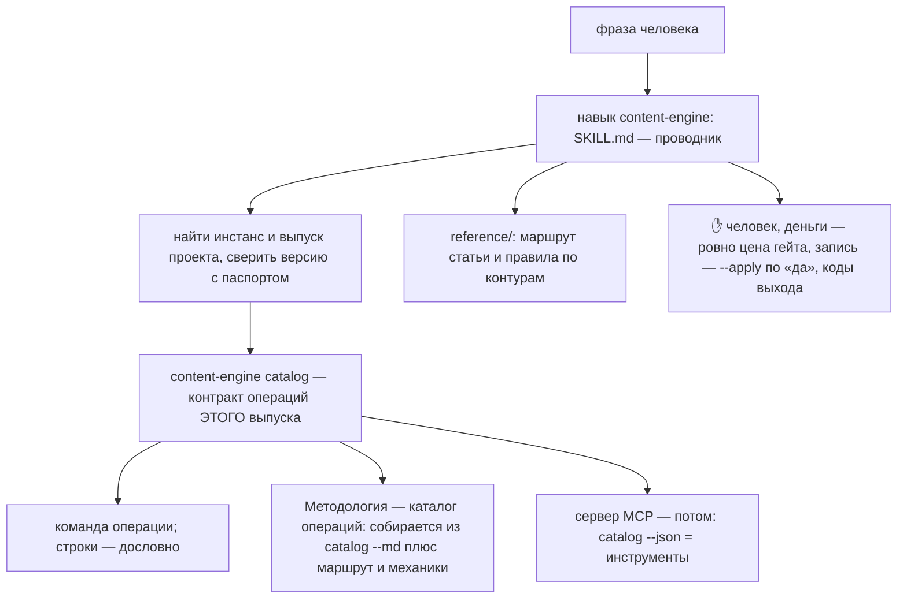
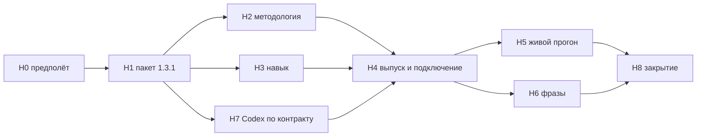

# План — Контент-машина, навык content-engine (маршрут работы, навык, готовность к серверу MCP)

Сделан из: шаг 4 [дорожной карты](<План — Контент-машина, дорожная карта (все волны до готовой машины).md>) и разговор с
Дмитрием 27.10.2026 после выпуска 1.3.0. Опора — [план части 2](<План — Контент-машина, волна 2, часть 2 (решение, текст, вычитка, картинки, спрос; выпуск 1.3.0).md>)
и [план части 1](<План — Контент-машина, волна 2, часть 1 (основание, подготовка, выпуск; выпуск 1.2.0).md>) (разделы
«Ход исполнения»), [карта](<Справочник — Карта Контент-машины (контуры, связи, ритм).md>),
[сверка со 126 механиками К. Васина](<Справочник — Сверка с системой К. Васина (126 механик).md>),
[ADR-0006](<../../_Движок/0 — System Docs/ADR-log/0006-content-engine-no-llm-calls-stack-adapters-in-instance.md>), код
пакета `content_engine` 1.3.0, прецедент — навыки Движка роста (`growth-*`).

**Режим** — один проход, один агент. Субагенты: проверка плана (уже 1, вторая итерация — продолжением) и приёмка (1);
«субагентов не запускай» в промптах. Вторая модель (Codex, навык `second-agent`) — на контракт операций. Безголовые
сессии Claude (`claude -p`) в Н6 — не субагенты, но тратят общий лимит: 40 запусков, считаются вслух до старта.

## Замысел

### Происхождение

Машина производства готова: волна 2 выпущена 26–27.10.2026, у первого потребителя вторая статья идёт машиной целиком.
Но пользоваться ею можно только зная команды, порядок, где нужен «да», какие флаги денег и записи; это знают два чата.
Дмитрий 27.10.2026: навык нужен такой, чтобы машина включалась фразой; навык и описание работы — в каноне, в
методологии, чтобы потом адаптировать под сервер MCP: «там много механик — объединили механики Васина и механику
Бризекса, которую долго выверяли и правили».

Проверка первой редакции плана показала: каталог операций прозой рядом с кодом — второй источник правды, и смысл
(деньги, запись, коды выхода) разойдётся с кодом молча; а навык, который не знает, каким выпуском пакета запущен, после
волны 3 начнёт подавать по инстансу 1.3.0 команды 1.4.0. Поэтому контракт операций переезжает в код пакета: каждая
подкоманда объявляет его при регистрации, а `content-engine catalog` печатает его — того выпуска, которым работают.

### Результат (изменение в мире)

В любом чате Claude Code человек говорит «пополни очередь тем», «возьми тему под гипотезу H-34», «сделай бриф»,
«вычитай факты», «сделай картинки», «доехала ли статья», «что с машиной» — и агент сам находит инстанс и выпуск
проекта, читает каталог этого выпуска, запускает нужную команду, переносит её строки дословно, останавливается на
каждом месте, где решает человек, и не ставит `--apply` и `--confirm-spend` без «да» в чате — а сумму `--confirm-spend`
берёт ровно ту, что назвал бюджет-гейт и подтвердил человек. Новый агент в новом чате без памяти проходит путь статьи
от темы до «доехало». Тот, кто строит сервер MCP, получает `content-engine catalog --json`: у каждой операции —
аргументы, вход, выход, решение человека, деньги, запись, побочная запись, шаг агента, секреты, повторяемость, коды
выхода; инструменты строятся из этого без переписки с нами.

### Что уже решено

- Пакет моделей не вызывает (ADR-0006): между командами — шаги агента по заданиям пакета; контракт их описывает.
- Механики и их владельцы — в карте и сверке; контракт ссылается на модуль карты (А1–Д6).
- Сервер MCP — решение шага 7 дорожной карты; сейчас — готовность контракта.
- Общие навыки устройства — в `_Движок/Исходники скиллов/`, в `~/.claude/skills` — ссылкой (точка соединения
  Windows, как у `growth-route`).
- Стандарта навыков в каноне нет (поиск по `_Движок/Канон/` пуст): опора — `skill-creator` и прецеденты `growth-*`,
  `keysso`, `marketing`; это пробел канона, записывается находкой.

## Устройство (решения Дмитрия при приёмке — вопросы ниже)

| Вопрос | Предложение | Почему | Отброшено |
|---|---|---|---|
| Сколько навыков | **Один** `content-engine`: SKILL.md до ~150 строк и `reference/` по контурам | Одна поверхность включения; один путь статьи; так же — один сервер MCP со многими инструментами | Десять навыков по шагам: описания спорят за включение |
| Где контракт операций | **В коде пакета** — при регистрации подкоманды (`contract={…}`), команда `content-engine catalog [--json\|--md]`; тест — у каждой подкоманды контракт, поля «деньги» и «запись» совпадают с её флагами в парсере (`--confirm-spend` и `--apply` подкоманды) | Один источник правды; каталог всегда того выпуска, которым идёт работа; сервер MCP берёт `--json` | Каталог только прозой в методологии: молча разойдётся с кодом (довод проверки плана) |
| Что в методологии | Маршрут статьи, ✋ человека, деньги и запись общими правилами, ссылки механик на карту и сверку (Васин / Бризекс / своё), путь к серверу MCP, **снимок каталога** `catalog --md` на дату выпуска | Методология — для людей и будущего сервера; снимок сверяется тестом с кодом | Ручная таблица операций |
| Каким выпуском запускать | Навык: перейти в папку выпуска проекта (у первого потребителя — `Скрипты`), `py -3 -c "import content_engine as c; print(c.__file__, c.__version__)"`, сверить с паспортом выпуска; путь ведёт в канон, а у проекта свой выпуск, — стоп и сказать | Из любой другой папки берётся установка ссылкой на канон — другая версия | Запуск откуда придётся |
| Деньги | Сумма `--confirm-spend` = цена, которую напечатал гейт и подтвердил человек, никогда не больше; какие шаги платные — по полю `money` в `catalog --json` выпуска, не по списку в навыке; код 2 различается по тексту («бюджет-гейт:» или «спорно») | Потолок — не согласие; «возьми тему» тоже может стоить денег (запасная выдача) | «Да/нет» без суммы |
| Как включается | Описание — слова человека по контурам **с маркером машины** («очередь тем», «гейт темы», «бриф статьи», «вычитка фактов статьи», «картинки в статью», «доехало», «книга ставок», «Контент-машина»); отличие от соседей названо явно: инфостиль и «вычитай текст» — `text-editor`; частотность и незакрытые запросы без машины — `seo-niche-research`; кластеризация ядра, потерянные запросы — `keysso`; гипотезы как таковые — `growth-hypotheses` | Проверка нашла прямые столкновения слов; маркер машины и явные отличия их снимают | Общие слова «вычитай», «гипотеза» без маркера |
| «Что с машиной» | Одна команда только чтения `content-engine status` (1.3.1): светофор без проб сети, запас в днях, цена статей за 30 дней, ближайшие замеры ставок, последние выпуски; брони не освобождает | Самый частый вопрос; ответ строками команды, без побочной записи | Пять команд подряд с побочной записью |

## Контракт операции — поля (в коде, `catalog --json`)

| Поле | Что |
|---|---|
| `name`, `phrases` | операция глаголом; 3–5 фраз человека |
| `module`, `mechanic` | модуль карты А1–Д6; источник механики — `vasin` / `breezeks` / `own` и ссылка на строку сверки |
| `command`, `args` | подкоманда; позиционные аргументы, флаги; `--profile` обязателен; есть ли `--json` |
| `requires` | вход: статус темы, файлы, что должно быть сделано до |
| `produces` | выход: файлы и реестры |
| `side_writes` | побочная запись, о которой человек не просил (освобождение истёкших броней перед командой, `images.json` при плане, отчёты в `reports/`) |
| `agent_step` | шаг агента после команды: какое задание (`task_*.md`), куда кладёт результат, какая команда проверяет; роль и модели — из профиля |
| `human` | ✋ решение человека: какое, чем фиксируется (`--who`, `review accept`, «да» на цену) |
| `money` | платная ли; чем считается цена; флаги `--confirm-spend`, `--unattended` |
| `write` | запись вовне: ключ права (`publish.allow`, `paths.allow`, `images.allow`, `indexing.allow`, `records.allow`), `--apply`, снимок «до», откат |
| `secrets` | имена переменных (`KEYSO_API_KEY`, `YANDEX_SEARCH_API_KEY` …) |
| `repeatable`, `locks` | можно ли повторить без вреда; блокировка темы и действия |
| `exit_codes` | что значат 0/1/2/3 именно здесь и что делать |
| `next` | следующая операция пути |

## Цель и критерии готовности

| № | Критерий | Чем доказан |
|---|---|---|
| К1 | У каждой подкоманды пакета есть контракт; `catalog --json` и `--md` печатают все подкоманды (обход `build_parser()` по подпарсерам, не по тексту `--help`); поля `money` и `write` совпадают с флагами подкоманды | тест пакета `test_catalog.py` обходом парсера: ноль подкоманд без контракта; `money=paid` ⇔ у подкоманды есть `--confirm-spend`; `write` с ключом права ⇔ у подкоманды есть `--apply` |
| К2 | `content-engine status [--topic ID]` ничего не пишет | тест: полный список путей инстанса (файлы **и папки**) и суммы файлов до и после равны, в том числе при истёкшей брони; `status` открывает папки темы только с `create=False` |
| К3 | Выпуск 1.3.1 у первого потребителя, `kos_release check` совпадает | как у 1.3.0 |
| К4 | Методология в каноне: маршрут, ✋, деньги и запись, механики, путь к MCP, снимок каталога | скрипт канона `_Движок/Инструменты/kos_catalog_check.py` сверяет снимок каталога в методологии с `catalog --md` пакета канона (в выпуске у проектов файла методологии нет — сверка не в тестах пакета) |
| К5 | Навык в `_Движок/Исходники скиллов/content-engine/`, ссылкой в `~/.claude/skills` | `Get-Item $HOME\.claude\skills\content-engine \| Select LinkType,Target` — Junction на исходник |
| К6 | Навык включается своими фразами и не перехватывает соседей | 20 фраз × 2 папки (`D:\Knowledge-OS` и папка потребителя) безголовыми сессиями `claude -p "<фраза>" --output-format stream-json`: в выводе — какой навык вызван; 15 своих — `content-engine` и верная операция; 5 чужих (дословно из триггеров соседей) — не `content-engine` |
| К7 | Навык ведёт путь и не тратит деньги и не пишет без «да» | живой прогон на **копии инстанса** в папке сессии (сценарии «возьми тему», «сделай картинки» — до цены) и `status` на боевом инстансе: ответы строками команд, ни одного `--apply` и `--confirm-spend` |
| К8 | Контракт годится для сервера MCP | вторая модель (Codex) по `catalog --json` и коду: по каким операциям инструмент не построить без вопросов; возражения разобраны по пунктам вслух |
| К9 | Синхронизация | `CLAUDE.md` канона (навыки), манифест контура, манифест пакетов, CHANGELOG, дорожная карта (✅ шага 4; в стартере волны 3 — «контракт и снимок каталога обновляются с выпуском 1.4.0»), TASKS |

## Откат

Канон — хэш главной на старте (в TASKS). Пакет 1.3.1 — `git revert` коммита слияния, у потребителя — копии выпуска 1.3.0
и известных ответов в папке сессии. Навык — удалить папку и ссылку. Боевой инстанс: из навыка запускается только
`status` (ничего не пишет); остальное — на копии инстанса.

## Границы

- **В работе:** пакет `content_engine` (рабочее дерево `D:\KOS-content-engine-skill`, ветка `content-engine-skill`),
  `Методологии/Контент-машина/`, `_Движок/Исходники скиллов/content-engine/`, ссылка в `~/.claude/skills`,
  `D:\Knowledge-OS\TASKS.md` (раздел «Контент-машина», подраздел «Навык»); у потребителя — только выпуск 1.3.1 через
  `kos_release.py` и строка журнала действий.
- **Вне работы:** профиль и реестры потребителя (только `status` читает), его навыки проекта.
- **Коммиты** — своих путей; push — по паспорту канона.

## Задачи

### Н0 — Предполёт
Прочитать: этот план; дорожную карту; карту и сверку; планы частей 1 и 2 (разделы «Ход исполнения»); поручение
`C:\Users\redmi\Breezeks-Git\02 — Области\Digital-маркетинг\Контент блога\Инструкция — Контент-машина 1.3.0 (выпуск, вторая статья машиной целиком).md`;
навыки `growth-route`, `keysso`, `marketing`, `text-editor`, `seo-niche-research`, `growth-hypotheses` (их описания —
словами включения); навык `skill-creator` (как пишется описание и проверяется включение). Выписать обходом
`build_parser()` (по `argparse._SubParsersAction`) все подкоманды с позиционными аргументами и флагами — в TASKS числом.
Хэш канона — в TASKS. Создать рабочее дерево `D:\KOS-content-engine-skill` (ветка `content-engine-skill`). **Установку
пакета не переключать** (её используют все чаты устройства): команды и тесты рабочего дерева — `py -3 -m content_engine`
и `py -3 -m pytest` из папки пакета рабочего дерева (текущая папка — первая в пути поиска); проверка —
`py -3 -c "import content_engine as c; print(c.__file__)"` из этой папки показывает рабочее дерево, из `D:\Knowledge-OS` — канон.
**Готово, когда:** в TASKS — хэш, список подкоманд (число), рабочее дерево.

### Н1 — Пакет 1.3.1: контракт, `catalog`, `status`
- `core/contract.py`: схема контракта (поля таблицы выше), функция `declare(parser, **contract)` — подкоманда объявляет
  контракт при регистрации; в каждом `steps/*.py` `register` — контракт каждой подкоманды (механика — по карте и
  сверке).
- `steps/catalog_cmd.py`: `content-engine catalog [--json|--md]` — обход парсера: подкоманды, аргументы, контракт.
- `steps/status_cmd.py`: `content-engine status --profile [--topic ID]` — только чтение: профиль, запас (`queue.status`
  без освобождения броней — `open_instance(expire=False)`), расход за 30 дней, ближайшие замеры книги ставок, последние
  записи журнала выпуска; с `--topic` — состояние одной темы: статус, бриф и утверждение, пакет, «доехало» и день
  выкладки, заявки и статус индексации из журнала выпуска; папки темы — только `create=False`; пробы сети нет.
- Попутно: справка групп `queue` и `images` перечисляет все подкоманды (сейчас не видно `card`, `photo`).
- Тесты `test_catalog.py` (К1), `test_status.py` (К2).
- `_Движок/Инструменты/kos_catalog_check.py` — сверка снимка каталога в методологии с `catalog --md` (К4).
**Готово, когда:** весь набор зелёный; К1, К2.

### Н2 — Методология
`Методологии/Контент-машина/Методология — Контент-машина, каталог операций (для навыка и сервера MCP).md`: маршрут статьи
(mermaid), ✋, деньги и запись, коды выхода, механики — ссылками на карту и сверку, «шаги агента» между командами,
путь к серверу MCP (операция = инструмент, ✋ = подтверждение клиента, деньги — подтверждение с ценой, побочная запись
— в описании инструмента), снимок `catalog --md` выпуска 1.3.1. Сверка — `kos_catalog_check.py` (К4).
**Готово, когда:** К4.

### Н3 — Навык
`_Движок/Исходники скиллов/content-engine/`: `SKILL.md` (описание с фразами и отличиями от соседей; поиск инстанса и
выпуска, сверка версии; чтение `catalog` выпуска; правила денег, записи, ✋, кодов; «что с машиной» — `status`);
`reference/` по контурам (маршрут и типичные развилки, без копии контракта); `.gitignore` (`__pycache__/`). Навык ничего
не пишет рядом с собой.
**Готово, когда:** ссылки ведут на существующие файлы; навык не дублирует контракт.

### Н4 — Выпуск 1.3.1 и подключение
Слияние, метка `content_engine-v1.3.1`, push; `kos_release issue|check` у потребителя (копии 1.3.0 — в папку сессии),
строка журнала действий компании; коммит и публикацию выпуска в GitLab компании делает чат контента — строкой
поручения в его инструкции 1.3.0 (раздел «Опубликовать»). Ссылка-точка соединения в `~/.claude/skills`; строки в `CLAUDE.md` канона, манифестах.
**Готово, когда:** К3, К5.

### Н5 — Живой прогон
Только по навыку, в этом чате: `status` на боевом инстансе потребителя; на копии инстанса (как в З46 части 2 — папка
сессии, пути корпуса абсолютными) — «что в очереди», «возьми тему <id>» до цены гейта, «сделай картинки для T0017» до
цены. Записать, что навык сделал и где остановился.
**Готово, когда:** К7.

### Н6 — Включение фразами
Список 20 фраз (15 своих по контурам, 5 чужих — дословно из триггеров `text-editor`, `seo-niche-research`, `keysso`,
`growth-hypotheses`, `marketing`) — в план до прогона. 40 безголовых сессий (20 × 2 папки) — число назвать вслух до
старта. Расхождения — правка описания, не больше двух итераций.
Исход «сессия в папке потребителя пошла по его `CLAUDE.md` и навыкам проекта» записывается отдельно от «не
включился» и разбирается: правка описания или строка в паспорте потребителя («машина — навыком `content-engine`»)
поручением чату контента.
**Готово, когда:** К6.

### Н7 — Вторая модель по контракту
Codex: пакет `catalog --json` + `core/contract.py` + модули с платными вызовами и записью; вопрос — «по каким операциям
инструмент сервера MCP не построить без вопросов; где контракт противоречит коду». Разбор по пунктам.
**Готово, когда:** К8.

### Н8 — Закрытие
Приёмка `maker-checker` по К1–К9; CHANGELOG; дорожная карта (✅ шага 4, стартер волны 3 с пунктом про контракт и
снимок); TASKS; итог Дмитрию — «Ждёт меня», «Изменено», «Найдено» (в том числе: стандарта навыков в каноне нет).

## Граф

## Вопросы Дмитрию при приёмке

| № | Вопрос | По умолчанию |
|---|---|---|
| Н-В1 | Один навык-проводник с `reference/` по контурам — или несколько по шагам, как у Движка роста? | Один |
| Н-В2 | Контракт операций — в коде пакета (выпуск 1.3.1, команда `catalog`), методология собирается из него? | Да |
| Н-В3 | Навык общий для всех проектов? | Да: у проекта без машины говорит «не подключено» и ведёт к `onboard` |
| Н-В4 | 40 безголовых сессий на проверку включения (общий лимит аккаунта) | Да, одним прогоном, с отчётом о расходе |

## Разбор проверки плана 27.10.2026

Редакция 1 — «не прошёл»: 2 блокирующие, 6 важных, 4 мелких. Приняты все, редакция 2 — эта:
- живая проверка у потребителя писала бы (освобождение броней, `images make` и `plan` пишут) — `status` только чтения
  в пакете, остальное — на копии инстанса;
- выпуск против канона — сверка версии с паспортом в навыке, каталог читается из выпуска;
- состав операций — обходом парсера, в коде; деньги не только у картинок, сумма `--confirm-spend` = цена гейта;
  код 2 различается по тексту;
- проверка включения — безголовыми сессиями в двух папках, а не субагентом по описаниям; маркер машины в словах
  включения и явные отличия от соседей;
- поля контракта: шаг агента, аргументы, `--json`, побочная запись, секреты, ключ права, повторяемость и блокировки;
- пути в Н0, отсутствие стандарта навыков — находкой, TASKS — путь и подраздел; «доехала ли» — `status`;
- мелкие: точка соединения вместо `ls -la`, навык не пишет рядом с собой, Codex — возражения разбираются, стартер
  волны 3 — обновление контракта.
Редакция 2 — «не прошёл»: 2 блокирующие, 5 важных, 2 мелких; приняты все, это редакция 3: деньги и запись сверяются
по флагам подкоманды, а не по исходнику модуля; установка пакета на устройстве не переключается; Codex — до выпуска
(Н7 → Н4); сверка снимка методологии — скриптом канона, не тестом пакета; `status` — без создания папок и с `--topic`;
публикация выпуска в GitLab компании — чат контента; список платных шагов — из `catalog --json`, не руками; исход
«пошла по `CLAUDE.md` проекта» в Н6 — отдельно. Третьей итерации нет (предел — две), решает Дмитрий.
- **Сильнейший довод против** редакции 1 — каталог прозой как второй источник правды — принят: контракт переехал в код.

## Приёмка

- Проверка плана — агент с чистым контекстом, вторая итерация — продолжением; принятие — Дмитрий.
- Приёмка результата — Н5–Н7 и `maker-checker` по К1–К9.

# Связанные документы

- [Контент-машина — _manifest](<_manifest.md>)
- [План — Контент-машина, дорожная карта (все волны до готовой машины)](<План — Контент-машина, дорожная карта (все волны до готовой машины).md>)
- [Справочник — Карта Контент-машины (контуры, связи, ритм)](<Справочник — Карта Контент-машины (контуры, связи, ритм).md>)
- [Справочник — Сверка с системой К. Васина (126 механик)](<Справочник — Сверка с системой К. Васина (126 механик).md>)
- [План — Контент-машина, волна 2, часть 2 (решение, текст, вычитка, картинки, спрос; выпуск 1.3.0)](<План — Контент-машина, волна 2, часть 2 (решение, текст, вычитка, картинки, спрос; выпуск 1.3.0).md>)
